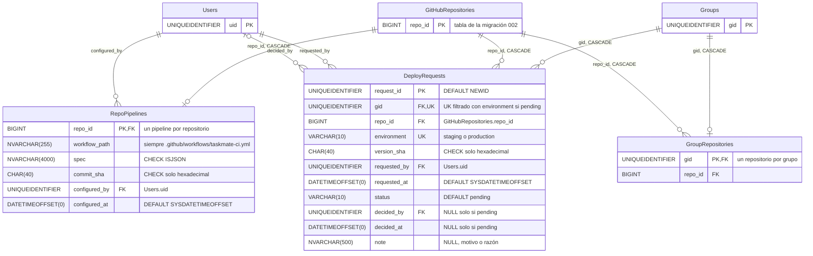

# CI/CD: base de datos

**En una frase:** el módulo guarda solo dos cosas, el pipeline que TaskMate escribió en cada repositorio (`RepoPipelines`) y las solicitudes de deploy a producción que esperan a un admin (`DeployRequests`); las ejecuciones, los logs y el historial de deploys viven en GitHub.

`GitHubRepositories`, `GroupRepositories`, `Groups` y `Users` aparecen solo con las columnas que usa este módulo. Sus campos completos están en [Tablas y campos](00-tablas-y-campos.md#github-y-cicd).

## Tablas

| Tabla | Para qué | Campos clave |
|-------|----------|--------------|
| `RepoPipelines` | El pipeline que TaskMate subió a un repositorio. `spec` es el JSON validado con el que se generó el YAML, así el diálogo puede reabrirlo | `repo_id` (PK y FK), `spec`, `commit_sha` del commit que subió el workflow, `configured_by` |
| `DeployRequests` | Un miembro pide publicar en producción la versión de staging. Un admin la aprueba (TaskMate lanza el deploy) o la rechaza | `request_id`, `gid`, `repo_id`, `environment`, `version_sha`, `status`, `decided_by`, `note` |

Ambas tablas vienen de la migración `007_cicd.sql` (la reversa es `007_cicd.down.sql`).

## Reglas

- **Un pipeline por repositorio:** `repo_id` es la PK. Si dos grupos usan el mismo repositorio, comparten su pipeline.
- **`spec`** debe ser JSON válido (`CK_RepoPipelines_Spec`). El modelo además rechaza un `spec` de más de 4000 caracteres.
- **SHAs:** `commit_sha` y `version_sha` son `CHAR(40)` y solo aceptan dígitos hexadecimales (`CK_..._CommitSha`, `CK_..._VersionSha`). El modelo los guarda en minúsculas.
- **Valores permitidos:** `environment` en (`staging`, `production`); `status` en (`pending`, `approved`, `rejected`, `cancelled`), con `pending` por defecto.
- **Decisión coherente (`CK_DeployRequests_Decision`):** si `status = 'pending'`, `decided_by` y `decided_at` son NULL. En cualquier otro estado, los dos tienen valor.
- **Una solicitud pendiente por grupo y entorno:** índice único filtrado `UX_DeployRequests_Pending (gid, environment) WHERE status = 'pending'`. Una segunda da `DEPLOY_REQUEST_PENDING` (409).
- **Cascadas:** al borrar un repositorio (`GitHubRepositories`) se borran su `RepoPipelines` y sus `DeployRequests`. Al borrar un grupo se borran sus `DeployRequests`. Las FKs a `Users` no tienen cascada.
- **Triggers:** ninguno en estas tablas. Los dos triggers del proyecto (migración 006) son de `Nodes` y `Edges`.
- **Al cambiar de repositorio:** vincular otro repositorio o desvincularlo borra las solicitudes **pendientes** del grupo para el repositorio anterior. Las ya decididas quedan como historial (`github.model.js`).
- **Sin carreras:** crear y reabrir una solicitud bloquea la fila del grupo en `GroupRepositories` (`UPDLOCK, HOLDLOCK`). Decidir solo cambia una fila que sigue `pending`, así que dos admins no pueden decidir la misma.
- **Índices de apoyo:** `IX_RepoPipelines_ConfiguredBy`, `IX_DeployRequests_Gid_RequestedAt (gid, requested_at DESC)`, `IX_DeployRequests_RepoId`, `IX_DeployRequests_RequestedBy` e `IX_DeployRequests_DecidedBy`.

## Dónde se usa

| Archivo | Qué hace con estas tablas |
|---------|---------------------------|
| `taskmate-api/models/cicd.model.js` | `getPipeline`, `upsertPipeline` (UPDATE con `HOLDLOCK` y, si no existía, INSERT, en una transacción), `deletePipeline` (solo la usan las pruebas) |
| `taskmate-api/models/cicd.model.js` | `createDeployRequest`, `getDeployRequest`, `listDeployRequests` (pendientes primero), `decideDeployRequest`, `reopenDeployRequest`, `cancelApprovedDeployRequest` |
| `taskmate-api/models/github.model.js` | Borra las solicitudes pendientes de otro repositorio al vincular o desvincular |
| `taskmate-api/services/github/pipelineService.js` | Guarda el pipeline después de subir el workflow y lo lee para reabrir el diálogo con el `spec` guardado |
| `taskmate-api/services/github/deployService.js` y `actionsService.js` | Leen el pipeline (¿hay pipeline?, ¿tiene deploy?) y manejan las solicitudes |
| `taskmate-api/migrations/007_cicd.sql` | Crea las tablas, las restricciones y los índices |
| `taskmate-api/tests/db/cicd.dbtest.js`, `migrations.dbtest.js` | Pruebas contra una base SQL Server desechable |

## Para saber más

- Modelo completo (24 tablas): [00-general.md](00-general.md)
- Arquitectura del módulo: [02-arquitectura/08-cicd.md](../02-arquitectura/08-cicd.md)
- Ciclo de vida de una solicitud: [06-flujos/08-cicd.md](../06-flujos/08-cicd.md)
- Capítulo de la Fase 4, sección de base de datos: [fase-04-pipeline-cicd/README.md](../08-fases/fase-04-pipeline-cicd/README.md#base-de-datos-migración-007)
