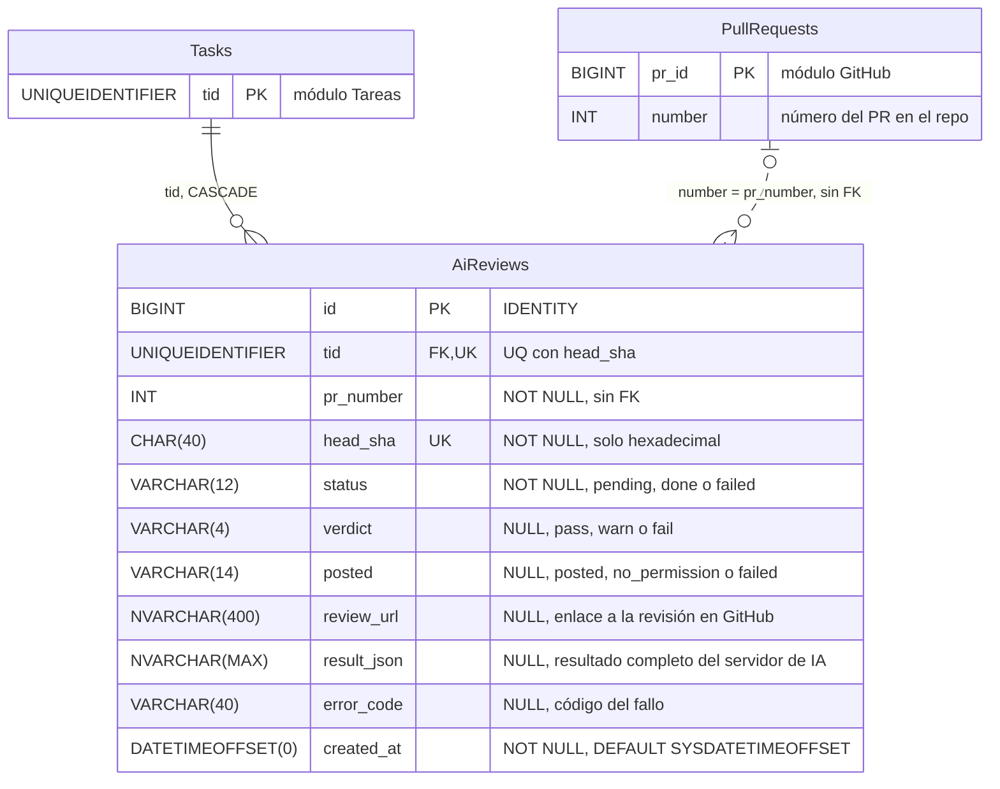
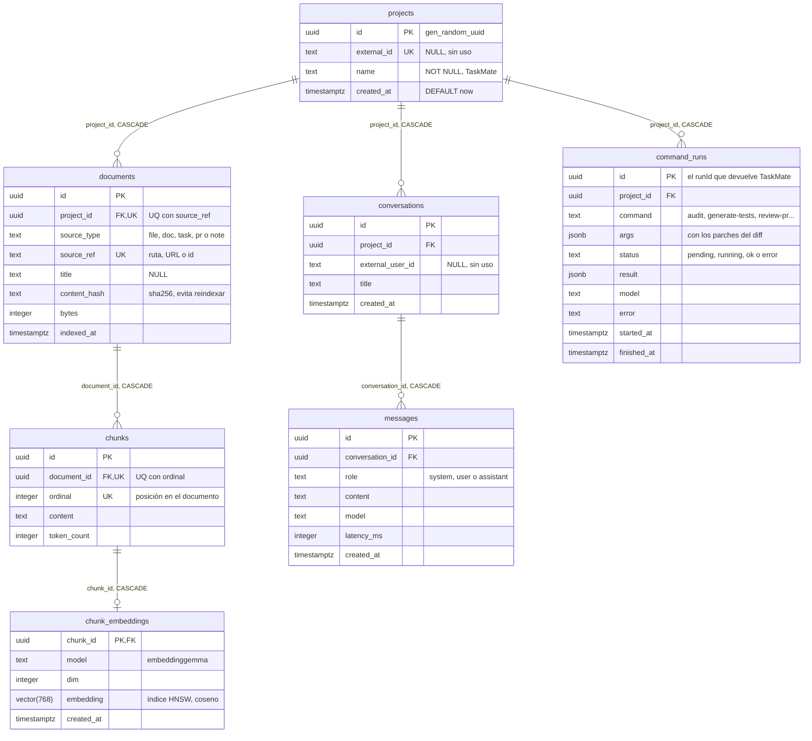

# IA sobre el código: base de datos

**En una frase:** en SQL Server el módulo solo tiene `AiReviews`, una fila por cada commit del PR de una tarea que la IA revisó; la auditoría y las pruebas propuestas no se guardan en TaskMate, quedan en la base aparte del servidor de IA local (Postgres + pgvector).

`PK` = llave primaria · `FK` = llave foránea · `UK` = valor único (en pareja) · `||--o{` = uno a muchos · línea punteada = relación sin FK.

`Tasks` y `PullRequests` son de otros módulos; aquí solo aparecen las columnas que importan. `pr_number` no tiene FK: el PR se ubica por la rama de la tarea.

## Tablas

| Tabla | Para qué sirve | Campos clave |
|---|---|---|
| `AiReviews` | La revisión con IA del PR de una tarea, una por commit (`head_sha`). Guarda si se publicó en GitHub y el resultado completo, que la vista de la tarea vuelve a mostrar | `id` (PK), (`tid`, `head_sha`) único, `status`, `verdict`, `posted`, `result_json` |

Origen: migración `011_ai_reviews.sql` (la reversa, `011_ai_reviews.down.sql`, borra la tabla con sus datos). Con ella, la base de TaskMate llega a 29 tablas.

## Reglas

**Restricciones (CHECK y UNIQUE)**
- `head_sha` es `CHAR(40)` y solo acepta caracteres hexadecimales (`CK_AiReviews_HeadSha`). La API, además, no revisa un commit cuyo SHA no tenga 40 caracteres hexadecimales.
- `status` solo acepta `pending`, `done` o `failed` (`CK_AiReviews_Status`), sin valor por defecto.
- `verdict` es NULL o `pass`, `warn` o `fail` (`CK_AiReviews_Verdict`).
- `posted` es NULL o `posted`, `no_permission` (la App no tiene `pull_requests: write`) o `failed` (`CK_AiReviews_Posted`).
- Único: (`tid`, `head_sha`) en `UQ_AiReviews_TaskSha`. Es la regla de **una revisión por commit**.
- `result_json` no tiene `CHECK ISJSON`. La API guarda NULL si el JSON pasa de 200 000 caracteres; `review_url` se corta a 400 y `error_code` a 40.

**Cascadas (`ON DELETE CASCADE`)**
- Borrar la fila de `Tasks` borra sus revisiones (`FK_AiReviews_Tasks`). Completar una tarea, mandarla a la papelera, borrar su lista o borrar el grupo borran esa fila, así que al fusionar el PR, que completa la tarea, sus revisiones desaparecen de TaskMate. En GitHub se quedan los comentarios publicados ([limitaciones conocidas](../01-proyecto/cierre-del-proyecto.md#limitaciones-conocidas)).

**Reglas que aplica la API**
- **Reservar antes de revisar.** `claim` inserta la fila como `pending` antes de llamar al servidor de IA. Si el par (`tid`, `head_sha`) ya existe y está `done`, o `pending` desde hace menos de 15 minutos, `claim` devuelve `null` y la API no hace nada: un webhook repetido o un `synchronize` seguido de `ready_for_review` sobre el mismo commit no revisan dos veces.
- **Cerrar.** `finish` pone `done` con `verdict`, `posted`, `review_url` y `result_json`, o `failed` con `error_code` (por ejemplo `AI_SERVER_UNAVAILABLE`).
- **Reintento (desde el 26 nov 2026).** Si el par ya existe, `claim` llama a `reclaim`: un solo `UPDATE` condicional que vuelve a `pending` una fila `failed` o una `pending` de más de 15 minutos (`STALE_PENDING_MINUTES`, la de un proceso que se cayó), limpia `verdict`, `posted`, `review_url`, `result_json` y `error_code`, renueva `created_at` y devuelve su `id`. Como es una sola sentencia, dos llamadas a la vez no ganan las dos. Se reintenta con «Review PR» o con el siguiente webhook del mismo commit; antes hacía falta un commit nuevo ([correcciones del 26 nov](../01-proyecto/cierre-del-proyecto.md#correcciones-del-26-nov-2026)).
- **Leer la última.** `getLatest` devuelve la más nueva de la tarea (`ORDER BY created_at DESC, id DESC`), con `result_json` ya convertido a objeto.
- **Permiso de IA.** Revisar exige `GroupRepositories.ai_analysis_enabled = 1` (tabla del [módulo GitHub](07-github.md)). Leer la última revisión no lo exige.

**Triggers:** ninguno. La 011 solo crea la tabla y su índice; siguen los 2 triggers de la 006, que son de los hitos.

**Índices:** `IX_AiReviews_Task (tid, created_at DESC)` para leer la última, además del único `UQ_AiReviews_TaskSha`, que también cubre la FK.

## Base del servidor de IA local (aparte)

No es SQL Server ni cuenta en las 29 tablas. Es **Postgres 17 + pgvector** en un contenedor de podman (`taskmate-ai-db`, imagen `pgvector/pgvector:pg17`, volumen `taskmate-ai-pgdata`), publicado solo en `127.0.0.1:5432`, con la base `taskmate_ai` y el usuario y la contraseña `taskmate` por defecto; se cambian con `DB_NAME`, `DB_USER` y `DB_PASSWORD`. Tiene 7 tablas.

`messages` tiene además `prompt_tokens` y `completion_tokens`.

| Tabla | Para qué | Quién la escribe |
|---|---|---|
| `projects` | Un corpus por nombre. TaskMate usa siempre `TaskMate` (`AI_SERVER_PROJECT`), el mismo para todos los grupos | El indexado y cada comando (lo crea si falta) |
| `documents` | Un archivo indexado; `content_hash` evita volver a indexar lo que no cambió | El indexado (`ingest-repo` o `POST /ingest`, a mano) |
| `chunks` | Los pasajes de cada documento (unos 256 tokens cada uno) | El indexado |
| `chunk_embeddings` | El vector de cada pasaje (`vector(768)`), donde busca `POST /search` | El indexado |
| `conversations` y `messages` | Previstas para guardar conversaciones | Nadie: ningún código las escribe |
| `command_runs` | Cada ejecución de un comando: argumentos (con los parches del diff), resultado, modelo, error y tiempos. Aquí quedan la auditoría y las pruebas propuestas | `commands.run`: `running` al empezar, luego `ok` o `error` |

- Las referencias a TaskMate (`external_id`, `external_user_id`) son texto que admite NULL, no FK.
- Migraciones en `db/migrations/`: `001` activa `vector` y `pgcrypto`, `002` y `003` crean las tablas y `004` el índice HNSW y cuatro índices btree (sobre `documents`, `chunks`, `messages` y `command_runs`). Son idempotentes (`IF NOT EXISTS`) y `scripts/up.sh` las aplica en cada arranque.
- Una ejecución cuyos argumentos no pasan la validación no deja fila.

## Dónde se usa

| Archivo | Qué hace con estas tablas |
|---|---|
| `taskmate-api/models/aiReview.model.js` | `claim` (INSERT `pending`; si el par ya existe, `reclaim` recupera una `failed` o una `pending` de más de 15 min, y si no, `null`), `finish` (cierra con `done` o `failed`) y `getLatest` (la más nueva de la tarea) |
| `taskmate-api/services/aiServer/prReview.js` | Reserva y cierra cada revisión, sea del webhook o manual |
| `taskmate-api/services/aiServer/taskAi.js` | Lee la última revisión para `GET` y `POST /api/github/tasks/:tid/review` |
| `taskmate-api/models/github.model.js` y `services/github/repoService.js` | Leen la rama y el PR de la tarea (`getTaskLinksByGroup`, `findTaskByBranch`) y el permiso `ai_analysis_enabled` (`getConnectedRepo`) |
| `taskmate-api/models/tasks.model.js` y `group.model.js` | Completar, mandar a la papelera, borrar una lista o borrar el grupo borra la fila de `Tasks` y, en cascada, sus revisiones |
| `taskmate-api/migrations/011_ai_reviews.sql` | Crea la tabla, las restricciones y el índice |
| `taskmate-api/tests/db/aiReview.dbtest.js` | 3 pruebas contra SQL Server: una revisión por commit, resultado con Unicode y los CHECK |
| `taskmate-ai-server`: `src/commands.py`, `src/ingest.py`, `src/retrieve.py`, `src/db.py` | Escriben `command_runs`, indexan y buscan en la base del servidor de IA |

## Para saber más

- Todas las tablas de TaskMate: [00-general.md](00-general.md) y [tablas y campos](00-tablas-y-campos.md)
- Migraciones e índices: [00-migraciones-y-triggers.md](00-migraciones-y-triggers.md)
- Rama, PR y permiso de IA: [07-github.md](07-github.md)
- Arquitectura del módulo: [02-arquitectura/10-ia-sobre-el-codigo.md](../02-arquitectura/10-ia-sobre-el-codigo.md)
- Paso a paso de una revisión: [06-flujos/10-ia-sobre-el-codigo.md](../06-flujos/10-ia-sobre-el-codigo.md)
- Migrar la BD: [guía de la BD en Docker](../07-guias/base-de-datos-docker.md)
