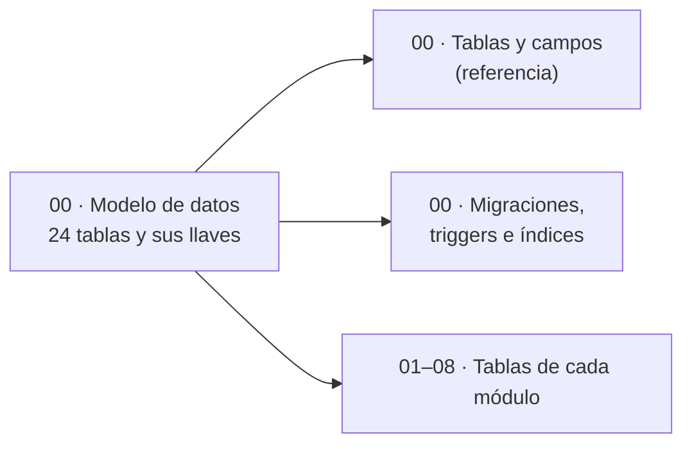

# 03 · Base de datos

**En una frase:** las 24 tablas de SQL Server 2019 que usa TaskMate: el modelo completo, cada campo, las migraciones 001–008 con sus triggers, y las tablas de cada módulo.

## Páginas generales

| Página | Qué explica |
|---|---|
| [Modelo de datos](00-general.md) | Las 24 tablas con sus llaves, qué tablas usa cada módulo, borrados y triggers en corto |
| [Tablas y campos](00-tablas-y-campos.md) | Referencia: cada campo de las 24 tablas, con tipo, llaves y restricciones |
| [Migraciones, triggers e índices](00-migraciones-y-triggers.md) | Qué cambia cada migración, cómo se aplican, los 2 triggers de la 006 y los índices |

## Páginas por módulo

| Módulo | Qué explica |
|---|---|
| [1 · Usuarios y acceso](01-usuarios-y-acceso.md) | `Users`; el registro crea en la misma transacción el grupo personal y su membresía |
| [2 · Grupos y roles](02-grupos-y-roles.md) | Grupos, miembros, roles de cada grupo y qué rol tiene cada miembro (4 tablas) |
| [3 · Tareas](03-tareas.md) | `Tasks`, `UserTask`, `Complete` y `DeleteTask`; las listas son la columna `Tasks.list` |
| [4 · Hitos y calendario](04-hitos-y-calendario.md) | `Nodes` y `Edges`, y los triggers que recalculan el porcentaje de los hitos |
| [5 · Chat con IA](05-chat-ia.md) | Sin tablas propias: el plan confirmado crea grupo, roles, tareas e hitos en una transacción |
| [6 · Analytics](06-analytics.md) | Historial de asignaciones, métricas que salen de él y la configuración por grupo |
| [7 · GitHub](07-github.md) | Instalación, repositorio, rama de cada tarea, PRs y webhooks recibidos (6 tablas, sin tokens) |
| [8 · CI/CD](08-cicd.md) | `RepoPipelines` y `DeployRequests`; ejecuciones, logs y deploys se leen de GitHub |

El módulo 9 (tiempo real y avisos) no tiene tablas ni página aquí: lee `UserGroups` y `GroupRepositories` para saber a quién avisar ([tablas por módulo](00-general.md#tablas-por-módulo)).

## Diagramas e imágenes

- Los diagramas de estas páginas son bloques Mermaid.
- Su copia en PNG está en [`imagenes/`](imagenes/), con el nombre `<página>-<n>.png` (n = orden del diagrama en la página).

## Para saber más

- Montar el contenedor y migrar: [SQL Server en Docker](../07-guias/base-de-datos-docker.md).
- Diseño (3FN, transacciones) de la Fase 3: [seguridad y base de datos](../08-fases/fase-03-integracion-github/SEGURIDAD-Y-BASE-DE-DATOS.md).
- [Índice de la documentación](../README.md).
