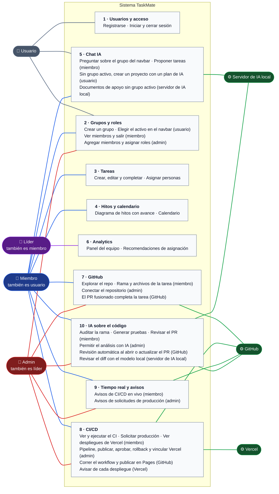
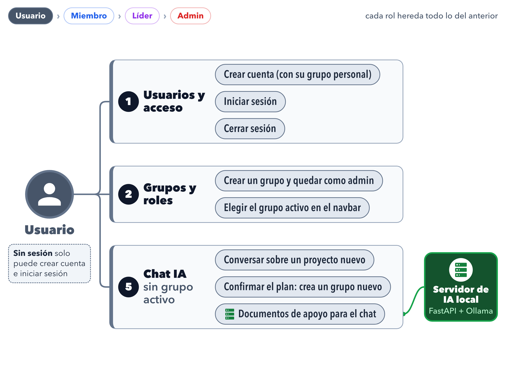
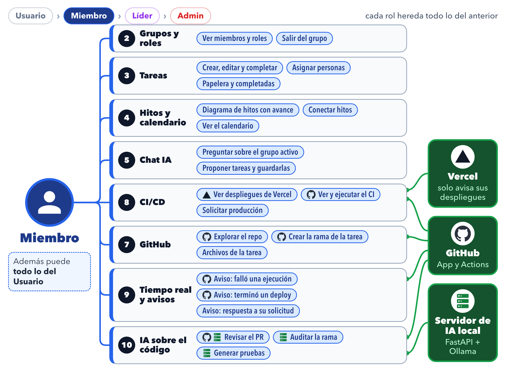
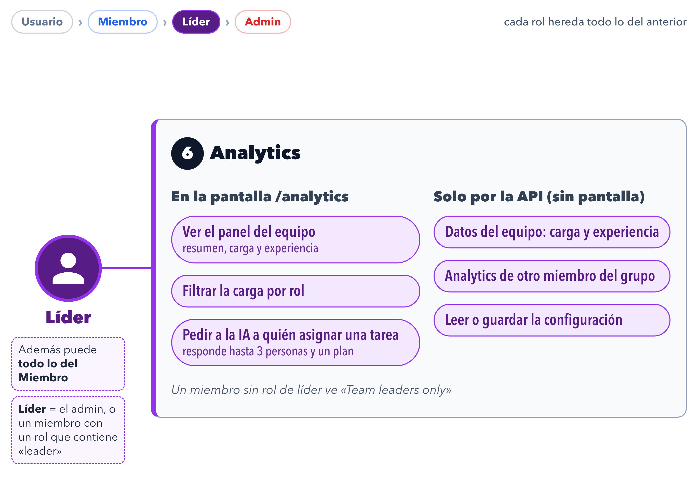
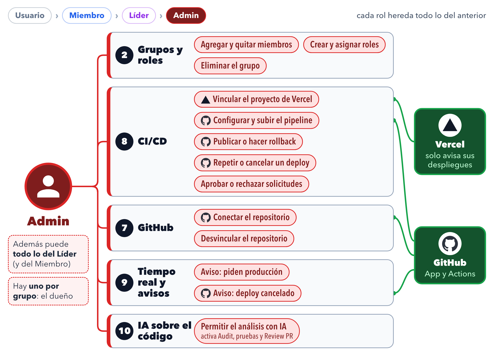

# Casos de uso: visión general

**En una frase:** quién usa TaskMate (cuatro roles de personas y tres sistemas externos: GitHub, Vercel y el servidor de IA local) y qué puede hacer cada uno en los 10 módulos.

**Cómo leerlo:**
- Cada recuadro es un módulo: un «paquete» con sus casos de uso principales. Entre paréntesis, quién lo hace cuando no es el mismo para todo el paquete.
- Una línea une a un actor con un módulo cuando **su rol** agrega algo ahí. Cada actor tiene su color: gris usuario, azul miembro, morado líder, rojo admin y verde los sistemas externos (GitHub, Vercel y el servidor de IA local).
- Los roles se heredan: el admin también es líder, el líder también es miembro y el miembro también es usuario. Por eso el admin también puede hacer todo lo del miembro, aunque no tenga línea a ese módulo.

## Rol por rol

El diagrama completo de arriba tiene muchas líneas. Estos cuatro lo muestran por partes: cada uno deja a un solo rol con **sus propias** conexiones y solo los casos que ese rol agrega (lo heredado no se repite). La barra de arriba de cada imagen dice en qué rol se está. Son los mismos diagramas de la presentación; sus fuentes HTML están en [`fuentes/`](fuentes/).

### Usuario

Cuenta e inicio de sesión, crear grupos (y quedar como admin), elegir el grupo activo y el chat sin grupo activo, que arma un plan para un grupo nuevo con documentos del servidor de IA local.

### Miembro

Lo que agrega al pertenecer a un grupo: tareas, hitos y calendario, chat sobre el grupo, GitHub, CI/CD, avisos en vivo y la IA sobre el código, con sus líneas a GitHub, Vercel y el servidor de IA local.

### Líder

Solo analytics: el panel del equipo, la carga por rol y la recomendación de a quién asignar una tarea; lo que no tiene pantalla se usa por la API.

### Admin

Miembros y roles, CI/CD (pipeline, publicar, aprobar, rollback y vincular Vercel), el repositorio, los avisos que solo le llegan a él y el permiso de análisis con IA.

## Actores

| Actor | Quién es | Cómo lo comprueba el código |
|---|---|---|
| Usuario | Cualquier persona. Sin sesión, solo se registra o inicia sesión. Con sesión, crea grupos, elige el grupo activo en el navbar y usa el chat | `requireAuth`: JWT (token firmado) de 24 h |
| Miembro | Usuario que pertenece al grupo (una fila en `UserGroups`) | `requireGroupMember` y `requireResourceMember` |
| Líder | El admin, o un miembro con un rol cuyo nombre contiene «leader» | `isGroupLeader` (`models/access.model.js`) |
| Admin | El dueño del grupo (`Groups.adminId`). Hay uno por grupo. Es el único que conecta el repo, activa «Allow AI analysis» y vincula el proyecto de Vercel | `requireGroupAdmin` |
| GitHub | Sistema externo: la GitHub App y GitHub Actions. Avisa de PRs, instalaciones y ejecuciones; recibe las ramas, el workflow y la revisión de IA del PR (como comentario) | Webhook firmado con HMAC SHA-256 (`X-Hub-Signature-256`) |
| Vercel | Sistema externo, solo de monitoreo: avisa de cada despliegue del proyecto que el admin vinculó. TaskMate no despliega en Vercel | Webhook firmado con HMAC SHA-1 (`x-vercel-signature`) |
| Servidor de IA local | Sistema externo: `taskmate-ai-server`, el repo aparte de Christian (FastAPI en `127.0.0.1:8000`, con Ollama). TaskMate le pide auditar la rama, generar pruebas y revisar el PR; el chat sin grupo activo le pide documentos de apoyo | Lo llama TaskMate, no al revés, con la cabecera `X-AI-Server-Secret`; sin ella responde 401 |

La matriz completa, acción por acción, está en [Permisos por rol](00-permisos-por-rol.md).

## Módulos

| # | Módulo | Casos de uso principales | Quién |
|---|---|---|---|
| 1 | [Usuarios y acceso](01-usuarios-y-acceso.md) | Registrarse (crea un grupo personal), iniciar y cerrar sesión | Usuario |
| 2 | [Grupos y roles](02-grupos-y-roles.md) | Crear grupos y elegir el activo; ver miembros y salir; agregar y quitar miembros, roles | Usuario, miembro, admin |
| 3 | [Tareas](03-tareas.md) | Listas y tareas: crear, editar, completar, papelera, asignar | Miembro |
| 4 | [Hitos y calendario](04-hitos-y-calendario.md) | Diagrama de hitos con prerrequisitos y avance; calendario | Miembro |
| 5 | [Chat IA](05-chat-ia.md) | Preguntar sobre el grupo del navbar y pedirle tareas; sin grupo activo, plan que crea un grupo nuevo | Usuario, miembro, servidor de IA local |
| 6 | [Analytics](06-analytics.md) | Panel del equipo, carga, experiencia y recomendaciones de asignación | Líder |
| 7 | [GitHub](07-github.md) | Conectar el repo, explorarlo, rama por tarea, archivos de la tarea, PR que completa la tarea | Miembro, admin, GitHub |
| 8 | [CI/CD](08-cicd.md) | Pipeline, ejecuciones, staging, producción con aprobación, rollback; monitoreo de despliegues de Vercel | Miembro, admin, GitHub, Vercel |
| 9 | [Tiempo real y avisos](09-tiempo-real-y-avisos.md) | Avisos en vivo de ejecuciones, deploys y solicitudes | Miembro, admin, GitHub |
| 10 | [IA sobre el código](10-ia-sobre-el-codigo.md) | Auditar la rama de la tarea, generar pruebas (se proponen, no se ejecutan) y revisar el PR con IA | Miembro, admin, GitHub, servidor de IA local |

## Reglas que conviene saber
- **La interfaz esconde, la API decide.** Las pantallas ocultan los botones de admin, pero el permiso real lo revisa la API. Un llamado directo sin el rol recibe 403.
- **Nadie se une solo a un grupo.** Solo el admin agrega miembros, por nombre de usuario.
- **El grupo activo se elige en el navbar.** El selector junto al logo cambia el grupo de todas las pantallas, también el del chat; «Manage groups» lleva a Groups, donde basta un clic en el grupo. Al iniciar sesión se activa el primero de la lista.
- **El chat sigue al grupo del navbar.** Con grupo, responde sobre ese proyecto y propone tareas solo si se le pide. Solo sin grupo activo arma un plan que crea un **grupo nuevo**, y quien lo pidió queda como admin.
- **Sin repositorio no hay GitHub ni CI/CD.** Las pestañas Files, Commits y CI/CD se activan cuando el admin conecta el repositorio. «Vercel (monitoring)» no está deshabilitada, pero vuelve a Repository mientras no haya repo, y las tareas no muestran «View task files».
- **La IA sobre el repositorio pide permiso.** Mientras el admin no active «Allow AI analysis», no hay análisis del repo, el chat no ve el repo, «Propose with AI» no propone el pipeline, y «Audit», «Generate tests» y «Review PR» (también la revisión automática) no corren.
- **Vercel solo informa.** TaskMate guarda lo que Vercel avisa del proyecto vinculado; no despliega ahí ni se actualiza en vivo («Refresh»).

## Para saber más
- [Recorridos de usuario](00-recorridos-de-usuario.md): un día típico de cada rol.
- [Permisos por rol](00-permisos-por-rol.md): la matriz completa.
- [Interfaz](../05-interfaz/00-general.md): las pantallas y la navegación.
- [Flujo de punta a punta](../06-flujos/00-general.md): del plan con IA a producción.
- Qué agregó la línea de Christian: [09-linea-christian](../09-linea-christian/README.md).
- Limitaciones y pendientes: [cierre de la línea de Pablo y estado](../01-proyecto/cierre-del-proyecto.md#limitaciones-conocidas).
