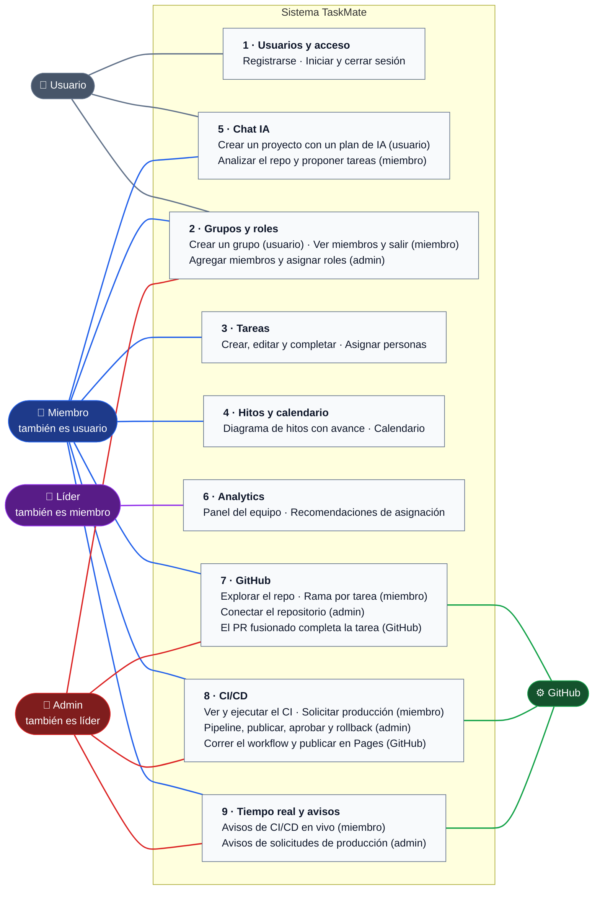

# Casos de uso: visión general

**En una frase:** quién usa TaskMate (cuatro roles de personas y GitHub) y qué puede hacer cada uno en los 9 módulos.

**Cómo leerlo:**
- Cada recuadro es un módulo: un «paquete» con sus casos de uso principales. Entre paréntesis, el rol mínimo cuando no es el mismo para todo el paquete.
- Una línea une a un actor con un módulo cuando **su rol** agrega algo ahí. Cada actor tiene su color: gris usuario, azul miembro, morado líder, rojo admin y verde GitHub.
- Los roles se heredan: el admin también es líder, el líder también es miembro y el miembro también es usuario. Por eso el admin también puede hacer todo lo del miembro, aunque no tenga línea a ese módulo.

## Actores

| Actor | Quién es | Cómo lo comprueba el código |
|---|---|---|
| Usuario | Cualquier persona. Sin sesión, solo se registra o inicia sesión. Con sesión, crea grupos y usa el chat | `requireAuth`: JWT (token firmado) de 24 h |
| Miembro | Usuario que pertenece al grupo (una fila en `UserGroups`) | `requireGroupMember` y `requireResourceMember` |
| Líder | El admin, o un miembro con un rol cuyo nombre contiene «leader» | `isGroupLeader` (`models/access.model.js`) |
| Admin | El dueño del grupo (`Groups.adminId`). Hay uno por grupo | `requireGroupAdmin` |
| GitHub | Sistema externo: la GitHub App y GitHub Actions | Webhook firmado con HMAC (firma con secreto compartido) |

La matriz completa, acción por acción, está en [Permisos por rol](00-permisos-por-rol.md).

## Módulos

| # | Módulo | Casos de uso principales | Quién |
|---|---|---|---|
| 1 | [Usuarios y acceso](01-usuarios-y-acceso.md) | Registrarse (crea un grupo personal), iniciar y cerrar sesión | Usuario |
| 2 | [Grupos y roles](02-grupos-y-roles.md) | Crear grupos; ver miembros y salir; agregar y quitar miembros, roles | Usuario, miembro, admin |
| 3 | [Tareas](03-tareas.md) | Listas y tareas: crear, editar, completar, papelera, asignar | Miembro |
| 4 | [Hitos y calendario](04-hitos-y-calendario.md) | Diagrama de hitos con prerrequisitos y avance; calendario | Miembro |
| 5 | [Chat IA](05-chat-ia.md) | Plan de proyecto con IA que crea un grupo nuevo; análisis del repo | Usuario, miembro |
| 6 | [Analytics](06-analytics.md) | Panel del equipo, carga, experiencia y recomendaciones de asignación | Líder |
| 7 | [GitHub](07-github.md) | Conectar el repo, explorarlo, rama por tarea, PR que completa la tarea | Miembro, admin, GitHub |
| 8 | [CI/CD](08-cicd.md) | Pipeline, ejecuciones, staging, producción con aprobación, rollback | Miembro, admin, GitHub |
| 9 | [Tiempo real y avisos](09-tiempo-real-y-avisos.md) | Avisos en vivo de ejecuciones, deploys y solicitudes | Miembro, admin, GitHub |

## Reglas que conviene saber
- **La interfaz esconde, la API decide.** Las pantallas ocultan los botones de admin, pero el permiso real lo revisa la API. Un llamado directo sin el rol recibe 403.
- **Nadie se une solo a un grupo.** Solo el admin agrega miembros, por nombre de usuario.
- **El chat crea grupos nuevos.** Un plan confirmado en el chat crea un grupo nuevo, y quien lo pidió queda como admin.
- **Sin repositorio no hay GitHub ni CI/CD.** Las pestañas Archivos, Commits y CI/CD se activan cuando el admin conecta el repositorio.

## Para saber más
- [Recorridos de usuario](00-recorridos-de-usuario.md): un día típico de cada rol.
- [Permisos por rol](00-permisos-por-rol.md): la matriz completa.
- [Interfaz](../05-interfaz/00-general.md): las pantallas y la navegación.
- [Flujo de punta a punta](../06-flujos/00-general.md): del plan con IA a producción.
- Limitaciones y pendientes: [cierre del proyecto](../01-proyecto/cierre-del-proyecto.md#limitaciones-conocidas).
