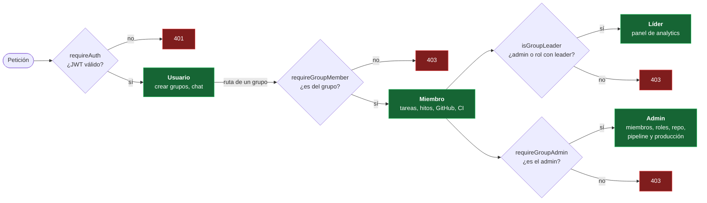

# Permisos por rol

**En una frase:** qué puede hacer cada rol en cada módulo, tal como lo revisa la API (no la pantalla).

JWT = el token firmado que la API entrega al iniciar sesión (dura 24 h). Cada ruta usa solo el control que necesita; el diagrama muestra cómo se suman.

## Cómo leer las tablas

| Columna | Quién es |
|---|---|
| **Usuario** | Tiene sesión, pero **no** es miembro de ese grupo |
| **Miembro** | Pertenece al grupo (fila en `UserGroups`) |
| **Líder** | Miembro con un rol cuyo nombre contiene «leader», sin importar mayúsculas. El admin también cuenta como líder |
| **Admin** | El dueño del grupo (`Groups.adminId`) |

- ✅ = permitido. — = la API responde 403 (o 404 si el recurso es de otro grupo).
- Los roles se heredan: lo que puede un miembro también lo pueden el líder y el admin.
- **Guardia** = la función del código que hace el control. Están en `taskmate-api/middleware/groupAccess.js` y `taskmate-api/models/access.model.js`.
- «solo API» = la API lo permite, pero ninguna pantalla lo usa.

**Sin sesión** solo se puede registrarse (`POST /api/users`) e iniciar sesión (`POST /api/users/login`). Ambas tienen un límite de intentos.

## 1 · Usuarios y acceso · [módulo](01-usuarios-y-acceso.md)

| Acción | Usuario | Miembro | Líder | Admin | Guardia |
|---|:-:|:-:|:-:|:-:|---|
| Buscar el id de un usuario por nombre (lo usa «Add User») | ✅ | ✅ | ✅ | ✅ | `requireAuth` |
| Cerrar sesión (borra la sesión del navegador) | ✅ | ✅ | ✅ | ✅ | — |

## 2 · Grupos y roles · [módulo](02-grupos-y-roles.md)

| Acción | Usuario | Miembro | Líder | Admin | Guardia |
|---|:-:|:-:|:-:|:-:|---|
| Crear un grupo (queda como su admin) | ✅ | ✅ | ✅ | ✅ | `requireAuth` |
| Ver sus propios grupos | ✅ | ✅ | ✅ | ✅ | `requireAuth` |
| Ver miembros, roles y matriz de roles | — | ✅ | ✅ | ✅ | `requireGroupMember` |
| Salir del grupo | — | ✅ | ✅ | ✅ | `requireGroupMember` |
| Agregar un miembro por nombre de usuario | — | — | — | ✅ | `requireGroupAdmin` |
| Quitar un miembro | — | — | — | ✅ | `requireGroupAdmin` |
| Eliminar el grupo | — | — | — | ✅ | `requireGroupAdmin` |
| Crear, editar y borrar roles | — | — | — | ✅ | `requireGroupAdmin` |
| Asignar y quitar roles | — | — | — | ✅ | `requireGroupAdmin` |

Si sale el admin, el grupo pasa al miembro más antiguo. Si sale el último miembro, el grupo se borra.

## 3 · Tareas · [módulo](03-tareas.md)

| Acción | Usuario | Miembro | Líder | Admin | Guardia |
|---|:-:|:-:|:-:|:-:|---|
| Ver las tareas del grupo | — | ✅ | ✅ | ✅ | `requireGroupMember` |
| Crear y editar **cualquier** tarea del grupo | — | ✅ | ✅ | ✅ | `requireGroupMember`, `requireResourceMember` |
| Completar o mandar a la papelera | — | ✅ | ✅ | ✅ | `requireResourceMember` |
| Borrar una lista entera | — | ✅ | ✅ | ✅ | `requireGroupMember` |
| Asignar y desasignar personas (solo miembros del grupo) | — | ✅ | ✅ | ✅ | `requireResourceMember` |
| Ver y vaciar completadas y papelera | — | ✅ | ✅ | ✅ | `requireGroupMember` |

Las tareas no tienen dueño: cualquier miembro puede tocarlas todas.

## 4 · Hitos y calendario · [módulo](04-hitos-y-calendario.md)

| Acción | Usuario | Miembro | Líder | Admin | Guardia |
|---|:-:|:-:|:-:|:-:|---|
| Ver el calendario y el diagrama de hitos | — | ✅ | ✅ | ✅ | `requireGroupMember` |
| Crear, editar, mover y borrar hitos | — | ✅ | ✅ | ✅ | `requireGroupMember`, `requireResourceMember` |
| Fijar el porcentaje o marcar completado | — | ✅ | ✅ | ✅ | `requireResourceMember` |
| Conectar hitos (prerrequisito o progresor) y borrar conexiones | — | ✅ | ✅ | ✅ | `requireGroupMember`, `requireResourceMember` |

## 5 · Chat IA · [módulo](05-chat-ia.md)

| Acción | Usuario | Miembro | Líder | Admin | Guardia |
|---|:-:|:-:|:-:|:-:|---|
| Conversar con la IA y crear un proyecto (grupo nuevo) con un plan | ✅ | ✅ | ✅ | ✅ | JWT al abrir `/chat` |
| Elegir un proyecto como contexto del chat | — | ✅ | ✅ | ✅ | `isGroupMember` en `UserSession` |
| Analizar el repositorio y guardar el plan en ese grupo | — | ✅ | ✅ | ✅ | `isGroupMember` + el admin activó el análisis |

## 6 · Analytics · [módulo](06-analytics.md)

| Acción | Usuario | Miembro | Líder | Admin | Guardia |
|---|:-:|:-:|:-:|:-:|---|
| Ver sus propios analytics y tendencias (solo API) | ✅ | ✅ | ✅ | ✅ | Solo los datos propios |
| Pedir recomendaciones por REST (solo API, 10 por minuto) | — | ✅ | ✅ | ✅ | `isGroupMember` |
| Registrar asignaciones y tareas completadas (solo API) | — | ✅ | ✅ | ✅ | `isGroupMember` |
| Ver el panel del equipo en `/analytics` | — | — | ✅ | ✅ | `isGroupLeader` |
| Recomendaciones de asignación con IA en el panel (`/insights`) | — | — | ✅ | ✅ | `isGroupLeader` |
| Ver analytics del equipo, carga, experiencia y de otro miembro (solo API) | — | — | ✅ | ✅ | `isGroupLeader` |
| Leer y guardar la configuración de analytics (solo API) | — | — | ✅ | ✅ | `isGroupLeader` |
| Sembrar asignaciones de demostración (solo API) | — | — | — | ✅ | `requireGroupAdmin` |

## 7 · GitHub · [módulo](07-github.md)

| Acción | Usuario | Miembro | Líder | Admin | Guardia |
|---|:-:|:-:|:-:|:-:|---|
| Ver el repositorio vinculado | — | ✅ | ✅ | ✅ | `requireGroupMember` |
| Explorar árbol, archivos, README y commits | — | ✅ | ✅ | ✅ | `requireGroupMember` |
| Crear la rama de una tarea | — | ✅ | ✅ | ✅ | `requireResourceMember` |
| Ver el PR de cada tarea y sincronizar los PRs | — | ✅ | ✅ | ✅ | `requireGroupMember` |
| Conectar el repositorio (instalar la App y elegir el repo) | — | — | — | ✅ | `requireGroupAdmin` + escritura en GitHub |
| Desvincular el repositorio | — | — | — | ✅ | `requireGroupAdmin` |
| Permitir o bloquear el análisis con IA | — | — | — | ✅ | `requireGroupAdmin` |

## 8 · CI/CD · [módulo](08-cicd.md)

| Acción | Usuario | Miembro | Líder | Admin | Guardia |
|---|:-:|:-:|:-:|:-:|---|
| Ver pipeline, ejecuciones, jobs, logs y anotaciones | — | ✅ | ✅ | ✅ | `requireGroupMember` |
| Ver entornos, historial de deploys y solicitudes | — | ✅ | ✅ | ✅ | `requireGroupMember` |
| Ejecutar el CI en una rama | — | ✅ | ✅ | ✅ | `requireGroupMember` |
| Re-ejecutar fallidos o cancelar una ejecución de **CI** | — | ✅ | ✅ | ✅ | `requireGroupMember` |
| Re-ejecutar o cancelar una ejecución de **deploy** | — | — | — | ✅ | `isGroupAdmin` en el servicio |
| Solicitar producción (solo la versión que está en staging) | — | ✅ | ✅ | ✅ | `requireGroupMember` |
| Cancelar una solicitud (solo la propia) | — | ✅ | ✅ | ✅ | `requireGroupMember` + ser quien la pidió |
| Configurar el pipeline (propuesta, vista previa y subir) | — | — | — | ✅ | `requireGroupAdmin` |
| Publicar ya o hacer rollback | — | — | — | ✅ | `requireGroupAdmin` |
| Aprobar o rechazar solicitudes de producción | — | — | — | ✅ | `requireGroupAdmin` |

En la pantalla, el admin ve «Publicar en producción» en lugar de «Solicitar producción».

## 9 · Tiempo real y avisos · [módulo](09-tiempo-real-y-avisos.md)

| Acción | Usuario | Miembro | Líder | Admin | Guardia |
|---|:-:|:-:|:-:|:-:|---|
| Abrir los WebSockets `/chat`, `/insights` y `/events` | ✅ | ✅ | ✅ | ✅ | JWT en `?token=` y `Origin` permitido |
| Recibir los eventos de CI/CD de un grupo en `/events` | — | ✅ | ✅ | ✅ | `isGroupMember` al suscribirse |
| Aviso: ejecución fallida o deploy terminado | — | ✅ | ✅ | ✅ | Filtro en el navegador |
| Aviso: solicitud de producción nueva, o deploy cancelado antes de publicar | — | — | — | ✅ | Filtro en el navegador |
| Aviso: tu solicitud fue aprobada o rechazada | — | ✅ | ✅ | ✅ | Filtro en el navegador (solo quien la pidió) |

El servidor manda los eventos del grupo a todos sus miembros. Qué aviso se muestra lo decide el navegador (`CicdNotifications.jsx`).

## GitHub (sistema)

| Entrada | Cómo se autentica |
|---|---|
| `POST /api/github/webhook` | Firma HMAC `X-Hub-Signature-256`, con protección contra repeticiones |
| `GET /api/github/callback` | `state` firmado y de un solo uso, generado al pulsar «Conectar repositorio» |

## Para saber más
- [Casos de uso: visión general](00-general.md) y [recorridos de usuario](00-recorridos-de-usuario.md).
- Permisos de CI/CD explicados para el usuario: [guía de CI/CD, «Quién puede hacer qué»](../07-guias/guia-cicd.md#10-quién-puede-hacer-qué).
- Limitaciones de permisos (por ejemplo, vaciar la papelera): [cierre del proyecto](../01-proyecto/cierre-del-proyecto.md#limitaciones-conocidas).
