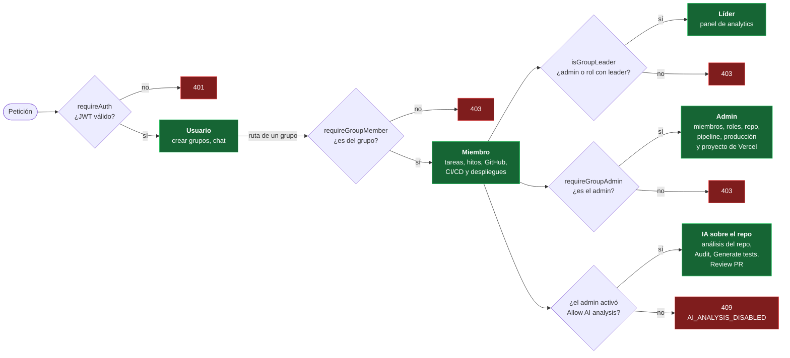

# Permisos por rol

**En una frase:** qué puede hacer cada rol en cada módulo, tal como lo revisa la API (no la pantalla).

JWT = el token firmado que la API entrega al iniciar sesión (dura 24 h). Cada ruta usa solo el control que necesita; el diagrama muestra cómo se suman. «Allow AI analysis» no es un rol: es un permiso del grupo que solo el admin enciende o apaga.

## Cómo leer las tablas

| Columna | Quién es |
|---|---|
| **Usuario** | Tiene sesión, pero **no** es miembro de ese grupo |
| **Miembro** | Pertenece al grupo (fila en `UserGroups`) |
| **Líder** | Miembro con un rol cuyo nombre contiene «leader», sin importar mayúsculas. El admin también cuenta como líder |
| **Admin** | El dueño del grupo (`Groups.adminId`) |

- ✅ = permitido. — = la API responde 403 (o 404 si el recurso es de otro grupo).
- Los roles se heredan: lo que puede un miembro también lo pueden el líder y el admin.
- **Guardia** = la función del código que hace el control. Están en `taskmate-api/middleware/groupAccess.js` y `taskmate-api/models/access.model.js`. El permiso de IA lo revisa el servicio (`taskmate-api/services/aiServer/taskAi.js`, `taskmate-api/services/aiServer/prReview.js`, `taskmate-api/services/UserSession.js` y, para «Propose with AI», `taskmate-api/services/github/pipelineService.js`).
- «solo API» = la API lo permite, pero ninguna pantalla lo usa.

**Sin sesión** solo se puede registrarse (`POST /api/users`) e iniciar sesión (`POST /api/users/login`). Ambas tienen un límite de intentos.

## 1 · Usuarios y acceso · [módulo](01-usuarios-y-acceso.md)

| Acción | Usuario | Miembro | Líder | Admin | Guardia |
|---|:-:|:-:|:-:|:-:|---|
| Buscar el id de un usuario por nombre (lo usa «Add User») | ✅ | ✅ | ✅ | ✅ | `requireAuth` |
| Cerrar sesión (borra la sesión del navegador) | ✅ | ✅ | ✅ | ✅ | — |

## 2 · Grupos y roles · [módulo](02-grupos-y-roles.md)

| Acción | Usuario | Miembro | Líder | Admin | Guardia |
|---|:-:|:-:|:-:|:-:|---|
| Crear un grupo (queda como su admin) | ✅ | ✅ | ✅ | ✅ | `requireAuth` |
| Ver sus propios grupos y elegir el activo (selector del navbar o clic en Groups) | ✅ | ✅ | ✅ | ✅ | `requireAuth` |
| Ver miembros, roles y matriz de roles | — | ✅ | ✅ | ✅ | `requireGroupMember` |
| Salir del grupo | — | ✅ | ✅ | ✅ | `requireGroupMember` |
| Agregar un miembro por nombre de usuario | — | — | — | ✅ | `requireGroupAdmin` |
| Quitar un miembro | — | — | — | ✅ | `requireGroupAdmin` |
| Eliminar el grupo | — | — | — | ✅ | `requireGroupAdmin` |
| Crear, editar y borrar roles | — | — | — | ✅ | `requireGroupAdmin` |
| Asignar y quitar roles («Assign/Edit Roles») | — | — | — | ✅ | `requireGroupAdmin` |

Si sale el admin, el grupo pasa al miembro más antiguo. Si sale el último miembro, el grupo se borra. El grupo activo es solo una elección del navegador: no da permisos.

## 3 · Tareas · [módulo](03-tareas.md)

| Acción | Usuario | Miembro | Líder | Admin | Guardia |
|---|:-:|:-:|:-:|:-:|---|
| Ver las tareas del grupo | — | ✅ | ✅ | ✅ | `requireGroupMember` |
| Crear y editar **cualquier** tarea del grupo | — | ✅ | ✅ | ✅ | `requireGroupMember`, `requireResourceMember` |
| Completar o mandar a la papelera | — | ✅ | ✅ | ✅ | `requireResourceMember` |
| Borrar una lista entera | — | ✅ | ✅ | ✅ | `requireGroupMember` |
| Asignar y desasignar personas (solo miembros del grupo) | — | ✅ | ✅ | ✅ | `requireResourceMember` |
| Ver y vaciar completadas y papelera | — | ✅ | ✅ | ✅ | `requireGroupMember` |

Las tareas no tienen dueño: cualquier miembro puede tocarlas todas.

## 4 · Hitos y calendario · [módulo](04-hitos-y-calendario.md)

| Acción | Usuario | Miembro | Líder | Admin | Guardia |
|---|:-:|:-:|:-:|:-:|---|
| Ver el calendario y el diagrama de hitos | — | ✅ | ✅ | ✅ | `requireGroupMember` |
| Crear, editar, mover y borrar hitos | — | ✅ | ✅ | ✅ | `requireGroupMember`, `requireResourceMember` |
| Fijar el porcentaje o marcar completado | — | ✅ | ✅ | ✅ | `requireResourceMember` |
| Conectar hitos (prerrequisito o progresor) y borrar conexiones | — | ✅ | ✅ | ✅ | `requireGroupMember`, `requireResourceMember` |

## 5 · Chat IA · [módulo](05-chat-ia.md)

| Acción | Usuario | Miembro | Líder | Admin | Guardia |
|---|:-:|:-:|:-:|:-:|---|
| Con «New project» o sin grupo activo, conversar con la IA y crear un proyecto (grupo nuevo) con un plan | ✅ | ✅ | ✅ | ✅ | JWT al abrir `/chat` |
| En un grupo sin usar, guardar en él el plan del proyecto nuevo (si no, se crea como grupo nuevo) | — | — | — | ✅ | `adminId` y grupo sin usar, comprobados con bloqueo en `fillEmptyGroupFromPlan` |
| Usar el grupo del navbar como proyecto del chat | — | ✅ | ✅ | ✅ | `isGroupMember` en `UserSession` al cambiar de grupo |
| Preguntar sobre el proyecto (tareas, hitos, equipo y asignaciones) | — | ✅ | ✅ | ✅ | `isGroupMember` de nuevo en cada mensaje |
| Que el chat vea también el repositorio | — | ✅ | ✅ | ✅ | `isGroupMember` + repo conectado y no suspendido + el admin activó el análisis |
| Proponer tareas («Propose tasks» o pedir un plan en el chat) y guardar el plan en ese grupo | — | ✅ | ✅ | ✅ | `isGroupMember` + repo conectado y no suspendido + el admin activó el análisis (uno por minuto) |

- El permiso de IA solo decide si el chat ve el repositorio; las tareas, los hitos, el equipo y las asignaciones del grupo van siempre en el contexto.
- Pedir un plan en el chat lanza el mismo análisis que «Propose tasks», con las mismas comprobaciones. Al guardar el plan se vuelve a comprobar la membresía.

## 6 · Analytics · [módulo](06-analytics.md)

| Acción | Usuario | Miembro | Líder | Admin | Guardia |
|---|:-:|:-:|:-:|:-:|---|
| Ver sus propios analytics y tendencias (solo API) | ✅ | ✅ | ✅ | ✅ | Solo los datos propios |
| Pedir recomendaciones por REST (solo API, 10 por minuto) | — | ✅ | ✅ | ✅ | `isGroupMember` |
| Registrar asignaciones y tareas completadas (solo API) | — | ✅ | ✅ | ✅ | `isGroupMember` |
| Ver el panel del equipo en `/analytics` | — | — | ✅ | ✅ | `isGroupLeader` |
| Recomendaciones de asignación con IA en el panel (`/insights`) | — | — | ✅ | ✅ | `isGroupLeader` |
| Ver analytics del equipo, carga, experiencia y de otro miembro (solo API) | — | — | ✅ | ✅ | `isGroupLeader` |
| Leer y guardar la configuración de analytics (solo API) | — | — | ✅ | ✅ | `isGroupLeader` |
| Sembrar asignaciones de demostración (solo API) | — | — | — | ✅ | `requireGroupAdmin` |

Un miembro sin rol de líder ve «Team leaders only» en `/analytics`.

## 7 · GitHub · [módulo](07-github.md)

| Acción | Usuario | Miembro | Líder | Admin | Guardia |
|---|:-:|:-:|:-:|:-:|---|
| Ver el repositorio vinculado | — | ✅ | ✅ | ✅ | `requireGroupMember` |
| Explorar árbol, archivos, README y commits | — | ✅ | ✅ | ✅ | `requireGroupMember` (60 por minuto y 600 por hora) |
| Crear la rama de una tarea («Create branch on GitHub») | — | ✅ | ✅ | ✅ | `requireResourceMember` (20 por minuto) |
| Ver el PR de cada tarea y sincronizar los PRs («Sync PRs») | — | ✅ | ✅ | ✅ | `requireGroupMember` |
| Ver los archivos que tocó una tarea («View task files») | — | ✅ | ✅ | ✅ | `requireResourceMember` (60 por minuto y 600 por hora) |
| Ver qué otras tareas tocan los mismos archivos («Also changed by») | — | ✅ | ✅ | ✅ | `requireResourceMember` |
| Conectar el repositorio (instalar la App y elegir el repo) | — | — | — | ✅ | `requireGroupAdmin` + escritura en GitHub |
| Desvincular el repositorio | — | — | — | ✅ | `requireGroupAdmin` |
| Permitir o bloquear el análisis con IA («Allow AI analysis») | — | — | — | ✅ | `requireGroupAdmin` |

«Allow AI analysis» habilita el análisis del repo, que el chat vea el repo, la propuesta de pipeline con IA («Propose with AI») y la IA sobre el código (sección 10). Empieza apagado y se apaga solo al cambiar de repo.

## 8 · CI/CD · [módulo](08-cicd.md)

| Acción | Usuario | Miembro | Líder | Admin | Guardia |
|---|:-:|:-:|:-:|:-:|---|
| Ver pipeline, ejecuciones, jobs, logs y anotaciones | — | ✅ | ✅ | ✅ | `requireGroupMember` |
| Ver entornos, historial de deploys y solicitudes | — | ✅ | ✅ | ✅ | `requireGroupMember` |
| Ejecutar el CI en una rama | — | ✅ | ✅ | ✅ | `requireGroupMember` |
| Re-ejecutar fallidos o cancelar una ejecución de **CI** | — | ✅ | ✅ | ✅ | `requireGroupMember` |
| Re-ejecutar o cancelar una ejecución de **deploy** | — | — | — | ✅ | `isGroupAdmin` en el servicio |
| Solicitar producción (solo la versión que está en staging) | — | ✅ | ✅ | ✅ | `requireGroupMember` |
| Cancelar una solicitud (solo la propia) | — | ✅ | ✅ | ✅ | `requireGroupMember` + ser quien la pidió |
| Configurar el pipeline (propuesta, vista previa y subir) | — | — | — | ✅ | `requireGroupAdmin` |
| Publicar ya o hacer rollback | — | — | — | ✅ | `requireGroupAdmin` |
| Aprobar o rechazar solicitudes de producción | — | — | — | ✅ | `requireGroupAdmin` |
| Ver el proyecto de Vercel vinculado y sus despliegues («Vercel (monitoring)») | — | ✅ | ✅ | ✅ | `requireGroupMember` |
| Vincular o desvincular el proyecto de Vercel (Project ID) | — | — | — | ✅ | `requireGroupAdmin` (10 por minuto al vincular) |

- En la pantalla, el admin ve «Publish to production» en lugar de «Request production».
- Vercel: las rutas van bajo `/api/deploy/groups/:gid`. Un proyecto de Vercel solo puede estar en un grupo: si ya es de otro, la API responde 409. Un rol con «leader» no basta para vincular.

## 9 · Tiempo real y avisos · [módulo](09-tiempo-real-y-avisos.md)

| Acción | Usuario | Miembro | Líder | Admin | Guardia |
|---|:-:|:-:|:-:|:-:|---|
| Abrir los WebSockets `/chat`, `/insights` y `/events` | ✅ | ✅ | ✅ | ✅ | JWT en `?token=` y `Origin` permitido |
| Recibir los eventos de CI/CD de un grupo en `/events` | — | ✅ | ✅ | ✅ | `isGroupMember` al suscribirse |
| Aviso: ejecución fallida o deploy terminado | — | ✅ | ✅ | ✅ | Filtro en el navegador |
| Aviso: solicitud de producción nueva, o deploy cancelado antes de publicar | — | — | — | ✅ | Filtro en el navegador |
| Aviso: tu solicitud fue aprobada o rechazada | — | ✅ | ✅ | ✅ | Filtro en el navegador (solo quien la pidió) |

- El servidor manda los eventos del grupo a todos sus miembros. Qué aviso se muestra lo decide el navegador (`CicdNotifications.jsx`).
- `Origin` permitido = el de `FRONTEND_URL`. Con `ALLOW_LAN_ORIGINS=true` (solo desarrollo) también se aceptan orígenes `http` de IPv4 privadas, para abrir la app desde otro equipo de la red.
- Los despliegues de Vercel no llegan por `/events`: la pestaña se refresca con «Refresh».

## 10 · IA sobre el código · [módulo](10-ia-sobre-el-codigo.md)

| Acción | Usuario | Miembro | Líder | Admin | Guardia |
|---|:-:|:-:|:-:|:-:|---|
| Auditar la rama de la tarea («Audit») | — | ✅ | ✅ | ✅ | `requireResourceMember` + el admin activó el análisis con IA + la tarea tiene rama |
| Generar pruebas para la rama («Generate tests»; se proponen, no se ejecutan ni se suben) | — | ✅ | ✅ | ✅ | `requireResourceMember` + el admin activó el análisis con IA + la tarea tiene rama |
| Ver la última revisión de IA del PR | — | ✅ | ✅ | ✅ | `requireResourceMember` (no pide el permiso de IA) |
| Pedir la revisión de IA del PR («Review PR») | — | ✅ | ✅ | ✅ | `requireResourceMember` + el admin activó el análisis con IA + PR abierto |

- Las rutas van bajo `/api/github/tasks/:tid`. «Audit», «Generate tests» y «Review PR» comparten un solo límite: **5 por minuto por usuario** entre las tres.
- El permiso lo enciende solo el admin, con «Allow AI analysis» (sección 7). Sin él, la API responde 409 `AI_ANALYSIS_DISABLED` y el panel no muestra los botones.
- Publicar la revisión en el PR necesita que la GitHub App tenga «Pull requests: write». Si no lo tiene, la revisión se guarda sin publicar (`no_permission`).

## Sistemas externos

| Entrada | Cómo se autentica |
|---|---|
| `POST /api/github/webhook` (GitHub) | Firma HMAC SHA-256 en `X-Hub-Signature-256`, con protección contra repeticiones |
| Revisión automática del PR (GitHub, por el mismo webhook `pull_request`) | El webhook firmado de arriba. Solo corre si el PR está abierto y no es borrador, la rama es de una tarea del repo vinculado y el grupo activó el análisis con IA |
| `GET /api/github/callback` (GitHub) | `state` firmado y de un solo uso, generado al pulsar «Connect repository» |
| `POST /api/deploy/webhook/vercel` (Vercel) | Firma HMAC SHA-1 en `x-vercel-signature` con `VERCEL_WEBHOOK_SECRET`; sin JWT ni límite. Solo guarda despliegues de proyectos vinculados a un grupo |
| Servidor de IA local (`127.0.0.1:8000`) | No entra a TaskMate: TaskMate lo llama con la cabecera `X-AI-Server-Secret` (`AI_SERVER_SECRET`), y el servidor responde 401 si falta o no coincide |

## Para saber más
- [Casos de uso: visión general](00-general.md) y [recorridos de usuario](00-recorridos-de-usuario.md).
- Permisos de CI/CD explicados para el usuario: [guía de CI/CD, «Quién puede hacer qué»](../07-guias/guia-cicd.md#10-quién-puede-hacer-qué).
- Seguridad de los webhooks y de los secretos compartidos: [seguridad](../02-arquitectura/00-seguridad.md).
- Limitaciones de permisos (por ejemplo, vaciar la papelera): [cierre de la línea de Pablo y estado](../01-proyecto/cierre-del-proyecto.md#limitaciones-conocidas).
