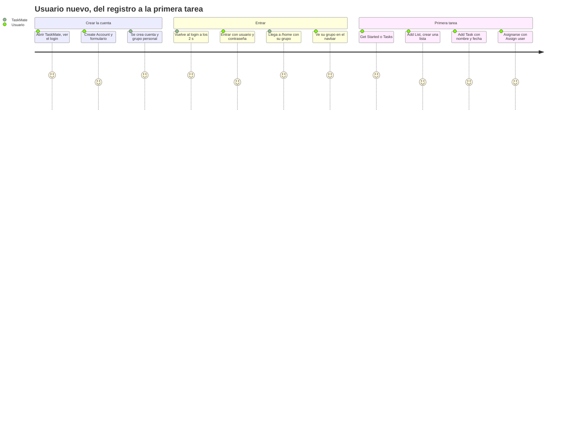
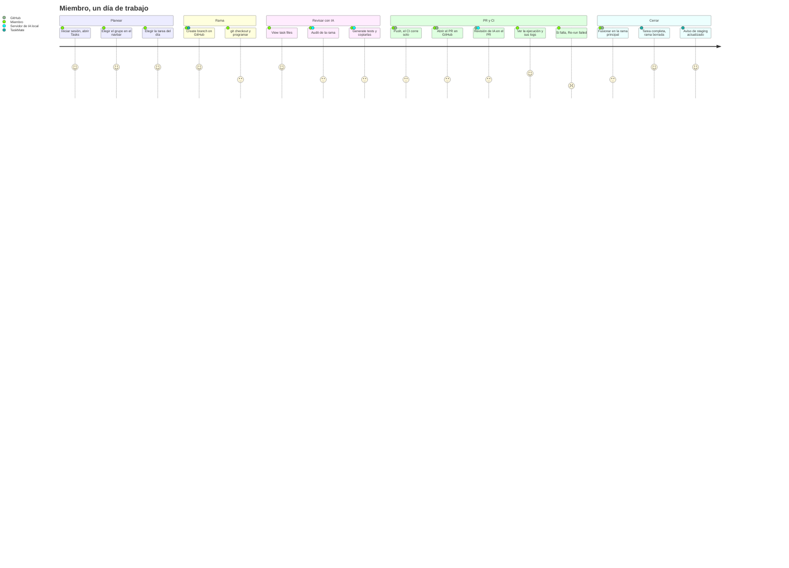
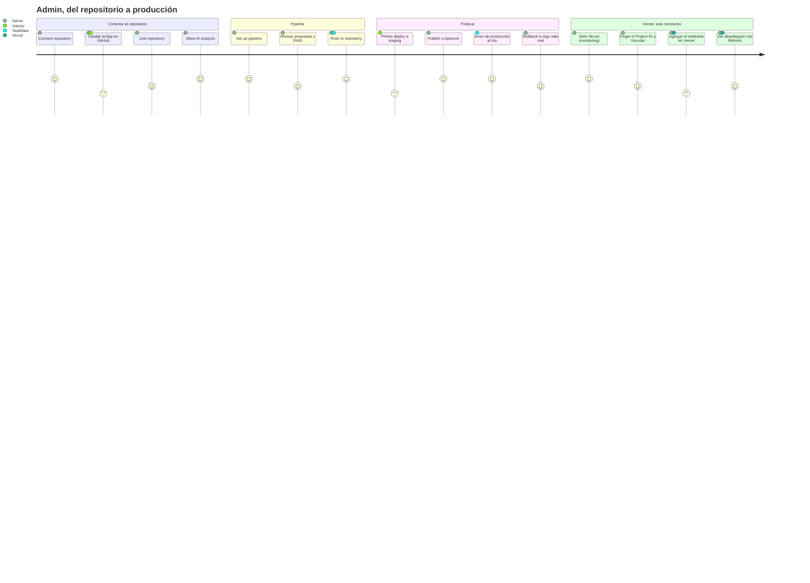
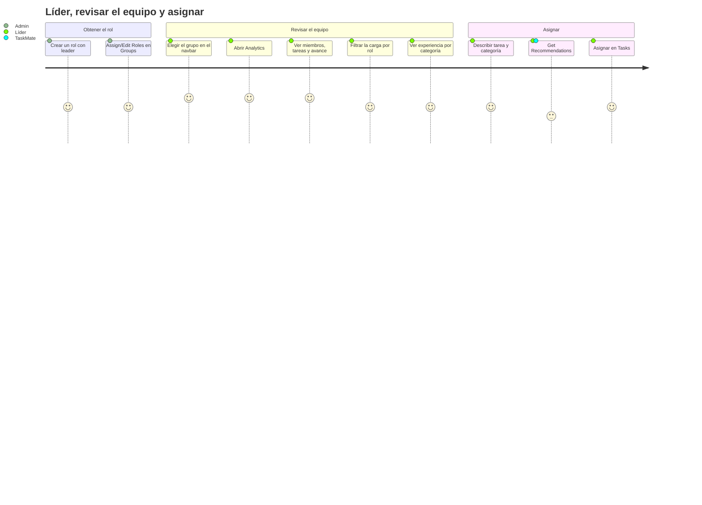

# Recorridos de usuario

**En una frase:** cuatro recorridos típicos, paso a paso, de las personas que usan TaskMate: un usuario nuevo, un miembro, un admin y un líder. Los nombres de botones van en inglés, como los muestra la app.

**Cómo leer la puntuación (1 a 5).** No es una medición de satisfacción. Es una regla fija para ver dónde está la fricción:

| Puntos | Significa |
|---|---|
| 5 | Un clic o un formulario dentro de TaskMate |
| 4 | Varios pasos o decisiones dentro de TaskMate |
| 3 | Hay que salir a GitHub, a Vercel o a la terminal, o esperar a otro sistema (por ejemplo, al modelo local) |
| 2 | Algo falló y hay que corregirlo |

## 1. Usuario nuevo: del registro a su primera tarea

**Persona:** alguien que entra a TaskMate por primera vez y quiere anotar su primera tarea.

- El grupo personal se llama «*usuario*'s Group» y la persona queda como su admin.
- Al iniciar sesión, TaskMate activa el primer grupo de la lista. Con un solo grupo, es el personal.
- El grupo activo se ve en el selector junto al logo (o «Select a group» si no hay). Cambiarlo ahí cambia el grupo de todas las pantallas; «Manage groups» lleva a Groups.
- Con la sesión ya iniciada, `/register` lleva directo a `/home`.

## 2. Miembro: un día típico con tareas, rama, IA, PR y CI

**Persona:** un desarrollador del equipo. Su grupo ya tiene repositorio y pipeline conectados, y el admin activó «Allow AI analysis».

- La rama se llama `tm/<nombre-de-la-tarea>-<8 caracteres del id>` y sale de la rama principal.
- «View task files» abre «Task files»: los archivos del PR de la rama y, si otra tarea toca los mismos, «Also changed by». Debajo está «AI on the branch» con «Audit», «Generate tests» y «Review PR» (este solo con el PR abierto).
- Con el modelo local, «Audit» puede tardar unos 20 s y «Generate tests» unos 30 s. Las pruebas se proponen para copiarlas: no se ejecutan ni se suben. Entre las tres acciones hay 5 por minuto por usuario.
- TaskMate no abre PRs: el PR se abre en GitHub. TaskMate lo muestra como un chip en la tarea.
- Al abrir o actualizar el PR, TaskMate pide por su cuenta la revisión al servidor de IA local y la publica en el PR como comentario: nunca aprueba ni pide cambios. También se ve en «AI on the branch».
- Solo un PR fusionado **en la rama principal** completa la tarea.
- La rama se borra salvo que tenga cambios sin fusionar u otro PR abierto.

## 3. Admin: conectar el repo, configurar el pipeline, publicar y monitorear Vercel

**Persona:** el admin del grupo. Tiene permiso de escritura en el repositorio de GitHub y, para el último tramo, un proyecto en Vercel.

- «Push to repository» hace un commit de `.github/workflows/taskmate-ci.yml` en la rama principal. Si hay deploy, también activa GitHub Pages.
- Staging se actualiza solo con cada push a la rama principal que pasa el CI.
- Solo se publican versiones que pasaron el CI de TaskMate en la rama principal.
- «Publish to production» publica ya; «Approve» publica lo que pidió un miembro con «Request production».
- En Vercel, el webhook apunta a `/api/deploy/webhook/vercel` con eventos de despliegue, y su secreto va en `VERCEL_WEBHOOK_SECRET` de la API. El botón «Vincular» es uno de los pocos textos que quedaron en español.
- «Vercel (monitoring)» solo muestra lo que Vercel avisa: TaskMate no despliega ahí y la lista no se actualiza en vivo. Los miembros la ven; solo el admin vincula o quita el proyecto («Unlink»).

## 4. Líder: revisar el equipo con analytics

**Persona:** un miembro con un rol cuyo nombre contiene «leader» (o el admin). Quiere repartir mejor el trabajo.

- Un miembro sin ese rol ve «Team leaders only».
- Las recomendaciones van por el WebSocket `/insights` (canal en vivo) al servicio Python del chat. Las responde el modelo local (Gemma 4 en Ollama), que es lo que pone `scripts/local-up.sh` con `LLM_PROVIDER=ollama`; sin esa variable se usa Groq, el respaldo en la nube.

## Para saber más
- [Casos de uso: visión general](00-general.md) y [permisos por rol](00-permisos-por-rol.md).
- Pantallas: [interfaz](../05-interfaz/00-general.md).
- El mismo camino de punta a punta: [flujo general](../06-flujos/00-general.md).
- Uso detallado del CI/CD: [guía de CI/CD](../07-guias/guia-cicd.md).
- Auditar, generar pruebas y revisar el PR: [IA sobre el código](10-ia-sobre-el-codigo.md).
- Limitaciones conocidas: [cierre de la línea de Pablo y estado](../01-proyecto/cierre-del-proyecto.md#limitaciones-conocidas).
