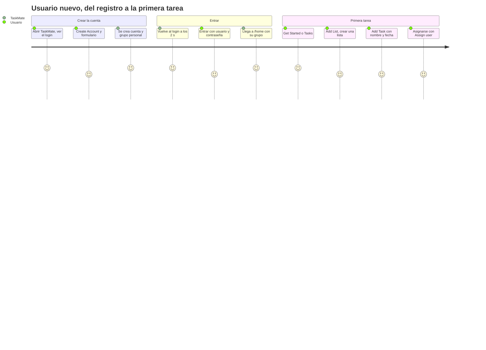
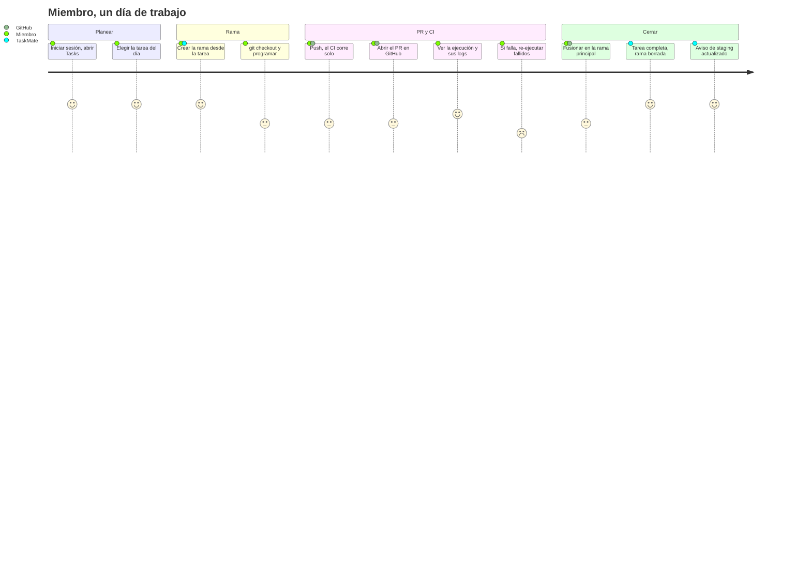
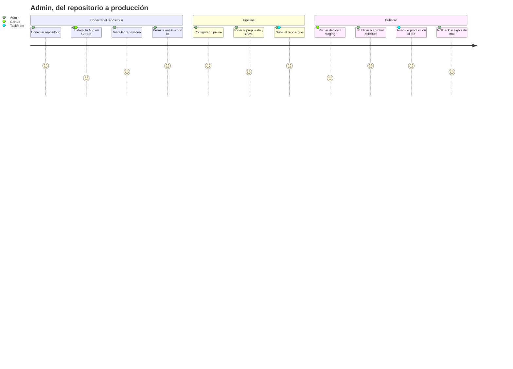
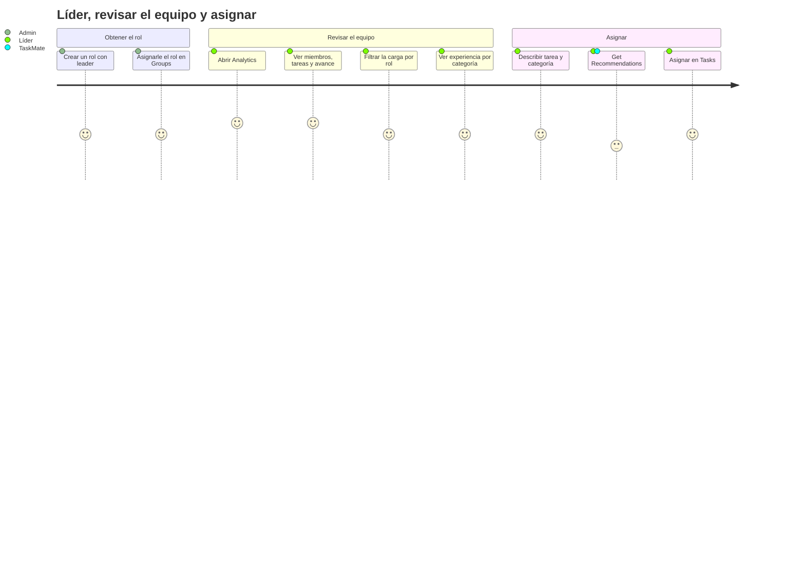

# Recorridos de usuario

**En una frase:** cuatro recorridos típicos, paso a paso, de las personas que usan TaskMate: un usuario nuevo, un miembro, un admin y un líder.

**Cómo leer la puntuación (1 a 5).** No es una medición de satisfacción. Es una regla fija para ver dónde está la fricción:

| Puntos | Significa |
|---|---|
| 5 | Un clic o un formulario dentro de TaskMate |
| 4 | Varios pasos o decisiones dentro de TaskMate |
| 3 | Hay que salir a GitHub o a la terminal, o esperar a otro sistema |
| 2 | Algo falló y hay que corregirlo |

## 1. Usuario nuevo: del registro a su primera tarea

**Persona:** alguien que entra a TaskMate por primera vez y quiere anotar su primera tarea.

- El grupo personal se llama «*usuario*'s Group» y la persona queda como su admin.
- Al iniciar sesión, TaskMate activa el primer grupo de la lista. Con un solo grupo, es el personal.
- Con la sesión ya iniciada, `/register` lleva directo a `/home`.

## 2. Miembro: un día típico con tareas, rama, PR y CI

**Persona:** un desarrollador del equipo. Su grupo ya tiene repositorio y pipeline conectados.

- La rama se llama `tm/<nombre-de-la-tarea>-<8 caracteres del id>` y sale de la rama principal.
- TaskMate no abre PRs: el PR se abre en GitHub. TaskMate lo muestra como un chip en la tarea.
- Solo un PR fusionado **en la rama principal** completa la tarea.
- La rama se borra salvo que tenga cambios sin fusionar u otro PR abierto.

## 3. Admin: conectar el repo, configurar el pipeline y publicar

**Persona:** el admin del grupo. Tiene permiso de escritura en el repositorio de GitHub.

- «Subir al repositorio» hace un commit de `.github/workflows/taskmate-ci.yml` en la rama principal. Si hay deploy, también activa GitHub Pages.
- Staging se actualiza solo con cada push a la rama principal que pasa el CI.
- Solo se publican versiones que pasaron el CI de TaskMate en la rama principal.

## 4. Líder: revisar el equipo con analytics

**Persona:** un miembro con un rol cuyo nombre contiene «leader» (o el admin). Quiere repartir mejor el trabajo.

- Un miembro sin ese rol ve «Solo líderes del equipo».
- Las recomendaciones van por el WebSocket `/insights` (canal en vivo) al servidor de IA, que usa Groq.

## Para saber más
- [Casos de uso: visión general](00-general.md) y [permisos por rol](00-permisos-por-rol.md).
- Pantallas: [interfaz](../05-interfaz/00-general.md).
- El mismo camino de punta a punta: [flujo general](../06-flujos/00-general.md).
- Uso detallado del CI/CD: [guía de CI/CD](../07-guias/guia-cicd.md).
- Limitaciones conocidas: [cierre del proyecto](../01-proyecto/cierre-del-proyecto.md#limitaciones-conocidas).
