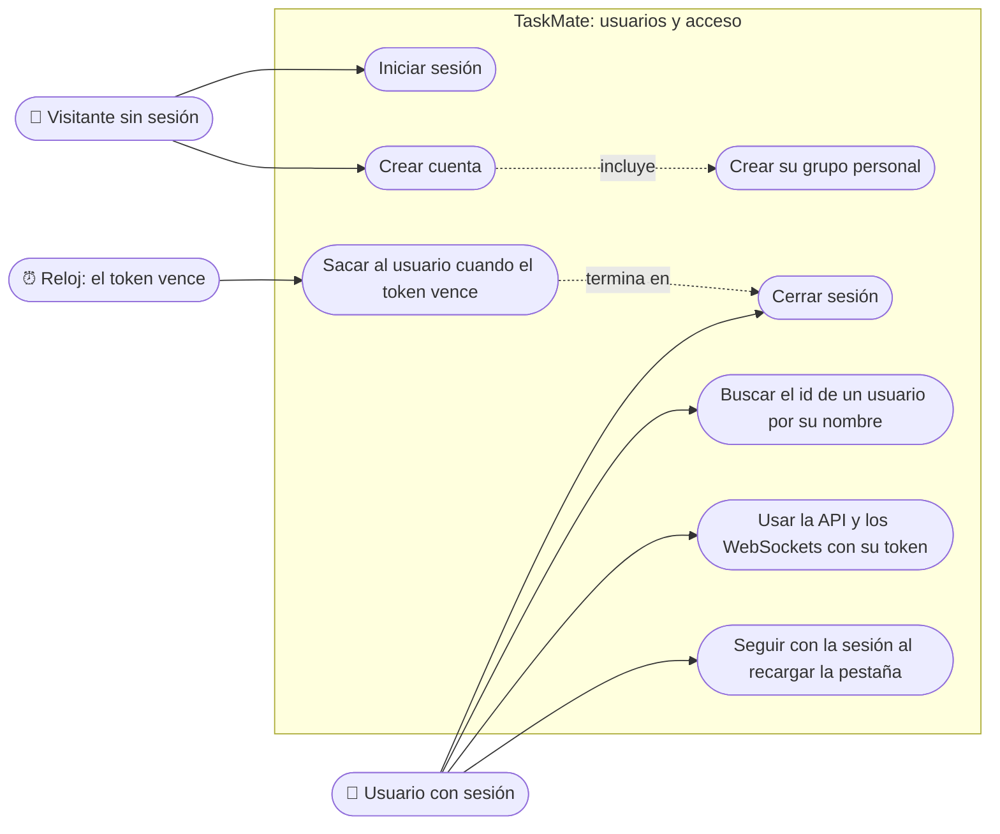

# Usuarios y acceso: casos de uso

**En una frase:** un visitante crea su cuenta e inicia sesión; con sesión, el usuario usa TaskMate con su token hasta que sale o el token vence a las 24 h.

## Casos de uso

| Caso | Quién puede | Qué pasa |
|---|---|---|
| Crear cuenta | Visitante (`/register`) | Elige usuario y contraseña. La API guarda el hash, crea el grupo «`<usuario>`'s Group» con él como admin y lo hace miembro. Luego vuelve a `/` para iniciar sesión |
| Iniciar sesión | Visitante (`/`) | Si usuario y contraseña coinciden, recibe un JWT (token firmado) de 24 h. TaskMate toma el primer grupo de su lista como grupo activo y abre `/home` |
| Seguir con la sesión al recargar | Usuario con sesión | Recargar la misma pestaña conserva el usuario y el grupo activo. Una pestaña nueva empieza sin sesión ([por qué](../06-flujos/01-usuarios-y-acceso.md#ciclo-de-la-sesión-en-el-navegador)) |
| Usar la API y los WebSockets | Usuario con sesión | Cada llamada lleva el token. Los WebSockets lo mandan al conectarse |
| Buscar el id de un usuario por su nombre | Usuario con sesión | `GET /api/users/getuid`. La pantalla de Grupos lo usa para agregar un miembro por su nombre |
| Cerrar sesión | Usuario con sesión (menú con su nombre → «Logout») | Se borran el usuario, el token y el grupo activo del navegador. Vuelve a la pantalla de login |
| Sacar al usuario cuando el token vence | El sistema | La API responde 401 o el WebSocket se cierra con el código 4001. TaskMate cierra la sesión y vuelve a `/` |

## Reglas de permiso

Verificadas en `taskmate-api/app.js`, `controllers/user.controller.js`, `services/WebSocketServer.js` y `src/App.js`.

| Qué | Guardia | Quién pasa |
|---|---|---|
| `POST /api/users` (registro) | `authLimiter` | Cualquiera, sin token: hasta 10 intentos por IP cada 15 min, contando registro y login juntos |
| `POST /api/users/login` | `authLimiter` | Igual que el registro |
| `GET /api/users/getuid` | `requireAuth` + `apiLimiter` | Cualquier usuario con sesión. No exige ser admin de un grupo |
| Resto de `/api/*` | `requireAuth` + `apiLimiter`, y los guardias de grupo de cada módulo | Usuario con sesión; el grupo decide lo demás ([Grupos y roles](02-grupos-y-roles.md)) |
| WebSockets `/chat`, `/insights` y `/events` | `Origin` permitido y token válido antes del upgrade | Usuario con sesión, desde el frontend configurado en `FRONTEND_URL` |
| Pantallas `/` y `/register` | `src/App.js` | Solo sin sesión; con sesión redirigen a `/home` |
| Las demás pantallas | `src/App.js` | Solo con sesión; sin sesión redirigen a `/` |

Qué cuenta como «token válido»:
- Firmado con `JWT_SECRET` y algoritmo HS256.
- Con `typ: access`, sin audiencia y con fecha de vencimiento.
- Por eso los tokens de propósito, como el `state` de la instalación de GitHub, no sirven para entrar.

`apiLimiter` permite 300 peticiones por minuto por usuario (`API_RATE_LIMIT_MAX`).

## Para saber más

- Todos los actores y permisos de TaskMate: [00-general.md](00-general.md)
- Arquitectura del módulo: [02-arquitectura/01-usuarios-y-acceso.md](../02-arquitectura/01-usuarios-y-acceso.md)
- Pantallas: [05-interfaz/01-usuarios-y-acceso.md](../05-interfaz/01-usuarios-y-acceso.md)
- Paso a paso y mensajes de error: [06-flujos/01-usuarios-y-acceso.md](../06-flujos/01-usuarios-y-acceso.md)
- Limitaciones conocidas: [cierre del proyecto](../01-proyecto/cierre-del-proyecto.md#limitaciones-conocidas)
