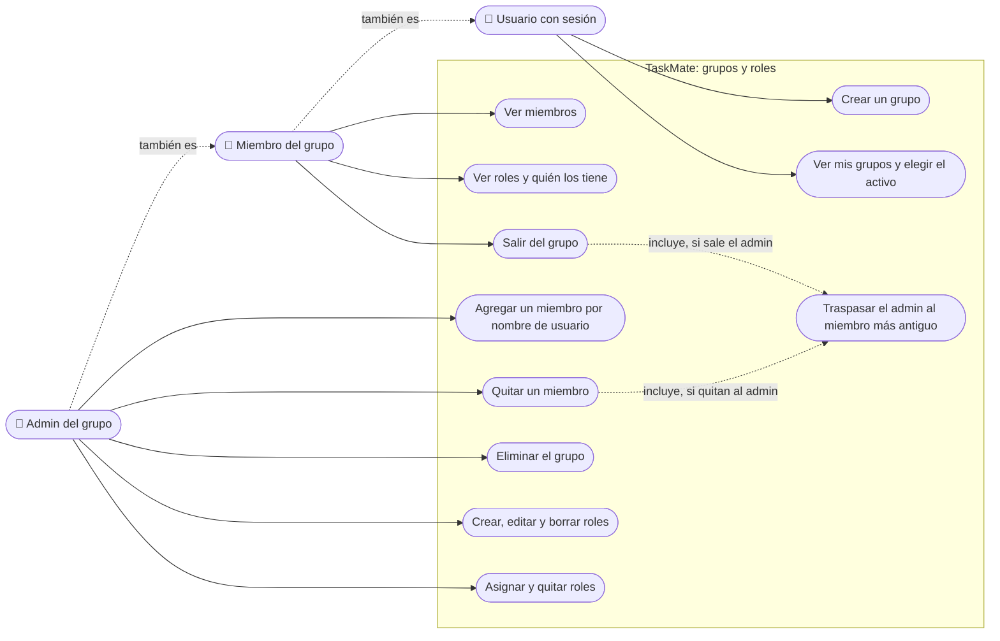

# Grupos y roles: casos de uso

**En una frase:** cualquier usuario crea grupos y elige el activo; los miembros ven el grupo y pueden salir; solo el admin agrega o quita gente y maneja los roles.

Las flechas punteadas entre actores significan «también es»: el admin puede hacer todo lo del miembro, y el miembro todo lo del usuario con sesión.

## Actores

| Actor | Quién es | Cómo lo comprueba la API |
|---|---|---|
| Usuario con sesión | Cualquier cuenta con JWT válido | `requireAuth` |
| Miembro del grupo | Tiene una fila en `UserGroups` para ese grupo | `requireGroupMember` → `access.model.isGroupMember` |
| Admin del grupo | Su `uid` está en `Groups.adminId` y además es miembro. Hay uno por grupo | `requireGroupAdmin` → `access.model.isGroupAdmin` |

**Líder** no es un actor de este módulo: es el admin o un miembro con un rol cuyo nombre contiene «leader» (sin importar mayúsculas). Solo cuenta para Analytics. Un rol «leader» **no** da permisos para manejar el grupo ni sus roles.

## Casos de uso

| Caso | Quién puede | Qué pasa |
|---|---|---|
| Crear un grupo | Usuario con sesión | Se crean el grupo y la membresía en una transacción; quien lo crea queda como admin. También nace un grupo al registrarse («`<usuario>`'s Group») y al confirmar un plan del chat |
| Ver mis grupos y elegir el activo | Usuario con sesión | Lista solo los grupos donde es miembro. El activo se guarda en el navegador y lo usan Tareas, Calendario, Hitos, Analytics y GitHub |
| Ver miembros | Miembro | Nombre de usuario de cada miembro, con la insignia Admin o Member |
| Ver roles y quién los tiene | Miembro | Roles con color e icono, y los roles de cada miembro como chips |
| Salir del grupo | Miembro | Se borran sus roles y su membresía. Si era el admin, el admin pasa al miembro más antiguo. Si era el último miembro, se borra el grupo con todo su contenido |
| Agregar un miembro | Admin | Escribe el nombre de usuario; entra directo, sin invitación. Si ya era miembro, no cambia nada |
| Quitar un miembro | Admin | Se borran los roles y la membresía de esa persona. Si el admin escribe su propio nombre, la pantalla lo trata como «salir del grupo» |
| Eliminar el grupo | Admin | Borra el grupo y todo lo que depende de él. En la pantalla, el botón «Delete Group» solo aparece cuando el admin es el único miembro, y usa la ruta de salir. `DELETE /api/groups/delete` existe, pero ninguna pantalla la llama |
| Crear, editar y borrar roles | Admin | Nombre (único en el grupo, hasta 40), color e icono. Al borrar un rol se quitan antes sus asignaciones |
| Asignar y quitar roles | Admin | Casillas por rol para un miembro. Solo se puede asignar un rol del mismo grupo a alguien que es miembro |

## Reglas de permisos (guardias de las rutas)

| Ruta | Guardia | Nota |
|---|---|---|
| `POST /api/groups/group` | `requireAuth` | El admin es siempre quien llama; se ignora `adminId` del cuerpo |
| `GET /api/groups/user-groups` | `requireAuth` | Usa el usuario del token; se ignora `?uid=` |
| `GET /api/users/getuid?username=` | `requireAuth` | Convierte un nombre de usuario en `uid` para agregar o quitar |
| `GET /api/groups/:gid/members` | Miembro | |
| `DELETE /api/groups/leave` | Miembro | Siempre saca a quien llama, aunque el cuerpo traiga otro `uid` |
| `POST /api/groups/join` | Admin | El `uid` debe existir (si no, 404) |
| `DELETE /api/groups/remove-member` | Admin | |
| `DELETE /api/groups/delete` | Admin | Solo API |
| `GET /api/grouproles/groups/:gid/roles` | Miembro | |
| `POST`, `PUT /:gr_id`, `DELETE /:gr_id` en `/api/grouproles/groups/:gid/roles` | Admin | En `PUT` y `DELETE` el rol debe ser de ese grupo (si no, 404) |
| `GET .../users/:uid/roles` y `GET .../rolesmatrix` en `/api/usergrouproles/groups/:gid` | Miembro | |
| `POST .../userroles` y `DELETE .../userroles` (con `uid` y `gr_id`) | Admin | Al asignar: rol del mismo grupo (404) y destinatario miembro (400) |
| `GET /api/groups/:gid/roles`, `GET .../userroles`, `DELETE .../userroles/:ugr_id`, `GET .../roles/:gr_id/users`, `GET .../users/:uid/roles/:gr_id`, `GET .../roles/:gr_id/count` | Miembro (el `DELETE`, admin) | Solo API: ninguna pantalla las llama |

- **La interfaz esconde, la API decide.** La pantalla oculta los botones de admin comparando con `Groups.adminId`, pero el permiso real lo aplica la guardia: sin el rol, la API responde 403.
- **Un `gid` por petición.** La guardia acepta el `gid` en la ruta, la query o el cuerpo; si llega en dos lugares con valores distintos, responde 400.
- **No hay forma de unirse por cuenta propia.** Solo el admin agrega miembros.

## Para saber más

- Todos los casos de uso del sistema: [00-general.md](00-general.md)
- Pantalla y botones por rol: [05-interfaz/02-grupos-y-roles.md](../05-interfaz/02-grupos-y-roles.md)
- Flujos paso a paso y errores: [06-flujos/02-grupos-y-roles.md](../06-flujos/02-grupos-y-roles.md)
- Limitaciones conocidas: [cierre del proyecto](../01-proyecto/cierre-del-proyecto.md#limitaciones-conocidas)
