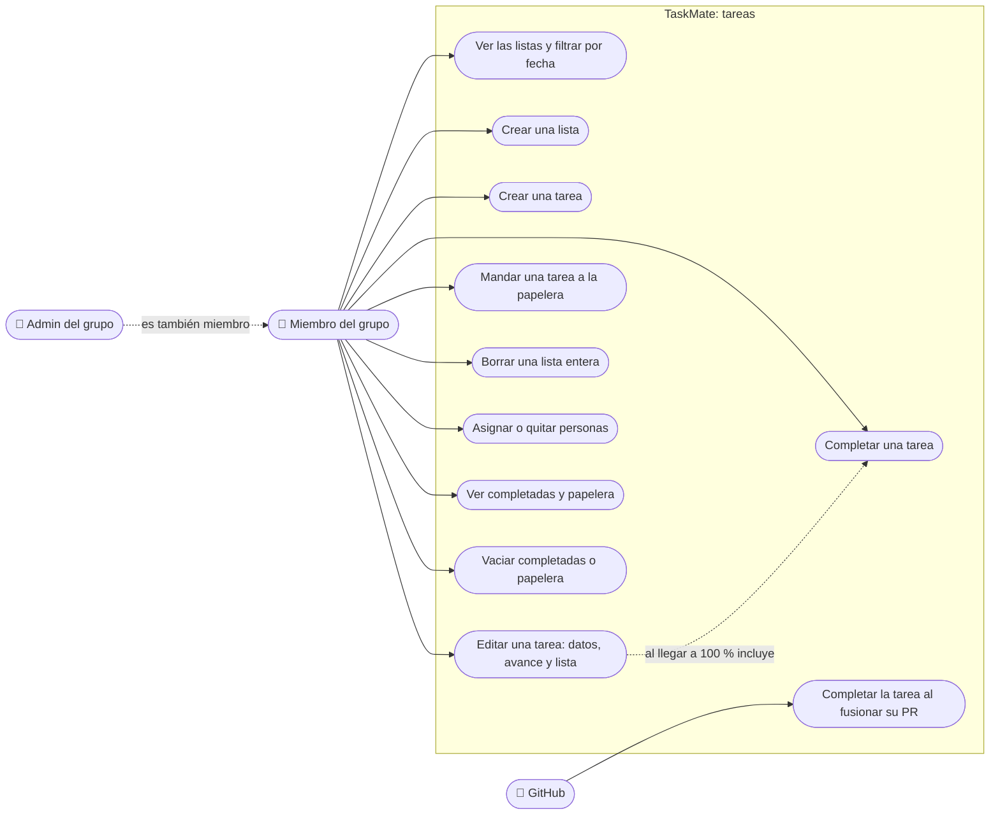

# Tareas: casos de uso

**En una frase:** las tareas no tienen dueño: cualquier miembro del grupo activo (el admin incluido) crea, edita, completa, asigna y borra cualquier tarea del grupo; GitHub también puede completarla cuando se fusiona su PR.

## Casos de uso

| Caso | Quién puede | Qué pasa |
|---|---|---|
| Ver las listas y filtrar | Miembro | Ve las tareas activas del grupo activo, agrupadas por lista. Filtra por hoy, esta semana o este mes y ordena por creación, fecha límite o prioridad (menos avance primero) |
| Crear una lista | Miembro | La lista aparece al instante, pero solo en su navegador. Se guarda en la base cuando recibe su primera tarea |
| Crear una tarea | Miembro | Nombre, fecha límite y lista son obligatorios; descripción y hora no (la hora por defecto es 00:00). Empieza en 0 % |
| Editar una tarea | Miembro | Cambia nombre, descripción, fecha, hora, avance (en pasos de 5 %) y lista. No se puede mover a otro grupo |
| Completar una tarea | Miembro | La tarea pasa al archivo de completadas con 100 %, se quitan sus asignaciones y, si tenía rama de GitHub, se intenta borrar |
| Mandar a la papelera | Miembro | La tarea pasa a la papelera con su avance; se quitan sus asignaciones y su rama, igual que al completar. No hay forma de restaurarla |
| Borrar una lista entera | Miembro | Borra todas las tareas de la lista sin pasarlas a la papelera. No pide confirmación |
| Asignar o quitar personas | Miembro | Elige miembros del grupo con interruptores. Solo se puede asignar a alguien que es miembro del grupo de la tarea |
| Ver completadas y papelera | Miembro | Filtros «Completed» y «Deleted» del panel lateral. Son de solo lectura |
| Vaciar completadas o papelera | Miembro | Borra para siempre todas las completadas o toda la papelera del grupo. No pide confirmación |
| Completar al fusionar el PR | GitHub (webhook firmado) | Un PR fusionado en la rama principal, cuya rama es la de una tarea, la completa por el mismo camino. Ver [GitHub](07-github.md) |

El [plan del chat](05-chat-ia.md) también crea tareas, dentro del grupo nuevo o del proyecto elegido. Los chips de rama y PR de cada tarea son parte de [GitHub](07-github.md).

## Reglas de permiso

Verificadas en `controllers/tasks.controller.js`, `complete.controller.js`, `delete.controller.js`, `usertask.controller.js` y `middleware/groupAccess.js`. Todas las rutas pasan antes por `requireAuth` (JWT válido) y `apiLimiter` (300 peticiones por minuto por usuario).

| Ruta | Guardia | Quién pasa |
|---|---|---|
| `GET /api/tasks?gid=` | `requireGroupMember('gid')` | Miembro del grupo |
| `GET /api/tasks/:id` | `requireResourceMember('task')` | Miembro del grupo de la tarea. Solo API: la interfaz no la usa |
| `POST /api/tasks` | `requireGroupMember('gid')`, con `gid` en el cuerpo | Miembro del grupo |
| `PUT /api/tasks/:id` | `requireResourceMember('task')` | Miembro del grupo de la tarea. El `gid` del cuerpo debe ser el de la tarea, si no responde 400 |
| `PUT /api/tasks/nodes/:id` | `requireResourceMember(['task', 'node'])` | Miembro del grupo. La usa el editor de [hitos](04-hitos-y-calendario.md) |
| `POST /api/tasks/:tid/complete` | `requireResourceMember(['task', 'completed'])` | Miembro del grupo. Si ya estaba completada responde `already_completed` |
| `POST /api/tasks/:tid/trash` | `requireResourceMember('task')` | Miembro del grupo de la tarea |
| `DELETE /api/tasks/list/:gid/:list` | `requireGroupMember('gid')` | Miembro del grupo |
| `GET` y `DELETE /api/completados/:gid` | `requireGroupMember('gid')` | Miembro del grupo (cualquiera puede vaciar) |
| `GET` y `DELETE /api/delete/:gid` | `requireGroupMember('gid')` | Miembro del grupo (cualquiera puede vaciar) |
| `GET`, `POST` y `DELETE /api/usertask` | `requireResourceMember('task', 'tid')` | Miembro del grupo de la tarea. `POST` además exige que la persona asignada (`uid`) sea miembro |

Cómo deciden las guardias:
- `requireGroupMember` lee el `gid` de la ruta, la query o el cuerpo. Si llega en dos lugares con valores distintos, responde 400.
- `requireResourceMember` busca la tarea y usa su grupo. Si no la encuentra responde 404 `TASK_NOT_FOUND`; si no es miembro, 403 `NOT_GROUP_MEMBER`.
- Ninguna ruta de este módulo es solo para el admin.

## Para saber más

- Pantalla y botones: [05-interfaz/03-tareas.md](../05-interfaz/03-tareas.md)
- Qué pasa paso a paso y qué ve el usuario si falla: [06-flujos/03-tareas.md](../06-flujos/03-tareas.md)
- Casos de uso de todo el sistema: [00-general.md](00-general.md)
- Limitaciones conocidas (por ejemplo, quién puede vaciar el historial): [cierre del proyecto](../01-proyecto/cierre-del-proyecto.md#limitaciones-conocidas)
