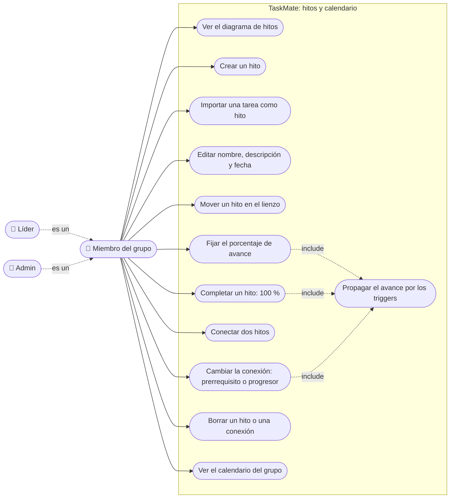

# Hitos y calendario: casos de uso

**En una frase:** cualquier miembro del grupo activo puede crear, conectar, mover, editar, completar y borrar hitos, y ver el calendario. El admin y los líderes no tienen permisos extra aquí.

«include» quiere decir que el caso siempre ocurre como parte del otro: la base de datos lo hace sola.

## Casos de uso

| Caso | Quién | Qué pasa |
|---|---|---|
| Ver el diagrama | Miembro | `GET /api/nodes/group/:gid` y `GET /api/edges/group/:gid`; se dibujan tarjetas y flechas |
| Crear un hito | Miembro | Nombre y fecha obligatorios. `POST /api/nodes`; nace con 0 % en la posición (10, 10) del lienzo |
| Importar una tarea | Miembro | «Import Task» lista las tareas activas que aún no son hito. El hito usa el mismo id que la tarea, y su nombre, fecha y porcentaje |
| Editar | Miembro | «Edit» abre la ventana. `PUT /api/nodes/:id` y `PUT /api/tasks/nodes/:id`: si el hito es una tarea importada, la tarea cambia igual |
| Mover | Miembro | Al soltar la tarjeta: `PUT /api/nodes/:id/coords` |
| Fijar el % | Miembro | Número de 0 a 100 en «Progress». `PUT /api/nodes/:id/percentage`; el trigger actualiza los hitos que dependen de este |
| Completar | Miembro | Escribir 100: la tarjeta se pone verde con «✓ Completed». `PUT /api/nodes/:id/toggleComplete` y luego el % |
| Conectar | Miembro | Arrastrar de un hito a otro. `POST /api/edges`; la conexión nace como prerrequisito |
| Cambiar la conexión | Miembro | Clic en la etiqueta de la flecha. `PUT /api/edges/:eid`; el trigger recalcula el destino |
| Borrar | Miembro | Seleccionar y pulsar Backspace. Hito: `DELETE /api/edges/source/:id` y `DELETE /api/nodes/:id`, que borra también sus conexiones. Conexión: `DELETE /api/edges/:eid` |
| Ver el calendario | Miembro | `GET /api/nodes/tasks/:gid`: hitos y tareas activas del grupo, en vista de mes |
| Propagar el avance | SQL Server | Triggers de la migración 006: el destino de flechas progresoras = promedio de sus fuentes |

## Reglas de permiso

Verificadas contra los guardias de `nodes.controller.js`, `edges.controller.js` y `tasks.controller.js`.

- **Sesión:** todas las rutas piden un JWT válido (`requireAuth`, si no 401) y pasan por el límite de pedidos por usuario (`apiLimiter`: 300 por minuto por defecto, si no 429).
- **Miembro, por grupo:** las rutas que reciben `gid` usan `requireGroupMember`. Quien no es miembro recibe 403 `NOT_GROUP_MEMBER`.
- **Miembro, por objeto:** las rutas con id de hito o de conexión usan `requireResourceMember`: buscan el grupo dueño del objeto. Si no existe, 404; si el usuario no es miembro, 403.
- **No hay rutas de admin ni de líder** en este módulo. Cualquier miembro puede editar o borrar cualquier hito, también los que creó otro miembro o la IA.
- **Mismo grupo:** una conexión solo une hitos del grupo indicado (400). Importar una tarea de otro grupo también da 400.
- **La interfaz no oculta nada por rol:** admin, líder y miembro ven la misma pantalla.

| Ruta | Guardia |
|---|---|
| `GET /api/nodes/group/:gid`, `GET /api/nodes/tasks/:gid`, `POST /api/nodes` | Miembro del `gid` |
| `PUT` y `DELETE /api/nodes/:id`, `/coords`, `/percentage`, `/toggleComplete` | Miembro del grupo del hito |
| `GET /api/edges/group/:gid`, `POST /api/edges` | Miembro del `gid` |
| `PUT` y `DELETE /api/edges/:eid` | Miembro del grupo de la conexión |
| `DELETE /api/edges/source/:id` | Miembro del grupo del hito |
| `PUT /api/tasks/nodes/:id` | Miembro del grupo de la tarea o del hito |
| `GET /api/nodes/:id`, `GET /api/edges/:eid` | Miembro; solo API, la interfaz no las llama |

## Para saber más
- Todos los casos de uso de TaskMate: [00-general.md](00-general.md)
- Pantallas: [05-interfaz/04-hitos-y-calendario.md](../05-interfaz/04-hitos-y-calendario.md)
- Paso a paso y errores: [06-flujos/04-hitos-y-calendario.md](../06-flujos/04-hitos-y-calendario.md)
- Tablas y triggers: [03-base-de-datos/04-hitos-y-calendario.md](../03-base-de-datos/04-hitos-y-calendario.md)
- Limitaciones conocidas: [cierre del proyecto](../01-proyecto/cierre-del-proyecto.md#limitaciones-conocidas)
