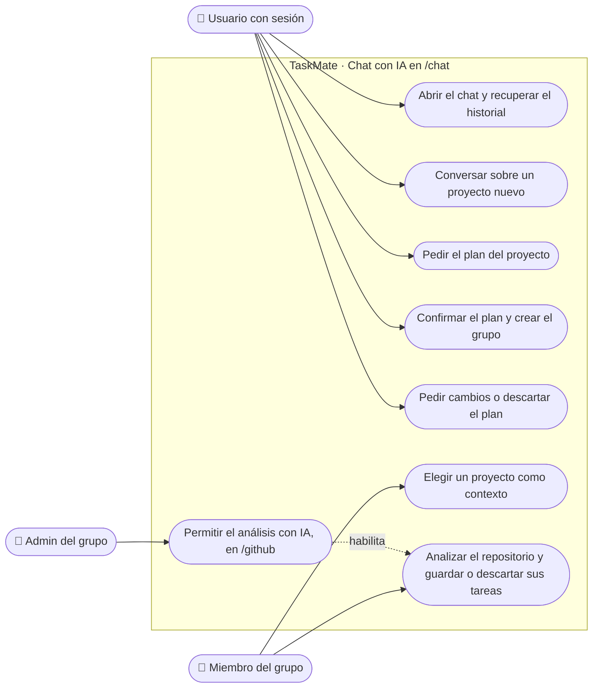

# Chat con IA: casos de uso

**En una frase:** cualquier usuario con sesión puede conversar con la IA y crear un proyecto nuevo a partir de su plan; elegir un proyecto existente como contexto exige ser miembro de ese grupo.

Un admin también es miembro de su grupo, y un miembro también es un usuario con sesión: cada actor puede hacer lo de los actores de arriba.

## Casos de uso

| Caso | Quién puede | Qué pasa |
|---|---|---|
| Abrir el chat y recuperar el historial | Usuario con sesión | Se abre el WebSocket `/chat`. Si ya tenía una sesión (otra pestaña o menos de 60 min desconectado), vuelve el historial; si no, aparece un saludo |
| Conversar sobre un proyecto nuevo | Usuario con sesión, con «Nuevo proyecto (sin contexto)» | La IA (Groq) responde y pregunta lo que falta: qué se construye, funciones y preferencias técnicas |
| Pedir el plan del proyecto | Usuario con sesión | Con datos suficientes, o al escribir frases como «genera el plan», la IA arma el plan: roles, hitos y tareas, y pregunta si se guarda |
| Confirmar el plan y crear el grupo | Usuario con sesión | Al responder «sí», «ok», «guardar»…, la API crea un **grupo nuevo** en una transacción; el usuario queda como su admin y la lista de grupos se recarga |
| Pedir cambios o descartar el plan | Usuario con sesión | «no» pregunta qué cambiar; otro texto retira el plan y sigue la conversación con la misma idea; «descarta» o «empezar de nuevo» borra todo |
| Elegir un proyecto como contexto | Miembro de ese grupo | El selector «Proyecto» muestra sus grupos; la API confirma la membresía y responde si el grupo tiene repositorio |
| Analizar el repositorio y guardar o descartar sus tareas | Miembro del grupo, con repositorio conectado y análisis permitido | El cuadro de texto pasa a ser «instrucciones» del análisis. Detalle en [07-github](07-github.md) |
| Permitir el análisis con IA | Solo el admin del grupo | Interruptor «Permitir análisis con IA» en `/github`. Detalle en [07-github](07-github.md) |

## Reglas de permiso (verificadas en el código)
- **Ruta `/chat`:** sin sesión, `src/App.js` redirige a `/`. En el menú es «AI Bot» y la ven todos.
- **Conexión:** `WebSocketServer.js` exige un JWT de acceso válido en `?token=` (si no, 401) y un `Origin` permitido (si no, 403). Si el JWT vence con el chat abierto, cierra con el código 4001 y el navegador vuelve al login.
- **Chat y plan:** no piden ningún rol ni grupo. El proyecto se crea siempre como grupo nuevo, con `adminId` = quien confirmó.
- **Guardar solo lo confirmado:** `UserSession.saveProjectPlan` acepta un `save_plan` solo si la respuesta anterior de la IA mostró un plan esperando confirmación; si no, lo rechaza y no escribe nada.
- **Contexto:** `set_context` llama a `access.model.isGroupMember`; quien no es miembro recibe `NOT_GROUP_MEMBER` («No eres miembro de ese proyecto.»).
- **Análisis del repositorio:** miembro del grupo, repositorio conectado, instalación no suspendida y `ai_analysis_enabled` activo. Al guardar el plan se vuelve a comprobar la membresía. El permiso lo cambia solo el admin (`requireGroupAdmin` en `PUT /api/github/groups/:gid/ai-analysis`).
- **Límites por usuario** (no por pestaña): mensajes de hasta 4000 caracteres, 20 mensajes por minuto y un análisis del repositorio por minuto.
- **Analytics por este socket:** `/chat` también acepta pedidos `analytics` con la regla de líder, pero `ChatPage` no los usa. Ver [06-analytics](06-analytics.md).

## Para saber más
- Pasos y mensajes de error: [06-flujos/05-chat-ia.md](../06-flujos/05-chat-ia.md)
- Todos los actores y permisos de TaskMate: [00-general.md](00-general.md)
- La pantalla: [05-interfaz/05-chat-ia.md](../05-interfaz/05-chat-ia.md)
