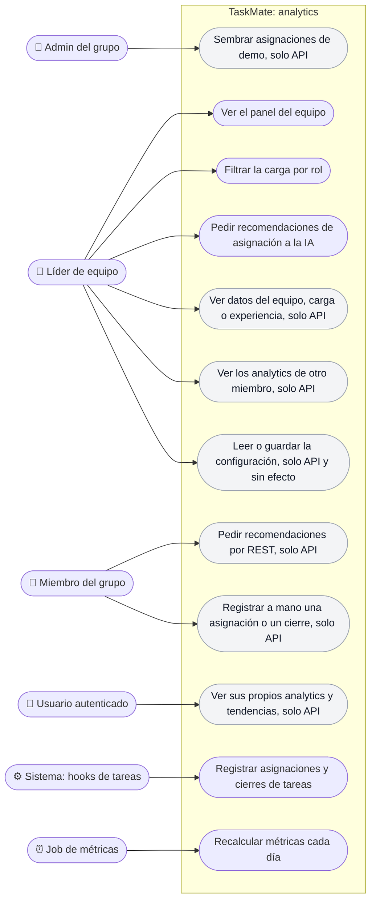

# Analytics: casos de uso

**En una frase:** el líder ve el panel del equipo y pide recomendaciones de asignación a la IA; el resto de los casos son solo de API o los hace el sistema por su cuenta.

Los roles se heredan: el admin siempre es líder, el líder siempre es miembro y todo miembro es un usuario autenticado. Por eso cada actor también puede hacer los casos de los roles que hereda. Gris = caso sin pantalla (solo API).

## Casos de uso

| Caso | Quién puede | Qué pasa |
|------|-------------|----------|
| Ver el panel del equipo | Líder | `/analytics` llama a `GET /api/analytics/dashboard/:groupId` y muestra el resumen, la carga de trabajo y la experiencia por categoría |
| Filtrar la carga por rol | Líder | El filtro corre en el navegador y ofrece los roles que tienen los miembros del grupo, más «No role» si alguien no tiene ninguno |
| Pedir recomendaciones de asignación a la IA | Líder | El panel manda la tarea por `/insights`. Node arma el `team_context` y el `AnalyticsAgent` devuelve hasta 3 personas y un plan |
| Ver datos del equipo, carga o experiencia (solo API) | Líder | `GET /team/:groupId`, `/workload/:groupId` y `/expertise/:groupId` (con `?category=` opcional) |
| Ver los analytics de otro miembro (solo API) | Líder de un grupo de esa persona | `GET /user/:userId?groupId=…` devuelve solo lo de ese grupo |
| Leer o guardar la configuración (solo API) | Líder | `GET` y `PUT /config/:groupId`. Se guarda en `AnalyticsConfig`, pero no cambia nada |
| Ver sus propios analytics y tendencias (solo API) | Cualquier usuario, solo sobre sí mismo | `GET /user/:userId` (de todos sus grupos) y `GET /trends/:userId?days=` (1 a 365, 30 por defecto) |
| Pedir recomendaciones por REST (solo API) | Miembro | `POST /recommendations`; la respuesta llega en la misma petición o falla a los 30 s |
| Registrar a mano una asignación o un cierre (solo API) | Miembro | `POST /assignment` y `POST /completion` |
| Sembrar asignaciones de demo (solo API) | Admin | `POST /api/utils/populate-assignments/:groupId` reparte al azar las tareas sin asignar y crea su historial |
| Registrar asignaciones y cierres | Sistema | Al asignar, desasignar, completar, mandar a la papelera, borrar una lista o fusionar un PR (ver [flujos](../06-flujos/06-analytics.md)) |
| Recalcular métricas cada día | Job de métricas | Solo con `ANALYTICS_BATCH_ENABLED=true`; por defecto a las 2:00 |

Las rutas de la tabla cuelgan de `/api/analytics`, salvo la de demo.

## Reglas de permisos

Verificadas en `analytics.controller.js`, `UserSession.prepareAnalyticsData`, `WebSocketServer.js` y `utils.controller.js`.

- **Quién es líder** (`access.model.isGroupLeader`): un miembro del grupo que es su admin o que tiene un rol cuyo nombre contiene «leader», sin importar mayúsculas. Un rol «Team Leader» basta.
- **Todas las rutas REST** exigen sesión (JWT válido) y pasan por el límite general de 300 pedidos por minuto y usuario (`API_RATE_LIMIT_MAX`). Cada ruta revisa sus permisos por su cuenta.
- **Solo líder:** `dashboard`, `team`, `workload`, `expertise` y `config` (`GET` y `PUT`). Si no, responden 403 `NOT_GROUP_ADMIN`.
- **`user/:userId`:**
  - sobre uno mismo: siempre;
  - sobre otra persona: hace falta `?groupId=` (si falta, 400), ser líder de ese grupo (si no, 403) y que la persona sea del grupo (si no, 404).
- **`trends/:userId`:** solo sobre uno mismo (si no, 403).
- **`recommendations`:**
  - exige ser miembro del grupo (si no, 403 `NOT_GROUP_MEMBER`);
  - máximo 10 por minuto y usuario (si no, 429);
  - `taskCategory` debe ser `frontend`, `backend`, `database`, `testing` o `general`;
  - `taskDescription` admite hasta 2000 caracteres.
- **`assignment`:** exige ser miembro; la tarea debe ser del grupo (si no, 404) y la persona asignada, miembro (si no, 400).
- **`completion`:** exige ser miembro del grupo de la tarea. El grupo se busca en `Tasks`, `Complete` y `DeleteTask`.
- **`/insights`:**
  - Al conectar se revisan el `Origin` (si no está permitido, 403) y el JWT (si falta o es inválido, 401).
  - Cada pedido de analytics cuenta para un límite de 10 por minuto y usuario. `/insights` y los analytics por `/chat` comparten ese límite.
  - Las acciones de equipo exigen ser líder del grupo, y el `team_context` que mande el navegador se descarta.
  - Una acción desconocida responde `VALIDATION_ERROR`.
- **Demo:** `populate-assignments` exige ser el admin del grupo (`requireGroupAdmin`).
- **La interfaz no decide:** la ruta `/analytics` solo pide sesión. La pantalla muestra «Solo líderes del equipo» cuando la API responde 403.

## Para saber más

- La pantalla por rol: [05-interfaz/06-analytics.md](../05-interfaz/06-analytics.md)
- Arquitectura del módulo: [02-arquitectura/06-analytics.md](../02-arquitectura/06-analytics.md)
- Casos de uso de todo el sistema: [00-general.md](00-general.md)
- Limitaciones (rutas sin pantalla, configuración sin efecto): [cierre del proyecto](../01-proyecto/cierre-del-proyecto.md#analytics)
