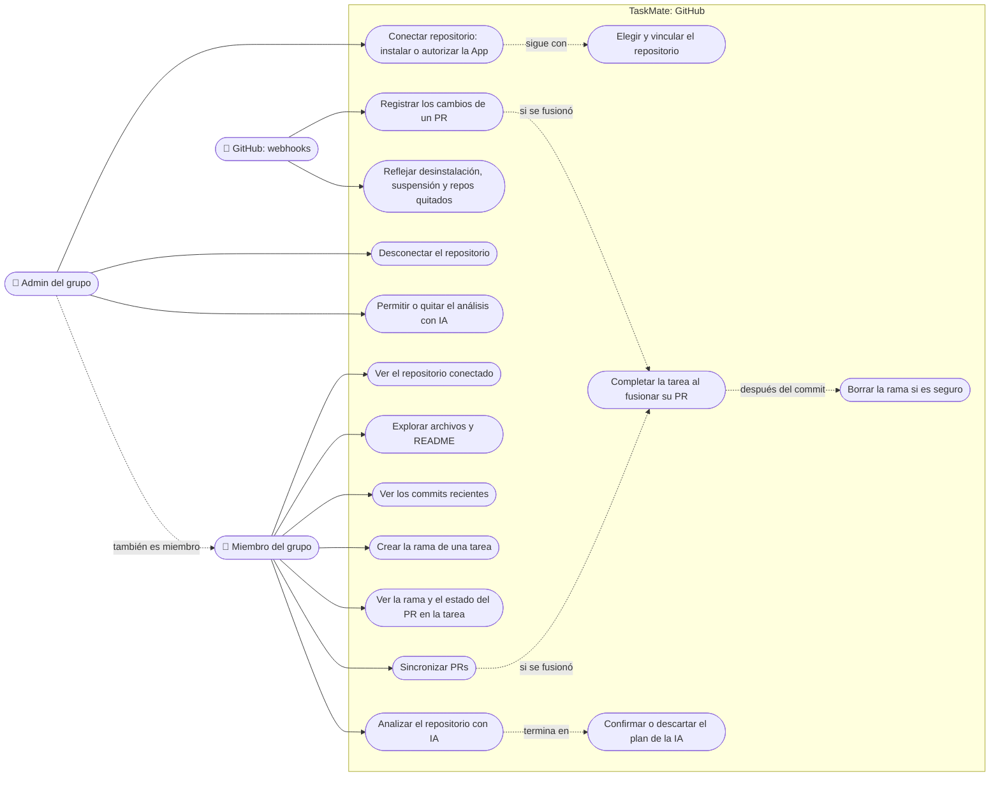

# GitHub: casos de uso

**En una frase:** el admin del grupo conecta y gobierna el repositorio; cualquier miembro lo explora, crea la rama de sus tareas y pide propuestas a la IA; GitHub, por webhooks, mantiene al día los PRs y completa las tareas fusionadas.

## Casos de uso

| Caso | Quién puede | Qué pasa |
|---|---|---|
| Conectar repositorio | Admin (pestaña Repositorio) | «Conectar repositorio» abre GitHub para instalar la App; «Ya instalé la App» solo pide autorizar. Al volver, TaskMate muestra los repos donde tu cuenta de GitHub puede escribir |
| Elegir y vincular el repositorio | Admin que empezó la conexión | Elige un repo de la lista y pulsa «Vincular repositorio». Si el grupo tenía otro, se cambia y se borran las ramas de tareas del repo anterior |
| Desconectar el repositorio | Admin | Quita el vínculo, las ramas de tareas guardadas y las solicitudes de deploy pendientes. La App sigue instalada en GitHub |
| Permitir o quitar el análisis con IA | Admin | Activa o apaga «Permitir análisis con IA». Empieza apagado y se apaga solo al cambiar de repo |
| Ver el repositorio conectado | Miembro | Nombre, rama por defecto, cuenta de la instalación y quién lo conectó |
| Explorar archivos y README | Miembro | Árbol filtrable, archivos de texto de hasta 1 MB y el README como Markdown seguro |
| Ver los commits recientes | Miembro | Hasta 30 commits de la rama por defecto |
| Crear la rama de una tarea | Miembro del grupo de la tarea | Crea `tm/<slug>-<8 caracteres del tid>` desde la rama por defecto. Si ya existe y no es de otra tarea, la adopta |
| Ver la rama y el estado del PR | Miembro | Chips en la tarea: la rama (copia `git checkout`) y «PR #N abierto, borrador, cerrado o fusionado» |
| Sincronizar PRs | Miembro | Consulta en GitHub los PRs de hasta 30 ramas y aplica lo que los webhooks no trajeron. Una vez cada 30 s por usuario |
| Analizar el repositorio con IA | Miembro, si el admin lo permitió | Desde «Analizar con IA» o eligiendo el proyecto en el chat. La IA propone hasta 12 tareas y 5 hitos. Uno por minuto por usuario |
| Confirmar o descartar el plan | Miembro del grupo | «Confirmar» crea las tareas y los hitos en el grupo; «Descartar» lo olvida. El plan vence a los 30 min |
| Registrar los cambios de un PR | GitHub (webhook `pull_request`) | Guarda o actualiza el PR. Los PRs desde forks se ignoran |
| Completar la tarea al fusionar su PR | GitHub o «Sincronizar PRs» | Si el PR se fusionó en la rama por defecto desde la rama de una tarea, la tarea pasa a completada |
| Reflejar cambios de la instalación | GitHub (webhooks `installation` e `installation_repositories`) | Desinstalar borra la instalación y, en cascada, sus vínculos. Suspender bloquea el uso. Un repo quitado se borra; uno agregado se registra |
| Borrar la rama si es seguro | El sistema | Después de completar la tarea (a mano o por PR), mandarla a la papelera o borrar su lista. Solo la borra si no tiene commits sin fusionar ni PRs abiertos |

## Reglas de permiso

Verificadas en `taskmate-api/controllers/github.controller.js`, `app.js`, `services/github/installFlow.js` y `services/UserSession.js`. Todas las rutas van bajo `/api/github` y, salvo el callback y el webhook, piden JWT (`requireAuth`).

| Qué | Guardia | Quién pasa |
|---|---|---|
| `POST /groups/:gid/install` | `requireGroupAdmin` + 10 por minuto | Admin del grupo |
| `GET /callback` | Sin JWT: `state` firmado, de un solo uso y de 10 min; 30 por minuto por IP | El admin que pidió el `state`; se vuelve a comprobar que sigue siendo admin |
| `GET /selections/:id` | `requireAuth` | Solo el usuario que hizo la conexión |
| `POST /groups/:gid/repository` | `requireGroupAdmin` + 10 por minuto | Admin, con una selección suya y de ese grupo. En GitHub debe tener push, maintain o admin sobre el repo |
| `GET /groups/:gid/repository` | `requireGroupMember` | Miembro |
| `DELETE /groups/:gid/repository` | `requireGroupAdmin` | Admin |
| `PUT /groups/:gid/ai-analysis` | `requireGroupAdmin` | Admin |
| `GET /groups/:gid/tree`, `file`, `readme`, `commits` | `requireGroupMember` + 60 por minuto y 600 por hora | Miembro |
| `POST /tasks/:tid/branch` | `requireResourceMember('task')` + 20 por minuto | Miembro del grupo dueño de la tarea |
| `GET /groups/:gid/task-links` | `requireGroupMember` | Miembro |
| `POST /groups/:gid/sync` | `requireGroupMember` + 1 cada 30 s | Miembro |
| `POST /webhook` | Sin JWT: firma HMAC `X-Hub-Signature-256` con `GITHUB_WEBHOOK_SECRET` | Solo GitHub |
| WebSocket `/chat`: `repo_analysis` | Miembro del grupo + `ai_analysis_enabled` + 1 por minuto | Miembro, si el admin lo permitió |
| WebSocket `/chat`: `repo_plan_confirm` | Miembro del grupo al confirmar | Miembro |

Notas:
- **Admin** es el usuario de `Groups.adminId`. Un rol con «leader» en el nombre no da permisos de admin en GitHub.
- Los límites son por usuario, salvo el del callback.
- La interfaz esconde los botones de admin a los miembros, pero quien decide es la API.

## Para saber más

- Todos los actores y permisos de TaskMate: [00-general.md](00-general.md)
- Arquitectura del módulo: [02-arquitectura/07-github.md](../02-arquitectura/07-github.md)
- Pantallas: [05-interfaz/07-github.md](../05-interfaz/07-github.md)
- Paso a paso y mensajes de error: [06-flujos/07-github.md](../06-flujos/07-github.md)
- Limitaciones conocidas: [cierre del proyecto](../01-proyecto/cierre-del-proyecto.md#github-y-cicd)
