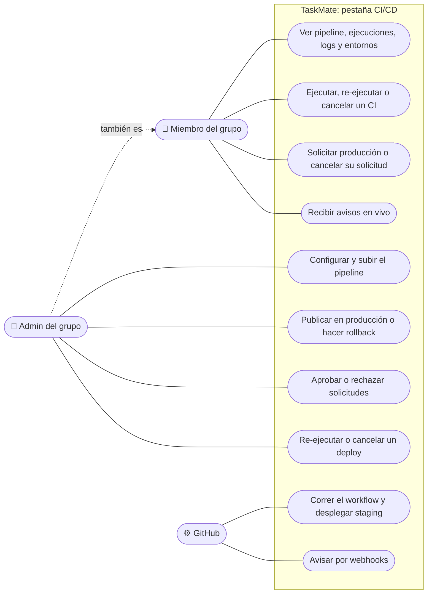

# CI/CD: casos de uso

**En una frase:** cualquier miembro ve el pipeline, las ejecuciones y los entornos, corre el CI y pide producción; el admin del grupo configura el pipeline, publica, aprueba y hace rollback; GitHub corre el workflow y avisa.

- **Miembro:** cualquier usuario del grupo (fila en `UserGroups`).
- **Admin del grupo:** el usuario de `Groups.adminId`, que además debe seguir siendo miembro. Puede todo lo del miembro.
- **GitHub:** actor del sistema. Corre el workflow cuando hay un push, un PR o un *dispatch* (lanzamiento a pedido desde TaskMate) y envía webhooks.

## Casos de uso

| Caso | Quién | Qué pasa |
|------|-------|----------|
| Ver pipeline, ejecuciones, logs y entornos | Miembro | Todo se lee en vivo de GitHub: jobs con sus pasos, anotaciones (errores y avisos con archivo y línea), el final del log (256 KB como máximo, con los secretos redactados), la versión de staging y de producción, y los últimos 15 deploys |
| Ejecutar, re-ejecutar o cancelar un CI | Miembro | «Ejecutar pipeline» lanza el workflow en una rama con `environment: none`: solo corre el job `ci`, nunca despliega. También re-ejecuta los jobs fallidos de una ejecución terminada o cancela una en curso |
| Solicitar producción o cancelar su solicitud | Miembro | Solo puede pedir la versión que está en staging, y solo si pasó el CI. Se crea una fila `pending` en `DeployRequests` y se avisa a los admins. Quien la pidió puede retirarla (`cancelled`) |
| Recibir avisos en vivo | Miembro | Ejecuciones fallidas, deploys y respuestas a sus solicitudes, por `/events` |
| Configurar y subir el pipeline | Admin | TaskMate detecta el proyecto (Node.js, Python o sitio estático) y propone las etapas. Si el grupo permite el análisis con IA, la IA puede proponer. Al subir: valida, activa GitHub Pages si hay deploy, hace un commit de `.github/workflows/taskmate-ci.yml` en la rama principal y guarda `RepoPipelines` |
| Publicar en producción o hacer rollback | Admin | Despliega de inmediato una versión verificada. El rollback elige una de las 10 versiones anteriores de producción |
| Aprobar o rechazar solicitudes | Admin | Aprobar lanza el deploy con el nombre de quien lo pidió. Rechazar guarda un motivo opcional (hasta 500 caracteres) |
| Re-ejecutar o cancelar un deploy | Admin | Solo el admin controla las ejecuciones de deploy que lanzó TaskMate: re-ejecutar un deploy viejo sería un rollback |
| Correr el workflow y desplegar staging | GitHub | CI en cada push y PR. Un push a la rama principal que pasa el CI se publica solo en staging |
| Avisar por webhooks | GitHub | `workflow_run`, `workflow_job` y `deployment_status` llegan a la API, que los reenvía a los miembros del grupo |

## Reglas de permisos (verificadas en las rutas)

Todas las rutas van detrás de `requireAuth` (JWT válido) y del límite general de la API. Prefijo: `/api/github/groups/:gid`.

| Ruta | Guardia | Límite por usuario | Regla extra en el servicio |
|------|---------|--------------------|----------------------------|
| `GET pipeline`, `GET actions/*`, `GET deployments` | `requireGroupMember` | 60/min y 600/h | — |
| `POST pipeline/proposal`, `PUT pipeline` | `requireGroupAdmin` | 10/min | En la propuesta con `ai: true`, el grupo debe permitir la IA (`AI_ANALYSIS_DISABLED`) |
| `POST pipeline/preview` | `requireGroupAdmin` | 60/min | — |
| `POST actions/runs` | `requireGroupMember` | 10/min | Debe existir el pipeline y la rama |
| `POST actions/runs/:runId/rerun-failed`, `.../cancel` | `requireGroupMember` | 10/min | Si es un deploy lanzado por TaskMate, solo el admin (`NOT_GROUP_ADMIN`, 403) |
| `POST deployments` | `requireGroupAdmin` | 10/min | El pipeline debe tener deploy (`DEPLOY_NOT_CONFIGURED`) y la versión, estar verificada (`VERSION_NOT_VERIFIED`) |
| `POST deploy-requests` | `requireGroupMember` | 10/min | Solo `production`, solo la versión de staging (`VERSION_NOT_STAGING`) y una pendiente por entorno (`DEPLOY_REQUEST_PENDING`) |
| `POST deploy-requests/:id/approve`, `.../reject` | `requireGroupAdmin` | 10/min | Solo si sigue `pending` (`DEPLOY_REQUEST_DECIDED`). Al aprobar, si cambió staging o el repositorio, se cancela (`DEPLOY_REQUEST_STALE`) |
| `POST deploy-requests/:id/cancel` | `requireGroupMember` | 10/min | Solo quien la pidió (`NOT_REQUESTER`, 403) |

- **Versión verificada:** TaskMate ya la publicó antes, o es un commit de la rama principal cuyo job «CI (…)» terminó en verde.
- **El permiso de TaskMate no es el de GitHub:** quien tiene escritura en el repositorio puede lanzar o editar el workflow desde GitHub. Por eso, para conectar el repositorio se exige ese mismo permiso de escritura (ver [guia-cicd.md](../07-guias/guia-cicd.md#10-quién-puede-hacer-qué) y las [limitaciones de GitHub y CI/CD](../01-proyecto/cierre-del-proyecto.md#github-y-cicd)).

## Para saber más

- Todos los casos de uso del sistema: [00-general.md](00-general.md)
- Pantalla de cada rol: [05-interfaz/08-cicd.md](../05-interfaz/08-cicd.md)
- Flujos y errores: [06-flujos/08-cicd.md](../06-flujos/08-cicd.md)
- Guía de uso completa: [guia-cicd.md](../07-guias/guia-cicd.md)
