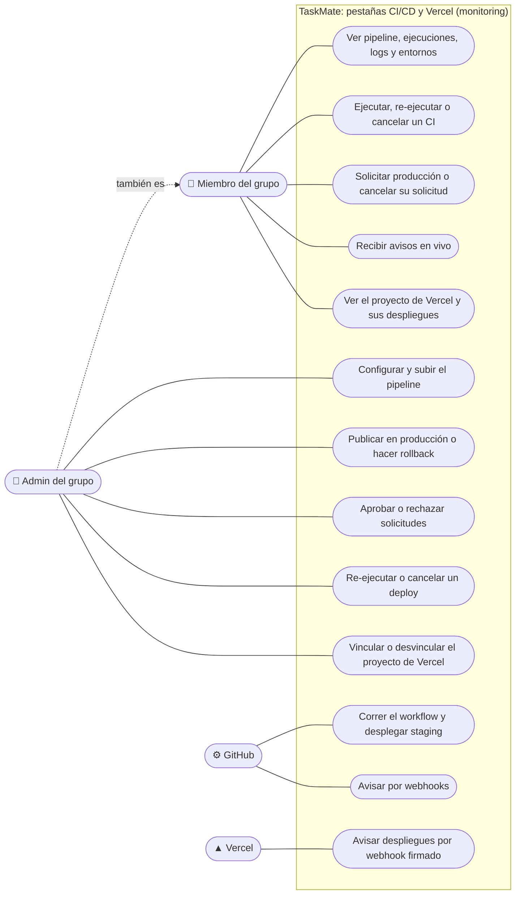

# CI/CD: casos de uso

**En una frase:** cualquier miembro ve el pipeline, las ejecuciones y los entornos, corre el CI, pide producción y ve los despliegues de Vercel; el admin del grupo configura el pipeline, publica, aprueba, hace rollback y vincula el proyecto de Vercel; GitHub corre el workflow y avisa, y Vercel avisa de sus despliegues.

- **Miembro:** cualquier usuario del grupo (fila en `UserGroups`).
- **Admin del grupo:** el usuario de `Groups.adminId`, que además debe seguir siendo miembro. Puede todo lo del miembro. Ser líder (tener un rol cuyo nombre contiene «leader») no basta.
- **GitHub:** actor del sistema. Corre el workflow cuando hay un push, un PR o un *dispatch* (lanzamiento a pedido desde TaskMate) y envía webhooks.
- **Vercel:** actor del sistema. Envía un webhook firmado por cada cambio de un despliegue. TaskMate no le pide nada a Vercel: solo escucha.

## Casos de uso

| Caso | Quién | Qué pasa |
|------|-------|----------|
| Ver pipeline, ejecuciones, logs y entornos | Miembro | Todo se lee en vivo de GitHub: jobs con sus pasos, anotaciones (errores y avisos con archivo y línea), el final del log (256 KB como máximo, con los secretos redactados), la versión de staging y de producción, y los últimos 15 deploys |
| Ejecutar, re-ejecutar o cancelar un CI | Miembro | «Run pipeline» lanza el workflow en una rama con `environment: none`: solo corre el job `ci`, nunca despliega. «Re-run failed» re-ejecuta los jobs fallidos de una ejecución terminada y «Cancel» cancela una en curso |
| Solicitar producción o cancelar su solicitud | Miembro | «Request production» solo pide la versión que está en staging, y solo si pasó el CI. Se crea una fila `pending` en `DeployRequests` y se avisa a los admins. Quien la pidió puede retirarla con «Cancel request» (`cancelled`) |
| Recibir avisos en vivo | Miembro | Ejecuciones fallidas, deploys y respuestas a sus solicitudes, por `/events`. Los despliegues de Vercel no llegan por aquí |
| Ver el proyecto de Vercel y sus despliegues | Miembro | La pestaña «Vercel (monitoring)» muestra el Project ID vinculado y los últimos 20 despliegues: estado, `production` o `preview`, rama, SHA, fecha, URL y, si falló, el mensaje de error. Se recarga al abrirla o con «Refresh». Sin proyecto vinculado, el miembro solo ve un aviso |
| Configurar y subir el pipeline | Admin | «Set up pipeline» o «Edit pipeline»: TaskMate detecta el proyecto (Node.js, Python o sitio estático) y propone las etapas. Si el grupo permite el análisis con IA, «Propose with AI» pide la propuesta a la IA. «Push to repository» valida, activa GitHub Pages si hay deploy, hace un commit de `.github/workflows/taskmate-ci.yml` en la rama principal y guarda `RepoPipelines` |
| Publicar en producción o hacer rollback | Admin | «Publish to production» despliega de inmediato una versión verificada. «Rollback…» elige una de las 10 versiones anteriores de producción |
| Aprobar o rechazar solicitudes | Admin | «Approve» lanza el deploy con el nombre de quien lo pidió. «Reject» guarda un motivo opcional (hasta 500 caracteres) |
| Re-ejecutar o cancelar un deploy | Admin | Solo el admin controla las ejecuciones de deploy que lanzó TaskMate: re-ejecutar un deploy viejo sería un rollback. TaskMate las reconoce por el título: «Deploy to production from TaskMate» o, en workflows subidos antes del 19 nov 2026, «Deploy a producción desde TaskMate» |
| Vincular o desvincular el proyecto de Vercel | Admin | Pega el Project ID de Vercel (Settings → General) y pulsa «Vincular»; se guarda en `GroupDeployTargets`. «Unlink» quita el vínculo sin pedir confirmación, y los despliegues ya guardados se quedan |
| Correr el workflow y desplegar staging | GitHub | CI en cada push y PR. Un push a la rama principal que pasa el CI se publica solo en staging |
| Avisar por webhooks | GitHub | `workflow_run`, `workflow_job` y `deployment_status` llegan a la API, que los reenvía a los miembros del grupo |
| Avisar despliegues por webhook firmado | Vercel | Eventos `deployment.*` a `POST /api/deploy/webhook/vercel`. La API guarda el despliegue en el grupo que vinculó ese Project ID; un evento de un proyecto sin vincular solo queda en la bitácora, como `ignored` |

## Reglas de permisos (verificadas en las rutas)

### Pipeline, ejecuciones y deploys

Todas las rutas van detrás de `requireAuth` (JWT válido) y del límite general de la API (300/min). Prefijo: `/api/github/groups/:gid`.

| Ruta | Guardia | Límite por usuario | Regla extra en el servicio |
|------|---------|--------------------|----------------------------|
| `GET pipeline`, `GET actions/*`, `GET deployments` | `requireGroupMember` | 60/min y 600/h | — |
| `POST pipeline/proposal`, `PUT pipeline` | `requireGroupAdmin` | 10/min | En la propuesta con `ai: true`, el grupo debe permitir la IA (`AI_ANALYSIS_DISABLED`) |
| `POST pipeline/preview` | `requireGroupAdmin` | 60/min | — |
| `POST actions/runs` | `requireGroupMember` | 10/min | Debe existir el pipeline y la rama |
| `POST actions/runs/:runId/rerun-failed`, `.../cancel` | `requireGroupMember` | 10/min | Si es un deploy lanzado por TaskMate (título `Deploy to …` o el viejo `Deploy a …`), solo el admin (`NOT_GROUP_ADMIN`, 403) |
| `POST deployments` | `requireGroupAdmin` | 10/min | El pipeline debe tener deploy (`DEPLOY_NOT_CONFIGURED`) y la versión, estar verificada (`VERSION_NOT_VERIFIED`) |
| `POST deploy-requests` | `requireGroupMember` | 10/min | Solo `production`, solo la versión de staging (`VERSION_NOT_STAGING`) y una pendiente por entorno (`DEPLOY_REQUEST_PENDING`) |
| `POST deploy-requests/:id/approve`, `.../reject` | `requireGroupAdmin` | 10/min | Solo si sigue `pending` (`DEPLOY_REQUEST_DECIDED`). Al aprobar, si cambió staging o el repositorio, se cancela (`DEPLOY_REQUEST_STALE`) |
| `POST deploy-requests/:id/cancel` | `requireGroupMember` | 10/min | Solo quien la pidió (`NOT_REQUESTER`, 403) |

- **Versión verificada:** TaskMate ya la publicó antes, o es un commit de la rama principal cuyo job «CI (…)» terminó en verde.
- **El permiso de TaskMate no es el de GitHub:** quien tiene escritura en el repositorio puede lanzar o editar el workflow desde GitHub. Por eso, para conectar el repositorio se exige ese mismo permiso de escritura (ver [guia-cicd.md](../07-guias/guia-cicd.md#10-quién-puede-hacer-qué) y las [limitaciones de GitHub y CI/CD](../01-proyecto/cierre-del-proyecto.md#github-y-cicd)).

### Monitoreo de Vercel

Las rutas de `/api/deploy/groups/:gid` también van detrás de `requireAuth` y del límite general (300/min). El webhook es la excepción.

| Ruta | Guardia | Límite por usuario | Regla extra |
|------|---------|--------------------|-------------|
| `GET target`, `GET deployments` | `requireGroupMember` | Solo el general | `provider` es `vercel` por defecto. `limit` va de 1 a 100 (20 por defecto); fuera de ese rango, `VALIDATION_ERROR` (400) |
| `PUT target` | `requireGroupAdmin` | 10/min | `projectRef` de 1 a 128 caracteres `[A-Za-z0-9_-]` (`VALIDATION_ERROR`, 400). Si el proyecto ya está en otro grupo, `CONFLICT` (409). Si el grupo ya tenía uno, lo reemplaza |
| `DELETE target` | `requireGroupAdmin` | Solo el general | Borra solo el vínculo; los despliegues se quedan |
| `POST /api/deploy/webhook/vercel` | Ninguna: sin JWT ni límite; lo protege la firma | — | HMAC-SHA1 de los bytes exactos en `x-vercel-signature` con `VERCEL_WEBHOOK_SECRET`. Si la firma no es válida o falta el secreto, `UNAUTHENTICATED` (401) |

- **Vincular no prueba que el proyecto sea del grupo:** TaskMate no consulta a Vercel. Cualquier admin puede vincular un Project ID libre y con formato válido, y desde entonces los eventos de ese proyecto (firmados con el único `VERCEL_WEBHOOK_SECRET` del servidor) se guardan en su grupo.
- **Solo Vercel:** las rutas aceptan `provider=aws`, pero no hay webhook de AWS; la interfaz siempre manda `vercel` ([limitaciones conocidas](../01-proyecto/cierre-del-proyecto.md#limitaciones-conocidas)).

## Para saber más

- Todos los casos de uso del sistema: [00-general.md](00-general.md)
- Pantalla de cada rol: [05-interfaz/08-cicd.md](../05-interfaz/08-cicd.md)
- Flujos y errores: [06-flujos/08-cicd.md](../06-flujos/08-cicd.md)
- Guía de uso completa: [guia-cicd.md](../07-guias/guia-cicd.md)
- Monitoreo de Vercel en la línea de Christian: [09-linea-christian/README.md](../09-linea-christian/README.md)
