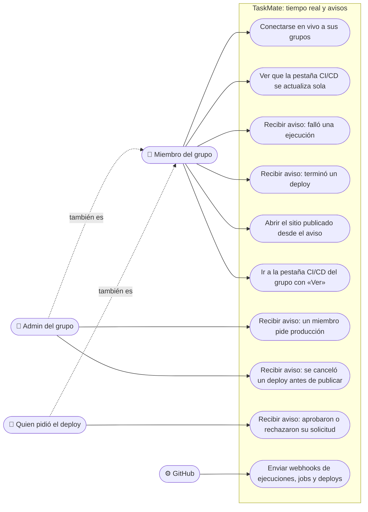

# Tiempo real y avisos: casos de uso

**En una frase:** cada miembro con TaskMate abierto recibe en vivo los eventos de CI/CD de sus grupos; el navegador decide qué aviso ve cada uno según su papel (miembro, admin o quien pidió el deploy).

Términos:
- **Evento**: mensaje corto que la API empuja por `/events` (`ci_run`, `ci_job`, `deployment` o `deploy_request`).
- **Aviso**: la notificación que aparece abajo a la derecha; no todo evento produce uno.
- **Admin del grupo**: el usuario en `Groups.adminId`; hay uno por grupo.

## Casos de uso

| Caso | Quién puede | Qué pasa |
|---|---|---|
| Conectarse en vivo | Cualquier usuario con sesión | Al iniciar sesión se abre `/events` y se suscribe a todos sus grupos. El servidor solo deja aquellos donde es miembro |
| Pantallas que se actualizan solas | Miembro | Ejecuciones, detalle de una ejecución y entornos se recargan al llegar `ci_run`, `ci_job`, `deployment` o `deploy_request` de ese grupo |
| Falló una ejecución | Miembro | «[Grupo] Falló «*título*» en *rama*.» Solo si terminó en `failure`, `timed_out` o `startup_failure` |
| Terminó un deploy | Miembro | Éxito: «[Grupo] Staging se actualizó con `abc1234`.», con el botón «Abrir sitio». Fallo: «[Grupo] Falló el deploy de `abc1234` a producción.» |
| «Ver» | Miembro | Elige ese grupo y abre `/github?tab=cicd` |
| Un miembro pide producción | Admin, si no es quien la pidió | «[Grupo] *usuario* pide publicar `abc1234` en producción.» |
| Deploy cancelado antes de publicar | Admin | «[Grupo] Se canceló «*título*» antes de publicar.» |
| Aprobaron o rechazaron su solicitud | Quien la pidió | «[Grupo] *admin* aprobó tu solicitud…» o «…rechazó tu solicitud de `abc1234`. Motivo: …» |
| Enviar webhooks | GitHub (sistema) | `workflow_run`, `workflow_job` y `deployment_status` llegan firmados; la API los reparte a los grupos del repositorio |

- Los avisos no se guardan. Lo que pasó con la pestaña cerrada se ve en la pestaña CI/CD.
- Una solicitud cancelada (por quien la pidió, o por TaskMate porque ya no aplica) no da aviso: solo recarga la lista de solicitudes.
- Un deploy que falla da un solo aviso, el del deploy; no llega además el de su ejecución.

## Reglas de permisos

Verificadas en `WebSocketServer.js`, `realtime.js`, `github.controller.js` y `CicdNotifications.jsx`.

| Regla | Dónde se aplica | Si no se cumple |
|---|---|---|
| El `Origin` debe estar en `FRONTEND_URL` (o faltar, como en clientes que no son navegadores) | Upgrade del WebSocket | HTTP 403, no se abre |
| JWT de acceso válido en `?token=` (HS256, `typ: access`, sin vencer) | Upgrade del WebSocket | HTTP 401, no se abre |
| Solo grupos donde el usuario es miembro (`UserGroups`), máx. 50, ids con formato UUID | `subscribe` | El grupo se omite en silencio |
| La membresía se vuelve a comprobar antes de entregar si tiene más de 5 min | Entrega de cada evento | Deja de recibir ese grupo |
| Un socket solo recibe eventos de los grupos de su lista | Hub | No le llega |
| Máx. 20 `subscribe` por minuto por socket y 10 sockets `/events` por usuario | Servidor WebSocket | `RATE_LIMITED`, o se cierra el socket más viejo |
| El webhook debe traer una firma HMAC válida | `POST /api/github/webhook` | 401, no se publica nada |
| Pedir producción: miembro. Aprobar o rechazar: admin. Cancelar: quien la pidió | Rutas `deploy-requests` (`requireGroupMember`, `requireGroupAdmin`) | 403 (`NOT_REQUESTER` al cancelar una ajena), sin evento |

- **Qué aviso ve cada papel lo decide el navegador.** Todos los miembros reciben los mismos eventos del grupo; `CicdNotifications` filtra los avisos con `adminId` del grupo y el id del usuario. Esos datos ya los ve cualquier miembro en la pestaña CI/CD.
- **Datos mínimos.** Un evento nunca lleva el payload crudo de GitHub: textos de máx. 300 caracteres y URLs solo `https://` (sitio) o `https://github.com/` (logs).
- **Líder de equipo:** no cambia nada en este módulo.

## Para saber más

- Arquitectura: [02-arquitectura/09-tiempo-real-y-avisos.md](../02-arquitectura/09-tiempo-real-y-avisos.md)
- Pantallas: [05-interfaz/09-tiempo-real-y-avisos.md](../05-interfaz/09-tiempo-real-y-avisos.md)
- Paso a paso y errores: [06-flujos/09-tiempo-real-y-avisos.md](../06-flujos/09-tiempo-real-y-avisos.md)
- Pedir, aprobar y desplegar: [08-cicd.md](08-cicd.md)
- Todos los casos de uso: [00-general.md](00-general.md)
- Guía de uso: [notificaciones](../07-guias/guia-cicd.md#9-notificaciones)
