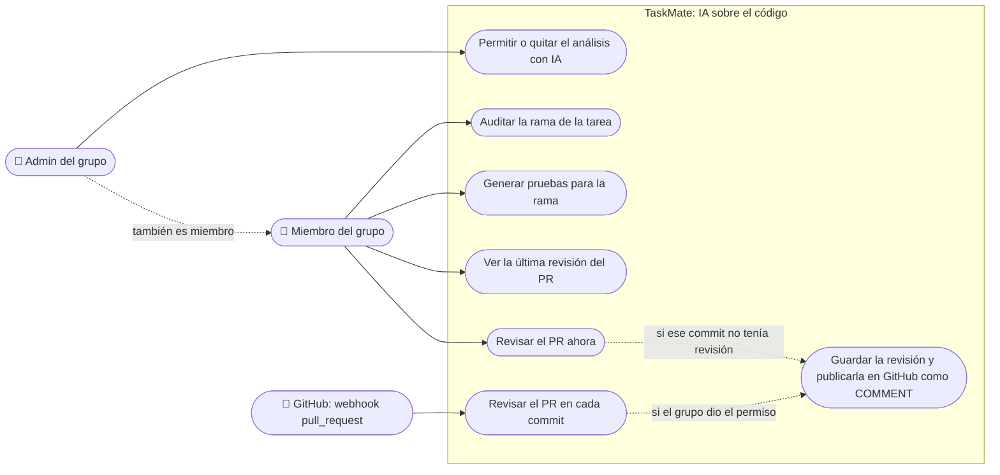

# IA sobre el código: casos de uso

**En una frase:** el admin decide si el grupo permite el análisis con IA; con ese permiso, cualquier miembro audita la rama de una tarea, pide pruebas propuestas o revisa su PR, y GitHub, por webhook, hace que cada commit nuevo del PR se revise solo.

Todo se usa desde el diálogo «Task files» de una tarea con rama, en el panel «AI on the branch». Es de la línea de Christian y vive en `test/e2e`.

## Casos de uso

| Caso | Quién puede | Qué pasa |
|---|---|---|
| Permitir o quitar el análisis con IA | Admin (pestaña Repository de `/github`) | Interruptor «Allow AI analysis». Es el mismo permiso que el análisis del repositorio desde el chat. Empieza apagado y se apaga solo al cambiar de repo. Sin él, el panel solo muestra un aviso y el webhook no revisa |
| Auditar la rama de la tarea | Miembro del grupo de la tarea, con el permiso | «Audit»: reglas fijas y el modelo local revisan las líneas añadidas (hasta 15 archivos de código). Sale un veredicto (`pass`, `warn` o `fail`) y la lista de hallazgos. No se guarda en TaskMate |
| Generar pruebas para la rama | Miembro, con el permiso | «Generate tests»: propone hasta 5 archivos de pruebas (pytest para `.py`; Jest para `.js`, `.jsx`, `.ts` y `.tsx`). No se ejecutan ni se suben: el miembro las revisa y las copia |
| Ver la última revisión del PR | Miembro | Al abrir el panel se carga la más nueva: veredicto, resumen, riesgos y si se publicó en GitHub. La API no pide el permiso de IA para leerla, pero el panel solo la carga con él |
| Revisar el PR ahora | Miembro, con el permiso y con el PR de la tarea abierto | «Review PR» revisa el último commit del PR. Si ese commit ya tenía revisión, aunque haya fallado, no hace nada y devuelve la guardada |
| Revisar el PR en cada commit | GitHub (webhook `pull_request`: `opened`, `synchronize`, `ready_for_review` o `reopened`) | Si el PR está abierto, no es borrador, sale de la rama de una tarea y el grupo dio el permiso, la revisión corre en segundo plano. Una por commit |
| Guardar y publicar la revisión | El sistema | Queda en `AiReviews` y va a GitHub como revisión `COMMENT` (nunca aprueba ni pide cambios), con comentarios en línea. Sin el permiso «Pull requests: write» de la App, queda guardada como no publicada |

## Reglas de permiso

Verificadas en `taskmate-api/controllers/github.controller.js`, `services/aiServer/taskAi.js`, `services/aiServer/prReview.js` y `middleware/groupAccess.js`. Las rutas van bajo `/api/github` y piden JWT (`requireAuth`).

| Qué | Guardia | Quién pasa |
|---|---|---|
| `POST /tasks/:tid/audit` | `requireResourceMember('task')` + 5 por minuto (compartido) + `ai_analysis_enabled` | Miembro del grupo dueño de la tarea, si el admin dio el permiso. La tarea necesita rama (`TASK_NO_BRANCH`) y cambios frente a su base (`NOTHING_TO_REVIEW`) |
| `POST /tasks/:tid/generate-tests` | Igual que `audit` | Igual que `audit` |
| `GET /tasks/:tid/review` | `requireResourceMember('task')`, sin límite propio (solo el general de 300 por minuto) | Miembro; no pide el permiso de IA |
| `POST /tasks/:tid/review` | `requireResourceMember('task')` + 5 por minuto (compartido) + PR abierto + `ai_analysis_enabled` | Miembro, si la tarea tiene un PR abierto (`NO_OPEN_PR`) y el admin dio el permiso |
| `PUT /groups/:gid/ai-analysis` | `requireGroupAdmin` | Admin |
| `POST /webhook` (evento `pull_request`) | Firma HMAC `X-Hub-Signature-256` | Solo GitHub. Revisa solo si hay `AI_SERVER_URL` y el grupo dio el permiso |
| API → servidor de IA local | Cabecera `X-AI-Server-Secret` (`AI_SERVER_SECRET`, 32 caracteres o más) | Solo la API y el servicio Python del chat |
| Publicar en GitHub | Permiso `pull_requests: write` de la App en la instalación | Opcional. Sin él, la revisión queda como `no_permission` |

Notas:
- **Miembro** basta: no hace falta ser admin ni líder para auditar, generar pruebas o revisar. **Admin** es el usuario de `Groups.adminId`.
- El límite de 5 por minuto es **uno solo por usuario** para las tres acciones (`audit`, `generate-tests` y `POST review`), porque cada una ocupa la GPU unos 20 s. El webhook no tiene límite: lo frena la regla de una revisión por commit.
- Una tarea completada ya no está en `Tasks`: las rutas responden `TASK_NOT_FOUND` (404). Un usuario de otro grupo recibe 403.
- Un commit cuya revisión falló no se vuelve a revisar, ni pidiéndolo a mano: hace falta un commit nuevo ([limitaciones conocidas](../01-proyecto/cierre-del-proyecto.md#limitaciones-conocidas)).
- La interfaz esconde los botones sin el permiso o sin PR abierto, pero quien decide es la API.

## Para saber más

- Todos los actores y permisos de TaskMate: [00-general.md](00-general.md) y [permisos por rol](00-permisos-por-rol.md)
- La rama de la tarea y el permiso de IA: [casos de uso de GitHub](07-github.md)
- Arquitectura del módulo: [02-arquitectura/10-ia-sobre-el-codigo.md](../02-arquitectura/10-ia-sobre-el-codigo.md)
- Pantallas: [05-interfaz/10-ia-sobre-el-codigo.md](../05-interfaz/10-ia-sobre-el-codigo.md)
- Paso a paso y mensajes de error: [06-flujos/10-ia-sobre-el-codigo.md](../06-flujos/10-ia-sobre-el-codigo.md)
- Limitaciones conocidas: [cierre de la línea de Pablo y estado](../01-proyecto/cierre-del-proyecto.md#limitaciones-conocidas)
