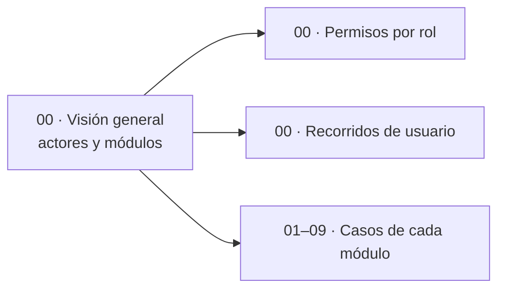

# 04 · Casos de uso

**En una frase:** quién usa TaskMate (usuario, miembro, líder, admin y GitHub) y qué puede hacer cada uno, en general y en cada uno de los 9 módulos.

## Páginas generales

| Página | Qué explica |
|---|---|
| [Visión general](00-general.md) | El diagrama de actores y módulos, y las reglas que conviene saber |
| [Permisos por rol](00-permisos-por-rol.md) | Referencia: qué puede hacer cada rol en cada módulo, tal como lo revisa la API |
| [Recorridos de usuario](00-recorridos-de-usuario.md) | Cuatro recorridos paso a paso: usuario nuevo, miembro, admin y líder |

## Páginas por módulo

| Módulo | Qué explica |
|---|---|
| [1 · Usuarios y acceso](01-usuarios-y-acceso.md) | Crear cuenta, iniciar sesión y usar la app hasta salir o hasta que el token vence (24 h) |
| [2 · Grupos y roles](02-grupos-y-roles.md) | Cualquiera crea grupos; los miembros ven y salen; solo el admin agrega, quita y maneja roles |
| [3 · Tareas](03-tareas.md) | Cualquier miembro del grupo activo maneja cualquier tarea; GitHub la completa al fusionar su PR |
| [4 · Hitos y calendario](04-hitos-y-calendario.md) | Cualquier miembro crea, conecta, edita y borra hitos y ve el calendario; sin permisos extra |
| [5 · Chat con IA](05-chat-ia.md) | Conversar con la IA y crear un proyecto desde su plan; usar un proyecto como contexto pide ser miembro |
| [6 · Analytics](06-analytics.md) | El líder ve el panel y pide recomendaciones de asignación; lo demás es solo de API o automático |
| [7 · GitHub](07-github.md) | El admin conecta y gobierna el repositorio; los miembros lo exploran, crean ramas y piden propuestas |
| [8 · CI/CD](08-cicd.md) | Los miembros ven, corren el CI y piden producción; el admin configura, publica, aprueba y hace rollback |
| [9 · Tiempo real y avisos](09-tiempo-real-y-avisos.md) | Cada miembro recibe en vivo los eventos de CI/CD de sus grupos y el aviso que le toca según su papel |

## Diagramas e imágenes

- Los diagramas de estas páginas son bloques Mermaid (los de casos de uso son flowcharts con actores y casos).
- Su copia en PNG está en [`imagenes/`](imagenes/), con el nombre `<página>-<n>.png` (n = orden del diagrama en la página).

## Para saber más

- Cómo se ve cada caso: [05-interfaz](../05-interfaz/README.md).
- Qué puede hacer cada rol, pantalla por pantalla: [guía de uso](../07-guias/guia-de-uso.md).
- Todas las funcionalidades en una tabla: [funcionalidades](../01-proyecto/funcionalidades.md).
- [Índice de la documentación](../README.md).
