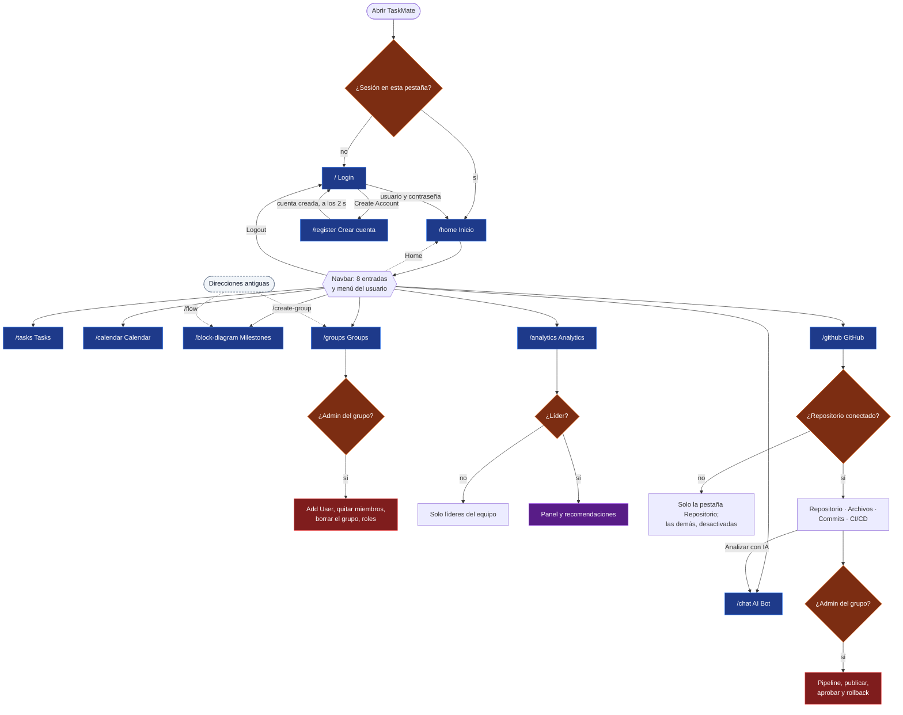
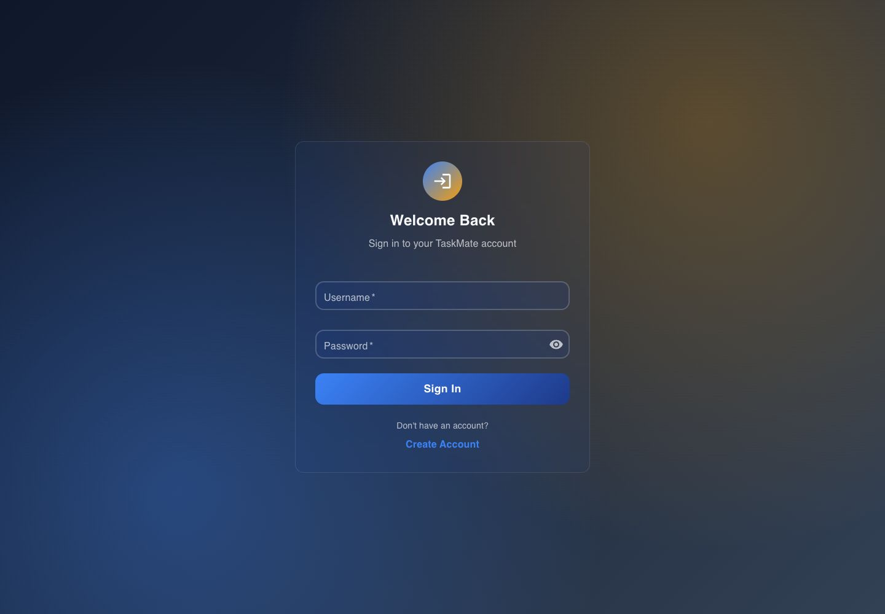
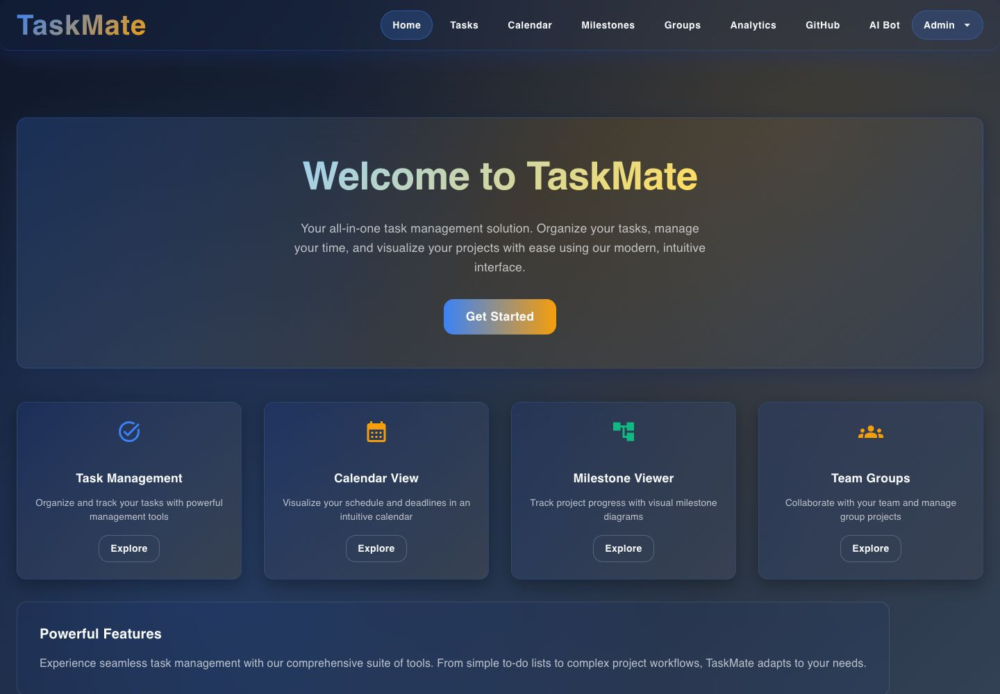
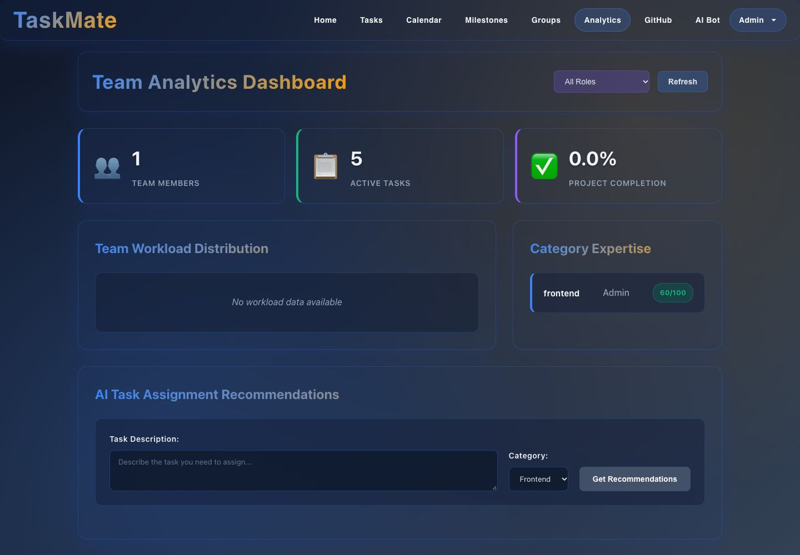
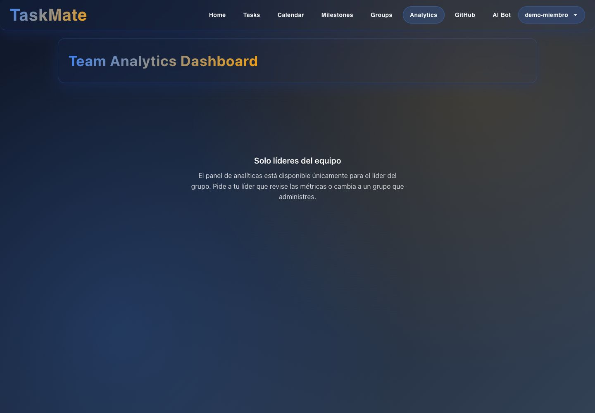

# Interfaz: visión general

**En una frase:** el mapa de pantallas de TaskMate, cómo se navega entre ellas y qué partes se repiten en todas.

- Azul = pantalla con su ruta. Marrón = control de rol o de estado. Rojo = solo el admin. Morado = solo líderes. Punteado = redirección o vuelta a Home.
- Todas las rutas, salvo `/` y `/register`, exigen sesión. Ninguna ruta está cerrada por rol: los roles se aplican **dentro** de cada pantalla.

| Login (sin sesión) | Inicio (`/home`) |
|---|---|
|  |  |

## El marco común

Con sesión, todas las pantallas comparten tres piezas:

| Pieza | Qué hace | Dónde está |
|---|---|---|
| **Navbar** (barra superior) | Logo «TaskMate» (vuelve a `/home`), las 8 entradas y el menú con el nombre del usuario, que tiene **Logout** | `src/components/Navbar.jsx` |
| **Grupo activo** | El grupo con el que trabajan Tasks, Calendar, Milestones, Analytics y GitHub. Se elige en **Groups** con el botón **Use**. Al iniciar sesión se activa el primer grupo de la lista | `src/components/GroupContext.jsx` |
| **Avisos de CI/CD** | Mensajes abajo a la derecha (fallos, deploys, solicitudes). **Ver** activa ese grupo y abre su pestaña CI/CD | `src/components/realtime/CicdNotifications.jsx` |

- No hay selector de grupo en la navbar. Sin grupo activo, cada pantalla pide elegir uno (por ejemplo, «Selecciona un grupo para gestionar tareas.»).
- El chat elige su proyecto aparte, con su propio selector.
- El grupo activo se guarda en el navegador (`localStorage`), así que sobrevive a una recarga.

## Pantallas

| Ruta | Menú | Qué muestra | Módulo |
|---|---|---|---|
| `/` | — | Iniciar sesión | [Usuarios y acceso](01-usuarios-y-acceso.md) |
| `/register` | — | Crear cuenta (también crea un grupo personal) | [Usuarios y acceso](01-usuarios-y-acceso.md) |
| `/home` | Home | «Get Started» y tarjetas a Tasks, Calendar, Milestones y Groups | Esta página |
| `/tasks` | Tasks | Listas de tareas, asignaciones, completadas y papelera | [Tareas](03-tareas.md) |
| `/calendar` | Calendar | Calendario mensual con tareas e hitos | [Hitos y calendario](04-hitos-y-calendario.md) |
| `/block-diagram` | Milestones | Diagrama de hitos con su avance | [Hitos y calendario](04-hitos-y-calendario.md) |
| `/groups` | Groups | Grupos, miembros y roles | [Grupos y roles](02-grupos-y-roles.md) |
| `/analytics` | Analytics | Panel del equipo (solo líderes) | [Analytics](06-analytics.md) |
| `/github` | GitHub | Pestañas Repositorio, Archivos y Commits | [GitHub](07-github.md) |
| `/github` (pestaña CI/CD) | GitHub | Pipeline, ejecuciones y despliegues. `/github?tab=cicd` abre esta pestaña | [CI/CD](08-cicd.md) |
| `/chat` | AI Bot | Chat con la IA y análisis del repositorio | [Chat IA](05-chat-ia.md) |
| (todas) | — | Avisos en vivo | [Tiempo real y avisos](09-tiempo-real-y-avisos.md) |

**La misma pantalla según el rol** (Analytics):

| Admin (cuenta como líder) | Miembro sin rol de líder |
|---|---|
|  |  |

## Rutas que redirigen

| Ruta | Con sesión | Sin sesión |
|---|---|---|
| `/` y `/register` | `/home` | Se muestran |
| `/flow` (dirección antigua) | `/block-diagram` | `/` |
| `/create-group` (dirección antigua) | `/groups` | `/` |
| Cualquier otra | `/home` | `/` |

`/flow` y `/create-group` ya no tienen pantalla propia: el diagrama de hitos vive en Milestones y los grupos se crean en Groups.

## Sesión
1. Al iniciar sesión, la API entrega un JWT (token firmado) de 24 h y el navegador lo guarda.
2. Una pestaña o ventana nueva del navegador empieza sin sesión. Recargar la misma pestaña la conserva.
3. Si la API responde que el token ya no vale, la app cierra la sesión y vuelve a `/`.

## Dónde está en el código

| Archivo | Qué hace |
|---|---|
| `src/App.js` | Rutas, redirecciones y manejo de la sesión |
| `src/components/HomePage.jsx` | Pantalla de inicio |
| `src/components/realtime/RealtimeContext.jsx` | Conexión en vivo `/events` para los avisos |
| `src/theme/` | Tema visual de MUI (la librería de componentes) |
| `src/__tests__/AppLegacyRoutes.test.jsx` | Pruebas de las redirecciones de `/register`, `/flow` y `/create-group` |

## Para saber más
- Qué puede hacer cada rol: [casos de uso](../04-casos-de-uso/00-general.md) y [permisos por rol](../04-casos-de-uso/00-permisos-por-rol.md).
- Recorridos paso a paso: [recorridos de usuario](../04-casos-de-uso/00-recorridos-de-usuario.md).
- Componentes del frontend: [arquitectura](../02-arquitectura/00-general.md).
- Problemas conocidos de la interfaz: [cierre del proyecto](../01-proyecto/cierre-del-proyecto.md#limitaciones-conocidas).
