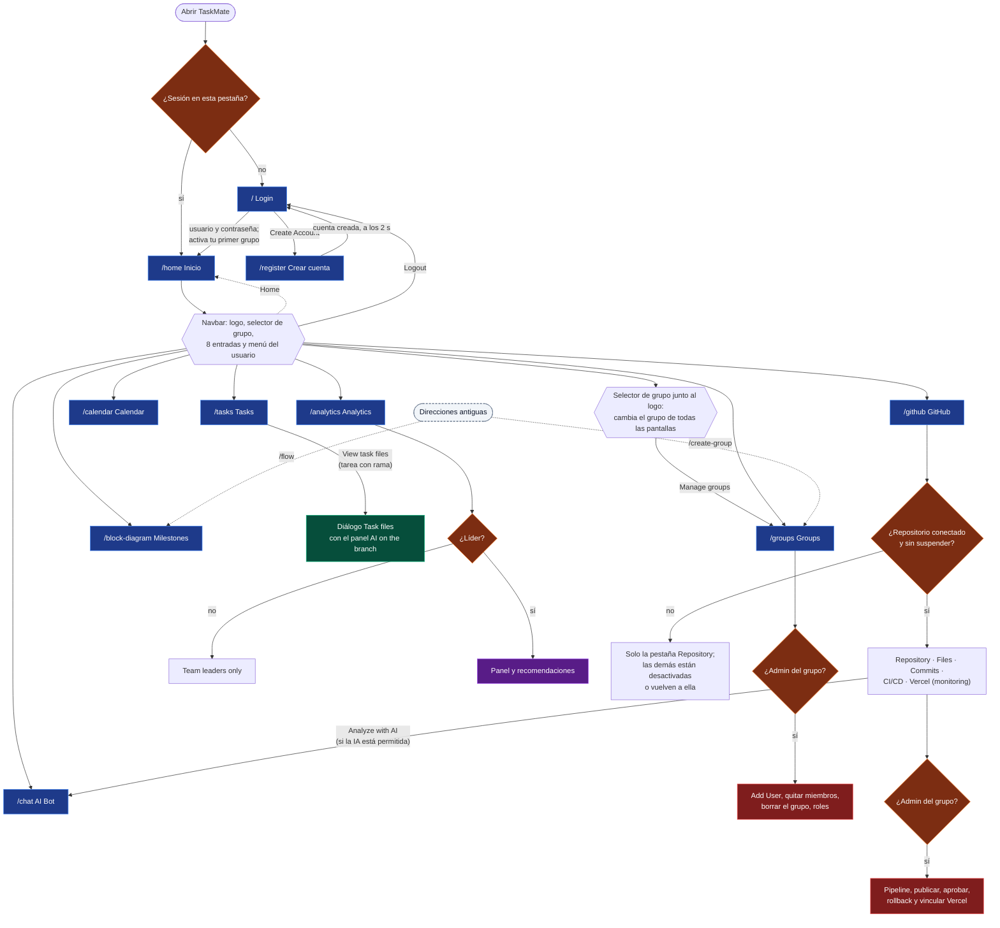
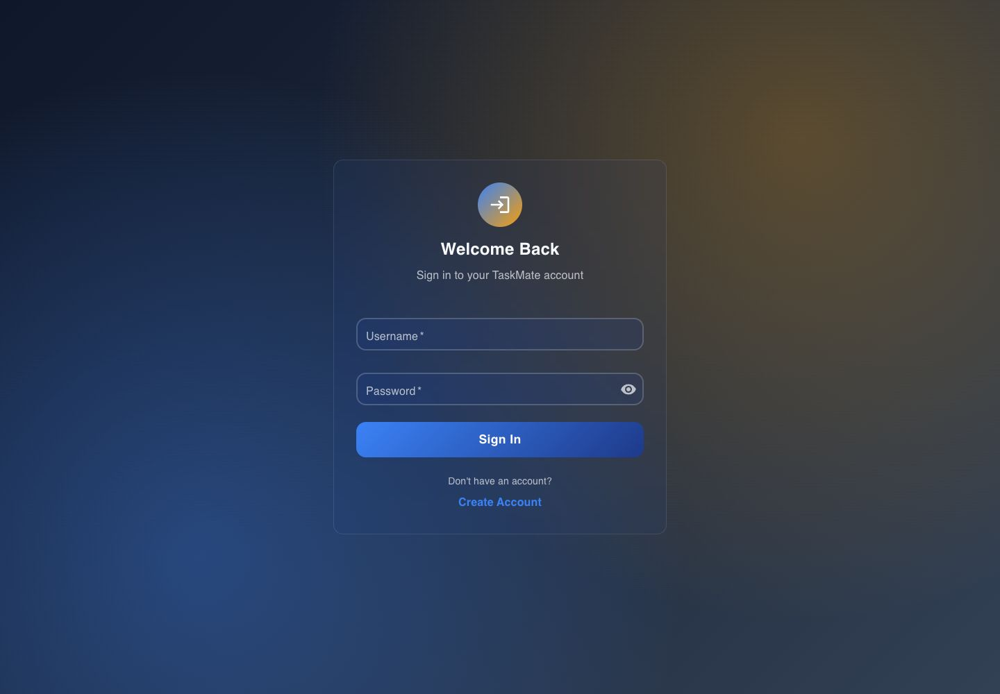
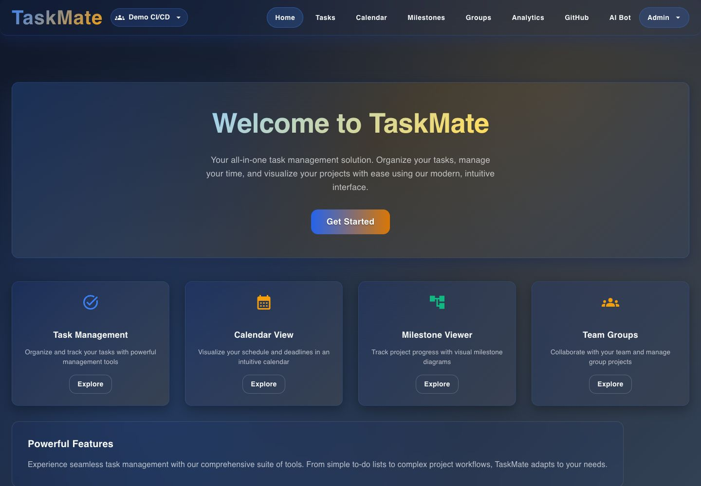
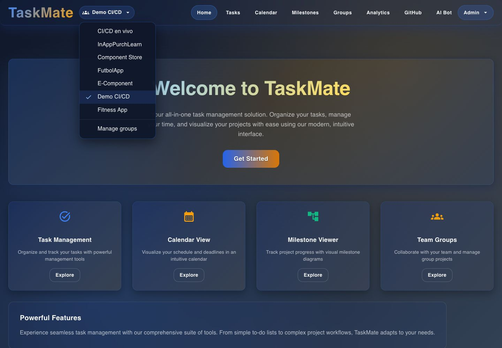
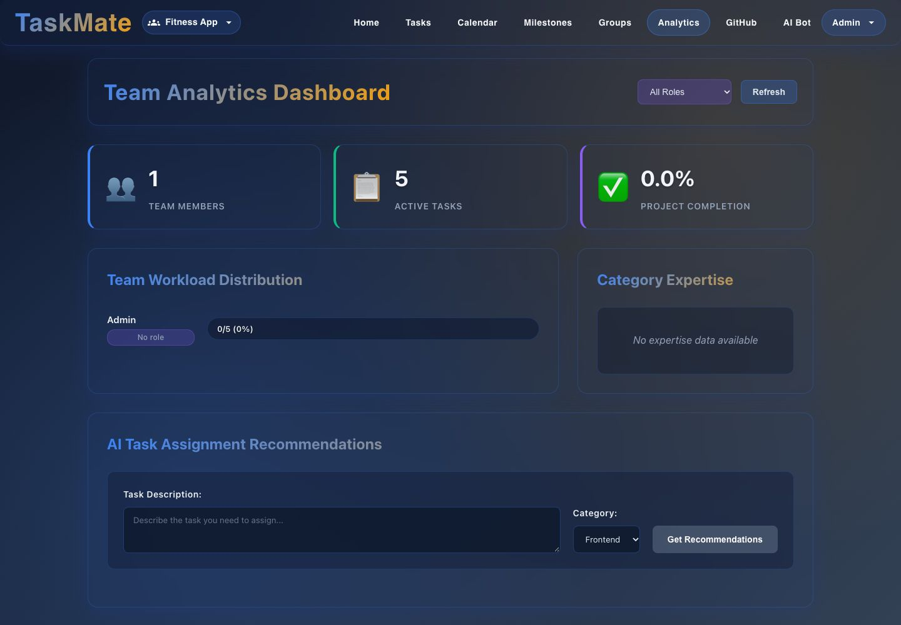
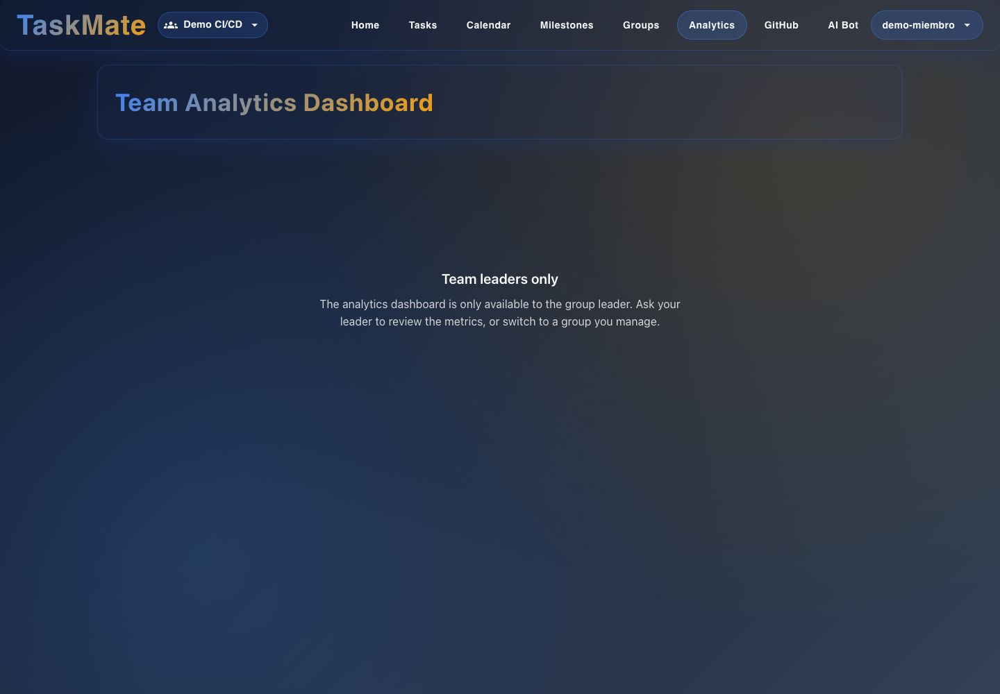

# Interfaz: visión general

**En una frase:** el mapa de pantallas de TaskMate, cómo se navega entre ellas y qué partes se repiten en todas.

- Azul = pantalla con su ruta. Verde = diálogo que se abre dentro de una pantalla. Marrón = control de rol o de estado. Rojo = solo el admin. Morado = solo líderes. Punteado = redirección o vuelta a Home.
- Todas las rutas, salvo `/` y `/register`, exigen sesión. Ninguna ruta está cerrada por rol: los roles se aplican **dentro** de cada pantalla.
- Los textos de la app se citan en inglés, como se ven desde el 19 nov 2026. Quedan unos pocos en español: ver [limitaciones](../01-proyecto/cierre-del-proyecto.md#interfaz).

| Login (sin sesión) | Inicio (`/home`) |
|---|---|
|  |  |

Capturas del 26 nov 2026. En Inicio, junto al logo, el selector de grupo muestra «Demo CI/CD» ([todas las capturas](README.md#galería-de-capturas)).

## El marco común

Con sesión, todas las pantallas comparten cuatro piezas:

| Pieza | Qué hace | Dónde está |
|---|---|---|
| **Navbar** (barra superior) | Logo «TaskMate» (vuelve a `/home`), el selector de grupo, las 8 entradas (Home, Tasks, Calendar, Milestones, Groups, Analytics, GitHub y AI Bot) y el menú con el nombre del usuario, que tiene **Logout** | `src/components/Navbar.jsx` |
| **Selector de grupo** (junto al logo) | Muestra el grupo activo, o «Select a group» si no hay. Su menú lista tus grupos, con una palomita en el activo, y termina en **Manage groups**, que lleva a `/groups`. Elegir otro grupo cambia el de todas las pantallas. No tiene opción «ninguno» | `src/components/NavGroupSelector.jsx` |
| **Grupo activo** | El grupo con el que trabajan Tasks, Calendar, Milestones, Analytics, GitHub y el chat. Se cambia con el selector de grupo o con un clic en el grupo dentro de **Groups**. Al iniciar sesión se activa el primer grupo de tu lista | `src/components/GroupContext.jsx` |
| **Avisos de CI/CD** | Mensajes abajo a la derecha (fallos, deploys, solicitudes). **View** activa ese grupo y abre su pestaña CI/CD; **Open site** abre el sitio publicado, si el aviso lo trae | `src/components/realtime/CicdNotifications.jsx` |

**El selector de grupo abierto** (aquí en `/home`): los 7 grupos del admin, la palomita en el activo («Demo CI/CD») y, separado abajo, «Manage groups».

- Sin grupo activo, cada pantalla pide elegir uno (por ejemplo, «Select a group to manage tasks.»). Casi no pasa: al registrarte se crea tu grupo personal y al iniciar sesión se activa el primero.
- El chat no tiene selector propio: usa el grupo del navbar, lo muestra arriba como «Project: &lt;grupo&gt;» y cambia de proyecto cuando cambias el grupo. «Analyze with AI» de `/github` también fija ese grupo antes de abrir el chat.
- Si estás en `/groups` y eliges otro grupo en el selector, se abren los detalles de ese grupo.
- El selector vuelve a pedir tu lista de grupos cada vez que lo abres, así que ve los grupos nuevos sin recargar.
- El grupo activo se guarda en el navegador (`localStorage`), así que sobrevive a una recarga.

## Pantallas

| Ruta | Menú | Qué muestra | Módulo |
|---|---|---|---|
| `/` | — | Iniciar sesión | [Usuarios y acceso](01-usuarios-y-acceso.md) |
| `/register` | — | Crear cuenta (también crea un grupo personal) | [Usuarios y acceso](01-usuarios-y-acceso.md) |
| `/home` | Home | «Get Started» y tarjetas a Tasks, Calendar, Milestones y Groups | Esta página |
| `/tasks` | Tasks | Listas de tareas, asignaciones, completadas y papelera. Con repositorio conectado, la rama y el PR de cada tarea | [Tareas](03-tareas.md) |
| `/tasks` (diálogo «Task files») | Tasks | Se abre con «View task files» en una tarea con rama: los archivos que cambió, «Also changed by: …» y el panel «AI on the branch» («Audit», «Generate tests» y «Review PR») | [GitHub](07-github.md) y [IA sobre el código](10-ia-sobre-el-codigo.md) |
| `/calendar` | Calendar | Calendario mensual con tareas e hitos | [Hitos y calendario](04-hitos-y-calendario.md) |
| `/block-diagram` | Milestones | Diagrama de hitos con su avance | [Hitos y calendario](04-hitos-y-calendario.md) |
| `/groups` | Groups | Grupos, miembros y roles. Un clic en un grupo lo vuelve el activo | [Grupos y roles](02-grupos-y-roles.md) |
| `/analytics` | Analytics | Panel del equipo (solo líderes) | [Analytics](06-analytics.md) |
| `/github` | GitHub | Pestañas Repository, Files y Commits; arriba, «Sync PRs» y «Analyze with AI» | [GitHub](07-github.md) |
| `/github` (pestaña CI/CD) | GitHub | Pipeline, ejecuciones y despliegues. `/github?tab=cicd` abre esta pestaña | [CI/CD](08-cicd.md) |
| `/github` (pestaña «Vercel (monitoring)») | GitHub | Los últimos 20 despliegues que avisó Vercel; se recargan con «Refresh». El admin vincula el proyecto con su «Vercel Project ID». Sin repositorio conectado vuelve a Repository | [CI/CD](08-cicd.md) |
| `/chat` | AI Bot | Chat con la IA sobre el grupo activo: respuestas en streaming, «Propose tasks» y análisis del repositorio | [Chat IA](05-chat-ia.md) |
| (todas) | — | Avisos en vivo | [Tiempo real y avisos](09-tiempo-real-y-avisos.md) |

**La misma pantalla según el rol** (Analytics):

| Admin (cuenta como líder) | Miembro sin rol de líder |
|---|---|
|  |  |

## Rutas que redirigen

| Ruta | Con sesión | Sin sesión |
|---|---|---|
| `/` y `/register` | `/home` | Se muestran |
| `/flow` (dirección antigua) | `/block-diagram` | `/` |
| `/create-group` (dirección antigua) | `/groups` | `/` |
| Cualquier otra | `/home` | `/` |

`/flow` y `/create-group` ya no tienen pantalla propia: el diagrama de hitos vive en Milestones y los grupos se crean en Groups.

## Sesión
1. Al iniciar sesión, la API entrega un JWT (token firmado) de 24 h y el navegador lo guarda.
2. Una pestaña o ventana nueva del navegador empieza sin sesión. Recargar la misma pestaña la conserva.
3. Si la API responde que el token ya no vale, la app cierra la sesión y vuelve a `/`.

## Carga bajo demanda
- Cada pantalla, la Navbar y los avisos de CI/CD se descargan la primera vez que hacen falta (`React.lazy`). Mientras tanto se ve un círculo de carga.
- En `/github`, las pestañas CI/CD y «Vercel (monitoring)» también se descargan la primera vez que se abren, con su propio círculo de carga.

## Dónde está en el código

| Archivo | Qué hace |
|---|---|
| `src/App.js` | Rutas, redirecciones, manejo de la sesión y carga bajo demanda de las pantallas, la Navbar y los avisos |
| `src/components/Navbar.jsx` | Barra superior: logo, selector de grupo, 8 entradas y menú del usuario |
| `src/components/NavGroupSelector.jsx` | Selector de grupo junto al logo, con «Manage groups» |
| `src/components/GroupContext.jsx` | Grupo activo y lista de grupos; guarda el grupo en `localStorage` |
| `src/components/HomePage.jsx` | Pantalla de inicio |
| `src/components/github/GitHubPage.jsx` | Las 5 pestañas de `/github`; carga CI/CD y «Vercel (monitoring)» bajo demanda |
| `src/components/realtime/RealtimeContext.jsx` | Conexión en vivo `/events` para los avisos |
| `src/theme/` | Tema visual de MUI (la librería de componentes) |
| `src/__tests__/AppLegacyRoutes.test.jsx` | Pruebas de las redirecciones de `/register`, `/flow` y `/create-group` |
| `src/__tests__/AppUnknownRoute.test.jsx` | Pruebas de las rutas desconocidas (a `/home` con sesión, a `/` sin ella) |
| `src/components/__tests__/NavGroupSelector.test.jsx` | Pruebas del selector: muestra el grupo activo, cambia a otro y pide elegir uno si no hay |

## Para saber más
- Qué puede hacer cada rol: [casos de uso](../04-casos-de-uso/00-general.md) y [permisos por rol](../04-casos-de-uso/00-permisos-por-rol.md).
- Recorridos paso a paso: [recorridos de usuario](../04-casos-de-uso/00-recorridos-de-usuario.md).
- Componentes del frontend: [arquitectura](../02-arquitectura/00-general.md).
- Problemas conocidos de la interfaz: [cierre de la línea de Pablo y estado](../01-proyecto/cierre-del-proyecto.md#limitaciones-conocidas).
