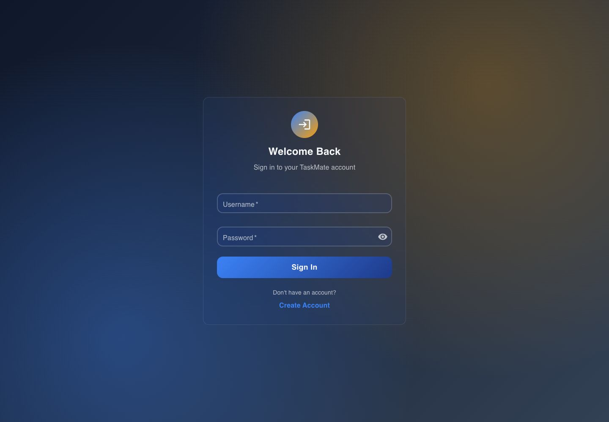
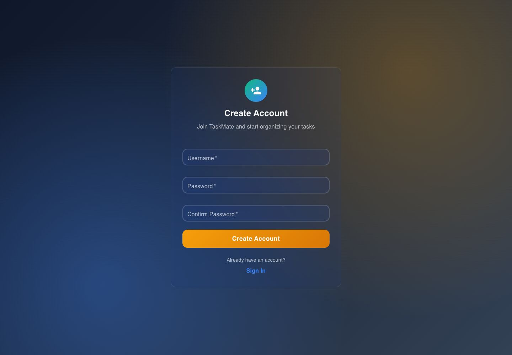
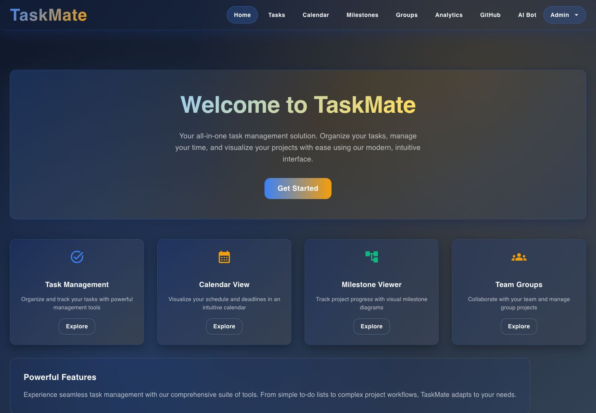
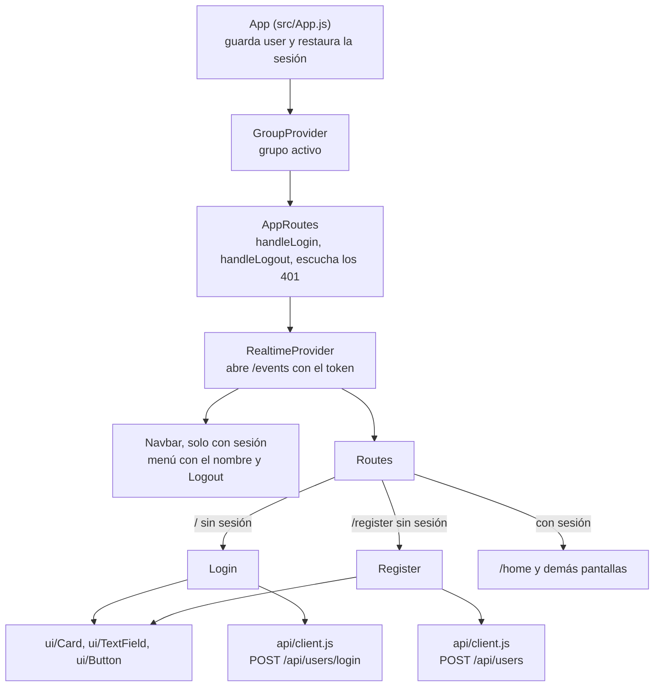

# Usuarios y acceso: interfaz

**En una frase:** dos pantallas sin sesión, «Sign In» (`/`) y «Create Account» (`/register`), y un menú con tu nombre en la barra de navegación para salir.

## Pantallas

**Iniciar sesión (`/`)**

**Crear cuenta (`/register`)**

**Con sesión: el menú con tu nombre** (arriba a la derecha, aquí «Admin») tiene la opción «Logout».

## Qué puedes hacer

**Sin sesión (visitante)**
- En «Sign In»: escribir usuario y contraseña, mostrar u ocultar la contraseña con el ojo y entrar.
- Pasar a «Create Account» con el enlace de abajo, y volver con «Sign In».
- En «Create Account», el formulario revisa antes de enviar:
  - usuario de 3 a 20 caracteres: letras, números y `_`;
  - contraseña de 6 a 50 caracteres;
  - «Confirm Password» igual a la contraseña.
- Al crear la cuenta aparece «Account created successfully! Redirecting to login...» y a los 2 s vuelves a «Sign In». El registro no inicia sesión solo.
- Cualquier otra dirección te lleva a «Sign In».

**Con sesión (admin o miembro: no hay diferencia en este módulo)**
- Ves la barra de navegación en todas las pantallas.
- Menú con tu nombre → «Logout»: borra la sesión del navegador y vuelve a «Sign In».
- Si abres `/` o `/register`, vas directo a `/home`.
- Cuando el token vence (24 h), el servidor cierra el WebSocket de avisos con el código 4001 y TaskMate te lleva a «Sign In». Si la API responde 401 a cualquier llamada, pasa lo mismo.

## Árbol de componentes

## Dónde está en el código

| Archivo | Qué hace |
|---|---|
| `src/components/Login.jsx` | Formulario «Sign In»: valida, llama al login, guarda `token` y `userId`, elige el grupo activo y abre `/home` |
| `src/components/Register.jsx` | Formulario «Create Account»: valida, crea la cuenta y vuelve a `/` a los 2 s |
| `src/App.js` | Restaura o borra la sesión al abrir, protege las rutas, `handleLogin` y `handleLogout`, y escucha `taskmate:unauthorized` |
| `src/components/Navbar.jsx` | Barra con las 8 entradas y el menú con el nombre del usuario y «Logout» |
| `src/components/GroupContext.jsx` | Grupo activo; `clearGroupState` lo vacía al salir |
| `src/api/client.js` | Pone el `Authorization: Bearer`, traduce errores y avisa los 401 |
| `src/hooks/useWebSocket.js` | Manda el token en `?token=` y, si el servidor cierra con 4001, cierra la sesión |
| `src/components/ui/` | `Card`, `TextField` y `Button` del sistema de diseño |
| `src/__tests__/AppLegacyRoutes.test.jsx` | Pruebas: `/register` sin sesión abre el registro; con sesión va a `/home` |

## Para saber más

- Navegación completa de la app: [00-general.md](00-general.md)
- Paso a paso del login y mensajes de error: [06-flujos/01-usuarios-y-acceso.md](../06-flujos/01-usuarios-y-acceso.md)
- Quién puede hacer qué: [04-casos-de-uso/01-usuarios-y-acceso.md](../04-casos-de-uso/01-usuarios-y-acceso.md)
- Limitaciones conocidas de la interfaz (por ejemplo, textos en inglés y español): [cierre del proyecto](../01-proyecto/cierre-del-proyecto.md#limitaciones-conocidas)
