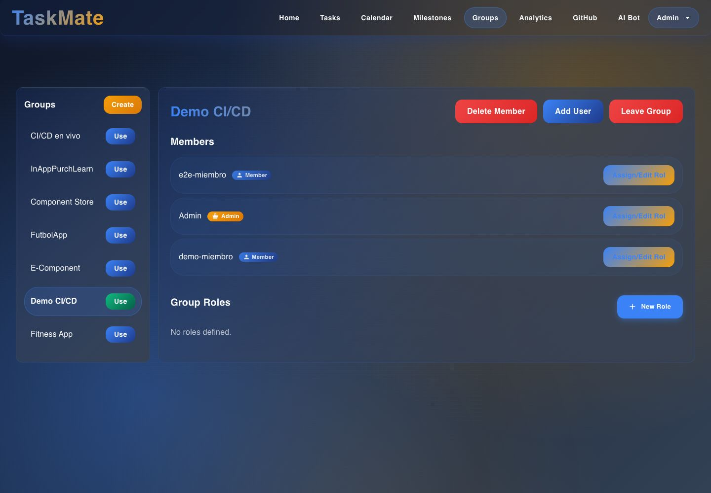
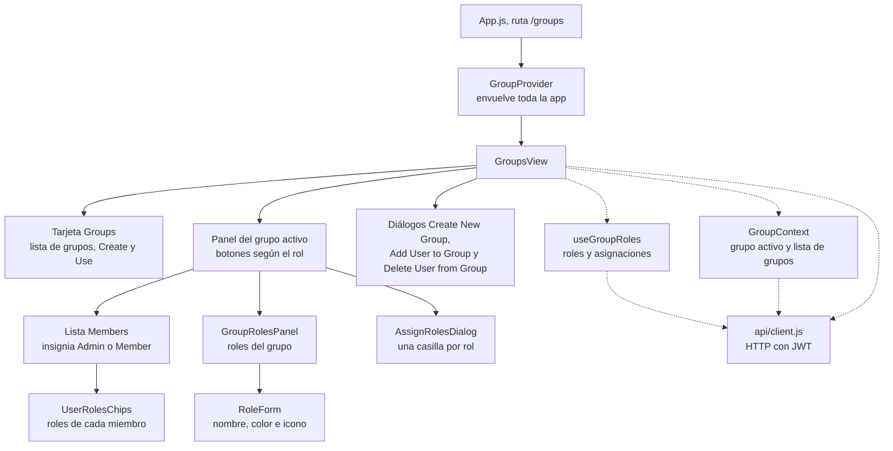

# Grupos y roles: interfaz

**En una frase:** en `/groups` eliges el grupo activo, ves a sus miembros y sus roles y, si eres el admin, agregas o quitas gente y manejas los roles.

*Admin en `/groups`. A la izquierda, la lista de sus grupos; «Demo CI/CD» es el grupo activo (botón **Use** en verde). Miembros y roles aparecen en el panel derecho después de pulsar **Use** (ver [limitaciones de la interfaz](../01-proyecto/cierre-del-proyecto.md#interfaz)).*

Flechas sólidas: qué componente contiene a cuál. Punteadas: de dónde saca los datos.

## Qué ves en la pantalla

- **Tarjeta «Groups» (izquierda):** tus grupos y el botón **Create**. Al hacer clic en un nombre solo se resalta; **Use** lo vuelve el grupo activo y abre sus detalles.
- **Panel del grupo (derecha):** el nombre del grupo, los botones de acción, la lista **Members** y la sección **Group Roles**.
- **Sin grupo elegido:** «No Group Selected» y el botón **Create Your First Group**.
- El grupo activo se guarda en el navegador (`localStorage`): sigue elegido al recargar y lo usan Tareas, Calendario, Hitos, Analytics y GitHub.

## Qué puedes hacer

| Acción | Miembro | Admin |
|---|---|---|
| Crear un grupo (**Create**) y elegir el activo (**Use**) | Sí | Sí |
| Ver miembros, su insignia y sus roles | Sí | Sí |
| Ver los roles del grupo | Sí (si no hay, «No roles defined.») | Sí |
| Salir del grupo | **Abandon Group** | **Leave Group**: el admin pasa al miembro más antiguo |
| Eliminar el grupo | — | **Delete Group**: aparece en lugar de Leave Group cuando el admin es el único miembro |
| Agregar un miembro | — | **Add User**: escribe el nombre de usuario |
| Quitar un miembro | — | **Delete Member** (solo si hay más de un miembro): escribe el nombre de usuario |
| Crear, editar y borrar roles | — | **New Role**, lápiz y papelera en cada rol |
| Asignar y quitar roles | — | **Assign/Edit Rol** en cada miembro: marca o desmarca casillas |

**Formulario de rol (RoleForm):**
- **Name:** obligatorio, hasta 40 caracteres, con contador.
- **Color:** selector de color del navegador; se guarda en hexadecimal.
- **Icon:** lista de 36 iconos de Material (por ejemplo `code`, `bug_report`, `supervisor_account`).

**Avisos:**
- Los resultados salen en una barra inferior (*snackbar*), por ejemplo «User added to the group», «Member removed» o «Rol creado exitosamente».
- Si falla asignar o quitar un rol, sale una alerta del navegador: «Error al asignar/quitar rol: …».
- Los mensajes de cada error están en [06-flujos/02-grupos-y-roles.md](../06-flujos/02-grupos-y-roles.md#qué-ve-el-usuario-si-algo-falla).

## Dónde está en el código

| Archivo | Qué hace |
|---|---|
| `src/components/GroupsView.jsx` | Pantalla completa: lista de grupos, panel del grupo, botones por rol y diálogos de crear, agregar y quitar |
| `src/components/GroupRolesPanel.jsx` | Sección «Group Roles»: chips de colores y, para el admin, crear, editar y borrar |
| `src/components/RoleForm.jsx` | Formulario de nombre, color e icono |
| `src/components/AssignRolesDialog.jsx` | Diálogo «Assign roles to users» con una casilla por rol |
| `src/components/UserRolesChips.jsx` | Chips con los roles de un miembro |
| `src/components/hooks/useGroupRoles.js` | Carga roles y matriz de roles; crea, edita y borra roles; asigna y quita con cambio optimista (se ve al instante y se revierte si la API falla) |
| `src/components/GroupContext.jsx` | Grupo activo y lista de grupos para toda la app |
| `src/constants/limits.js` | Límite de 40 caracteres del nombre del rol |
| `src/components/__tests__/GroupsView.test.jsx` | Pruebas: compara ids sin importar mayúsculas y reconoce al admin |

## Para saber más

- Navegación de toda la app: [00-general.md](00-general.md)
- Quién puede hacer qué, según la API: [04-casos-de-uso/02-grupos-y-roles.md](../04-casos-de-uso/02-grupos-y-roles.md)
- Arquitectura del módulo: [02-arquitectura/02-grupos-y-roles.md](../02-arquitectura/02-grupos-y-roles.md)
