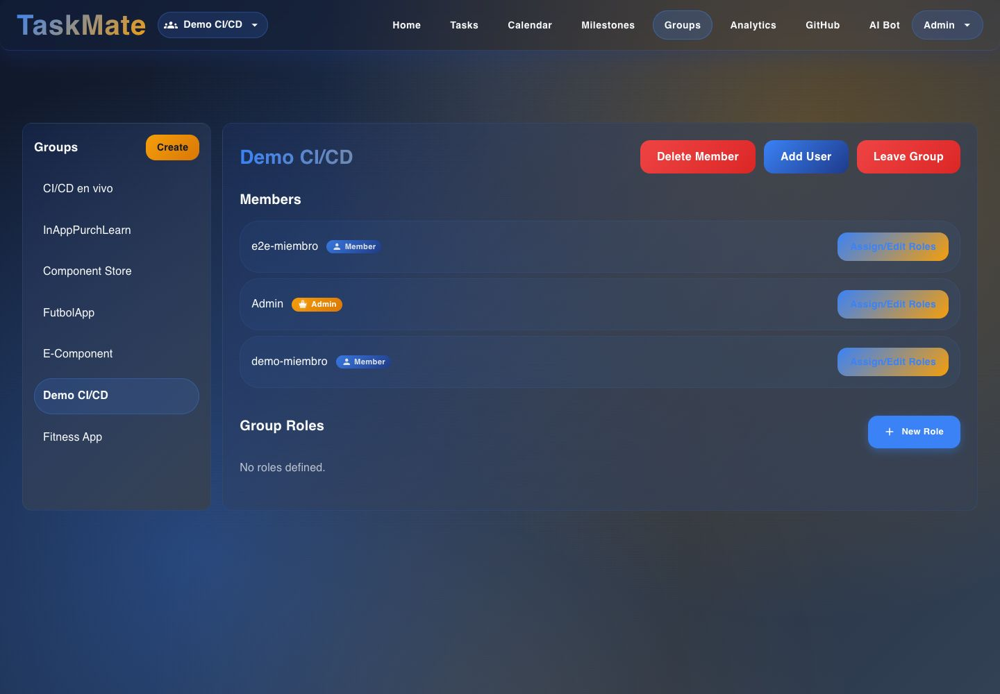
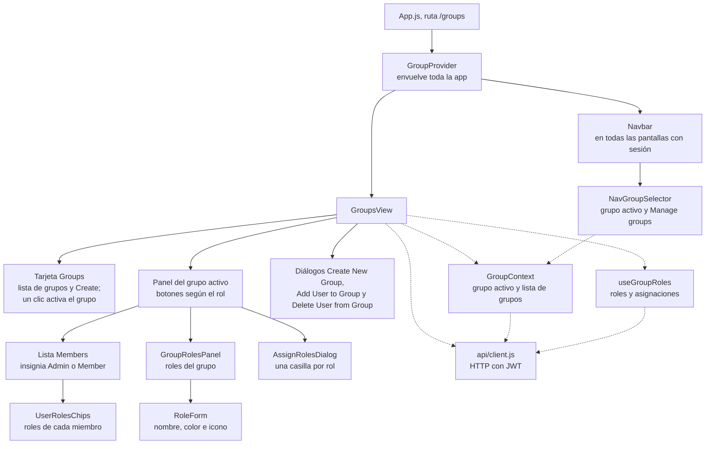

# Grupos y roles: interfaz

**En una frase:** en `/groups` un clic en un grupo lo vuelve el activo y muestra sus miembros y sus roles; si eres el admin, además agregas o quitas gente y manejas los roles. El grupo activo también se cambia desde el selector junto al logo, en cualquier pantalla.

*Admin en `/groups`. A la izquierda, la lista de sus grupos; «Demo CI/CD» es el grupo activo. A la derecha, sus tres miembros y la sección **Group Roles**, todavía sin roles. La captura es del 3 nov 2026, anterior a la interfaz en inglés: todavía muestra los botones **Use** (ya no existen: basta un clic en el grupo), «Assign/Edit Rol» (hoy «Assign/Edit Roles») y la barra sin el selector de grupo ([qué cambió en cada captura](README.md#galería-de-capturas)).*

Flechas sólidas: qué componente contiene a cuál. Punteadas: de dónde saca los datos.

## Qué ves en la pantalla

- **Tarjeta «Groups» (izquierda):** tus grupos (o «No groups yet») y el botón **Create**. Un clic en un grupo, o Enter o Espacio con el teclado, lo vuelve el grupo activo y abre sus detalles. El activo se ve resaltado en azul y en negritas. Ya no hay botón **Use**.
- **Panel del grupo (derecha):** el nombre del grupo, los botones de acción, la lista **Members** y la sección **Group Roles**.
- **Sin grupo elegido:** «No Group Selected» y el botón **Create Your First Group**.
- **Selector de grupo (junto al logo, en todas las pantallas con sesión):**
  - Muestra el nombre del grupo activo, o «Select a group» si no hay.
  - Su menú lista tus grupos con una palomita en el activo («You are not in any group yet» si no tienes; «Unnamed group» si uno no tiene nombre) y termina en **Manage groups**, que lleva a `/groups`.
  - No tiene opción «ninguno». La lista se recarga cada vez que se abre el menú.
  - Si estás en `/groups` y eliges otro grupo ahí, se abren los detalles de ese grupo.
- **Dónde se usa el grupo activo:** se guarda en el navegador (`localStorage`), así que sigue elegido al recargar. Al iniciar sesión se activa el primero de tus grupos. Lo usan Tasks, Calendar, Milestones, Analytics, GitHub y el chat (AI Bot).
- **Al salir del grupo activo** (o al borrarlo), deja de haber grupo activo: el selector vuelve a «Select a group» y las demás pantallas piden elegir uno.

## Qué puedes hacer

| Acción | Miembro | Admin |
|---|---|---|
| Crear un grupo (**Create**) y elegir el activo (clic en el grupo o selector de la barra) | Sí | Sí |
| Ver miembros, su insignia y sus roles | Sí | Sí |
| Ver los roles del grupo | Sí (si no hay, «No roles defined.») | Sí |
| Salir del grupo | **Abandon Group** | **Leave Group**: el admin pasa al miembro más antiguo |
| Eliminar el grupo | — | **Delete Group**: aparece en lugar de Leave Group cuando el admin es el único miembro |
| Agregar un miembro | — | **Add User**: escribe el nombre de usuario |
| Quitar un miembro | — | **Delete Member** (solo si hay más de un miembro): escribe el nombre de usuario |
| Crear, editar y borrar roles | — | **New Role**, lápiz y papelera en cada rol |
| Asignar y quitar roles | — | **Assign/Edit Roles** en cada miembro: marca o desmarca casillas |
| Permitir el análisis con IA del grupo | Solo ve «AI analysis: allowed» u «off» | Interruptor **Allow AI analysis**, en `/github` → pestaña Repository ([detalle](07-github.md); qué habilita en la rama de una tarea: [IA sobre el código](10-ia-sobre-el-codigo.md)) |

El permiso de IA no está en `/groups`: vive en la pestaña Repository de `/github`, porque necesita un repositorio conectado. Qué apaga se explica en [casos de uso](../04-casos-de-uso/02-grupos-y-roles.md#reglas-de-permisos-guardias-de-las-rutas).

**Formulario de rol (RoleForm):**
- **Name:** obligatorio, hasta 40 caracteres, con contador.
- **Color:** selector de color del navegador; se guarda en hexadecimal.
- **Icon:** lista de 36 iconos de Material (por ejemplo `code`, `bug_report`, `supervisor_account`).

**Avisos (en inglés):**
- Los resultados salen en una barra inferior (*snackbar*), por ejemplo «User added to the group», «Member removed», «Role created», «Role updated» o «Role deleted».
- Si falla guardar o borrar un rol: «Could not save the role» o «Could not delete the role» (o el mensaje que manda la API).
- Si falla asignar o quitar un rol, sale una alerta del navegador: «Could not assign/remove the role: …».
- Los mensajes de cada error están en [06-flujos/02-grupos-y-roles.md](../06-flujos/02-grupos-y-roles.md#qué-ve-el-usuario-si-algo-falla).

## Dónde está en el código

| Archivo | Qué hace |
|---|---|
| `src/components/GroupsView.jsx` | Pantalla completa: lista de grupos (un clic activa el grupo), panel del grupo, botones por rol y diálogos de crear, agregar y quitar. Si el grupo cambia desde la barra, abre sus detalles |
| `src/components/NavGroupSelector.jsx` | Selector de grupo junto al logo; lo monta `Navbar.jsx` solo con sesión |
| `src/components/GroupRolesPanel.jsx` | Sección «Group Roles»: chips de colores y, para el admin, crear, editar y borrar |
| `src/components/RoleForm.jsx` | Formulario de nombre, color e icono |
| `src/components/AssignRolesDialog.jsx` | Diálogo «Assign roles to users» con una casilla por rol |
| `src/components/UserRolesChips.jsx` | Chips con los roles de un miembro |
| `src/components/hooks/useGroupRoles.js` | Carga roles y matriz de roles; crea, edita y borra roles; asigna y quita con cambio optimista (se ve al instante y se revierte si la API falla) |
| `src/components/GroupContext.jsx` | Grupo activo y lista de grupos para toda la app; guarda el grupo en `localStorage` |
| `src/constants/limits.js` | Límite de 40 caracteres del nombre del rol |
| `src/components/__tests__/GroupsView.test.jsx` | Pruebas: compara ids sin importar mayúsculas, reconoce al admin y comprueba que ya no hay botón «Use» y que un clic activa el grupo |
| `src/components/__tests__/NavGroupSelector.test.jsx` | Pruebas: muestra el grupo activo, cambia a otro y pide «Select a group» si no hay |

## Para saber más

- Navegación de toda la app: [00-general.md](00-general.md)
- Quién puede hacer qué, según la API: [04-casos-de-uso/02-grupos-y-roles.md](../04-casos-de-uso/02-grupos-y-roles.md)
- Arquitectura del módulo: [02-arquitectura/02-grupos-y-roles.md](../02-arquitectura/02-grupos-y-roles.md)
- Lo que permite «Allow AI analysis» en la rama de una tarea: [10-ia-sobre-el-codigo.md](10-ia-sobre-el-codigo.md)
