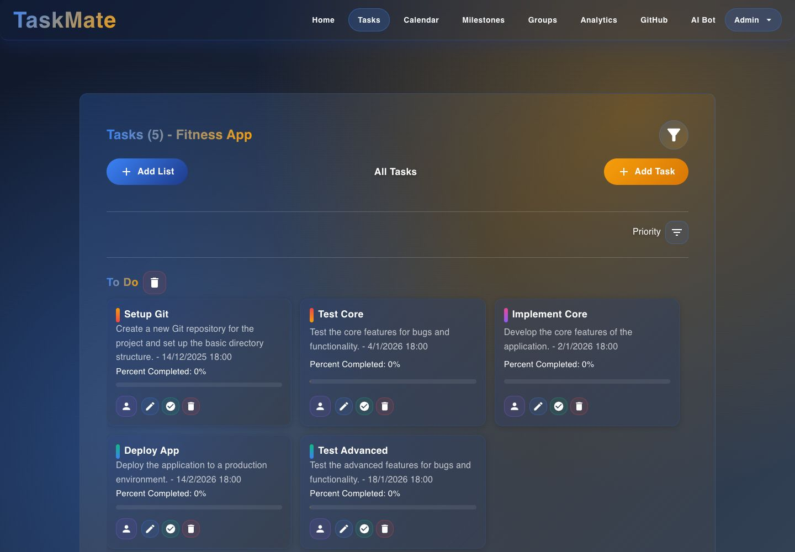
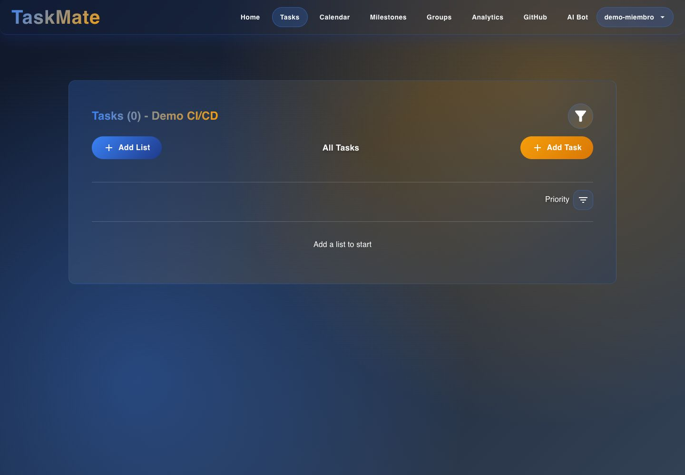
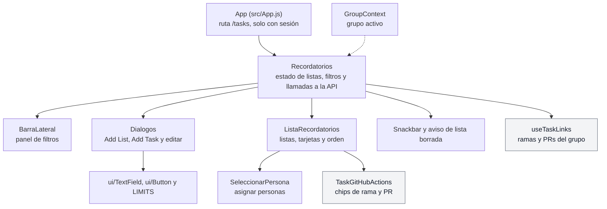

# Tareas: interfaz

**En una frase:** una sola pantalla, «Tasks» (`/tasks`), muestra las listas del grupo activo con una tarjeta por tarea; desde ahí se crea, edita, completa, asigna y borra, y un panel lateral cambia a las completadas o a la papelera.

## Pantallas

**Tareas del admin (`/tasks`).** El grupo activo es «Fitness App»: una lista, «To Do», con 5 tareas. Cada tarjeta tiene cuatro botones: persona, lápiz, check y basurero. No hay chips de GitHub: solo salen si el grupo tiene repositorio conectado.

**Tareas de un miembro (`/tasks`).** `demo-miembro` con el grupo «Demo CI/CD», que aún no tiene listas: «Tasks (0)» y el texto «Add a list to start». Tiene los mismos botones que el admin.

Partes de la pantalla, de arriba abajo:
- **Encabezado:** «Tasks (n) - grupo», donde n cuenta las tareas que se ven con el filtro actual, y el botón del embudo («Filters»).
- **Botones:** «Add List» a la izquierda, «Add Task» a la derecha y, en el centro, el nombre del filtro («All Tasks», «Today»…). En «Completed» y «Deleted» no salen los dos botones.
- **Orden:** a la derecha, el nombre del orden y el botón «Sort by» con «Creation Date», «Deadline» y «Priority». La etiqueta siempre dice el orden que siguen las tarjetas:
  - **«Creation Date»**, con el que se abre la pantalla: la tarea más antigua primero, según `created_at` (la hora en que se creó). Una tarea que acabas de agregar va al final hasta que la lista se recarga.
  - **«Deadline»:** la fecha límite más cercana primero.
  - **«Priority»:** el menor porcentaje primero y, con el mismo porcentaje, la fecha límite más cercana.
  - En «Deadline» y «Priority», una tarea sin fecha límite va al final.
  - «Completed» y «Deleted» se ordenan igual: al completarla o mandarla a la papelera, la tarea conserva su `created_at`.
- **Listas:** el nombre de cada lista con su botón de borrar y, debajo, una tarjeta por tarea con nombre, descripción, fecha y hora, «Percent Completed» y una barra de avance.

## Qué puedes hacer

**Admin o miembro: no hay diferencia en este módulo.** Hace falta tener un grupo activo; sin él aparece «Selecciona un grupo para gestionar tareas.»

- **«Add List»:** pide el nombre (hasta 25 caracteres). La lista se ve enseguida, pero solo en tu navegador hasta que tenga una tarea.
- **«Add Task»:** «Task Name» (hasta 25), «Description (optional)» (hasta 1000), «Deadline», «Time» y «Select List». El botón dice «Missing: …» hasta que estén el nombre, la fecha y la lista.
- **En cada tarjeta:**
  - persona: interruptores con los miembros del grupo para asignar o quitar;
  - lápiz: editar nombre, descripción, fecha, hora, lista y «PERCENTAGE» (deslizador de 5 en 5);
  - check: «Mark as complete»;
  - basurero: «Delete task», manda la tarea a la papelera.
- **Al llegar a 100 % en la edición**, la tarea se guarda y se completa en el mismo paso.
- **Basurero junto al nombre de la lista:** borra la lista con todas sus tareas. Mientras borra muestra un círculo de carga y la lista no acepta clics.
- **Embudo («Filters»):** «Today», «This Week», «This Month», «All Tasks», «Completed» y «Deleted».
- **En «Completed» y «Deleted»:** las tarjetas no tienen botones y aparece «Empty Completed» o «Empty Deleted» para vaciar todo.
- **Avisos:** abajo al centro aparecen «Task completed», «Task deleted», «Task updated», «List deleted» o el error de la API.
- **Con repositorio de GitHub conectado,** cada tarjeta muestra además los chips de rama y PR. Ver [GitHub](07-github.md).

Las animaciones de completar (check verde) y de borrar (X roja) duran unos 3 s antes de quitar la tarjeta.

## Árbol de componentes

En gris, lo que pertenece al módulo de [GitHub](07-github.md).

## Dónde está en el código

| Archivo | Qué hace |
|---|---|
| `src/App.js` | Ruta `/tasks`: solo con sesión; sin ella manda a `/` |
| `src/components/GroupContext.jsx` | Da el grupo activo que usa la pantalla |
| `src/components/Recordatorios.jsx` | La pantalla: carga tareas, completadas, papelera y miembros; crea, edita, completa, borra y vacía |
| `src/components/ListaRecordatorios.jsx` | Dibuja las listas y las tarjetas, ordena y muestra los avisos de cada tarjeta |
| `src/components/Dialogos.jsx` | Los tres diálogos: nueva lista, nueva tarea y editar tarea |
| `src/components/BarraLateral.jsx` | Panel lateral con los seis filtros |
| `src/components/SeleccionarPersona.jsx` | Menú de miembros con interruptores; cambia al instante y vuelve atrás si la API falla |
| `src/constants/limits.js` | Largos máximos de los campos (iguales a los de la API) |
| `src/api/client.js` | Llama a la API con el JWT y convierte los errores en mensajes |
| `src/components/__tests__/Recordatorios.test.jsx`, `RecordatoriosGitHub.test.jsx`, `formLimits.test.jsx` | Pruebas de la pantalla |

## Para saber más

- Quién puede hacer qué: [04-casos-de-uso/03-tareas.md](../04-casos-de-uso/03-tareas.md)
- Qué pasa al pulsar cada botón: [06-flujos/03-tareas.md](../06-flujos/03-tareas.md)
- Todas las pantallas y la navegación: [00-general.md](00-general.md)
- Limitaciones conocidas: [cierre del proyecto](../01-proyecto/cierre-del-proyecto.md#limitaciones-conocidas)
