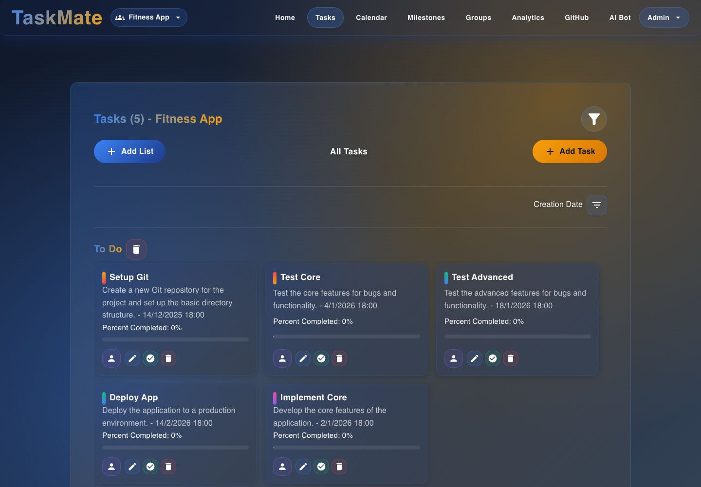
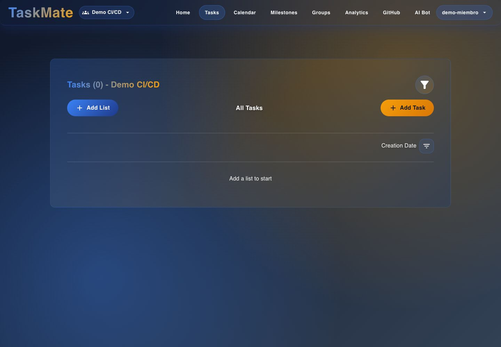
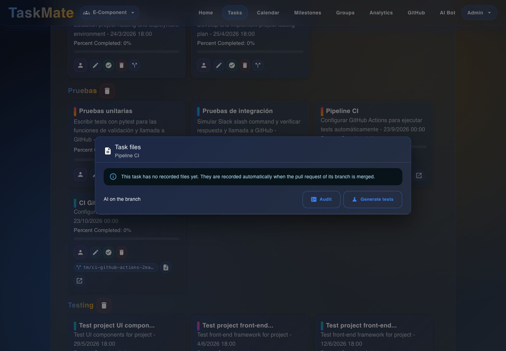
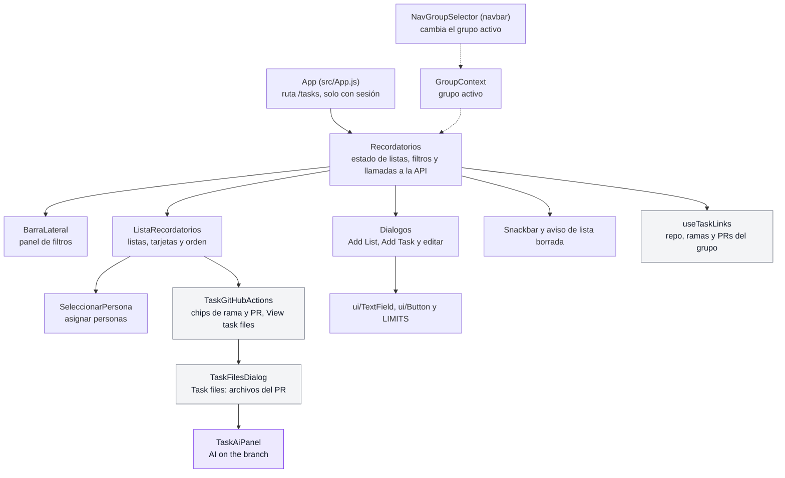

# Tareas: interfaz

**En una frase:** una sola pantalla, «Tasks» (`/tasks`), muestra las listas del grupo activo con una tarjeta por tarea; desde ahí se crea, edita, completa, asigna y borra, y un panel lateral cambia a las completadas o a la papelera.

## Pantallas

**Tareas del admin (`/tasks`).** El grupo activo es «Fitness App»: una lista, «To Do», con 5 tareas. Cada tarjeta tiene cuatro botones: persona, lápiz, check y basurero. No hay chips de GitHub: solo salen si el grupo tiene repositorio conectado.

**Tareas de un miembro (`/tasks`).** `demo-miembro` con el grupo «Demo CI/CD», que aún no tiene listas: «Tasks (0)» y el texto «Add a list to start». Tiene los mismos botones que el admin.

**Diálogo «Task files» (`/tasks`, grupo «E-Component»).** Se abrió con «View task files» en la tarea «Pipeline CI». Su rama todavía no tiene archivos registrados, así que sale el aviso «This task has no recorded files yet…»; debajo, «AI on the branch» con «Audit» y «Generate tests» («Review PR» no aparece: no hay PR abierto). Atrás se ven otras tarjetas del grupo; las que aún no tienen rama llevan un quinto botón, «Create branch on GitHub», y una muestra el chip de su rama (`tm/ci-github-actions-…`) con el ícono de archivos. Detalle en [GitHub](07-github.md).

Partes de la pantalla, de arriba abajo:
- **Encabezado:** «Tasks (n) - grupo», donde n cuenta las tareas que se ven con el filtro actual, y el botón del embudo («Filters»).
- **Botones:** «Add List» a la izquierda, «Add Task» a la derecha y, en el centro, el nombre del filtro («All Tasks», «Today»…). En «Completed» y «Deleted» no salen los dos botones.
- **Orden:** a la derecha, el nombre del orden y el botón «Sort by» con «Creation Date», «Deadline» y «Priority». La etiqueta siempre dice el orden que siguen las tarjetas:
  - **«Creation Date»**, con el que se abre la pantalla: la tarea más antigua primero, según `created_at` (la hora en que se creó). Una tarea que acabas de agregar va al final hasta que la lista se recarga.
  - **«Deadline»:** la fecha límite más cercana primero.
  - **«Priority»:** el menor porcentaje primero y, con el mismo porcentaje, la fecha límite más cercana.
  - En «Deadline» y «Priority», una tarea sin fecha límite va al final.
  - «Completed» y «Deleted» se ordenan igual: al completarla o mandarla a la papelera, la tarea conserva su `created_at`.
- **Listas:** el nombre de cada lista con su botón de borrar y, debajo, una tarjeta por tarea con nombre, descripción, fecha y hora, «Percent Completed» y una barra de avance.

## Qué puedes hacer

**Admin o miembro: no hay diferencia en este módulo.** Hace falta tener un grupo activo; sin él aparece «Select a group to manage tasks.». El grupo se cambia con el selector junto al logo de la navbar (`NavGroupSelector`) o con un clic en un grupo de «Groups», y la pantalla carga las tareas del grupo nuevo.

- **«Add List»:** pide el nombre (hasta 25 caracteres); si está vacío, sale la alerta «The list name cannot be empty.». La lista se ve enseguida, pero solo en tu navegador hasta que tenga una tarea.
- **«Add Task»:** «Task Name» (hasta 25), «Description (optional)» (hasta 1000), «Deadline», «Time» y «Select List». El botón dice «Missing: …» hasta que estén el nombre, la fecha y la lista.
- **En cada tarjeta:**
  - persona: interruptores con los miembros del grupo para asignar o quitar («No members available» si no hay; si la API falla, el interruptor vuelve atrás con «Could not assign the user» o «Could not remove the assignment»);
  - lápiz: editar nombre, descripción, fecha, hora, lista y «PERCENTAGE» (deslizador de 5 en 5);
  - check: «Mark as complete»;
  - basurero: «Delete task», manda la tarea a la papelera.
- **Al llegar a 100 % en la edición**, la tarea se guarda y se completa en el mismo paso.
- **Basurero junto al nombre de la lista:** borra la lista con todas sus tareas. Mientras borra muestra un círculo de carga y la lista no acepta clics.
- **Embudo («Filters»):** «Today», «This Week», «This Month», «All Tasks», «Completed» y «Deleted».
- **En «Completed» y «Deleted»:** las tarjetas no tienen botones y aparece «Empty Completed» o «Empty Deleted» para vaciar todo.
- **Avisos:** abajo al centro aparecen «Task completed», «Task deleted», «Task updated», «List deleted» o el error de la API.
- **Con repositorio de GitHub conectado,** cada tarjeta activa muestra además:
  - sin rama, el botón «Create branch on GitHub»;
  - con rama, el chip de la rama (al pulsarlo copia `git checkout …`), «View branch on GitHub» y el chip del PR («PR #N open», «draft», «closed» o «merged»);
  - con rama, el ícono de documento **«View task files»**, que abre el diálogo «Task files».
- **Diálogo «Task files»:** el nombre de la tarea, el enlace «PR #N» y «N files» con el total +/−. Por cada archivo que cambió el PR de su rama:
  - un chip de estado (`added`, `modified`, `removed`, `renamed`, `copied` o `changed`);
  - las líneas +/− y el botón «Open on GitHub» (los archivos borrados no lo tienen);
  - «Also changed by: …» cuando otra tarea activa del grupo toca el mismo archivo.
- **Estados del diálogo:** si la lista se pidió a GitHub al abrirlo, sale el chip «recovered from GitHub». Sin archivos, sale «This task has no recorded files yet. They are recorded automatically when the pull request of its branch is merged.»; según el código, ese registro al fusionar no llega a guardarse ([Limitaciones conocidas](../01-proyecto/cierre-del-proyecto.md#limitaciones-conocidas)). Si falla: «Could not load the task files.». Detalle en [GitHub](07-github.md).
- **Panel «AI on the branch»,** debajo de los archivos: «Audit», «Generate tests» y, solo con el PR abierto, «Review PR». Al abrirse muestra la última revisión guardada del PR, si la hay. Si la IA está apagada en el grupo, sale «AI analysis is turned off for this project; an admin can turn it on from the GitHub page.». Detalle en [IA sobre el código](10-ia-sobre-el-codigo.md).
- **En «Completed» y «Deleted»** las tarjetas no muestran chips ni el ícono de archivos. Además, al completar o mandar a la papelera, la base borra con la tarea su rama vinculada, su lista de archivos y sus revisiones de IA.

Las animaciones de completar (check verde) y de borrar (X roja) duran unos 3 s antes de quitar la tarjeta.

## Árbol de componentes

En gris, lo que pertenece al módulo de [GitHub](07-github.md); en morado, lo de [IA sobre el código](10-ia-sobre-el-codigo.md).

## Dónde está en el código

| Archivo | Qué hace |
|---|---|
| `src/App.js` | Ruta `/tasks`: solo con sesión; sin ella manda a `/` |
| `src/components/GroupContext.jsx` | Da el grupo activo que usa la pantalla (lo cambia `NavGroupSelector.jsx` desde la navbar) |
| `src/components/Recordatorios.jsx` | La pantalla: carga tareas, completadas, papelera y miembros; crea, edita, completa, borra y vacía |
| `src/components/ListaRecordatorios.jsx` | Dibuja las listas y las tarjetas, ordena y muestra los avisos de cada tarjeta |
| `src/components/Dialogos.jsx` | Los tres diálogos: nueva lista, nueva tarea y editar tarea |
| `src/components/BarraLateral.jsx` | Panel lateral con los seis filtros |
| `src/components/SeleccionarPersona.jsx` | Menú de miembros con interruptores; cambia al instante y vuelve atrás si la API falla |
| `src/components/github/TaskGitHubActions.jsx`, `TaskFilesDialog.jsx`, `TaskAiPanel.jsx` | Chips de rama y PR, ícono «View task files», diálogo «Task files» y panel «AI on the branch» (módulos [GitHub](07-github.md) e [IA sobre el código](10-ia-sobre-el-codigo.md)) |
| `src/constants/limits.js` | Largos máximos de los campos (iguales a los de la API) |
| `src/api/client.js` | Llama a la API con el JWT y convierte los errores en mensajes |
| `src/components/__tests__/Recordatorios.test.jsx`, `RecordatoriosGitHub.test.jsx`, `formLimits.test.jsx` | Pruebas de la pantalla |

## Para saber más

- Quién puede hacer qué: [04-casos-de-uso/03-tareas.md](../04-casos-de-uso/03-tareas.md)
- Qué pasa al pulsar cada botón: [06-flujos/03-tareas.md](../06-flujos/03-tareas.md)
- Todas las pantallas y la navegación: [00-general.md](00-general.md)
- Archivos de la tarea: [GitHub](07-github.md) · IA de la rama: [IA sobre el código](10-ia-sobre-el-codigo.md)
- Limitaciones conocidas: [cierre de la línea de Pablo y estado](../01-proyecto/cierre-del-proyecto.md#limitaciones-conocidas)
