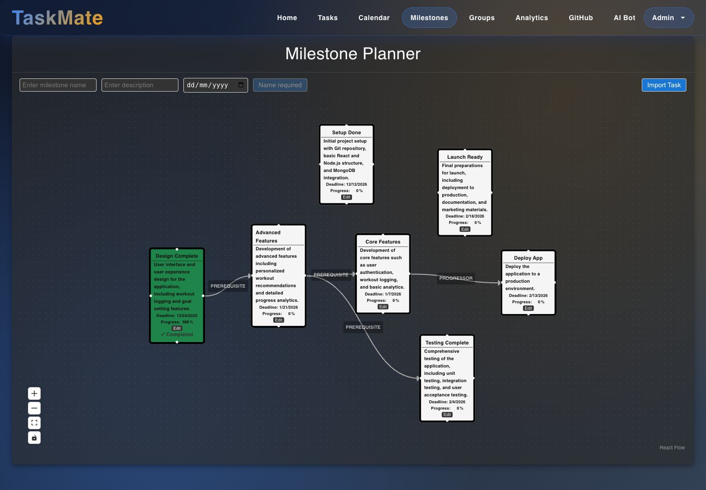
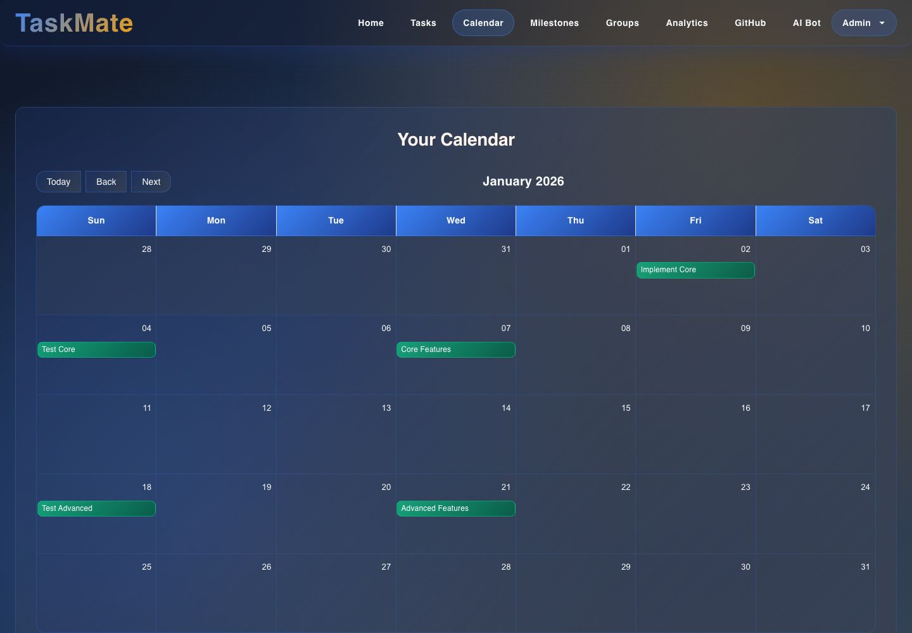
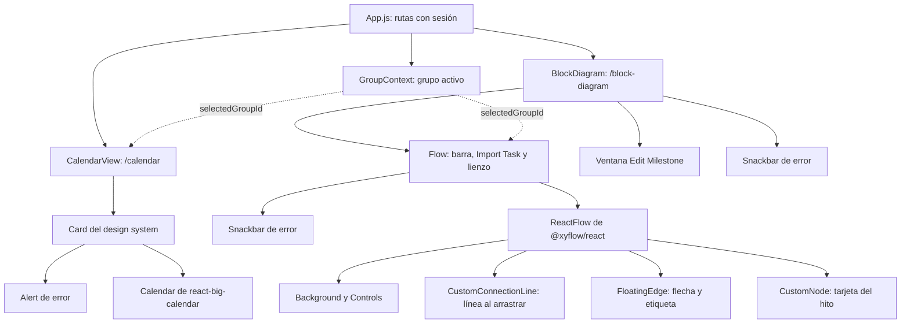

# Hitos y calendario: interfaz

**En una frase:** «Milestones» (`/block-diagram`) es un lienzo donde cada hito es una tarjeta y las flechas los conectan; «Calendar» (`/calendar`) muestra en un mes las fechas de los hitos y de las tareas del grupo activo.

## Pantallas

**Hitos: `/block-diagram`** (menú «Milestones» o tarjeta «Milestone Viewer» del inicio)

- Barra de arriba: nombre, descripción, fecha y el botón para crear. El botón dice qué falta: «Select a group first», «Name required» o «Date required»; con todo listo dice «Add Milestone».
- «Import Task»: lista las tareas del grupo que todavía no son hito.
- Lienzo: cada tarjeta muestra nombre, descripción, «Deadline», «Progress: N %» y el botón «Edit». Con 100 % se pone verde y dice «✓ Completed».
- Cada flecha lleva una etiqueta, «Prerequisite» o «Progressor». Un clic la cambia.
- Abajo a la izquierda: acercar, alejar, ajustar a la vista y bloquear el lienzo.
- En la captura el grupo activo todavía no tiene hitos.

**Calendario: `/calendar`** (menú «Calendar» o tarjeta «Calendar View» del inicio)

- Solo vista de mes, con «Today», «Back» y «Next».
- Cada evento es un hito o una tarea activa, con su nombre, en su fecha. Es de solo lectura.
- En la captura el grupo activo no tiene fechas en noviembre de 2026.

## Qué puedes hacer

| Rol | Hitos | Calendario |
|---|---|---|
| Miembro | Todo: crear, importar, editar, mover, fijar el %, completar, conectar, cambiar el tipo de flecha y borrar | Ver el mes |
| Líder o admin | Lo mismo que un miembro; no hay botones extra | Lo mismo |
| Sin grupo activo | Ve «Selecciona un grupo para ver y crear milestones.» | Ve «Selecciona un grupo para ver el calendario.» |
| Sin sesión | Vuelve al login (`/`) | Vuelve al login |

Cómo se hace cada acción en el lienzo:
- **Conectar:** arrastrar desde uno de los 4 puntos del borde de una tarjeta y soltar sobre otra. La flecha apunta al hito donde se suelta.
- **Mover:** arrastrar la tarjeta. La posición se guarda al soltarla.
- **Fijar el %:** escribir un número de 0 a 100 en «Progress» y salir del campo. Otro valor vuelve al anterior.
- **Editar:** botón «Edit» → ventana «Edit Milestone» con nombre, descripción y fecha → «Save».
- **Borrar:** clic en la tarjeta o en la flecha y tecla Backspace.

El grupo activo se elige en «Groups». Los textos de estas dos pantallas están en inglés, salvo los avisos de «sin grupo».

## Árbol de componentes

Snackbar: aviso rojo abajo al centro que se cierra solo a los 4 s.

## Dónde está en el código

| Archivo | Qué hace |
|---|---|
| `src/App.js` | Rutas `/block-diagram` y `/calendar`; sin sesión redirige a `/` |
| `src/components/BlockDiagram.jsx` | Página «Milestone Planner» y ventana «Edit Milestone» |
| `src/components/flow/Flow.jsx` | Carga hitos y flechas, barra de creación, «Import Task», guardar posición, conectar y borrar |
| `src/components/flow/CustomNode.jsx` | Tarjeta: campo «Progress», completar y botón «Edit» |
| `src/components/flow/FloatingEdge.jsx` | Flecha flotante con la etiqueta Prerequisite / Progressor |
| `src/components/flow/utils.js`, `flow/CustomConnectionLine.jsx` | Geometría de la flecha y línea mientras se arrastra |
| `src/components/CalendarView.jsx` | Calendario de mes con hitos y tareas |
| `src/components/GroupContext.jsx` | Grupo activo, guardado en `localStorage` |
| `src/constants/limits.js` | Largo máximo del nombre del hito (25) |
| `src/components/__tests__/FlowFitView.test.jsx` | Prueba el ajuste de la vista al cargar y al cambiar de grupo |

## Para saber más
- Mapa de todas las pantallas: [00-general.md](00-general.md)
- Paso a paso y mensajes de error: [06-flujos/04-hitos-y-calendario.md](../06-flujos/04-hitos-y-calendario.md)
- Permisos: [04-casos-de-uso/04-hitos-y-calendario.md](../04-casos-de-uso/04-hitos-y-calendario.md)
- Arquitectura del módulo: [02-arquitectura/04-hitos-y-calendario.md](../02-arquitectura/04-hitos-y-calendario.md)
- Limitaciones conocidas: [cierre del proyecto](../01-proyecto/cierre-del-proyecto.md#limitaciones-conocidas)
