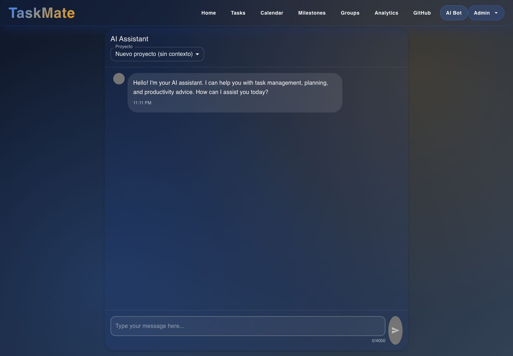
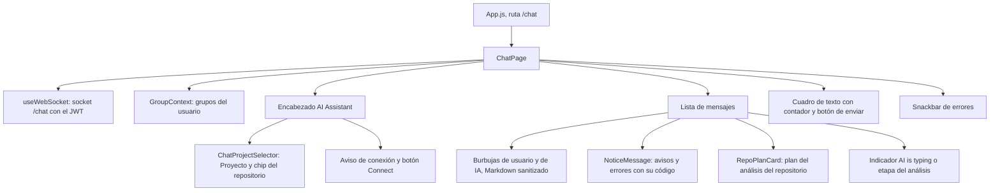

# Chat con IA: interfaz

**En una frase:** la pantalla «AI Bot» (`/chat`) es un chat con un selector de proyecto arriba, la conversación en el centro y un cuadro de texto abajo.

*Admin, sesión nueva: el saludo inicial y el selector en «Nuevo proyecto (sin contexto)».*

## Qué se ve
- **Encabezado «AI Assistant»** con el selector **Proyecto**: «Nuevo proyecto (sin contexto)» o uno de tus grupos. Si eliges un grupo, aparece un chip con su repositorio o «Sin repositorio».
- **Conversación:** tus mensajes a la derecha y los de la IA a la izquierda, con hora. Las respuestas de la IA se muestran en Markdown (títulos, tablas, listas), sin HTML peligroso.
- **Avisos centrados:** «Proyecto "X" creado» (informativo) y los errores, con su código debajo (por ejemplo `Code: LLM_TIMEOUT`).
- **Mientras espera:** «AI is typing...», o la etapa del análisis del repositorio.
- **Cuadro de texto** con contador `n/4000`; con un proyecto elegido el límite es `n/500` y el texto son instrucciones para el análisis. Enter envía y Shift+Enter hace un salto de línea.
- **Sin conexión:** «Connection problem: …» y un botón «🔌 Connect» para reintentar.

## Qué puedes hacer

| Rol | Qué puede hacer en esta pantalla |
|---|---|
| Cualquier usuario con sesión | Conversar con «Nuevo proyecto (sin contexto)», pedir el plan, confirmarlo («sí») para crear un grupo nuevo, pedir cambios o descartarlo. Al volver, recupera el historial |
| Miembro de un grupo | Elegir ese grupo en «Proyecto». Si tiene repositorio y el análisis está permitido, enviar instrucciones (opcionales) y recibir un plan de tareas que se guarda o descarta en una tarjeta |
| Admin del grupo | Lo mismo que un miembro. Además, desde `/github` activa «Permitir análisis con IA»; con eso, el botón «Analizar con IA» de `/github` abre el chat y lanza el análisis |

Las tarjetas del análisis y el atajo desde `/github` se explican en [05-interfaz/07-github](07-github.md). Los defectos visuales conocidos de esta pantalla están en [limitaciones conocidas](../01-proyecto/cierre-del-proyecto.md#limitaciones-conocidas).

## Dónde está en el código

| Archivo | Qué hace |
|---|---|
| `src/components/ChatPage.jsx` | La pantalla: mensajes, errores, historial, contexto y envío |
| `src/components/ChatPage.css` | Estilos del chat |
| `src/components/github/ChatProjectSelector.jsx` | Selector «Proyecto» y chip del repositorio |
| `src/components/github/RepoPlanCard.jsx` | Tarjeta del plan del análisis del repositorio |
| `src/hooks/useWebSocket.js` | Conexión, reconexión (hasta 5 intentos), `ping` cada 30 s, cierre por token vencido |
| `src/components/GroupContext.jsx` | Lista de grupos; se recarga al crear un proyecto |
| `src/constants/limits.js` | Límites 4000 (mensaje) y 500 (instrucciones) |
| `src/constants/ws.js` | Códigos de cierre 4001 (token vencido) y 1009 (mensaje demasiado grande) |
| `src/config.js` | `WS_BASE` (`REACT_APP_WS_URL`, por defecto `ws://localhost:9000`) |
| `src/components/Navbar.jsx` | Entrada «AI Bot» del menú |

Pruebas: `src/components/__tests__/ChatPage.test.jsx`, `src/components/__tests__/ChatPageGitHub.test.jsx`, `src/components/github/__tests__/ChatProjectSelector.test.jsx`, `src/components/github/__tests__/RepoPlanCard.test.jsx` y `src/hooks/__tests__/useWebSocket.test.js`.

## Para saber más
- Qué pasa detrás de cada mensaje: [06-flujos/05-chat-ia.md](../06-flujos/05-chat-ia.md)
- Piezas y conexiones: [02-arquitectura/05-chat-ia.md](../02-arquitectura/05-chat-ia.md)
- Mapa de todas las pantallas: [00-general.md](00-general.md)
