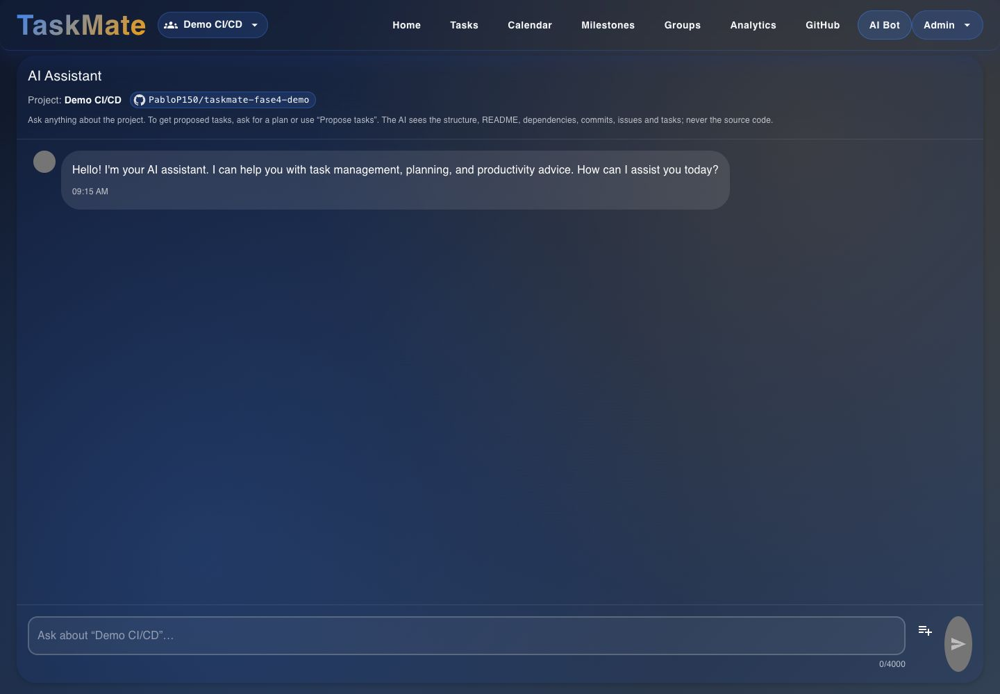
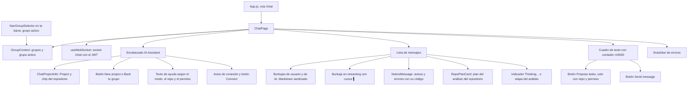

# Chat con IA: interfaz

**En una frase:** la pantalla «AI Bot» (`/chat`) es un chat que sigue al grupo elegido en la barra de navegación: arriba muestra el proyecto y el botón «New project», en el centro la conversación de ese proyecto (las respuestas llegan mientras se escriben) y abajo el cuadro de texto con el botón «Propose tasks».

*Admin con «Demo CI/CD» elegido en la barra (captura anterior al botón «New project»). Arriba, «AI Assistant», «Project: Demo CI/CD», el chip `PabloP150/taskmate-fase4-demo` y el texto de ayuda (repo conectado y análisis permitido). En el centro, el saludo inicial de la IA. Abajo, el cuadro «Ask about “Demo CI/CD”…» con el contador 0/4000, «Propose tasks» (ícono de lista con un +) y «Send message».*

## Qué se ve
- **Encabezado «AI Assistant»** con «Project: <grupo>» (el grupo activo de la barra; aquí no se cambia), «Project: new project» o «Project: none (select a group in the navbar)». Cuando ya se sabe el repo, un chip con `owner/repo` o «No repository».
- **«New project»** a la derecha, solo con un grupo con datos: pasa el chat a un proyecto nuevo sin cambiar el grupo de la barra. En ese modo aparece **«Back to “<grupo>”»**, que vuelve al grupo. Sin conexión, los dos quedan desactivados.
- **Texto de ayuda** bajo el encabezado, en un proyecto nuevo:
  - con «New project» o sin grupo: «New project: describe what you want to build and ask for the plan; it will be saved as a new group.»;
  - con un grupo sin usar (sin tareas, hitos ni repositorio): «This group is empty: describe the project you want to build and ask for the plan; it will be created in this group.» si eres su admin; si no, «… it will be saved as a new group (only the group admin can create it here).».
- **Texto de ayuda** con un grupo con datos:
  - con repo y permiso: «Ask anything about the project. To get proposed tasks, ask for a plan or use “Propose tasks”. The AI sees the structure, README, dependencies, commits, issues and tasks; never the source code.»;
  - sin repo: «This project has no repository connected: the AI only sees its tasks, milestones and team. Connect one from the GitHub page.»;
  - con la IA apagada: «AI analysis is turned off for this project. A group admin can turn it on from the GitHub page (“Allow AI analysis”).».
- **Conversación** a todo el ancho: tus mensajes a la derecha y los de la IA a la izquierda, con hora. Las respuestas de la IA se muestran en Markdown (títulos, tablas, listas), sin HTML peligroso. Cada proyecto tiene la suya: al cambiar de grupo o pasar a «New project» se ve la de ese proyecto (si no tiene, el saludo) y al volver se recupera.
- **Respuestas en streaming:** la burbuja de la IA crece mientras llega el texto, con un cursor «▍»; al terminar se reemplaza por el texto completo.
- **Avisos centrados:** «Proyecto "X" creado», «… creado en este grupo» o «… creado como un grupo nuevo (motivo)» (informativos; el servidor todavía los manda en español) y los errores, con su código debajo (por ejemplo `Code: LLM_TIMEOUT`). Si el plan se guardó en el grupo sin usar, la barra muestra el nombre nuevo del grupo.
- **Mientras espera:** «Thinking...», o la etapa del análisis («Reading the repository on GitHub…», «The AI is analyzing the repository (this can take up to a minute and a half)…»). Se oculta en cuanto llega el primer trozo de texto.
- **Cuadro de texto:** placeholder «Ask about “<proyecto>”…» con grupo o «Type your message…» sin proyecto (también con «New project»); contador `n/4000` siempre, porque el texto siempre es un mensaje de chat. Enter envía y Shift+Enter hace un salto de línea. Mientras llega una respuesta o corre un análisis se puede seguir escribiendo, pero «Send message» y Enter quedan bloqueados hasta la respuesta final.
- **Botón «Propose tasks»** (ícono de lista con un +) junto a «Send message»: solo con grupo, repo y permiso. Tooltip: «Propose the next tasks for the project (analyzes the repository; once per minute)».
- **Sin conexión:** «Connection problem: …» y un botón «🔌 Connect» para reintentar.

## Qué puedes hacer

| Rol | Qué puede hacer en esta pantalla |
|---|---|
| Cualquier usuario con sesión | Con «New project», sin grupo o con un grupo sin usar: conversar sobre un proyecto nuevo, pedir el plan («generate the plan», «crea un plan»; tras describir la idea, también «create the project»), confirmarlo («yes», «sí») para guardarlo (en el grupo sin usar si eres su admin; si no, como grupo nuevo), pedir cambios o descartarlo. Al volver, recupera el historial de cada proyecto |
| Miembro de un grupo | Con ese grupo activo en la barra: preguntar sobre el proyecto, o pasar a «New project» y volver con «Back to “<grupo>”». Si tiene repositorio y el análisis está permitido, pedir tareas con «Propose tasks» o pidiendo un plan en el chat, y guardarlas («Confirm») o descartarlas («Discard») en la tarjeta |
| Admin del grupo | Lo mismo que un miembro. Además, desde `/github` activa «Allow AI analysis»; con eso, «Analyze with AI» de `/github` fija ese grupo en la barra, abre el chat y lanza el análisis |

Las tarjetas del análisis y el atajo desde `/github` se explican en [05-interfaz/07-github](07-github.md). Los defectos visuales conocidos de esta pantalla están en [limitaciones conocidas](../01-proyecto/cierre-del-proyecto.md#limitaciones-conocidas).

## Dónde está en el código

| Archivo | Qué hace |
|---|---|
| `src/components/ChatPage.jsx` | La pantalla: mensajes, streaming, errores, historial por proyecto, proyecto, «New project» y envío |
| `src/components/ChatPage.css` | Estilos del chat |
| `src/components/github/ChatProjectInfo.jsx` | «Project: …» (también «new project») y chip del repositorio, solo lectura |
| `src/components/NavGroupSelector.jsx` | Selector de grupo de la barra; el chat sigue ese grupo |
| `src/components/github/RepoPlanCard.jsx` | Tarjeta del plan del análisis del repositorio |
| `src/hooks/useWebSocket.js` | Conexión, reconexión (hasta 5 intentos), `ping` cada 30 s, cierre por token vencido |
| `src/components/GroupContext.jsx` | Grupos y grupo activo; la lista se recarga al crear un proyecto |
| `src/constants/limits.js` | Límite de 4000 del mensaje; `analysisInstructions` (500) sigue ahí, pero el chat ya no lo usa |
| `src/constants/ws.js` | Códigos de cierre 4001 (token vencido) y 1009 (mensaje demasiado grande) |
| `src/config.js` | `WS_BASE` (`REACT_APP_WS_URL`; por defecto `ws://<host de la página>:9000`) |
| `src/components/Navbar.jsx` | Entrada «AI Bot» del menú y el selector de grupo |

Pruebas: `src/components/__tests__/ChatPage.test.jsx`, `src/components/__tests__/ChatPageGitHub.test.jsx`, `src/components/__tests__/ChatPageStreaming.test.jsx`, `src/components/__tests__/ChatPageProjects.test.jsx` (los modos de proyecto y una conversación por proyecto), `src/components/__tests__/NavGroupSelector.test.jsx`, `src/components/github/__tests__/ChatProjectInfo.test.jsx`, `src/components/github/__tests__/RepoPlanCard.test.jsx` y `src/hooks/__tests__/useWebSocket.test.js`.

## Para saber más
- Qué pasa detrás de cada mensaje: [06-flujos/05-chat-ia.md](../06-flujos/05-chat-ia.md)
- Piezas y conexiones: [02-arquitectura/05-chat-ia.md](../02-arquitectura/05-chat-ia.md)
- Mapa de todas las pantallas: [00-general.md](00-general.md)
