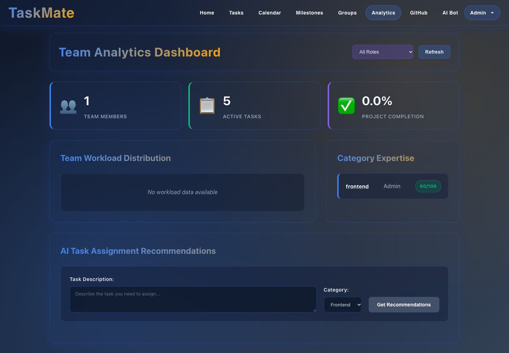
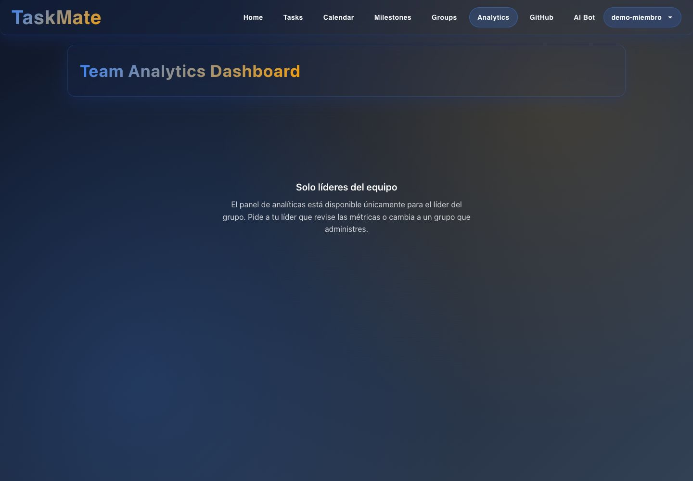
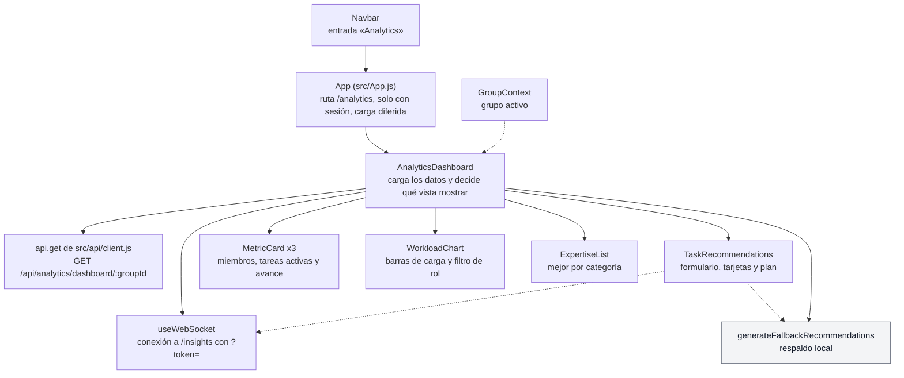

# Analytics: interfaz

**En una frase:** una sola pantalla, «Analytics» (`/analytics`), muestra al líder los números del grupo activo y le deja pedir a la IA quién debería hacer una tarea; un miembro solo ve el aviso «Solo líderes del equipo».

## Pantallas

**Panel del líder (`/analytics`).** El admin es líder de su grupo. Arriba, tres tarjetas: 1 miembro, 5 tareas activas y 0.0 % de avance. «Category Expertise» muestra al mejor de cada categoría (aquí, frontend con 60/100). Abajo está el formulario de recomendaciones. La captura es de antes de la corrección del 4 nov 2026: ahí «Team Workload Distribution» sale vacía porque solo contaba a los miembros con al menos un rol en el grupo, y la experiencia sumaba todos los grupos de la persona. Hoy el panel muestra una barra por cada miembro.

**Vista de un miembro (`/analytics`).** La API responde 403 y la pantalla lo cambia por un aviso. El navegador igual registra el 403 en la consola.

Partes del panel, de arriba abajo:
- **Encabezado:** «Team Analytics Dashboard», el filtro de rol («All Roles») y el botón «Refresh».
- **Tarjetas:**
  - «Team Members»: los miembros del grupo.
  - «Active Tasks»: los registros de analytics que siguen abiertos (`pending`).
  - «Project Completion»: completados ÷ (completados + abiertos).
- **«Team Workload Distribution»:** una barra por cada miembro del grupo, con «tareas/capacidad (uso %)».
  - Bajo el nombre van todos sus roles en este grupo, separados por coma; quien no tiene ninguno muestra «No role».
  - Verde hasta 60 %, ámbar sobre 60 % y rojo sobre 80 %.
  - La capacidad es lo máximo que la persona tuvo abierto a la vez en este grupo, o 3 si aquí no tiene historial.
- **«Category Expertise»:** por cada categoría, el nombre del mejor y su puntaje sobre 100, calculado solo con las tareas cerradas de este grupo.
- **«AI Task Assignment Recommendations»:** «Task Description», «Category» y «Get Recommendations».

Todo el panel cuenta solo este grupo: las tarjetas, las barras (tareas y capacidad), la experiencia y los datos que recibe la IA. Lo que la persona hace en otros grupos no cambia nada aquí.

## Qué puedes hacer

**Líder** (el admin del grupo, o un miembro con un rol cuyo nombre contiene «leader»):
- **Ver el panel** del grupo elegido en el menú de grupos. Al cambiar de grupo, se recarga solo.
- **«Refresh»:** vuelve a pedir los números a la API.
- **Filtro de rol:** «All Roles», los roles que tienen de verdad los miembros del panel (en orden alfabético) y «No role» si alguien no tiene ninguno.
  - Filtra en el navegador: un miembro aparece si cualquiera de sus roles es el elegido; «No role» deja solo a los que no tienen rol.
  - Vuelve a «All Roles» al cambiar de grupo, o si tras un «Refresh» ya nadie tiene el rol elegido.
  - Si nadie tiene ese rol: «No team members found for role: …».
- **Pedir recomendaciones:**
  - Escribe la tarea, elige la categoría (Frontend, Backend, Database, Testing o General) y pulsa «Get Recommendations».
  - El botón está apagado mientras la descripción esté vacía, y dice «Analyzing...» mientras espera.
  - Llegan hasta 3 tarjetas en «Recommended Assignees:», con puesto, nombre, puntaje sobre 100 y razón; si la IA los dio, también la confianza y «Growth Opportunity».
  - Debajo, «AI Assignment Strategy:» trae el tipo de plan, la persona principal («Primary») y su razón; a veces también un enfoque alternativo y el valor estratégico.
  - Las recomendaciones no asignan nada: para asignar se usa [Tareas](03-tareas.md).

**Miembro sin liderazgo:** solo ve «Solo líderes del equipo». Para ver el panel tiene que cambiar a un grupo que lidere.

**Sin grupo activo:** «Select a group to view analytics.»

Mientras carga aparece «Loading analytics data...». Si la API falla, sale un aviso rojo «Could not load analytics data: …» y el panel queda en cero.

**Respaldo local.** Si `/insights` no está conectado, el envío falla, llega un error o no hay respuesta en 30 s, el navegador arma sus propias tarjetas.
- Toma hasta 3 personas de la tabla de carga con menos de 80 % de uso, de la más libre a la menos libre.
- Usa textos fijos en inglés, como «estimated 1-2 weeks». A quien tiene rol le agrega «Their … expertise aligns well…» y la línea «Expertise: …»; a quien no tiene rol, ninguna de las dos.
- Las muestra bajo el mismo título de IA, sin decir que no vienen de la IA (ver [limitaciones](../01-proyecto/cierre-del-proyecto.md#analytics)).
- Si la tabla de carga está vacía (por ejemplo, porque la API falló), no aparece nada.

## Árbol de componentes

En gris, el respaldo local que se arma en el navegador. Las líneas punteadas son datos o funciones que llegan por props o por contexto.

## Dónde está en el código

| Archivo | Qué hace |
|---|---|
| `src/components/AnalyticsDashboard.jsx` | La pantalla completa: carga, aviso de solo líderes, tarjetas, barras, experiencia, recomendaciones y respaldo local |
| `src/components/AnalyticsDashboard.css` | Estilos del panel |
| `src/hooks/useWebSocket.js` | Abre `/insights`, envía `ping` cada 30 s y reconecta hasta 5 veces |
| `src/api/client.js` | Llama a la API con el JWT y pasa el código de error (`NOT_GROUP_ADMIN`) a la pantalla |
| `src/config.js` | `WS_BASE`: la dirección de los WebSockets (`REACT_APP_WS_URL`, por defecto `ws://localhost:9000`) |
| `src/App.js`, `src/components/Navbar.jsx` | La ruta `/analytics` y su entrada en el menú |
| `src/components/__tests__/AnalyticsDashboard.test.jsx` | 10 pruebas: el aviso para quien no es líder, otros errores, el filtro de rol (opciones, «No role», varios roles, reinicio) y el respaldo local con un miembro sin rol. Las recomendaciones de la IA no tienen prueba |

## Para saber más

- Quién puede hacer qué: [04-casos-de-uso/06-analytics.md](../04-casos-de-uso/06-analytics.md)
- Qué pasa al pedir recomendaciones y si algo falla: [06-flujos/06-analytics.md](../06-flujos/06-analytics.md)
- De dónde salen los números: [03-base-de-datos/06-analytics.md](../03-base-de-datos/06-analytics.md)
- Todas las pantallas y la navegación: [00-general.md](00-general.md)
- Limitaciones conocidas: [cierre del proyecto](../01-proyecto/cierre-del-proyecto.md#analytics)
