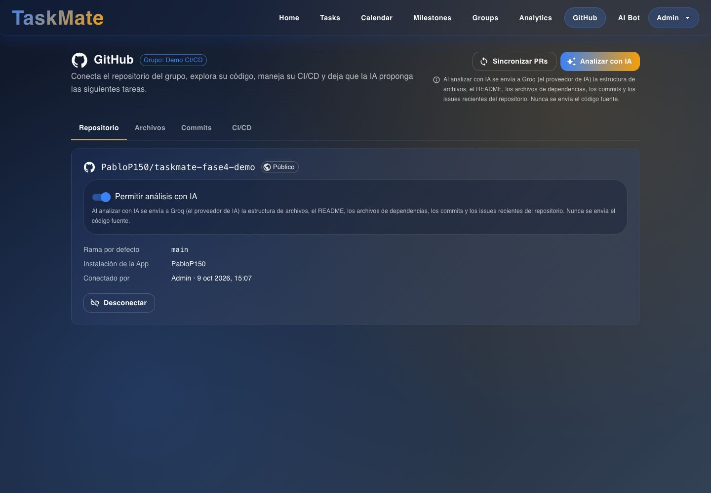
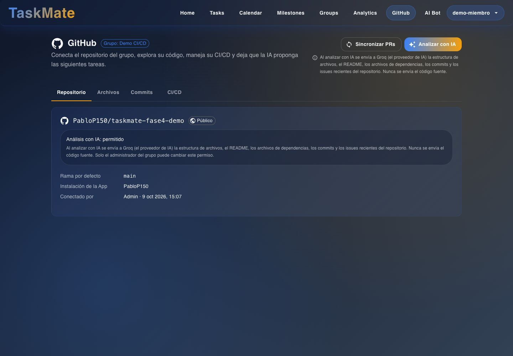
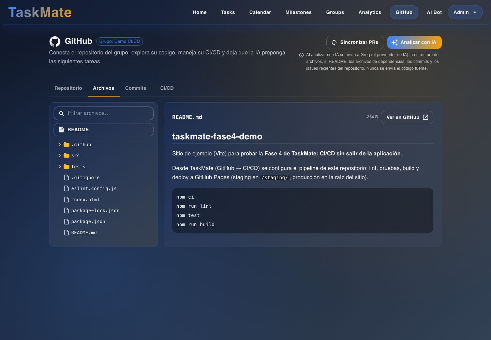
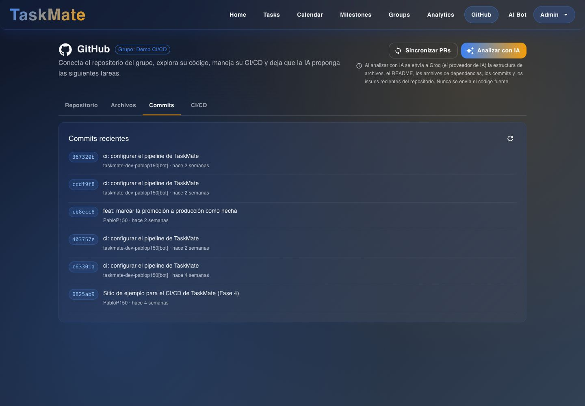
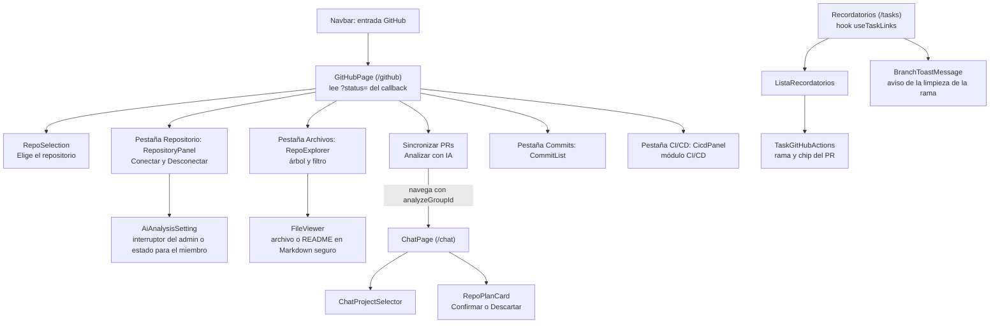

# GitHub: interfaz

**En una frase:** la página «GitHub» (`/github`) del grupo activo tiene las pestañas Repositorio, Archivos, Commits y CI/CD; además, cada tarea de `/tasks` muestra su rama y su PR, y el chat muestra el plan que propone la IA.

## Pantallas

**Repositorio, vista del admin.** Arriba, «Sincronizar PRs» y «Analizar con IA». En la tarjeta: el interruptor «Permitir análisis con IA», los datos del repositorio y «Desconectar».

**Repositorio, vista de un miembro.** Los mismos datos y los mismos botones de arriba. En lugar del interruptor dice «Análisis con IA: permitido» (o «desactivado») y que solo el admin puede cambiarlo. No hay «Desconectar».

**Archivos.** Árbol con filtro a la izquierda; a la derecha, el README o el archivo elegido, con «Ver en GitHub».

**Commits.** Los últimos commits de la rama por defecto, con su autor y hace cuánto.

La pestaña CI/CD es del módulo [CI/CD](08-cicd.md).

## Qué puedes hacer

**Sin repositorio conectado**
- La tarjeta dice «Sin repositorio conectado». Archivos, Commits y CI/CD quedan desactivadas.
- Admin: «Conectar repositorio» (instala la App en GitHub) o «Ya instalé la App» (solo autoriza). Al volver aparece «Elige el repositorio», con «Conectando como @usuario», y el botón «Vincular repositorio».
- Miembro: ve «Solo el administrador del grupo puede conectar un repositorio».

**Admin del grupo**
- Todo lo que hace un miembro.
- Activar o apagar «Permitir análisis con IA». El texto de al lado dice qué se manda a Groq.
- «Desconectar», con confirmación. La App sigue instalada en GitHub.

**Miembro del grupo**
- Ver el repositorio (público o privado), la rama por defecto, la cuenta de la instalación y quién lo conectó.
- Ver si el análisis con IA está permitido, sin poder cambiarlo.
- Archivos: filtrar el árbol, abrir archivos de texto de hasta 1 MB, leer el README y activar «Ajustar líneas».
- Commits: ver los recientes y recargarlos.
- «Sincronizar PRs»: al terminar, un aviso dice cuántas ramas revisó, cuántos PR encontró y cuántos actualizó.
- «Analizar con IA», solo si el admin lo permitió (si no, el botón está apagado y el texto pide al admin que lo active): abre el chat con el grupo elegido y empieza el análisis. El plan llega como una tarjeta con «Confirmar» y «Descartar».
- En `/tasks`, en cada tarea:
  - si aún no tiene rama, el botón «Crear rama en GitHub»;
  - el chip con el nombre de la rama: al pulsarlo copia `git checkout <rama>`;
  - el enlace «Ver rama en GitHub»;
  - el chip «PR #N abierto», «borrador», «cerrado» o «fusionado». Si se fusionó en otra rama, el chip lo dice y avisa que la tarea no se completa sola.
- Al completar una tarea, mandarla a la papelera o borrar su lista, un aviso dice qué pasó con su rama: «eliminada en GitHub», «sigue en GitHub: tiene commits sin fusionar» o «tiene un PR abierto».

Si la instalación está suspendida, la tarjeta lo avisa, las otras pestañas se desactivan y desaparecen «Sincronizar PRs» y «Analizar con IA».

## Árbol de componentes

## Dónde está en el código

| Archivo | Qué hace |
|---|---|
| `src/components/github/GitHubPage.jsx` | Página `/github`: pestañas, resultado del callback (`?status=select`, `updated`, `pending`, `error`), sincronizar y analizar |
| `src/components/github/RepoSelection.jsx` | Lista de repositorios del callback y «Vincular repositorio» |
| `src/components/github/RepositoryPanel.jsx` | Estado del repo, «Conectar repositorio», «Ya instalé la App», «Desconectar» y `AiAnalysisSetting` (el permiso de IA) |
| `src/components/github/RepoExplorer.jsx` | Árbol filtrable; carga el README o el archivo elegido |
| `src/components/github/FileViewer.jsx` | Muestra código o Markdown con `react-markdown` + `rehype-sanitize` (sin HTML crudo) |
| `src/components/github/CommitList.jsx` | Commits recientes de la rama por defecto |
| `src/components/github/TaskGitHubActions.jsx` | En cada tarea: crear rama, copiar `git checkout`, enlaces y chip del PR |
| `src/components/github/useTaskLinks.js` | Hook (función que guarda estado y llama a la API): repo y vínculos rama ↔ PR del grupo en dos llamadas |
| `src/components/github/BranchToastMessage.jsx` | Convierte el resultado de la limpieza de ramas en el texto del aviso |
| `src/components/github/RepoPlanCard.jsx` | Tarjeta del plan de la IA en el chat |
| `src/components/github/ChatProjectSelector.jsx` | Elegir el proyecto del chat; con repo y permiso, el mensaje se usa para analizarlo |
| `src/components/github/githubUtils.js` | Mensajes de error en español, URLs seguras (solo `https://github.com`), fechas |
| `src/api/github.js` | Llamadas a `/api/github` |

## Para saber más

- Navegación completa de la app: [00-general.md](00-general.md)
- Paso a paso y mensajes de error: [06-flujos/07-github.md](../06-flujos/07-github.md)
- Quién puede hacer qué: [04-casos-de-uso/07-github.md](../04-casos-de-uso/07-github.md)
- Chat con la IA: [05-chat-ia.md](05-chat-ia.md)
- Probar todo con GitHub real: [checklist E2E](../07-guias/guia-github-app.md#9-checklist-e2e-manual)
- Limitaciones conocidas: [cierre del proyecto](../01-proyecto/cierre-del-proyecto.md#github-y-cicd)
