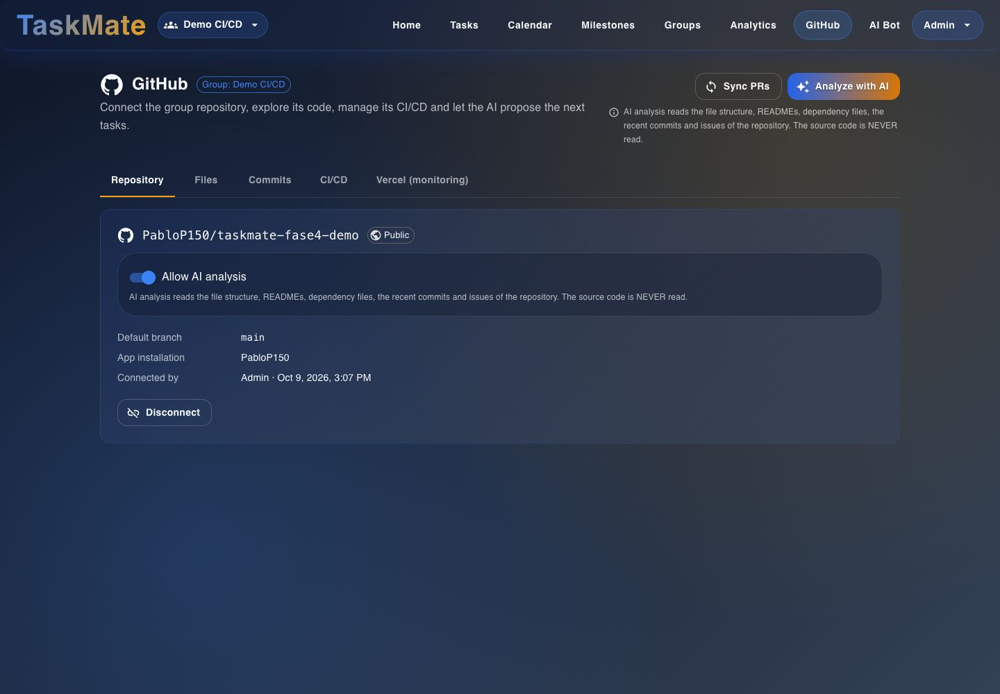
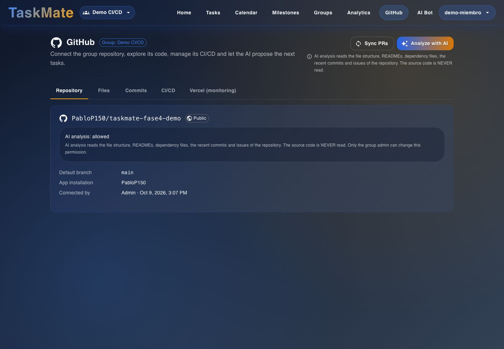
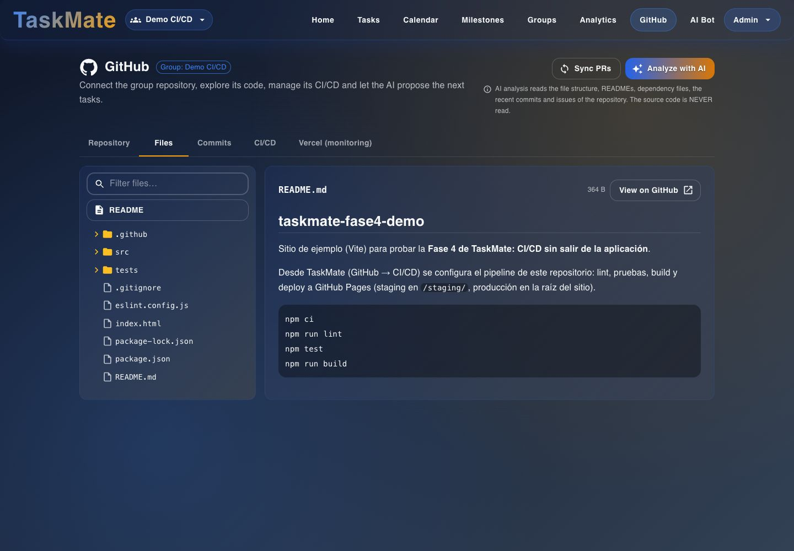
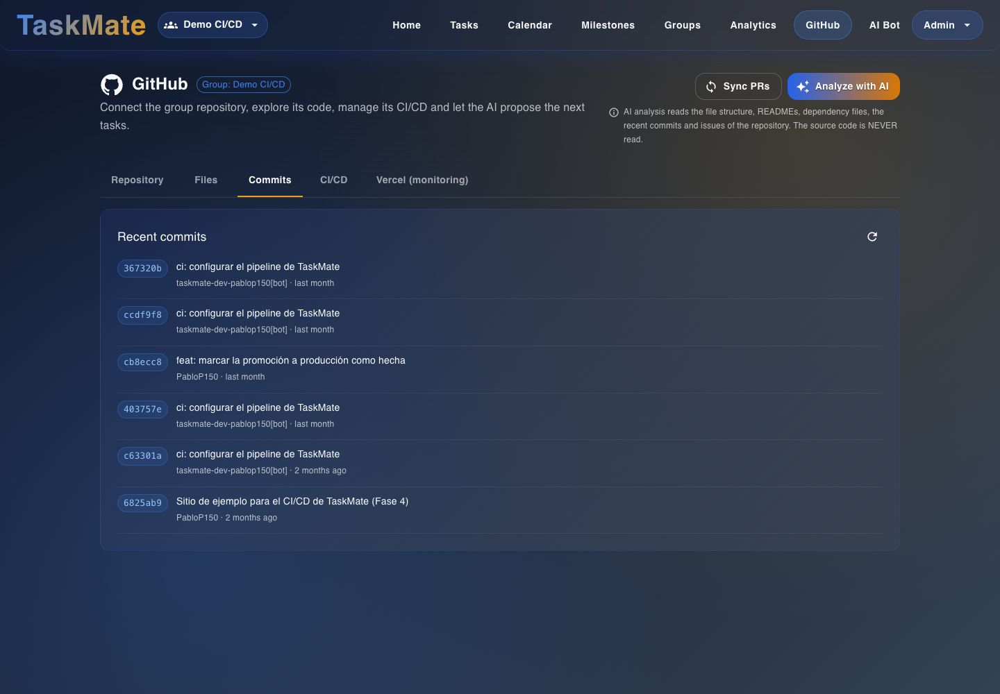
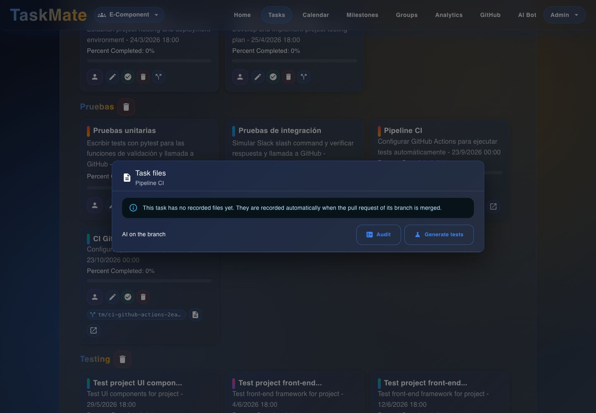
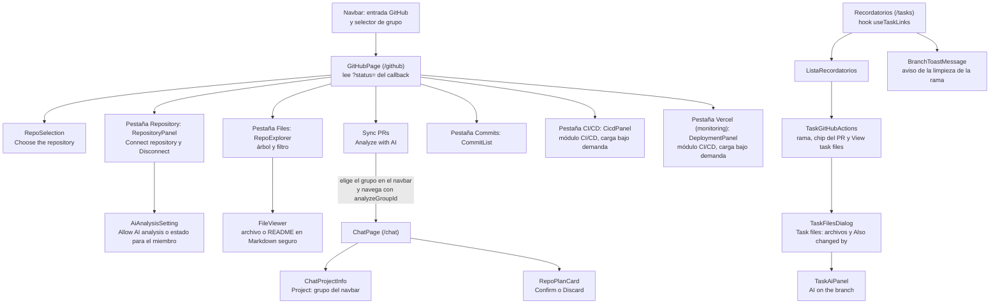

# GitHub: interfaz

**En una frase:** la página «GitHub» (`/github`) del grupo activo tiene las pestañas Repository, Files, Commits, CI/CD y «Vercel (monitoring)»; además, cada tarea de `/tasks` muestra su rama, su PR y sus archivos («Task files»), y el chat muestra el plan que propone la IA.

## Pantallas

Capturas del 26 nov 2026, grupo «Demo CI/CD» con el repositorio `PabloP150/taskmate-fase4-demo`.

**Repository, vista del admin.** Arriba, «GitHub» con el chip «Group: Demo CI/CD», «Sync PRs» y «Analyze with AI», y las 5 pestañas. En la tarjeta: el repositorio («Public»), el interruptor «Allow AI analysis» encendido, «Default branch», «App installation», «Connected by» y «Disconnect».

**Repository, vista de un miembro.** Los mismos datos y los mismos botones de arriba. En lugar del interruptor dice «AI analysis: allowed» (u «off») y, al final del texto de abajo, «Only the group admin can change this permission.». No hay «Disconnect».

**Files.** Árbol con filtro («Filter files…») y el botón «README» a la izquierda; a la derecha, el README o el archivo elegido, con su tamaño y «View on GitHub». El README del repo de prueba está en español.

**Commits.** «Recent commits» de la rama por defecto, con el SHA corto, el mensaje, el autor y hace cuánto (en inglés: «last month», «2 months ago»). Los mensajes son los del repo, en español.

Las pestañas CI/CD y «Vercel (monitoring)» son del módulo [CI/CD](08-cicd.md).

**Task files.** Diálogo que abre el icono «View task files» de una tarea en `/tasks`: título «Task files» con el nombre de la tarea y, si hay PR, el enlace «PR #N»; debajo, «N files» con el total de +/− y la lista de archivos. Abajo va el panel «AI on the branch».

En la captura (grupo «E-Component», tarea «Pipeline CI») la rama aún no tiene PR ni archivos registrados: sale el aviso «This task has no recorded files yet. They are recorded automatically when the pull request of its branch is merged.» y, abajo, «AI on the branch» con «Audit» y «Generate tests», sin «Review PR».

## Qué puedes hacer

**Sin repositorio conectado**
- La tarjeta dice «No repository connected». Files, Commits y CI/CD quedan desactivadas, y «Vercel (monitoring)» devuelve a Repository.
- Admin: «Connect repository» (instala la App en GitHub) o «I already installed the App» (solo autoriza). Al volver aparece «Choose the repository», con «Connecting as @usuario», y el botón «Link repository».
- Miembro: ve «Only the group admin can connect a repository.».

**Admin del grupo**
- Todo lo que hace un miembro.
- Activar o apagar «Allow AI analysis». El texto de al lado dice qué lee la IA: estructura, README, dependencias, commits e issues recientes; nunca el código fuente. Ese texto no cubre «Audit», «Generate tests» y «Review PR», que sí mandan el diff ([limitaciones](../01-proyecto/cierre-del-proyecto.md#ia-sobre-el-código)).
- «Disconnect», con la confirmación «Disconnect the repository?». La App sigue instalada en GitHub.

**Miembro del grupo**
- Ver el repositorio («Private» o «Public»), «Default branch», «App installation» y «Connected by».
- Ver si el análisis con IA está permitido, sin poder cambiarlo.
- Files: filtrar el árbol, abrir archivos de texto de hasta 1 MB, leer el README y activar «Wrap lines».
- Commits: ver los recientes y recargarlos («Refresh»).
- «Sync PRs»: al terminar, el aviso «Sync complete: N branches checked, M PRs found, K updated.».
- «Analyze with AI», solo si el admin lo permitió (si no, el botón está apagado y el texto pide activarlo): elige ese grupo en el navbar, abre el chat y empieza el análisis. El plan llega como una tarjeta con «Confirm» y «Discard».
- En `/tasks`, en cada tarea activa (no en los filtros «Completed» ni «Deleted») y solo si el grupo tiene repositorio:
  - si aún no tiene rama, el botón «Create branch on GitHub»;
  - el chip con el nombre de la rama: al pulsarlo copia `git checkout <rama>` («Command copied: …»);
  - el icono «View task files», que abre «Task files»;
  - el enlace «View branch on GitHub»;
  - el chip «PR #N open», «draft», «closed» o «merged». Si se fusionó en otra rama dice «… into <rama>» y avisa que la tarea no se completa sola.
- En «Task files»:
  - cada archivo con un chip de estado de color (`added`, `modified`, `removed`, `renamed`, `copied` o `changed`), su ruta, +/− y «Open on GitHub» (salvo los borrados);
  - en ámbar, «Also changed by: …» si otra tarea activa del grupo también tocó ese archivo;
  - el chip «recovered from GitHub» si la lista se acaba de pedir al abrir;
  - sin lista: «This task has no recorded files yet. They are recorded automatically when the pull request of its branch is merged.». Ese registro automático, según el código, no funciona ([limitaciones](../01-proyecto/cierre-del-proyecto.md#limitaciones-conocidas)): en la práctica la lista aparece cuando la rama ya tiene PR;
  - si falla: «Could not load the task files.»;
  - el panel «AI on the branch» con «Audit», «Generate tests» y «Review PR» (este, solo con el PR abierto). Con la IA apagada solo muestra un aviso. Detalle en [IA sobre el código](10-ia-sobre-el-codigo.md).
- Al completar una tarea, mandarla a la papelera o borrar su lista, un aviso dice qué pasó con su rama: «Branch x deleted on GitHub.», «Branch x is still on GitHub: it has unmerged commits.» o «… it has an open PR.», con el enlace «View branch».

Si la instalación está suspendida, la tarjeta lo avisa, Files, Commits y CI/CD se desactivan, «Vercel (monitoring)» devuelve a Repository y desaparecen «Sync PRs» y «Analyze with AI».

## Árbol de componentes

## Dónde está en el código

| Archivo | Qué hace |
|---|---|
| `src/components/github/GitHubPage.jsx` | Página `/github`: pestañas (CI/CD y Vercel se cargan con `React.lazy`), resultado del callback (`?status=select`, `updated`, `pending`, `error`), sincronizar y analizar |
| `src/components/github/RepoSelection.jsx` | Lista de repositorios del callback y «Link repository» |
| `src/components/github/RepositoryPanel.jsx` | Estado del repo, «Connect repository», «I already installed the App», «Disconnect» y `AiAnalysisSetting` (el permiso de IA) |
| `src/components/github/RepoExplorer.jsx` | Árbol filtrable; carga el README o el archivo elegido |
| `src/components/github/FileViewer.jsx` | Muestra código o Markdown con `react-markdown` + `rehype-sanitize` (sin HTML crudo) |
| `src/components/github/CommitList.jsx` | Commits recientes de la rama por defecto |
| `src/components/github/TaskGitHubActions.jsx` | En cada tarea: crear rama, copiar `git checkout`, enlaces, chip del PR y el icono «View task files». Sin repo conectado no se muestra |
| `src/components/github/TaskFilesDialog.jsx` | Diálogo «Task files»: pide `/files` y, si hay archivos, `/overlaps`; un fallo en `/overlaps` no oculta la lista. Los enlaces van al commit de la lista, o a la rama |
| `src/components/github/TaskAiPanel.jsx` | Panel «AI on the branch» dentro de «Task files» ([detalle](10-ia-sobre-el-codigo.md)) |
| `src/components/github/useTaskLinks.js` | Hook (función que guarda estado y llama a la API): repo y vínculos rama ↔ PR del grupo en dos llamadas |
| `src/components/github/BranchToastMessage.jsx` | Convierte el resultado de la limpieza de ramas en el texto del aviso |
| `src/components/github/RepoPlanCard.jsx` | Tarjeta del plan de la IA en el chat |
| `src/components/github/ChatProjectInfo.jsx` | Encabezado del chat: muestra el grupo del navbar («Project: …») y el repo o «No repository»; no elige nada |
| `src/components/github/githubUtils.js` | Mensajes de error en inglés por código, URLs seguras (solo `https://github.com`), fechas en inglés |
| `src/api/github.js` | Llamadas a `/api/github`, incluidas las de la tarea: `getTaskFiles`, `getTaskOverlaps`, `auditTask`, `generateTaskTests`, `getTaskReview` y `reviewTaskPr` |

## Para saber más

- Navegación completa de la app: [00-general.md](00-general.md)
- Paso a paso y mensajes de error: [06-flujos/07-github.md](../06-flujos/07-github.md)
- Quién puede hacer qué: [04-casos-de-uso/07-github.md](../04-casos-de-uso/07-github.md)
- Tarjetas de tareas: [03-tareas.md](03-tareas.md)
- Chat con la IA: [05-chat-ia.md](05-chat-ia.md)
- Panel «AI on the branch»: [10-ia-sobre-el-codigo.md](10-ia-sobre-el-codigo.md)
- Probar todo con GitHub real: [checklist E2E](../07-guias/guia-github-app.md#9-checklist-e2e-manual)
- Limitaciones conocidas: [cierre de la línea de Pablo y estado](../01-proyecto/cierre-del-proyecto.md#limitaciones-conocidas)
