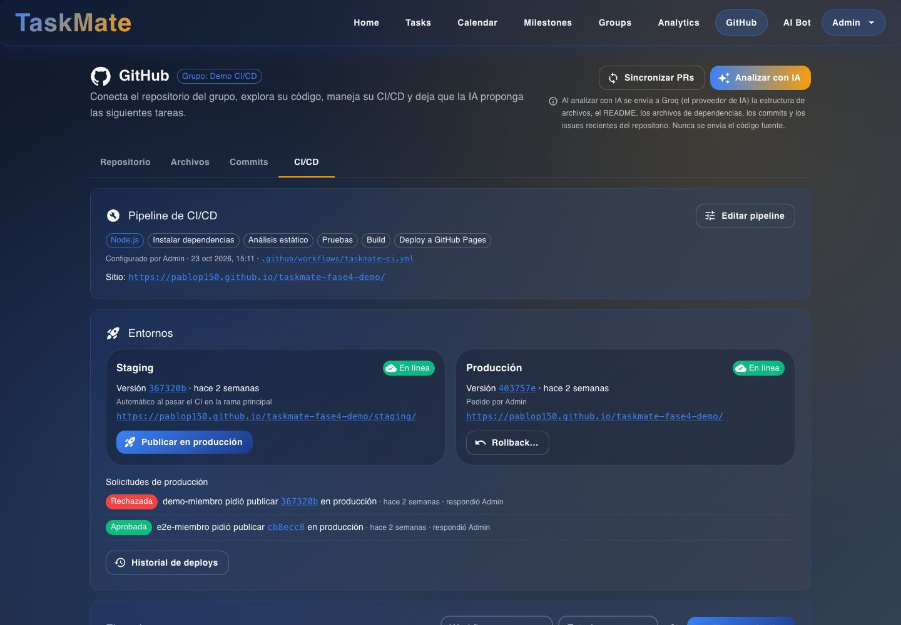
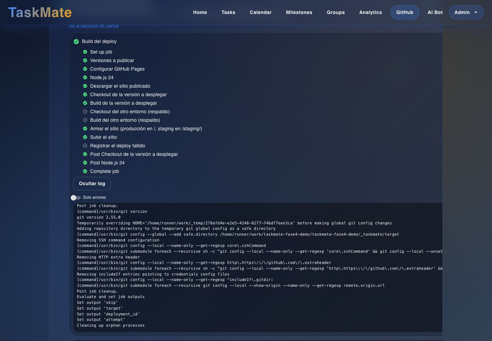
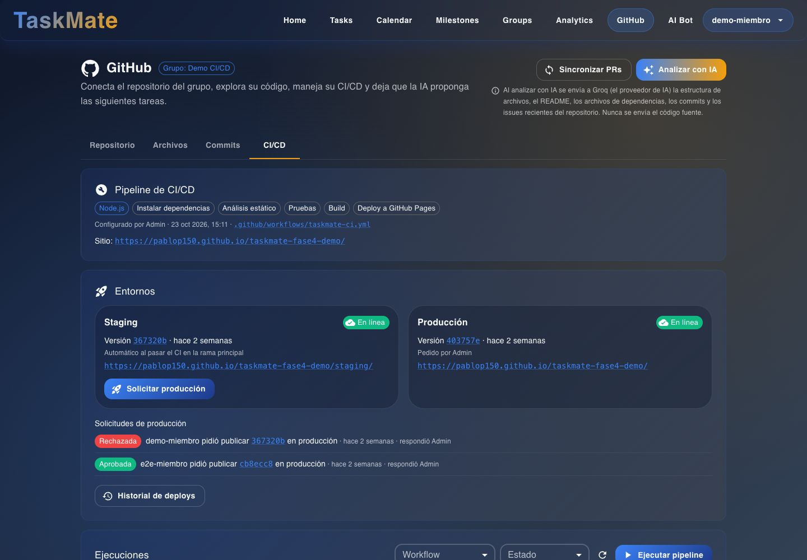
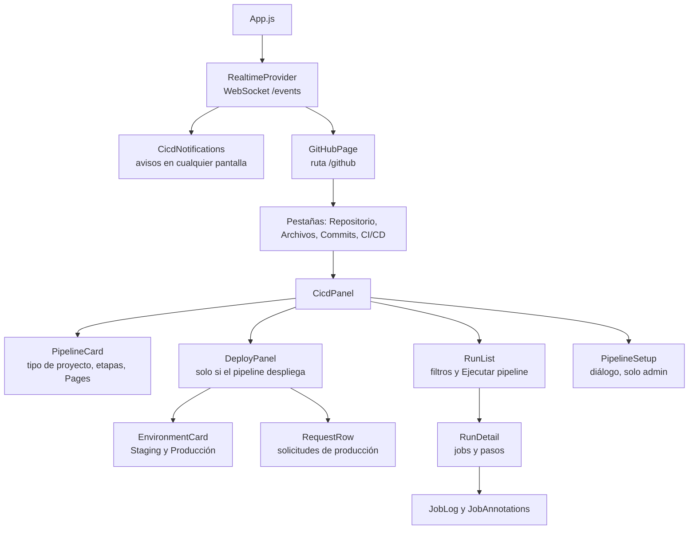

# CI/CD: interfaz

**En una frase:** todo el CI/CD del repositorio del grupo se maneja en **GitHub → pestaña CI/CD** (`/github`): la tarjeta del pipeline, los entornos (staging y producción) y la lista de ejecuciones con sus logs.

## Pantallas

**Vista del admin:** tarjeta **Pipeline de CI/CD** con «Editar pipeline», y tarjeta **Entornos** con «Publicar en producción», «Rollback…», las solicitudes de producción y el «Historial de deploys». La lista de **Ejecuciones** sigue debajo.

**Una ejecución abierta:** el job «Build del deploy» con sus pasos (los saltados llevan un círculo gris) y su log abierto, con «Ocultar log» y «Solo errores».

**Vista de un miembro:** sin «Editar pipeline» ni «Rollback…»; en staging aparece «Solicitar producción» en lugar de «Publicar en producción». «Ejecutar pipeline» sigue disponible.

## Qué puedes hacer

**Cualquier miembro**
- Ver el pipeline: tipo de proyecto, etapas, quién lo configuró, el archivo del workflow y la URL de GitHub Pages.
- Ver las **Ejecuciones** (de todos los workflows del repositorio), filtrar por workflow y estado, y cargar 20 más con «Ver más».
- Abrir una ejecución: jobs y pasos, las anotaciones de los jobs fallidos (errores y avisos con archivo y línea) y **«Ver log»** (con «Solo errores»).
- **«Ejecutar pipeline»** en una rama (solo CI), **«Re-ejecutar fallidos»** y **«Cancelar»** en ejecuciones de CI.
- Ver **Entornos**: estado, versión publicada y URL de staging y producción, y el **«Historial de deploys»**.
- **«Solicitar producción»** con la versión de staging, y **«Cancelar solicitud»** si es suya.

**Admin del grupo** (además de lo anterior)
- **«Configurar pipeline»** o **«Editar pipeline»**: elegir proyecto, etapas y deploy, **«Proponer con IA»**, **«Ver el archivo YAML»** y **«Subir al repositorio»**.
- **«Publicar en producción»** la versión de staging y **«Rollback…»** a una versión anterior.
- **«Aprobar»** o **«Rechazar»** las solicitudes de producción.
- Re-ejecutar o cancelar las ejecuciones de deploy (a un miembro se le muestra «Solo el administrador del grupo puede re-ejecutar o cancelar un deploy.»).

**Estados de la pantalla**
- Sin repositorio conectado, la pestaña **CI/CD** está deshabilitada.
- Sin pipeline, la tarjeta lo dice: el admin ve el botón para configurarlo y el miembro, «Pide al administrador del grupo que lo configure.».
- La tarjeta **Entornos** solo aparece si el pipeline tiene deploy.
- Todo se actualiza solo con los avisos de `/events`. Mientras algo corre, la pantalla además consulta cada 60 s (cada 10–15 s si se cortó la conexión en vivo), solo con la pestaña del navegador visible.

## Árbol de componentes

## Dónde está en el código

| Archivo | Qué hace |
|---------|----------|
| `src/components/github/GitHubPage.jsx` | Página `/github`, pestañas y cálculo de `isAdmin` (`Groups.adminId`) |
| `src/components/github/cicd/CicdPanel.jsx` | Arma la pestaña CI/CD |
| `src/components/github/cicd/PipelineCard.jsx` | Tarjeta del pipeline y avisos de workflow viejo o borrado |
| `src/components/github/cicd/PipelineSetup.jsx` | Diálogo para configurar: propuesta, campos, etapas, YAML y subida |
| `src/components/github/cicd/RunList.jsx` | Lista de ejecuciones, filtros, «Ejecutar pipeline», re-ejecutar y cancelar |
| `src/components/github/cicd/RunDetail.jsx` | Jobs y pasos de una ejecución |
| `src/components/github/cicd/JobLog.jsx` | Log del job y anotaciones |
| `src/components/github/cicd/DeployPanel.jsx` | Entornos, publicar, rollback, solicitudes e historial |
| `src/components/github/cicd/cicdUtils.jsx`, `useVisibleInterval.js` | Estados, etiquetas y consultas periódicas con la pestaña visible |
| `src/components/realtime/RealtimeContext.jsx`, `CicdNotifications.jsx` | Conexión a `/events` y avisos globales |
| `src/components/github/githubUtils.js` | Mensajes en español de cada código de error |
| `src/api/github.js` | Llamadas REST del módulo |

Pruebas del frontend: `src/components/github/cicd/__tests__/` y `src/components/realtime/__tests__/`.

## Para saber más

- Navegación general: [00-general.md](00-general.md)
- Casos de uso y permisos: [04-casos-de-uso/08-cicd.md](../04-casos-de-uso/08-cicd.md)
- Qué pasa al pulsar cada botón: [06-flujos/08-cicd.md](../06-flujos/08-cicd.md)
- Guía de uso con todos los mensajes: [guia-cicd.md](../07-guias/guia-cicd.md)
