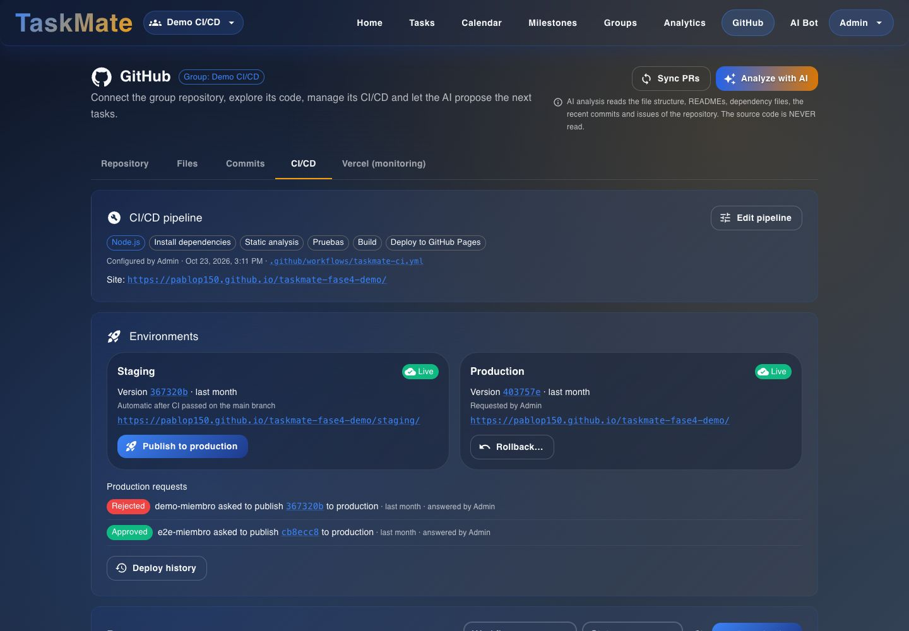
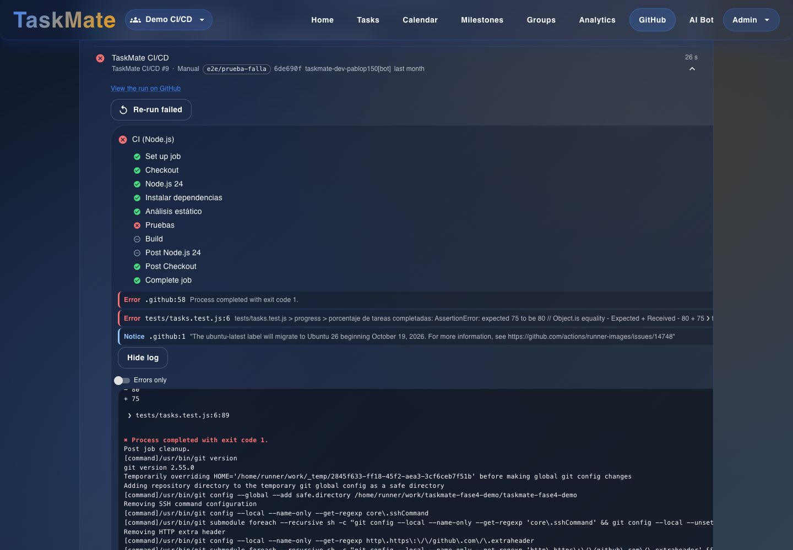
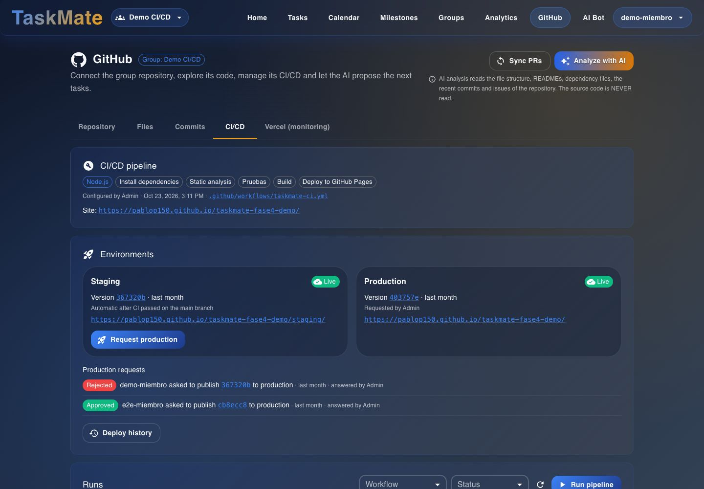
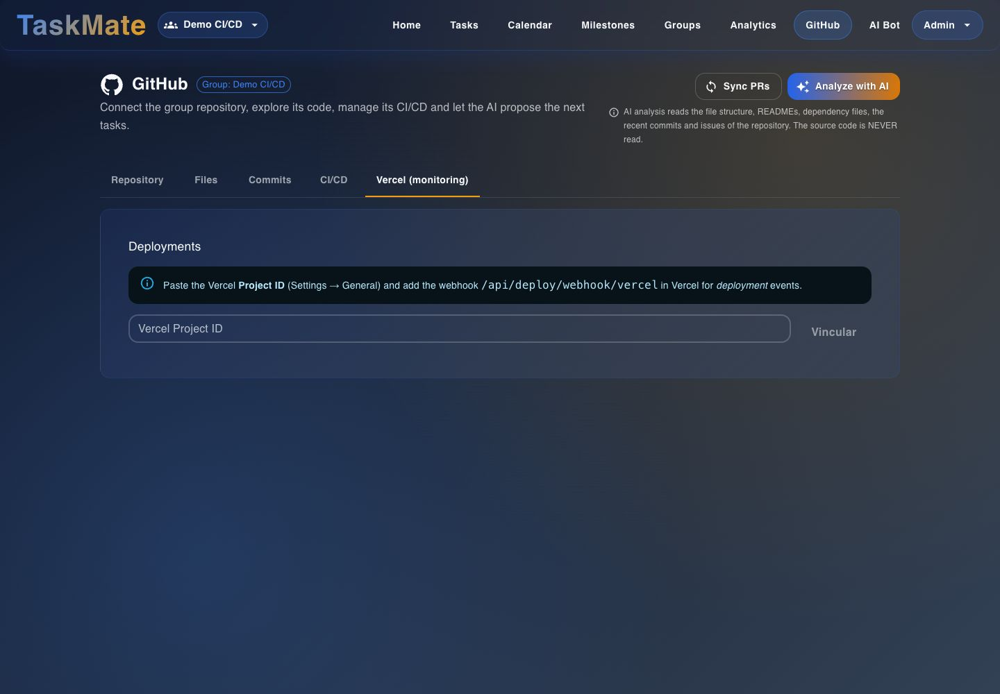
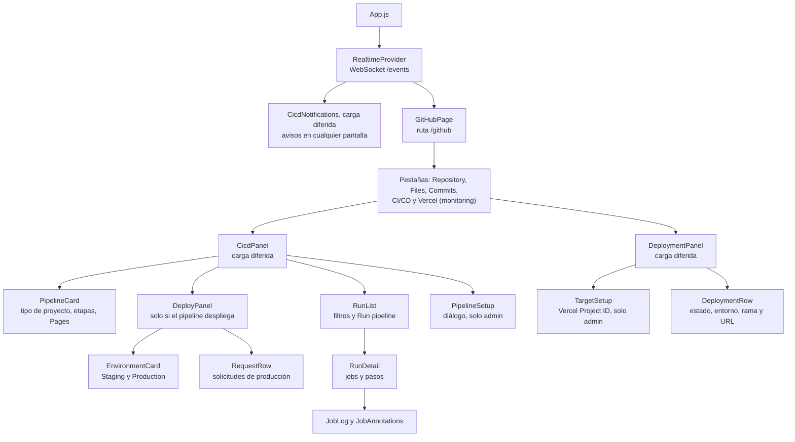

# CI/CD: interfaz

**En una frase:** todo el CI/CD del repositorio del grupo se maneja en **GitHub → pestaña CI/CD** (`/github`): la tarjeta del pipeline, los entornos (staging y producción) y la lista de ejecuciones con sus logs; al lado, la pestaña **Vercel (monitoring)** muestra los despliegues que avisa Vercel.

## Pantallas

Capturas del 26 nov 2026, grupo «Demo CI/CD» con el repositorio `PabloP150/taskmate-fase4-demo`. El pipeline se subió el 23 oct, antes del cambio de idioma, así que la etapa y los pasos que vienen del YAML conservan sus nombres en español («Pruebas», «Instalar dependencias», «Análisis estático»).

**Vista del admin:** tarjeta **CI/CD pipeline** con sus etapas, «Configured by», el archivo `.github/workflows/taskmate-ci.yml`, «Site:» y «Edit pipeline»; tarjeta **Environments** con staging y producción en «Live», «Publish to production», «Rollback…», las **Production requests** (una «Rejected» y una «Approved») y el «Deploy history». La lista de **Runs** sigue debajo.

**Una ejecución abierta:** «TaskMate CI/CD #9», lanzada a mano en la rama `e2e/prueba-falla`. El job «CI (Node.js)» falló en el paso «Pruebas»; los pasos saltados («Build», «Post Node.js 24») llevan un círculo gris. Debajo, las anotaciones (dos «Error» y un «Notice» con archivo y línea), «Hide log», el interruptor «Errors only» y el log abierto. Arriba, «View the run on GitHub» y «Re-run failed».

**Vista de un miembro:** sin «Edit pipeline» ni «Rollback…»; en staging aparece «Request production» en lugar de «Publish to production». «Run pipeline» sigue disponible, abajo en **Runs**, junto a los filtros «Workflow» y «Status».

**Pestaña Vercel (monitoring), sin proyecto vinculado (admin):** la tarjeta **Deployments** con el aviso «Paste the Vercel Project ID (Settings → General) and add the webhook /api/deploy/webhook/vercel in Vercel for deployment events.», el campo «Vercel Project ID» y el botón «Vincular», que la app todavía muestra en español.

**Con un proyecto vinculado** (sin captura): la misma tarjeta **Deployments** con «Vercel project: <id>», «Refresh» y, solo para el admin, «Unlink». Debajo, hasta 20 despliegues, del más nuevo al más viejo.

## Qué puedes hacer

**Cualquier miembro**
- Ver el pipeline: tipo de proyecto, etapas, «Configured by», el archivo del workflow y la URL de GitHub Pages («Site:»).
- Ver las **Runs** (de todos los workflows del repositorio), filtrar por «Workflow» y «Status», y cargar 20 más con «Show more».
- Abrir una ejecución: jobs y pasos, las anotaciones de los jobs fallidos (errores y avisos con archivo y línea) y **«View log»** (con «Errors only»).
- **«Run pipeline»** en una rama (solo CI), **«Re-run failed»** y **«Cancel»** en ejecuciones de CI.
- Ver **Environments**: estado («Live», «Last deploy failed» o «No version»), versión publicada y URL de staging y producción, y el **«Deploy history»**.
- **«Request production»** con la versión de staging, y **«Cancel request»** si es suya.
- En **Vercel (monitoring)**: ver el proyecto vinculado y sus despliegues, y recargar con **«Refresh»**.

**Admin del grupo** (además de lo anterior)
- **«Set up pipeline»** o **«Edit pipeline»**: en el diálogo «Set up CI/CD pipeline», elegir proyecto, etapas y deploy («Deploy to GitHub Pages»), **«Propose with AI»**, **«Show the YAML file»** y **«Push to repository»**.
- **«Publish to production»** la versión de staging y **«Rollback…»** a una versión anterior.
- **«Approve»** o **«Reject»** las solicitudes de producción.
- Re-ejecutar o cancelar las ejecuciones de deploy (a un miembro se le muestra «Only the group admin can re-run or cancel a deploy.»).
- En **Vercel (monitoring)**: pegar el **«Vercel Project ID»** (`prj_…`) y pulsar **«Vincular»**, o quitarlo con **«Unlink»** (no pide confirmación).

**Estados de la pantalla**
- Sin repositorio conectado (o con la instalación suspendida), la pestaña **CI/CD** está deshabilitada. **Vercel (monitoring)** no se deshabilita, pero la página vuelve sola a **Repository** mientras no haya un repositorio usable, así que en la práctica también lo necesita.
- Sin pipeline, la tarjeta lo dice: el admin ve el botón para configurarlo y el miembro, «This repository does not have a TaskMate pipeline yet. Ask the group admin to set it up.».
- La tarjeta **Environments** solo aparece si el pipeline tiene deploy.
- CI/CD se actualiza solo con los avisos de `/events`. Mientras algo corre, la pantalla además consulta cada 60 s (cada 10–15 s si se cortó la conexión en vivo), solo con la pestaña del navegador visible.
- **Vercel sin proyecto vinculado:** el admin ve «Paste the Vercel Project ID (Settings → General) and add the webhook /api/deploy/webhook/vercel in Vercel for deployment events.» y el campo para vincular; el miembro ve «This group does not have a deployment project linked yet. A group admin can link it.».
- **Vercel con proyecto vinculado:** cada despliegue lleva un chip de estado («Queued», «Building», «Deployed», «Failed» o «Cancelled»), otro de `production` o `preview`, la rama, el SHA corto, la fecha y la URL; si falló, una alerta roja con el mensaje de Vercel. Sin despliegues aparece «No deployments received yet. They will show up here as soon as Vercel sends the first webhook.».
- **Vercel no se actualiza solo:** la lista se pide al abrir la pestaña o al pulsar «Refresh»; no llega nada por `/events`.
- **Textos que siguen en español:** «Desplegando…» y «Publicando <sha>…» en Environments, «Omitido» en los pasos saltados, la etapa y el paso «Pruebas», y «Vincular» / «Vinculando…» en Vercel. Un workflow subido antes del 19 nov conserva sus nombres en español hasta que el admin vuelva a subir el pipeline.
- El aviso del diálogo dice que solo se manda a Groq la lista de proyectos y scripts; con `LLM_PROVIDER=ollama` la propuesta la hace el modelo local y no sale a Groq.

## Árbol de componentes

## Dónde está en el código

| Archivo | Qué hace |
|---------|----------|
| `src/components/github/GitHubPage.jsx` | Página `/github`, pestañas, cálculo de `isAdmin` (`Groups.adminId`) y carga diferida (`React.lazy`) de `CicdPanel` y `DeploymentPanel` |
| `src/components/github/cicd/CicdPanel.jsx` | Arma la pestaña CI/CD |
| `src/components/github/cicd/PipelineCard.jsx` | Tarjeta del pipeline y avisos de workflow viejo o borrado |
| `src/components/github/cicd/PipelineSetup.jsx` | Diálogo para configurar: propuesta, campos, etapas, YAML y subida |
| `src/components/github/cicd/RunList.jsx` | Lista de ejecuciones, filtros, «Run pipeline», re-ejecutar y cancelar |
| `src/components/github/cicd/RunDetail.jsx` | Jobs y pasos de una ejecución |
| `src/components/github/cicd/JobLog.jsx` | Log del job y anotaciones |
| `src/components/github/cicd/DeployPanel.jsx` | Entornos, publicar, rollback, solicitudes e historial |
| `src/components/github/cicd/cicdUtils.jsx`, `useVisibleInterval.js` | Estados, etiquetas y consultas periódicas con la pestaña visible |
| `src/components/deploy/DeploymentPanel.jsx` | Pestaña Vercel (monitoring): vincular el Project ID (`TargetSetup`), lista de despliegues (`DeploymentRow`), «Refresh» y «Unlink» |
| `src/components/realtime/RealtimeContext.jsx`, `CicdNotifications.jsx` | Conexión a `/events` y avisos globales (`App.js` carga `CicdNotifications` con `React.lazy`) |
| `src/components/github/githubUtils.js` | Mensajes en inglés de cada código de error |
| `src/api/github.js` | Llamadas REST del CI/CD |
| `src/api/deploy.js` | Llamadas REST de Vercel: `getDeployTarget`, `linkDeployTarget`, `unlinkDeployTarget` y `getDeployments` (no confundir con el `getDeployments` de `src/api/github.js`, que lee los deploys de GitHub Pages) |

Pruebas del frontend: `src/components/github/cicd/__tests__/` y `src/components/realtime/__tests__/`. `DeploymentPanel` no tiene pruebas propias.

## Para saber más

- Navegación general: [00-general.md](00-general.md)
- Casos de uso y permisos: [04-casos-de-uso/08-cicd.md](../04-casos-de-uso/08-cicd.md)
- Qué pasa al pulsar cada botón: [06-flujos/08-cicd.md](../06-flujos/08-cicd.md)
- Guía de uso con todos los mensajes: [guia-cicd.md](../07-guias/guia-cicd.md)
- Limitaciones conocidas: [cierre de la línea de Pablo y estado](../01-proyecto/cierre-del-proyecto.md#limitaciones-conocidas)
