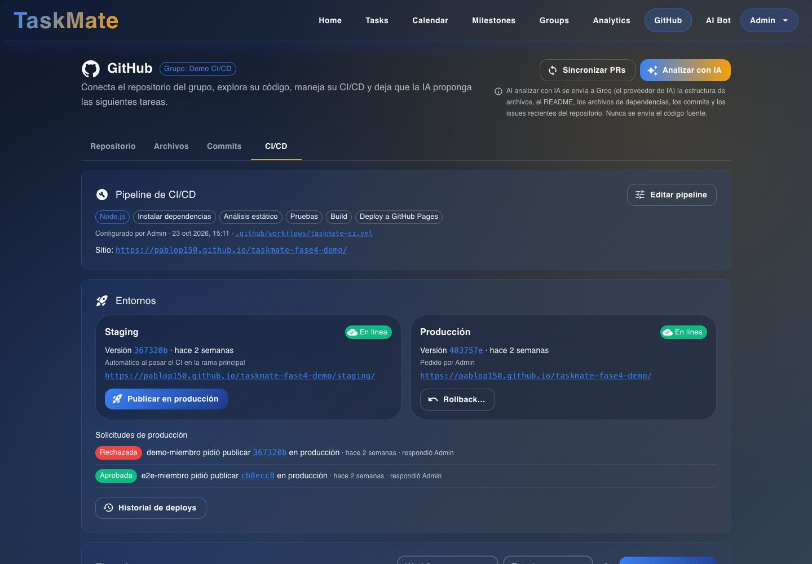
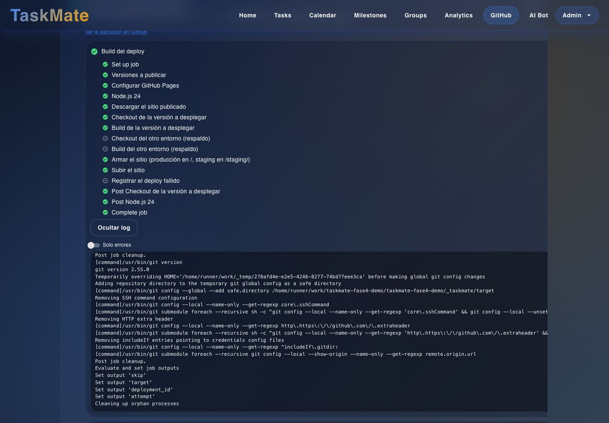
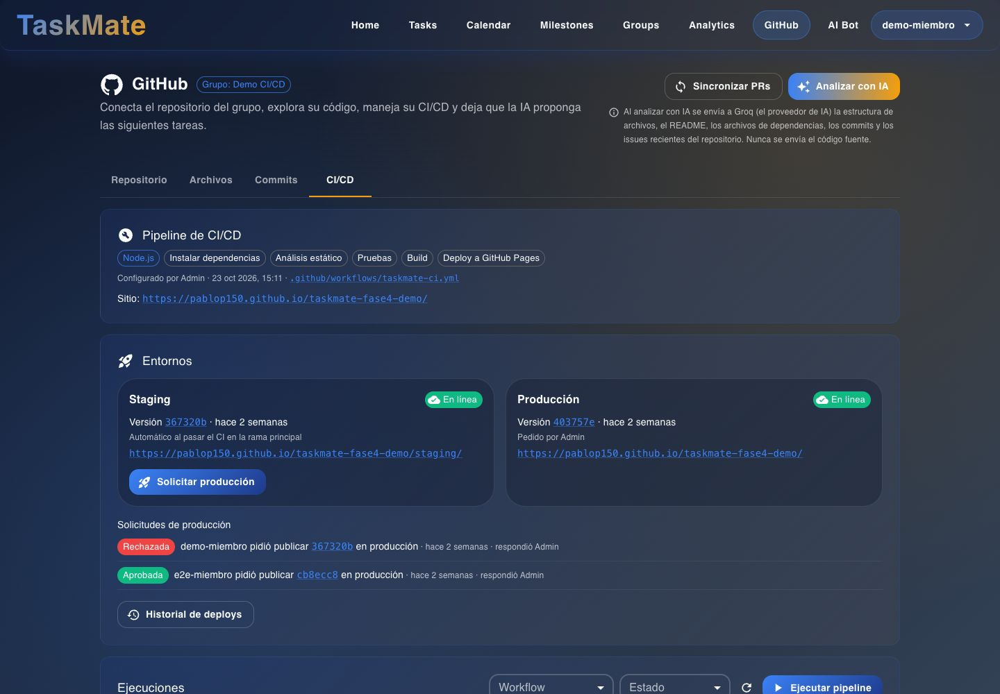
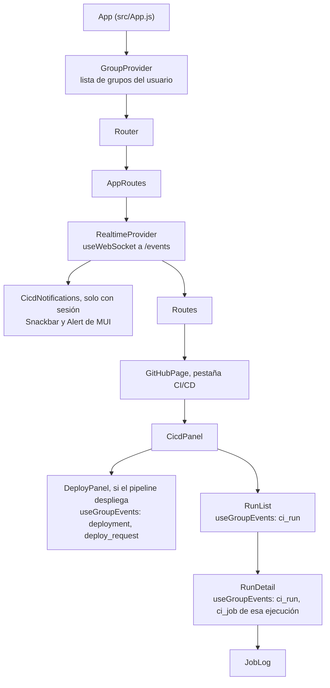

# Tiempo real y avisos: interfaz

**En una frase:** este módulo no tiene pantalla propia: pone avisos abajo a la derecha en cualquier pantalla y hace que la pestaña CI/CD de `/github` se actualice sola.

## Pantallas

**Pestaña CI/CD (admin):** «Entornos» y «Solicitudes de producción» se recargan con los eventos `deployment` y `deploy_request`; «Ejecuciones», con `ci_run`.

**Detalle de una ejecución:** los jobs y sus pasos se recargan con los `ci_run` y `ci_job` de esa ejecución.

**Pestaña CI/CD (miembro):** recibe los mismos eventos y se recarga igual. Solo cambian los botones: «Solicitar producción» en vez de «Publicar en producción», y sin «Editar pipeline» ni «Rollback…».

**El aviso** (no hay captura): una caja de color abajo a la derecha.

| Parte | Cómo es |
|---|---|
| Color | Rojo: algo falló. Verde: deploy publicado o solicitud aprobada. Naranja: solicitud pendiente, rechazada o deploy cancelado |
| Texto | Empieza con el grupo entre corchetes, por ejemplo «[Demo CI/CD] Falló «feat: login» en main.» |
| «Ver» | Elige ese grupo y abre `/github?tab=cicd` |
| «Abrir sitio» | Solo en un deploy exitoso: abre el entorno publicado en otra pestaña |
| Cierre | Con la ✕ o solo a los 9 s. Un clic fuera no lo cierra |
| Cola | Se ven de uno en uno; se guardan los últimos 5 |

No hay un indicador de «conectado». Sin conexión en vivo, mientras algo corre, la pestaña CI/CD sigue al día consultando a GitHub cada 10–15 s.

## Qué puedes hacer

**Sin sesión**
- Nada: no se abre la conexión y no hay avisos.

**Miembro**
- Ver avisos de tus grupos en cualquier pantalla, también justo después de recargar.
- Avisos de ejecuciones fallidas y de deploys terminados (éxito o fallo).
- Abrir el sitio publicado desde el aviso.
- Pulsar «Ver» para ir a la pestaña CI/CD de ese grupo.
- Ver cómo ejecuciones, detalle y entornos se actualizan sin recargar la página.

**Quien pidió un deploy a producción** (es un miembro)
- Aviso cuando el admin aprueba o rechaza tu solicitud, con su motivo.

**Admin del grupo**
- Todo lo del miembro.
- Aviso cuando otro miembro pide publicar en producción.
- Aviso cuando un deploy se cancela antes de publicar.

## Árbol de componentes

## Dónde está en el código

| Archivo | Qué hace |
|---|---|
| `src/App.js` | Envuelve todas las rutas con `RealtimeProvider` y monta `CicdNotifications` cuando hay sesión |
| `src/components/realtime/RealtimeContext.jsx` | Una conexión a `/events`, suscripción a los grupos, reintentos, `connected` y `epoch`; el hook `useGroupEvents` |
| `src/components/realtime/CicdNotifications.jsx` | Decide qué evento es un aviso para este usuario (`toNotice`), evita avisos dobles y muestra la cola |
| `src/hooks/useWebSocket.js` | Abre el socket con `?token=`, manda `ping` cada 30 s, reconecta y maneja el cierre 4001 |
| `src/components/github/cicd/RunList.jsx` | Lista de ejecuciones: recarga con `ci_run` (agrupa ráfagas en 1 s) |
| `src/components/github/cicd/RunDetail.jsx` | Jobs de una ejecución: recarga con sus `ci_run` y `ci_job` (800 ms) |
| `src/components/github/cicd/DeployPanel.jsx` | Entornos y solicitudes: recarga con `deployment` y `deploy_request` (800 ms) |
| `src/components/github/cicd/useVisibleInterval.js` | Polling de respaldo, solo con la pestaña visible |
| `src/components/GroupContext.jsx` | Grupos del usuario (con su `adminId`) y grupo activo |
| `src/components/realtime/__tests__/Realtime.test.jsx` | Pruebas de los avisos, la suscripción y la reconexión |

## Para saber más

- Arquitectura: [02-arquitectura/09-tiempo-real-y-avisos.md](../02-arquitectura/09-tiempo-real-y-avisos.md)
- Quién ve cada aviso: [04-casos-de-uso/09-tiempo-real-y-avisos.md](../04-casos-de-uso/09-tiempo-real-y-avisos.md)
- Paso a paso y fallos: [06-flujos/09-tiempo-real-y-avisos.md](../06-flujos/09-tiempo-real-y-avisos.md)
- La pestaña CI/CD completa: [08-cicd.md](08-cicd.md)
- Navegación de la app: [00-general.md](00-general.md)
- Guía de uso: [notificaciones](../07-guias/guia-cicd.md#9-notificaciones)
