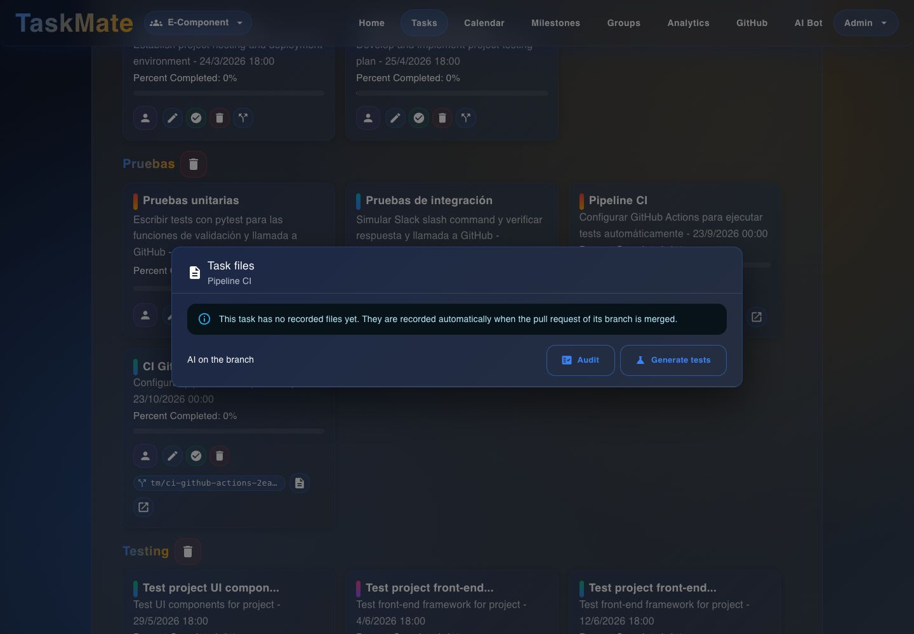
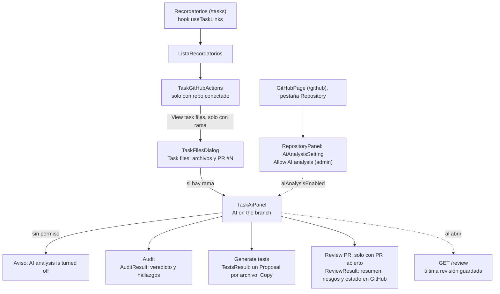

# IA sobre el código: interfaz

**En una frase:** el módulo no tiene página propia: vive en el panel «AI on the branch» del diálogo «Task files», que se abre desde cada tarea con rama en `/tasks`, con los botones «Audit», «Generate tests» y «Review PR».

## Pantallas

*Captura del 26 nov 2026: el diálogo «Task files» de la tarea «Pipeline CI» (grupo «E-Component»), todavía sin archivos registrados. Abajo, el bloque «AI on the branch» con «Audit» y «Generate tests»; «Review PR» no sale porque la tarea no tiene un PR abierto. No hay captura de los resultados: lo que sigue los describe según el código (`TaskAiPanel.jsx`).*

**Cómo se llega.** En `/tasks`, una tarea con rama muestra el botón-icono «View task files» junto al chip de la rama. Abre el diálogo «Task files», con el nombre de la tarea y, si hay PR, el enlace «PR #N». Arriba van los archivos de la tarea ([módulo GitHub](07-github.md)); debajo, el panel «AI on the branch».

**El panel.** El título «AI on the branch» y tres botones:

| Botón | Cuándo aparece | Mientras corre |
|---|---|---|
| «Audit» | Siempre que hay permiso de IA | «Auditing with the local model (can take ~20 s)…» |
| «Generate tests» | Siempre que hay permiso de IA | «Generating tests with the local model (can take ~30 s)…» |
| «Review PR» | Solo si el PR de la tarea está abierto | «Reviewing the pull request (can take ~30 s)…» |

Mientras corre una acción, los tres botones se desactivan.

**Resultado de «Audit».** Un aviso del color del veredicto: «No issues» (verde), «Needs review» (ámbar) o «Serious issues» (rojo), con «N files» y cuántos hallazgos hay de cada nivel («X high, Y medium, Z low»). Debajo, cada hallazgo: un chip con su nivel, el título, `archivo:línea`, el chip «AI, advisory» si lo encontró el modelo (no una regla fija), el detalle y la sugerencia tras «→».

**Resultado de «Generate tests».** El aviso «N proposed test files. They were not run or pushed: review them before adding them to the branch.» y un acordeón por archivo propuesto:
- En la fila: la ruta de la prueba, «para <archivo>», un chip con el framework (`pytest` o `jest`), el chip de sintaxis («syntax ok», «invalid» o «not checked») y «N casos». «para» y «casos» siguen en español.
- Al abrirlo: el problema detectado (si lo hay), la lista de casos y el código, con el botón «Copy».
- Al final, «Skipped <archivo>: <motivo>» por cada archivo que no se trató.

**Resultado de «Review PR» (o la última revisión guardada).**
- Si aún corre: «Review in progress for the latest commit…».
- Si falló: «The last review failed (<código>).», por ejemplo `AI_SERVER_UNAVAILABLE`.
- Si terminó: «PR #N · commit abc1234 · <veredicto> · N inline comments», el resumen, los riesgos en viñetas y una línea de estado: «Posted on GitHub» (enlace a la revisión), «Not posted on GitHub: the GitHub App needs the “Pull requests: write” permission.» o «Could not post on GitHub.».

**Sin el permiso de IA.** El panel no tiene botones; solo dice «AI analysis is turned off for this project; an admin can turn it on from the GitHub page.».

## Qué puedes hacer

**Sin repositorio conectado o tarea sin rama**
- No aparece «View task files». Sin repo, la tarjeta de la tarea no tiene nada de GitHub; con repo y sin rama, primero se pulsa «Create branch on GitHub».

**Admin del grupo**
- Todo lo que hace un miembro.
- Activar o apagar «Allow AI analysis» en la pestaña Repository de `/github`. Sin eso, nadie del grupo usa el panel.

**Miembro del grupo (con el permiso activo)**
- Ver, al abrir el panel, la última revisión guardada del PR de la tarea (el webhook revisa solo cada commit nuevo del PR).
- «Audit»: ver el veredicto y los hallazgos de la rama frente a su base.
- «Generate tests»: leer las pruebas propuestas y copiarlas con «Copy». No se ejecutan ni se suben.
- «Review PR», con el PR abierto: revisar el último commit. Si ese commit ya tenía revisión, se muestra la guardada.
- Si algo falla, un aviso rojo con el mensaje de la tabla de [errores](../06-flujos/10-ia-sobre-el-codigo.md#qué-ve-el-usuario-si-algo-falla). Los errores del servidor de IA (`AI_SERVER_*`) no tienen texto propio: se ve el genérico de cada botón («Could not audit the branch.», «Could not generate the tests.» o «Could not review the pull request.»).

Los resultados se ven solo mientras el diálogo está abierto; la auditoría y las pruebas no se guardan en TaskMate.

## Árbol de componentes

## Dónde está en el código

| Archivo | Qué hace |
|---|---|
| `src/components/github/TaskAiPanel.jsx` | Panel «AI on the branch»: botones, espera, resultados de la auditoría, las pruebas y la revisión; carga la última revisión al abrir |
| `src/components/github/TaskFilesDialog.jsx` | Diálogo «Task files»: archivos de la tarea y, si hay rama, el panel |
| `src/components/github/TaskGitHubActions.jsx` | Botón «View task files» en cada tarea con rama |
| `src/components/github/RepositoryPanel.jsx` | Interruptor «Allow AI analysis» (`AiAnalysisSetting`) |
| `src/components/github/githubUtils.js` | `errorMessage`: texto en inglés por código; sin texto propio, el genérico de cada botón |
| `src/components/github/cicd/cicdUtils.jsx` | `safeHttpsUrl`: «Posted on GitHub» solo lleva enlace si la URL es `https` |
| `src/api/github.js` | `auditTask`, `generateTaskTests`, `getTaskReview` y `reviewTaskPr` |
| `src/components/github/__tests__/TaskAiPanel.test.jsx` | 6 pruebas del panel: auditoría, error, sin permiso, pruebas propuestas, revisión guardada y «Review PR» |

La salida del modelo se muestra como texto de React (sin Markdown ni HTML).

## Para saber más

- Navegación completa de la app: [00-general.md](00-general.md)
- Tareas y el diálogo «Task files»: [03-tareas.md](03-tareas.md) y [07-github.md](07-github.md)
- Paso a paso y mensajes de error: [06-flujos/10-ia-sobre-el-codigo.md](../06-flujos/10-ia-sobre-el-codigo.md)
- Quién puede hacer qué: [04-casos-de-uso/10-ia-sobre-el-codigo.md](../04-casos-de-uso/10-ia-sobre-el-codigo.md)
- Arquitectura del módulo: [02-arquitectura/10-ia-sobre-el-codigo.md](../02-arquitectura/10-ia-sobre-el-codigo.md)
- Limitaciones conocidas: [cierre de la línea de Pablo y estado](../01-proyecto/cierre-del-proyecto.md#limitaciones-conocidas)
