# 05 · Interfaz

**En una frase:** cómo se ven y se usan las pantallas de TaskMate, con capturas reales del admin y de un miembro: primero el mapa de navegación y después una página por módulo.

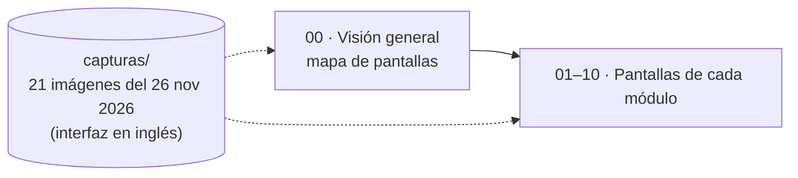

**Idioma:** desde el 19 nov 2026 (commit `d148763`) la app está casi toda en inglés. Estas páginas siguen en español, pero citan los textos de la app tal como se ven hoy («Create branch on GitHub», «Task files»…). Quedan unos pocos textos en español: ver las [limitaciones de la interfaz](../01-proyecto/cierre-del-proyecto.md#interfaz).

## Páginas generales

| Página | Qué explica |
|---|---|
| [Visión general](00-general.md) | El mapa de pantallas, la barra de navegación con el selector de grupo, las rutas que redirigen, la sesión por pestaña y la carga bajo demanda |

## Páginas por módulo

| Módulo | Qué explica |
|---|---|
| [1 · Usuarios y acceso](01-usuarios-y-acceso.md) | «Sign In» (`/`), «Create Account» (`/register`) y el menú con tu nombre para salir |
| [2 · Grupos y roles](02-grupos-y-roles.md) | `/groups`: un clic en un grupo lo vuelve el activo y muestra sus miembros y roles; el admin agrega, quita y maneja roles |
| [3 · Tareas](03-tareas.md) | `/tasks`: listas con una tarjeta por tarea y el panel lateral de completadas y papelera |
| [4 · Hitos y calendario](04-hitos-y-calendario.md) | «Milestones» (`/block-diagram`), el lienzo de hitos, y «Calendar» (`/calendar`), la vista de mes |
| [5 · Chat con IA](05-chat-ia.md) | «AI Bot» (`/chat`): el proyecto es el grupo del navbar («Project: …»), respuestas en streaming, el botón «Propose tasks» y el cuadro de texto |
| [6 · Analytics](06-analytics.md) | `/analytics`: el panel del líder y el aviso «Team leaders only» para los demás |
| [7 · GitHub](07-github.md) | `/github`: pestañas Repository, Files y Commits; en cada tarea, la rama, el PR y el diálogo «Task files» |
| [8 · CI/CD](08-cicd.md) | La pestaña CI/CD (pipeline, entornos staging y producción, ejecuciones y logs) y la pestaña «Vercel (monitoring)» con los despliegues de Vercel |
| [9 · Tiempo real y avisos](09-tiempo-real-y-avisos.md) | Sin pantalla propia: avisos abajo a la derecha y la pestaña CI/CD que se recarga sola |
| [10 · IA sobre el código](10-ia-sobre-el-codigo.md) | El panel «AI on the branch» del diálogo «Task files» («Audit», «Generate tests» y «Review PR») y el permiso «Allow AI analysis» del grupo |

## Galería de capturas

Capturas JPG de 1440 × 1000 en [`capturas/`](capturas/), tomadas el **26 nov 2026** con la interfaz en inglés (Chrome sin ventana). El nombre dice quién la ve: `anon-` (sin sesión), `admin-` (admin del grupo) o `miembro-` (`demo-miembro`, que no es admin).

- Las 19 con sesión muestran el selector de grupo junto al logo.
- Lo que se ve en español son datos (nombres de grupos, tareas, commits y el README del repo de prueba), los pasos del workflow subido el 23 oct («Pruebas», «Instalar dependencias»…) y el botón «Vincular» de Vercel, que la app sigue mostrando así ([limitaciones de la interfaz](../01-proyecto/cierre-del-proyecto.md#interfaz)).

| Captura | Qué muestra | Página |
|---|---|---|
|  | «Welcome Back» / «Sign In» (`/`), sin sesión, con el enlace «Create Account» | [Usuarios](01-usuarios-y-acceso.md) |
|  | «Create Account» (`/register`): usuario, contraseña y «Confirm Password» | [Usuarios](01-usuarios-y-acceso.md) |
|  | Inicio (`/home`) del admin: barra con el selector en «Demo CI/CD», las 8 entradas y el menú «Admin» | [Usuarios](01-usuarios-y-acceso.md) |
| 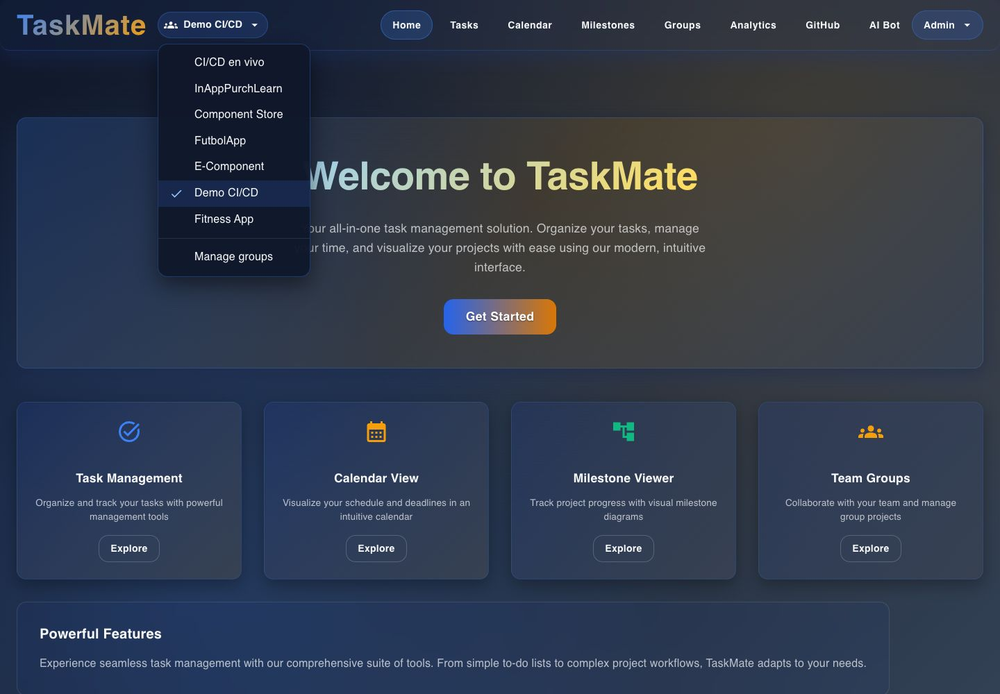 | El menú del selector de grupo abierto en `/home`: los 7 grupos del admin, palomita en «Demo CI/CD» y «Manage groups» al final | [Visión general](00-general.md), [Grupos](02-grupos-y-roles.md) |
| 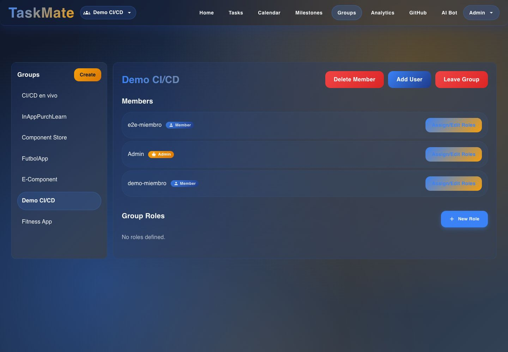 | `/groups` con «Demo CI/CD» activo: 3 miembros con «Assign/Edit Roles», «Delete Member», «Add User», «Leave Group» y «No roles defined.» con «New Role» | [Grupos](02-grupos-y-roles.md) |
| 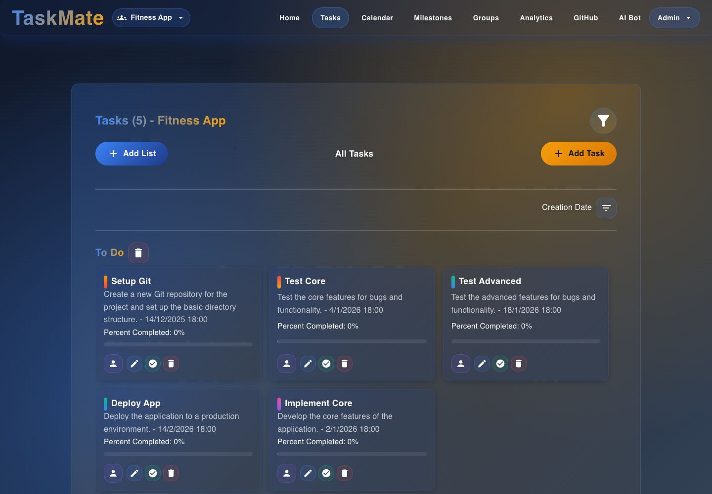 | `/tasks` del admin en «Fitness App»: «Tasks (5)», la lista «To Do» con 5 tarjetas, sin GitHub | [Tareas](03-tareas.md) |
| 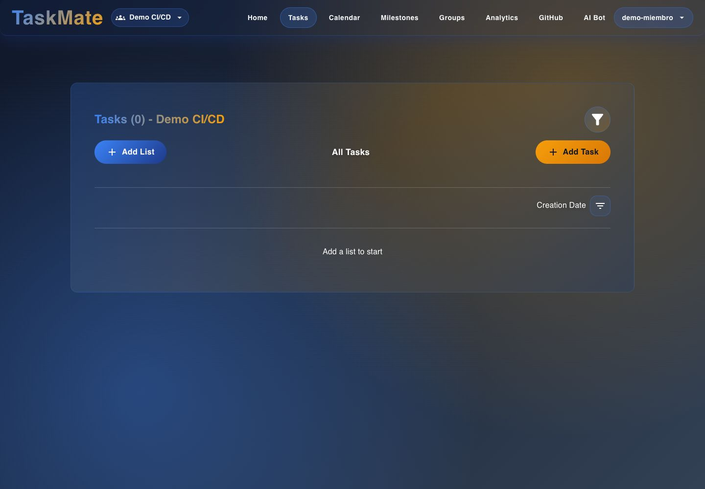 | `/tasks` de `demo-miembro` en «Demo CI/CD», sin listas: «Add a list to start» | [Tareas](03-tareas.md) |
| 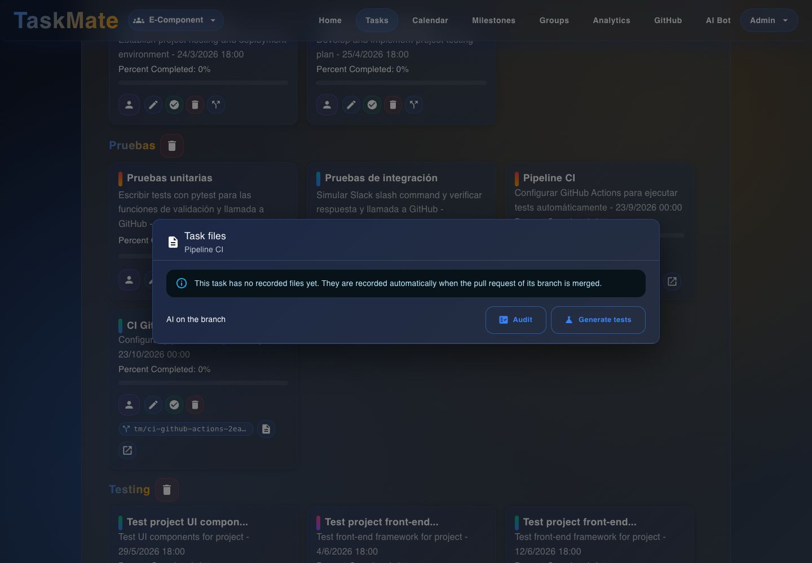 | Diálogo «Task files» de la tarea «Pipeline CI» (grupo «E-Component»): aviso de que aún no hay archivos registrados y el bloque «AI on the branch» con «Audit» y «Generate tests» | [GitHub](07-github.md), [IA sobre el código](10-ia-sobre-el-codigo.md) |
|  | «Milestone Planner» (`/block-diagram`) en «Fitness App»: 7 hitos, cinco unidos por flechas «Prerequisite» y «Progressor»; «Design Complete» en verde al 100 % | [Hitos](04-hitos-y-calendario.md) |
|  | «Your Calendar» en enero de 2026 («Fitness App»): tareas e hitos en su fecha, con Today, Back y Next | [Hitos](04-hitos-y-calendario.md) |
|  | «AI Assistant» con «Project: Demo CI/CD», el chip `PabloP150/taskmate-fase4-demo`, el saludo inicial y el cuadro «Ask about “Demo CI/CD”…» | [Chat](05-chat-ia.md) |
| 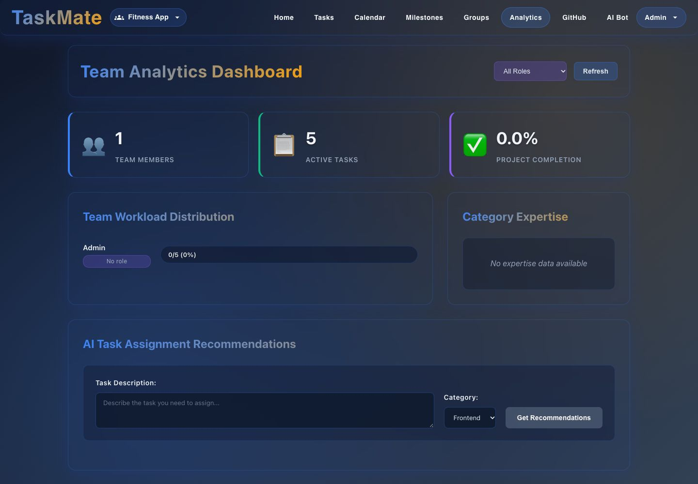 | «Team Analytics Dashboard» del admin en «Fitness App»: 1 miembro, 5 tareas activas, 0.0 %, la barra del admin y el formulario de recomendaciones | [Analytics](06-analytics.md) |
| 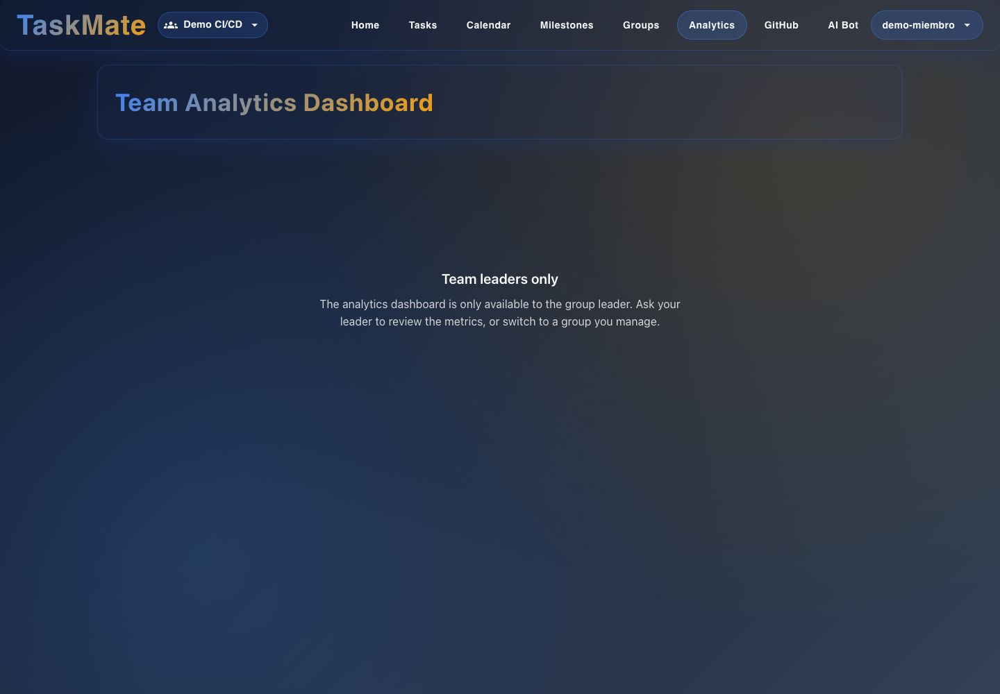 | El aviso «Team leaders only» que ve `demo-miembro` | [Analytics](06-analytics.md) |
|  | GitHub → Repository del admin: «Sync PRs», «Analyze with AI», las 5 pestañas, «Allow AI analysis» encendido y «Disconnect» | [GitHub](07-github.md) |
|  | Repository de un miembro: «AI analysis: allowed» en lugar del interruptor y sin «Disconnect» | [GitHub](07-github.md) |
| 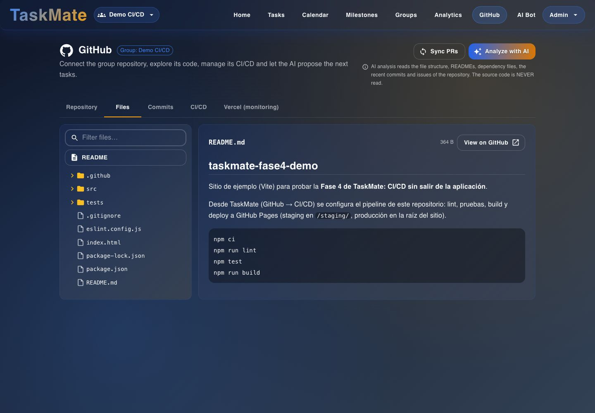 | Files: árbol con «Filter files…» y el README con «View on GitHub» | [GitHub](07-github.md) |
| 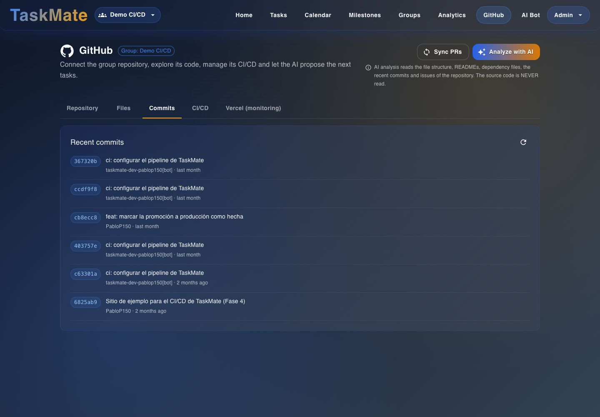 | Commits: «Recent commits» de `main`, con autor y fechas como «last month» | [GitHub](07-github.md) |
| 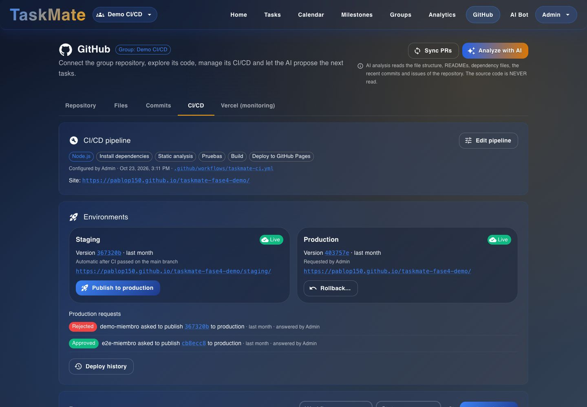 | CI/CD del admin: «CI/CD pipeline» con «Edit pipeline», «Environments» con «Publish to production» y «Rollback…», «Production requests» y «Deploy history» | [CI/CD](08-cicd.md) |
| 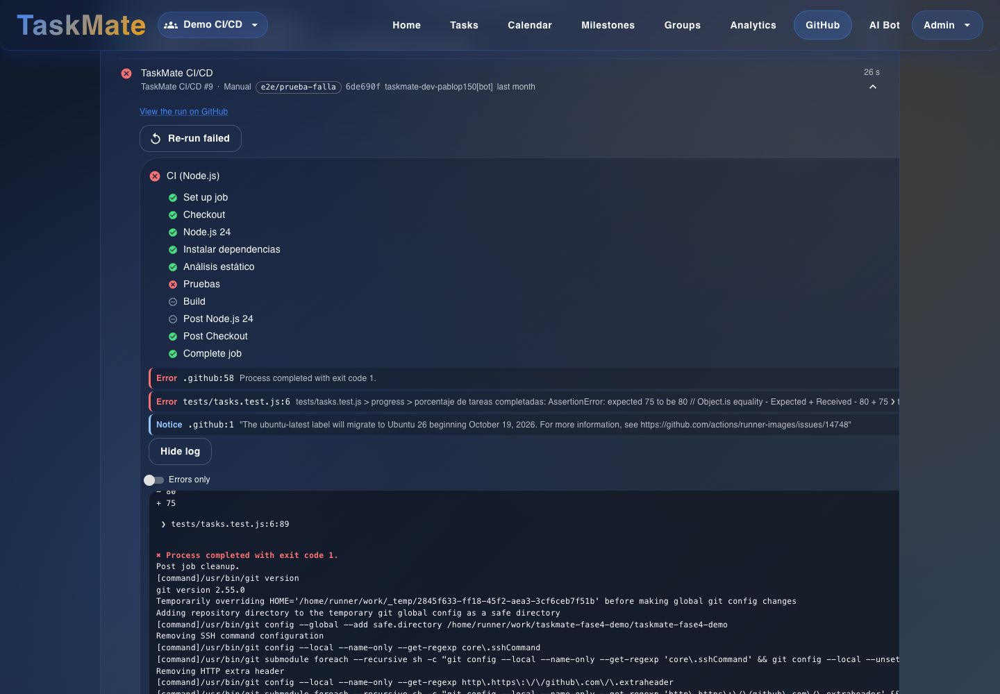 | La ejecución «TaskMate CI/CD #9» (manual, rama `e2e/prueba-falla`) abierta: el job «CI (Node.js)» falló en «Pruebas», con sus anotaciones, «Re-run failed», «Hide log» y «Errors only» | [CI/CD](08-cicd.md) |
| 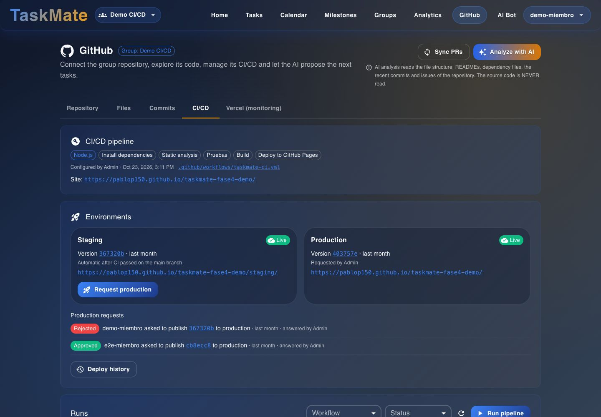 | CI/CD de un miembro: «Request production» en vez de «Publish to production», sin «Edit pipeline» ni «Rollback…»; abajo, «Runs» con «Run pipeline» | [CI/CD](08-cicd.md) |
| 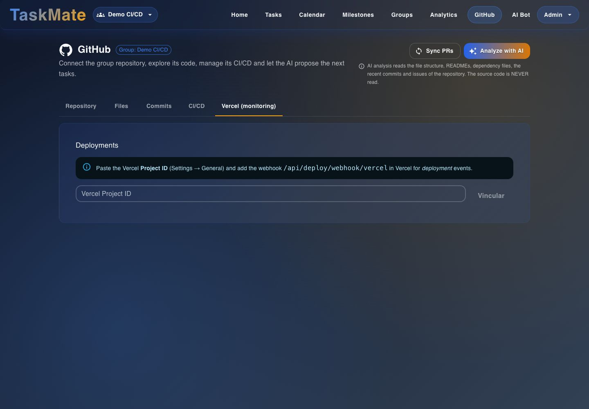 | «Vercel (monitoring)» del admin sin proyecto vinculado: la tarjeta «Deployments», el aviso para pegar el Project ID, el campo «Vercel Project ID» y «Vincular» | [CI/CD](08-cicd.md) |

No hay captura del aviso en vivo (módulo 9), de un diálogo «Task files» con archivos, de los resultados de «Audit», «Generate tests» y «Review PR», ni de «Vercel (monitoring)» con un proyecto vinculado. Su aspecto se describe en sus páginas.

## Diagramas e imágenes

- Los diagramas de estas páginas son bloques Mermaid.
- Su copia en PNG está en [`imagenes/`](imagenes/), con el nombre `<página>-<n>.png` (n = orden del diagrama en la página).

## Para saber más

- Qué puede hacer cada rol en cada pantalla: [guía de uso](../07-guias/guia-de-uso.md).
- Limitaciones de la interfaz: [cierre de la línea de Pablo y estado](../01-proyecto/cierre-del-proyecto.md#interfaz).
- [Índice de la documentación](../README.md).
