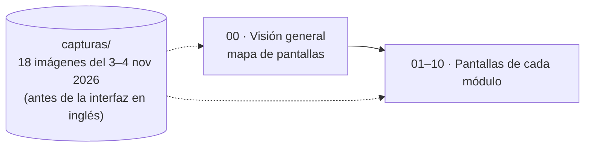
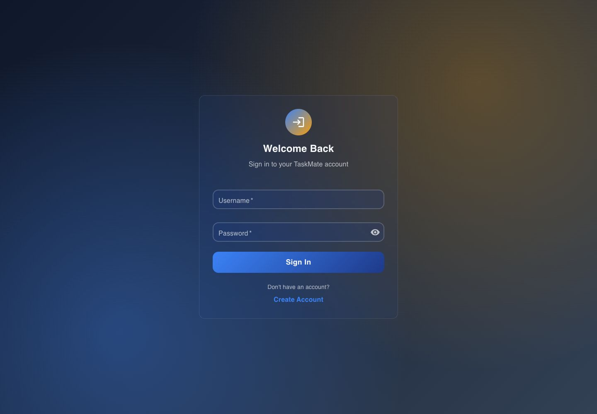
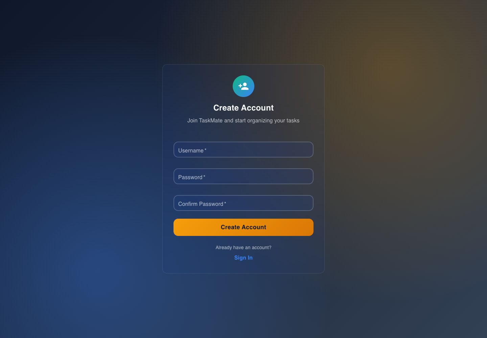
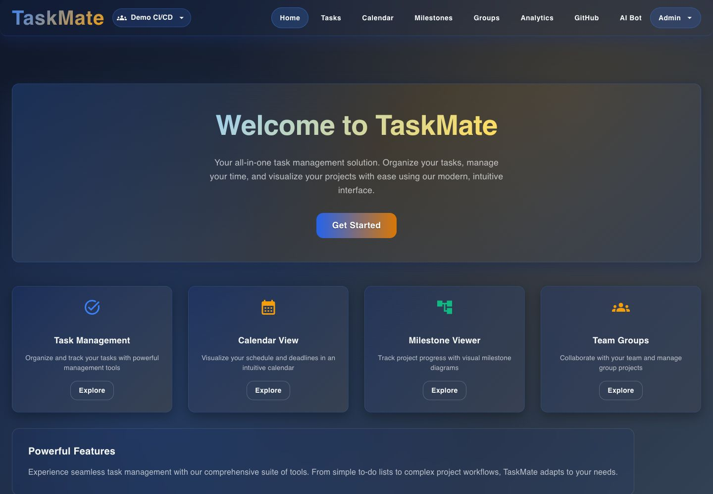
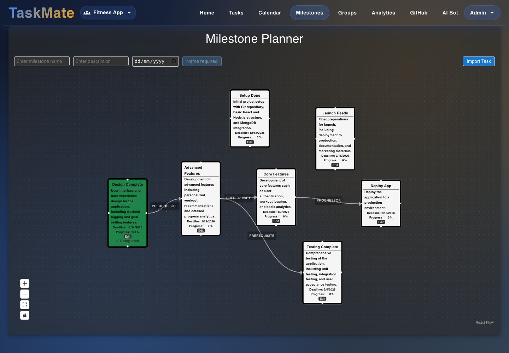
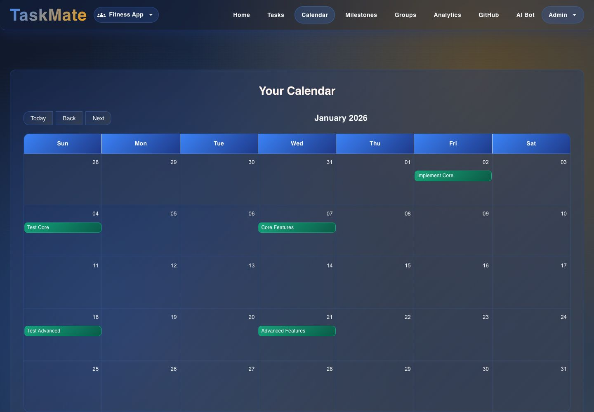
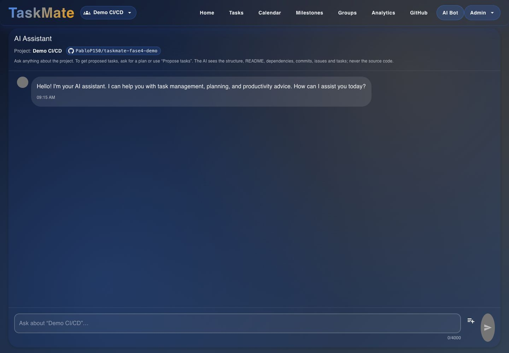
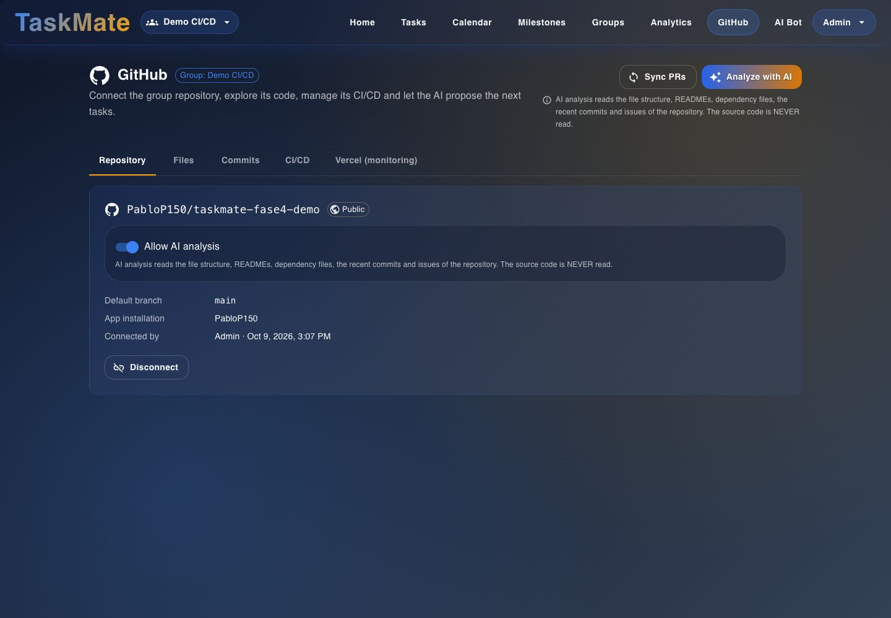
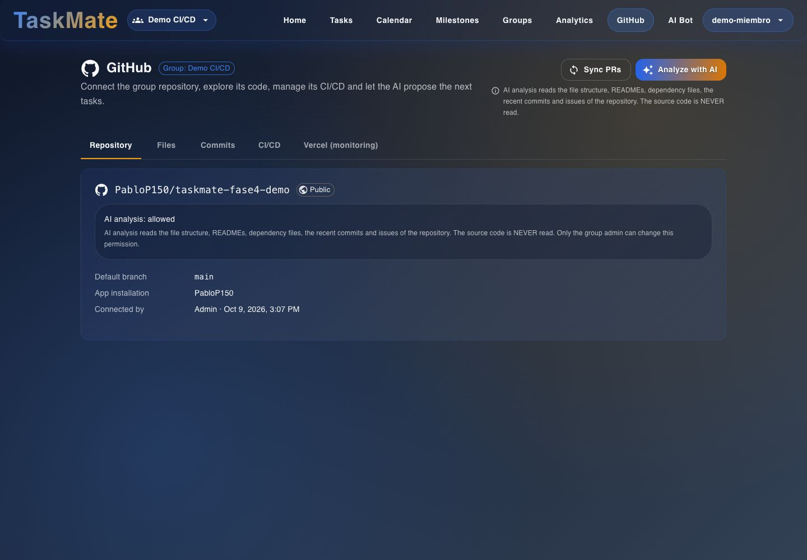

# 05 · Interfaz

**En una frase:** cómo se ven y se usan las pantallas de TaskMate, con capturas reales del admin y de un miembro: primero el mapa de navegación y después una página por módulo.

**Idioma:** desde el 19 nov 2026 (commit `d148763`) la app está casi toda en inglés. Estas páginas siguen en español, pero citan los textos de la app tal como se ven hoy («Create branch on GitHub», «Task files»…). Quedan unos pocos textos en español: ver las [limitaciones de la interfaz](../01-proyecto/cierre-del-proyecto.md#interfaz).

## Páginas generales

| Página | Qué explica |
|---|---|
| [Visión general](00-general.md) | El mapa de pantallas, la barra de navegación con el selector de grupo, las rutas que redirigen, la sesión por pestaña y la carga bajo demanda |

## Páginas por módulo

| Módulo | Qué explica |
|---|---|
| [1 · Usuarios y acceso](01-usuarios-y-acceso.md) | «Sign In» (`/`), «Create Account» (`/register`) y el menú con tu nombre para salir |
| [2 · Grupos y roles](02-grupos-y-roles.md) | `/groups`: un clic en un grupo lo vuelve el activo y muestra sus miembros y roles; el admin agrega, quita y maneja roles |
| [3 · Tareas](03-tareas.md) | `/tasks`: listas con una tarjeta por tarea y el panel lateral de completadas y papelera |
| [4 · Hitos y calendario](04-hitos-y-calendario.md) | «Milestones» (`/block-diagram`), el lienzo de hitos, y «Calendar» (`/calendar`), la vista de mes |
| [5 · Chat con IA](05-chat-ia.md) | «AI Bot» (`/chat`): el proyecto es el grupo del navbar («Project: …»), respuestas en streaming, el botón «Propose tasks» y el cuadro de texto |
| [6 · Analytics](06-analytics.md) | `/analytics`: el panel del líder y el aviso «Team leaders only» para los demás |
| [7 · GitHub](07-github.md) | `/github`: pestañas Repository, Files y Commits; en cada tarea, la rama, el PR y el diálogo «Task files» |
| [8 · CI/CD](08-cicd.md) | La pestaña CI/CD (pipeline, entornos staging y producción, ejecuciones y logs) y la pestaña «Vercel (monitoring)» con los despliegues de Vercel |
| [9 · Tiempo real y avisos](09-tiempo-real-y-avisos.md) | Sin pantalla propia: avisos abajo a la derecha y la pestaña CI/CD que se recarga sola |
| [10 · IA sobre el código](10-ia-sobre-el-codigo.md) | El panel «AI on the branch» del diálogo «Task files» («Audit», «Generate tests» y «Review PR») y el permiso «Allow AI analysis» del grupo |

## Galería de capturas

Capturas JPG de 1440 × 1000 en [`capturas/`](capturas/). El nombre dice quién la ve: `anon-` (sin sesión), `admin-` (admin del grupo) o `miembro-` (un miembro que no es admin).

**Son del 3 y 4 nov 2026, anteriores a la interfaz en inglés (19 nov) y al selector de grupo del navbar.** Todavía no se han vuelto a tomar:

- Ninguna de las 16 con sesión muestra el selector de grupo junto al logo.
- 9 salen con los textos viejos en español: las de GitHub, las de CI/CD, la del chat y el aviso de analytics.
- `anon-login` y `anon-registro` siguen al día: «Sign In» y «Create Account» no cambiaron.
- La columna «Qué cambió» dice qué se ve distinto hoy.

| Captura | Qué muestra | Qué cambió | Página |
|---|---|---|---|
|  | «Sign In» (`/`), sin sesión | Nada | [Usuarios](01-usuarios-y-acceso.md) |
|  | «Create Account» (`/register`), sin sesión | Nada | [Usuarios](01-usuarios-y-acceso.md) |
|  | Inicio (`/home`) con la barra de navegación | Falta el selector de grupo junto al logo | [Usuarios](01-usuarios-y-acceso.md) |
|  | `/groups` con «Demo CI/CD» como grupo activo | Ya no hay botones «Use»: basta un clic en el grupo. «Assign/Edit Rol» ahora es «Assign/Edit Roles» | [Grupos](02-grupos-y-roles.md) |
|  | `/tasks` del admin, grupo «Fitness App» | Solo falta el selector de grupo | [Tareas](03-tareas.md) |
|  | `/tasks` de un miembro en «Demo CI/CD», sin listas todavía | Solo falta el selector de grupo | [Tareas](03-tareas.md) |
|  | «Milestones»: barra para crear hitos y lienzo | Solo falta el selector de grupo | [Hitos](04-hitos-y-calendario.md) |
|  | «Calendar»: vista de mes con Today, Back y Next | Solo falta el selector de grupo | [Hitos](04-hitos-y-calendario.md) |
|  | «AI Bot»: saludo inicial, sin proyecto de contexto | Ya no existe el selector «Proyecto» / «Nuevo proyecto (sin contexto)»: arriba dice «Project: &lt;grupo del navbar&gt;». El cuadro dice «Ask about “&lt;grupo&gt;”…» («Type your message…» sin grupo; antes «Type your message here...») y el chat ocupa todo el ancho | [Chat](05-chat-ia.md) |
|  | Panel de analytics que ve el admin (es líder) | Solo falta el selector de grupo | [Analytics](06-analytics.md) |
|  | Aviso que ve un miembro sin rol de líder | Sale en español («Solo líderes del equipo»); hoy dice «Team leaders only» | [Analytics](06-analytics.md) |
|  | GitHub → Repository, vista del admin | En español: hoy «Group: …», «Sync PRs», «Analyze with AI», «Repository», «Files» y «Allow AI analysis». El aviso de la IA ya no nombra a Groq. Falta la pestaña «Vercel (monitoring)» | [GitHub](07-github.md) |
|  | Repository, vista de un miembro: sin «Disconnect» | En español, como la del admin; el estado que ve el miembro hoy dice «AI analysis: allowed». Falta la pestaña «Vercel (monitoring)» | [GitHub](07-github.md) |
|  | Files: árbol y README | Encabezado y pestañas en español; falta «Vercel (monitoring)» | [GitHub](07-github.md) |
|  | Commits de la rama por defecto | En español: hoy «Recent commits» y fechas como «2 weeks ago» | [GitHub](07-github.md) |
|  | CI/CD del admin: pipeline, entornos y ejecuciones | En español: hoy «CI/CD pipeline», «Edit pipeline», «Environments», «Publish to production», «Deploy history» y «Runs». Las etapas salen en inglés, salvo «Pruebas» | [CI/CD](08-cicd.md) |
|  | Una ejecución abierta, con sus jobs y su log | «Ocultar log» y «Solo errores» ahora son «Hide log» y «Errors only». El nombre del job sale del YAML subido: con un pipeline subido después del cambio es «Deploy build», no «Build del deploy» | [CI/CD](08-cicd.md) |
|  | CI/CD de un miembro: «Request production» en vez de «Publish to production» | En español: hoy «Request production» y «Run pipeline» | [CI/CD](08-cicd.md) |

No hay captura del aviso en vivo (módulo 9), del menú del selector de grupo, de la pestaña «Vercel (monitoring)», del diálogo «Task files» ni del panel «AI on the branch». Su aspecto se describe en sus páginas.

## Diagramas e imágenes

- Los diagramas de estas páginas son bloques Mermaid.
- Su copia en PNG está en [`imagenes/`](imagenes/), con el nombre `<página>-<n>.png` (n = orden del diagrama en la página).

## Para saber más

- Qué puede hacer cada rol en cada pantalla: [guía de uso](../07-guias/guia-de-uso.md).
- Limitaciones de la interfaz: [cierre de la línea de Pablo y estado](../01-proyecto/cierre-del-proyecto.md#interfaz).
- [Índice de la documentación](../README.md).
