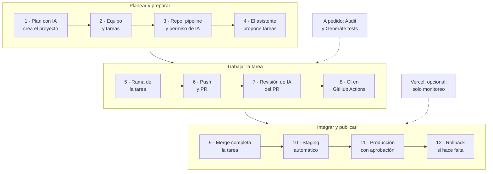
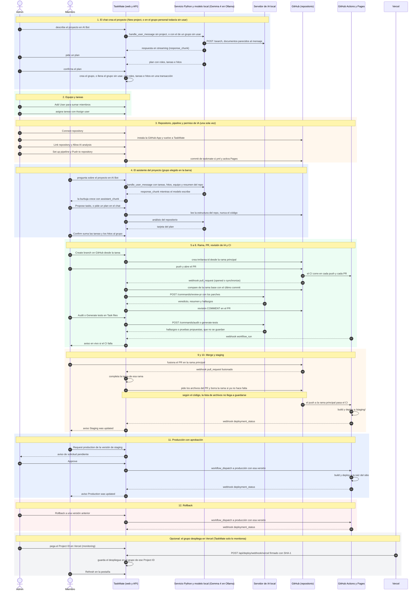

# Flujos: visión general

**En una frase:** el camino completo de un proyecto en TaskMate, desde que la IA lo crea hasta que una versión llega a producción (y vuelve atrás si hace falta), con el asistente del chat, la revisión de IA de cada PR y, si el grupo despliega en Vercel, el monitoreo de sus despliegues.

## El recorrido completo

## Paso a paso
1. **Plan con IA:** con «New project» en el chat (o sin grupo), la IA ayuda a armar la idea y, si se le pide un plan, lo propone. Al confirmarlo se crea un grupo nuevo; quien lo pidió queda como admin. En un grupo sin usar, como el grupo personal que una cuenta nueva tiene activo al entrar, pasa lo mismo, pero el plan se guarda en ese grupo (si quien confirma es su admin), que toma el nombre del proyecto.
2. **Equipo:** el admin agrega miembros por nombre de usuario; cualquier miembro asigna tareas.
3. **Repo, pipeline y permiso de IA:** el admin conecta el repositorio, sube `.github/workflows/taskmate-ci.yml` y, si quiere que la IA lea el repo, activa «Allow AI analysis».
4. **Asistente del proyecto:** con el grupo elegido en la barra, el chat responde con sus tareas, hitos, equipo y (con permiso) el resumen del repo. La respuesta llega en streaming. «Propose tasks», o pedir un plan, analiza el repo y suma las tareas al grupo al pulsar «Confirm».
5. **Rama:** desde la tarea, un miembro crea `tm/<nombre>-<8 caracteres del id>`.
6. **Push y PR:** se hacen en GitHub; TaskMate no abre PRs, solo los muestra.
7. **Revisión de IA:** cada commit nuevo del PR de una tarea se revisa en segundo plano en el servidor de IA local y se publica como comentario (`COMMENT`), nunca como aprobación. Hace falta «Allow AI analysis». A pedido, en «Task files», cualquier miembro tiene «Audit» (revisa la rama), «Generate tests» (propone pruebas, no las ejecuta ni las sube) y «Review PR» (solo con el PR abierto).
8. **CI:** corre en cada push y cada PR; un fallo llega como aviso en vivo.
9. **Merge:** el PR fusionado en la rama principal completa la tarea y, si no hace falta, borra la rama. También intenta guardar la lista de archivos del PR, pero según el código no lo logra.
10. **Staging:** el push a la rama principal que pasa el CI se publica solo en `/staging/`.
11. **Producción:** un miembro pide la versión de staging y el admin aprueba (o publica directo).
12. **Rollback:** el admin vuelve producción a una versión anterior.

- **Vercel (opcional):** si el grupo despliega en Vercel, el admin vincula el Project ID en la pestaña «Vercel (monitoring)». Vercel avisa por webhook y TaskMate guarda el estado de cada despliegue. Es solo lectura: no despliega nada y la pestaña se actualiza con «Refresh».
- **Webhook:** aviso que GitHub (o Vercel) manda a la API. Los de GitHub llegan al navegador por el WebSocket `/events` (canal en vivo); los de Vercel no.
- **Streaming:** el texto de la respuesta llega por trozos (`response_chunk` → `assistant_chunk`) y la burbuja crece mientras el modelo escribe.
- **`workflow_dispatch`:** pedirle a GitHub que corra el workflow con un entorno y una versión.
- Solo se publican versiones que pasaron el CI de TaskMate en la rama principal.

## Errores comunes

| Paso | Qué pasa | Qué ve el usuario |
|---|---|---|
| 1 y 4 · Chat | El modelo falla (Ollama apagado o modelo sin instalar; si se usa Groq de respaldo, un error de Groq) | Una respuesta normal del asistente: «The AI assistant is temporarily unavailable. Please try again in a moment.». Solo con Groq (respaldo), al pasar su límite: «The AI assistant is receiving too many requests right now. Please try again in <tiempo>.» |
| 1 y 4 · Chat | El servicio Python no responde en 90 s | «The AI took too long to answer. Please try again.» |
| 4 · Asistente | Se piden tareas con un grupo sin repositorio | «The project has no GitHub repository connected.» |
| 4 y 7 · IA | El admin no activó «Allow AI analysis» | En el chat: «AI analysis is turned off for this project. A group admin can turn it on from the GitHub page (“Allow AI analysis”).». En «Task files»: «AI analysis is turned off for this project; an admin can turn it on from the GitHub page.». La revisión automática no corre y no avisa |
| 7 · IA a pedido | Servidor de IA local apagado o sin `AI_SERVER_URL`, rama sin cambios o sin PR abierto | Un texto genérico: «Could not audit the branch.», «Could not generate the tests.» o «Could not review the pull request.» |
| 7 · IA a pedido | Más de 5 acciones de IA en un minuto (sumando las tres) | «Too many requests. Wait a moment and try again.» |
| 7 · Revisión | La App no tiene «Pull requests: write» | «Not posted on GitHub: the GitHub App needs the “Pull requests: write” permission.» |
| 7 · Revisión | La revisión de un commit falló | Nada en el momento. Al abrir el panel: «The last review failed (<código>).». «Review PR» la repite sobre el mismo commit (desde el 26 nov 2026) |
| 8 · CI | El pipeline falla | Aviso en vivo «[<grupo>] “<título>” failed on <rama>.» |
| 9 · Merge | No se guarda la lista de archivos del PR | Nada: solo un `console.warn` en la API, y la tarea ya está completada |
| 11 · Producción | La versión no pasó el CI de TaskMate | «That commit did not pass TaskMate CI, so it cannot be deployed.» |
| Vercel | El Project ID ya está vinculado a otro grupo | «Could not link the Vercel project.» |
| Vercel | Firma inválida o falta `VERCEL_WEBHOOK_SECRET` | Nada en la pestaña: la API responde 401 a Vercel y el despliegue no aparece |
| Webhooks de GitHub | Una entrega falla | Nada en la interfaz: se arregla con «Sync PRs» o reenviándola desde GitHub |

Todos los casos, con su código: en la sección «Qué ve el usuario si algo falla» de cada página por módulo. Los fallos sin aviso (la lista de archivos al fusionar, una entrega de Vercel fallida que no se reintenta) están en las [limitaciones conocidas](../01-proyecto/cierre-del-proyecto.md#limitaciones-conocidas).

## Todos los flujos, por módulo

| Módulo | Flujos que documenta |
|---|---|
| [Usuarios y acceso](01-usuarios-y-acceso.md) | Crear cuenta, iniciar sesión y usar el token, ciclo de la sesión |
| [Grupos y roles](02-grupos-y-roles.md) | Agregar un miembro y darle un rol, elegir el grupo activo, ciclo de vida de un grupo, salir del grupo |
| [Tareas](03-tareas.md) | Completar una tarea, ciclo de vida de una tarea, guardar una edición |
| [Hitos y calendario](04-hitos-y-calendario.md) | Conectar dos hitos y propagar el avance, vida de un hito y de una flecha, cómo propaga el avance el trigger |
| [Chat IA](05-chat-ia.md) | Proyecto nuevo («New project», sin grupo o grupo sin usar): de la idea al proyecto guardado y vida del plan; cómo decide el orquestador qué responder; con un grupo con datos: el asistente del proyecto con streaming |
| [Analytics](06-analytics.md) | Pedir recomendaciones de asignación por `/insights`, vida de un registro de `TaskAnalytics`, qué muestra el panel |
| [GitHub](07-github.md) | Conectar el repositorio, un webhook que llega a la API, vida de la rama de una tarea, ver los archivos de una tarea |
| [CI/CD](08-cicd.md) | Del pipeline a producción, jobs de cada caso, solicitudes de producción, monitoreo de Vercel |
| [Tiempo real y avisos](09-tiempo-real-y-avisos.md) | De GitHub al aviso, ciclo de la conexión `/events`, qué decide el hub con cada evento |
| [IA sobre el código](10-ia-sobre-el-codigo.md) | Revisión automática de un PR, auditar la rama o generar pruebas, vida de una revisión en `AiReviews` |

## Dónde está en el código

| Archivo | Qué hace en este recorrido |
|---|---|
| `taskmate-api/services/UserSession.js` y `ProjectService.js` | Chat, contexto del proyecto, streaming, confirmación del plan y creación del proyecto |
| `taskmate-api/mcp/agents/orchestrator.py`, `mcp/llm_service.py` y `mcp/knowledge.py` | Clasifica cada mensaje, responde con el modelo local (Ollama; Groq si se usa el respaldo) y consulta los documentos del servidor de IA local |
| `taskmate-api/services/github/installFlow.js` | Conexión del repositorio (instalación y callback) |
| `taskmate-api/services/github/pipelineService.js` y `pipelineSpec.js` | Propuesta, YAML y commit del workflow |
| `taskmate-api/services/github/branchService.js` | Crear y limpiar la rama de una tarea |
| `taskmate-api/services/github/webhookHandler.js` y `pullRequestProcessor.js` | Webhooks: PR fusionado, ejecuciones y deploys; `webhookHandler.js` dispara la revisión de IA |
| `taskmate-api/services/github/taskFileService.js` | Lista de archivos del PR de una tarea |
| `taskmate-api/services/aiServer/` (`client.js`, `taskAi.js`, `prReview.js`) | Auditar, generar pruebas y revisar el PR con el servidor de IA local |
| `taskmate-api/services/github/deployService.js` | Solicitudes, aprobación, deploy y rollback |
| `taskmate-api/services/deploy/` (`deploySignature.js`, `vercelEvents.js`, `deployWebhookHandler.js`) | Webhook de Vercel: firma, traducción del evento y guardado |
| `taskmate-api/services/realtime.js` y `src/components/realtime/CicdNotifications.jsx` | Avisos en vivo por `/events` |
| `src/components/ChatPage.jsx`, `github/TaskFilesDialog.jsx`, `github/TaskAiPanel.jsx` y `deploy/DeploymentPanel.jsx` | Chat con streaming, «Task files», «AI on the branch» y «Vercel (monitoring)» |

## Para saber más
- Quién puede hacer cada paso: [permisos por rol](../04-casos-de-uso/00-permisos-por-rol.md). Desde cada persona: [recorridos de usuario](../04-casos-de-uso/00-recorridos-de-usuario.md).
- Uso detallado: [guía de CI/CD](../07-guias/guia-cicd.md) y [guía de la GitHub App](../07-guias/guia-github-app.md). Componentes: [arquitectura](../02-arquitectura/00-general.md).
- El servidor de IA local y la revisión de PR: [arquitectura de IA sobre el código](../02-arquitectura/10-ia-sobre-el-codigo.md).
- Limitaciones conocidas: [cierre de la línea de Pablo y estado](../01-proyecto/cierre-del-proyecto.md#limitaciones-conocidas).
