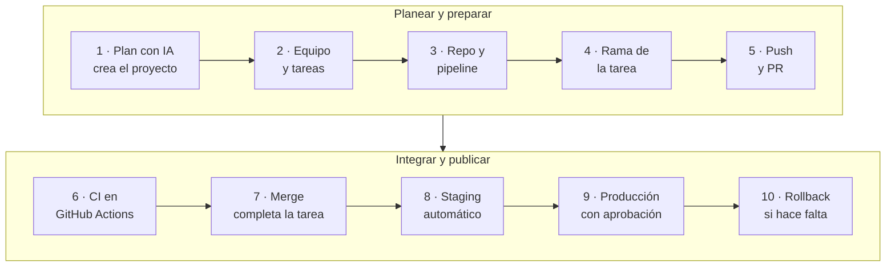
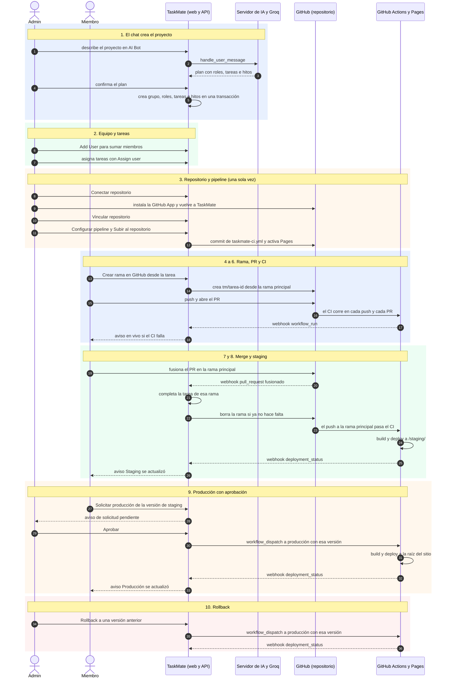

# Flujos: visión general

**En una frase:** el camino completo de un proyecto en TaskMate, desde que la IA lo crea hasta que una versión llega a producción (y vuelve atrás si hace falta).

## El recorrido completo

## Paso a paso
1. **Plan con IA:** al confirmar el plan del chat se crea un grupo nuevo; quien lo pidió queda como admin.
2. **Equipo:** el admin agrega miembros por nombre de usuario; cualquier miembro asigna tareas.
3. **Repo y pipeline:** el admin conecta el repositorio y sube `.github/workflows/taskmate-ci.yml`.
4. **Rama:** desde la tarea, un miembro crea `tm/<nombre>-<8 caracteres del id>`.
5. **Push y PR:** se hacen en GitHub; TaskMate no abre PRs, solo los muestra.
6. **CI:** corre en cada push y cada PR; un fallo llega como aviso en vivo.
7. **Merge:** el PR fusionado en la rama principal completa la tarea y, si no hace falta, borra la rama.
8. **Staging:** el push a la rama principal que pasa el CI se publica solo en `/staging/`.
9. **Producción:** un miembro pide la versión de staging y el admin aprueba (o publica directo).
10. **Rollback:** el admin vuelve producción a una versión anterior.

- **Webhook:** aviso que GitHub manda a la API. Llega al navegador por el WebSocket `/events` (canal en vivo).
- **`workflow_dispatch`:** pedirle a GitHub que corra el workflow con un entorno y una versión.
- Solo se publican versiones que pasaron el CI de TaskMate en la rama principal.

## Todos los flujos, por módulo

| Módulo | Flujos que documenta |
|---|---|
| [Usuarios y acceso](01-usuarios-y-acceso.md) | Crear cuenta, iniciar sesión y usar el token, ciclo de la sesión |
| [Grupos y roles](02-grupos-y-roles.md) | Agregar un miembro y darle un rol, ciclo de vida de un grupo, salir del grupo |
| [Tareas](03-tareas.md) | Completar una tarea, ciclo de vida de una tarea, guardar una edición |
| [Hitos y calendario](04-hitos-y-calendario.md) | Conectar dos hitos y propagar el avance, vida de un hito y de una flecha, cómo propaga el avance el trigger |
| [Chat IA](05-chat-ia.md) | De la idea al proyecto guardado, vida del plan, cómo decide el orquestador qué responder |
| [Analytics](06-analytics.md) | Pedir recomendaciones de asignación por `/insights`, vida de un registro de `TaskAnalytics`, qué muestra el panel |
| [GitHub](07-github.md) | Conectar el repositorio, un webhook que llega a la API, vida de la rama de una tarea |
| [CI/CD](08-cicd.md) | Del pipeline a producción, jobs de cada caso, solicitudes de producción |
| [Tiempo real y avisos](09-tiempo-real-y-avisos.md) | De GitHub al aviso, ciclo de la conexión `/events`, qué decide el hub con cada evento |

## Dónde está en el código

| Archivo | Qué hace en este recorrido |
|---|---|
| `taskmate-api/services/UserSession.js` y `ProjectService.js` | Chat, confirmación del plan y creación del proyecto |
| `taskmate-api/services/github/installFlow.js` | Conexión del repositorio (instalación y callback) |
| `taskmate-api/services/github/pipelineService.js` y `pipelineSpec.js` | Propuesta, YAML y commit del workflow |
| `taskmate-api/services/github/branchService.js` | Crear y limpiar la rama de una tarea |
| `taskmate-api/services/github/webhookHandler.js` y `pullRequestProcessor.js` | Webhooks: PR fusionado, ejecuciones y deploys |
| `taskmate-api/services/github/deployService.js` | Solicitudes, aprobación, deploy y rollback |
| `taskmate-api/services/realtime.js` y `src/components/realtime/CicdNotifications.jsx` | Avisos en vivo por `/events` |

## Para saber más
- Quién puede hacer cada paso: [permisos por rol](../04-casos-de-uso/00-permisos-por-rol.md). Desde cada persona: [recorridos de usuario](../04-casos-de-uso/00-recorridos-de-usuario.md).
- Uso detallado: [guía de CI/CD](../07-guias/guia-cicd.md) y [guía de la GitHub App](../07-guias/guia-github-app.md). Componentes: [arquitectura](../02-arquitectura/00-general.md).
- Limitaciones conocidas: [cierre del proyecto](../01-proyecto/cierre-del-proyecto.md#limitaciones-conocidas).
