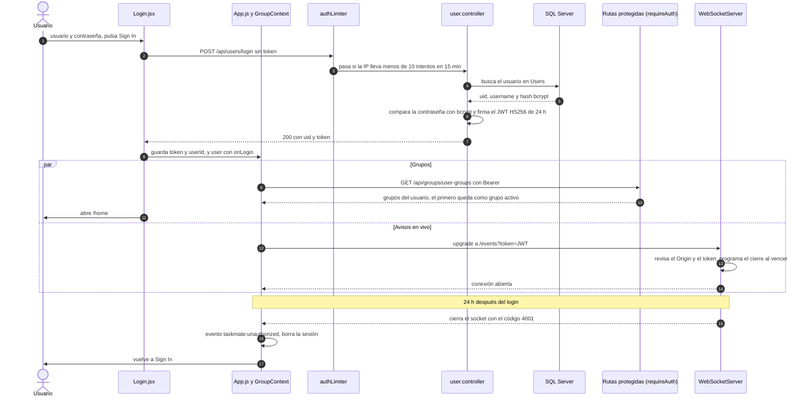
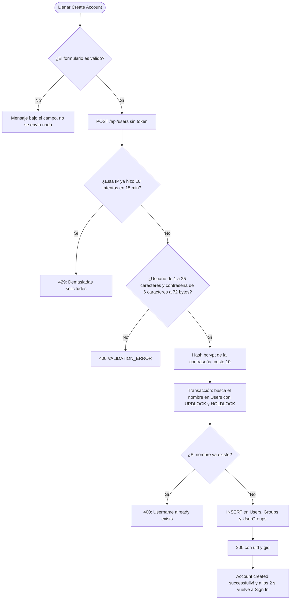
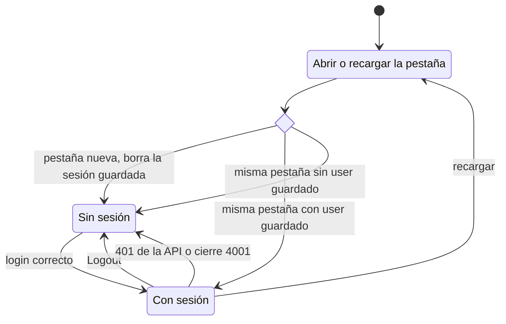

# Usuarios y acceso: flujos

**En una frase:** registrarse crea la cuenta y el grupo personal; iniciar sesión entrega un JWT (token firmado) de 24 h que el navegador guarda y manda en cada llamada y en cada WebSocket.

## Iniciar sesión y usar el token

## Crear cuenta

## Ciclo de la sesión en el navegador

- `sessionStorage` (memoria de una sola pestaña) guarda la marca `sessionStarted`.
- `localStorage` (memoria del sitio, compartida entre pestañas) guarda `user`, `token`, `userId` y el grupo activo.
- Si la pestaña no tiene la marca, `App.js` la pone y borra esas claves de `localStorage`. Por eso una pestaña nueva empieza sin sesión.
- Como `localStorage` es compartido, una pestaña que ya tenía sesión queda sin token guardado: su siguiente llamada a la API recibe 401 y vuelve a «Sign In».

## Paso a paso

**Crear cuenta**
1. El formulario valida y `POST /api/users` pasa por `authLimiter`.
2. La API valida otra vez y calcula el hash bcrypt.
3. Una transacción crea el usuario, su grupo «`<usuario>`'s Group» y la membresía.
4. La pantalla avisa y a los 2 s vuelve a «Sign In». No inicia sesión sola.

**Iniciar sesión**
1. `POST /api/users/login` pasa por `authLimiter` y la API compara la contraseña con bcrypt.
2. La API firma un JWT con `userId`, `username` y `typ: access`, válido 24 h.
3. El navegador guarda `token`, `userId` y `user`, toma el primer grupo como activo y abre `/home`.

**Con sesión**
1. Cada llamada lleva `Authorization: Bearer <token>` y `requireAuth` lo verifica.
2. Cada WebSocket (`/chat`, `/insights`, `/events`) manda el token en `?token=`; el servidor revisa también el `Origin`.
3. Un 401 o un cierre 4001 disparan `taskmate:unauthorized` y `App.js` cierra la sesión.

**Cerrar sesión**
1. Menú con tu nombre → «Logout».
2. Se borran `user`, `token`, `userId`, el grupo activo y `showGroupDetails`, y el WebSocket de avisos se desconecta.

## Qué ve el usuario si algo falla

| Situación | Respuesta de la API | Mensaje en pantalla |
|---|---|---|
| Campo vacío en «Sign In» | No se envía | «Username is required» o «Password is required» |
| Usuario o contraseña incorrectos | 401 `UNAUTHENTICATED` | «Invalid credentials» |
| Dato inválido en «Create Account» | No se envía | Mensaje bajo el campo, por ejemplo «Username must be at least 3 characters», «Username can only contain letters, numbers, and underscores» o «Passwords do not match» |
| El usuario ya existe | 400 `VALIDATION_ERROR` | «Username already exists» |
| Contraseña de más de 72 bytes (por ejemplo, con muchos emoji) | 400 `VALIDATION_ERROR` | «Password too long» |
| La base de datos está ocupada al registrar | 503 `DB_BUSY` | «The database is busy, please try again» |
| Más de 10 intentos de login o registro desde la misma IP en 15 min | 429 `RATE_LIMITED` | «Demasiadas solicitudes. Espera un momento e inténtalo de nuevo.» |
| Más de 300 llamadas por minuto con sesión | 429 `RATE_LIMITED` | El mismo mensaje, en la pantalla que hizo la llamada |
| La API no responde | Sin respuesta (`NETWORK_ERROR`) | «Network error. Please check your connection and try again.» |
| Error inesperado del servidor | 500 `INTERNAL_ERROR` | «Internal server error» |
| Token vencido o inválido en una llamada | 401 `UNAUTHENTICATED` | Se cierra la sesión y aparece «Sign In» |
| Token vencido con un WebSocket abierto | Cierre 4001 | Se cierra la sesión y aparece «Sign In» |
| WebSocket sin token, con token inválido u `Origin` no permitido | 401 o 403 antes del upgrade | No se conecta y el navegador reintenta; en el chat aparece «Connection problem: …» |

## Para saber más

- Arquitectura del módulo: [02-arquitectura/01-usuarios-y-acceso.md](../02-arquitectura/01-usuarios-y-acceso.md)
- Tablas que escribe el registro: [03-base-de-datos/01-usuarios-y-acceso.md](../03-base-de-datos/01-usuarios-y-acceso.md)
- Pantallas: [05-interfaz/01-usuarios-y-acceso.md](../05-interfaz/01-usuarios-y-acceso.md)
- El chat sobre el mismo WebSocket autenticado: [05-chat-ia.md](05-chat-ia.md)
- Limitaciones conocidas (por ejemplo, el JWT en la URL del WebSocket): [cierre del proyecto](../01-proyecto/cierre-del-proyecto.md#limitaciones-conocidas)
