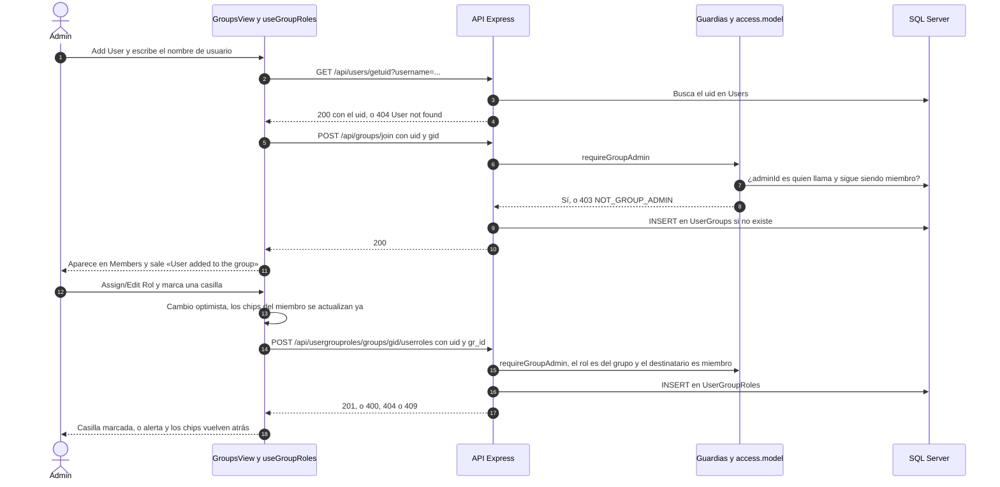
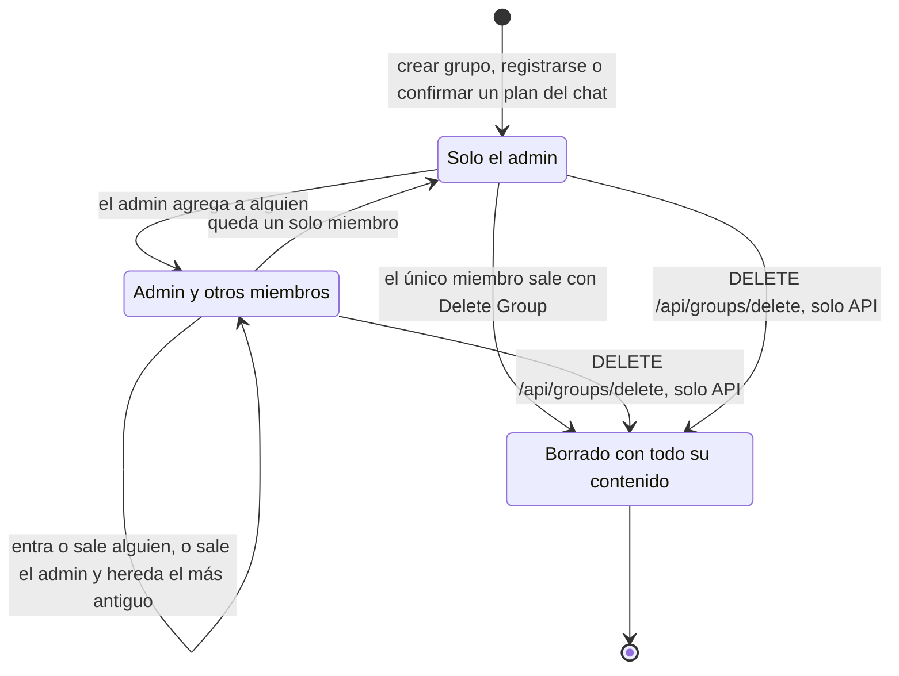
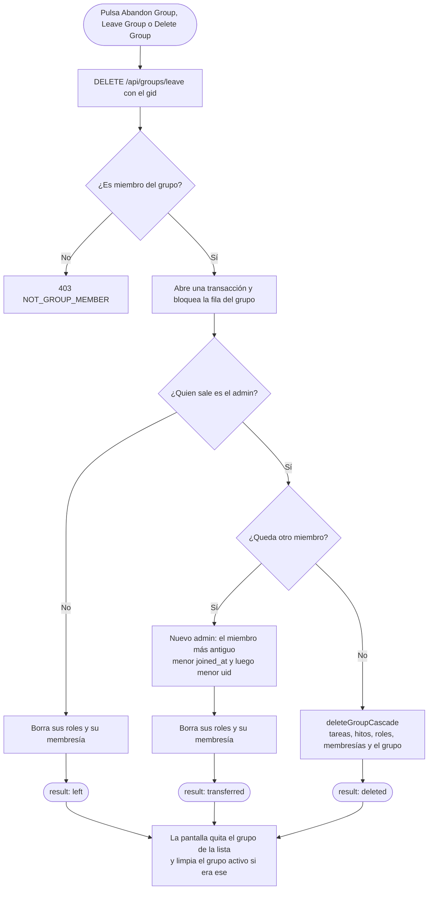

# Grupos y roles: flujos

**En una frase:** el admin agrega a alguien por su nombre de usuario y le da roles; cuando alguien sale, la API decide en una transacción si solo se va, si traspasa el admin o si borra el grupo.

## Flujo principal: agregar un miembro y darle un rol

## Ciclo de vida de un grupo

## Salir del grupo: qué decide la API

## Paso a paso

**Agregar un miembro y darle un rol**
1. El admin pulsa **Add User** y escribe un nombre de usuario.
2. La pantalla pide el `uid` con `GET /api/users/getuid`.
3. La pantalla envía `POST /api/groups/join` con `uid` y `gid`.
4. `requireAuth` valida el JWT y `requireGroupAdmin` confirma que quien llama es el admin.
5. El controller revisa que el `uid` exista y llama a `addUserToGroup`.
6. Se inserta la fila en `UserGroups`, con `joined_at` = ahora. Si ya existía, no cambia nada.
7. La pantalla agrega a la persona a **Members**.
8. El admin pulsa **Assign/Edit Rol** y marca un rol.
9. `useGroupRoles` actualiza ya los chips del miembro (cambio optimista) y envía `POST .../userroles`.
10. La API revisa que el rol sea del grupo y que la persona sea miembro, e inserta en `UserGroupRoles`.
11. Con 201 la casilla queda marcada. Si la API falla, los chips vuelven atrás, la casilla no cambia y sale una alerta.

**Salir del grupo**
1. El miembro pulsa **Abandon Group** (o el admin, **Leave Group** o **Delete Group**).
2. `DELETE /api/groups/leave` siempre saca a quien llama.
3. En una transacción, la API decide: `left`, `transferred` (nuevo admin) o `deleted` (era el último).
4. La pantalla quita el grupo de la lista y, si era el activo, deja de haber grupo activo.

**Quitar a otro miembro (admin):** **Delete Member** + nombre de usuario → `DELETE /api/groups/remove-member` borra sus roles y su membresía en una transacción. Si el admin escribe su propio nombre, la pantalla hace «salir del grupo».

## Qué ve el usuario si algo falla

La pantalla muestra el mensaje que manda la API (en inglés) en la barra inferior; en el diálogo de asignar roles, en una alerta.

| Situación | Código | HTTP | Qué ve el usuario |
|---|---|---|---|
| Nombre de grupo vacío | — (lo frena la pantalla) | — | «Group name is required» |
| Nombre de grupo de más de 25 caracteres | `VALIDATION_ERROR` | 400 | «Group name is required (max 25 characters)» |
| Nombre de usuario vacío al agregar o quitar | — (lo frena la pantalla) | — | «Username is required» |
| El nombre de usuario no existe | `NOT_FOUND` | 404 | «User not found» |
| Quien llama no es el admin | `NOT_GROUP_ADMIN` | 403 | «Only the group admin can perform this action» |
| Quien llama no es miembro | `NOT_GROUP_MEMBER` | 403 | «You are not a member of this group» |
| Ya hay un rol con ese nombre en el grupo | `DUPLICATE_ROLE` | 409 | «A role with that name already exists in this group» |
| El miembro ya tiene ese rol | `DUPLICATE_ROLE_ASSIGNMENT` | 409 | «Error al asignar/quitar rol: The user already has this role» |
| La persona ya no es miembro | `VALIDATION_ERROR` | 400 | «Error al asignar/quitar rol: The user is not a member of this group» |
| El rol no existe o es de otro grupo | `NOT_FOUND` | 404 | «Role not found» (al asignar, con el prefijo de la alerta) |
| La base está ocupada: un bloqueo dura más de 5 s, o un *deadlock* (dos transacciones esperándose) sigue tras 2 reintentos | `DB_BUSY` | 503 | «The database is busy, please try again» |
| Demasiadas peticiones (más de 300 por minuto, valor por defecto) | `RATE_LIMITED` | 429 | «Demasiadas solicitudes. Espera un momento e inténtalo de nuevo.» |
| No hay conexión con la API | `NETWORK_ERROR` | — | «Could not reach the server. Check your connection.» |
| El JWT venció o no es válido | `UNAUTHENTICATED` | 401 | Se cierra la sesión y vuelve a la pantalla de inicio de sesión |
| Error inesperado | `INTERNAL_ERROR` | 500 | «Internal server error» |

## Para saber más

- Casos de uso y permisos: [04-casos-de-uso/02-grupos-y-roles.md](../04-casos-de-uso/02-grupos-y-roles.md)
- Tablas que se escriben: [03-base-de-datos/02-grupos-y-roles.md](../03-base-de-datos/02-grupos-y-roles.md)
- Crear un grupo desde un plan de la IA: [05-chat-ia.md](05-chat-ia.md)
- Limitaciones conocidas: [cierre del proyecto](../01-proyecto/cierre-del-proyecto.md#limitaciones-conocidas)
