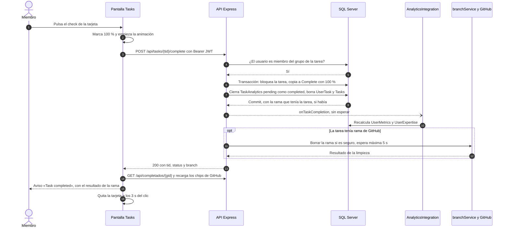
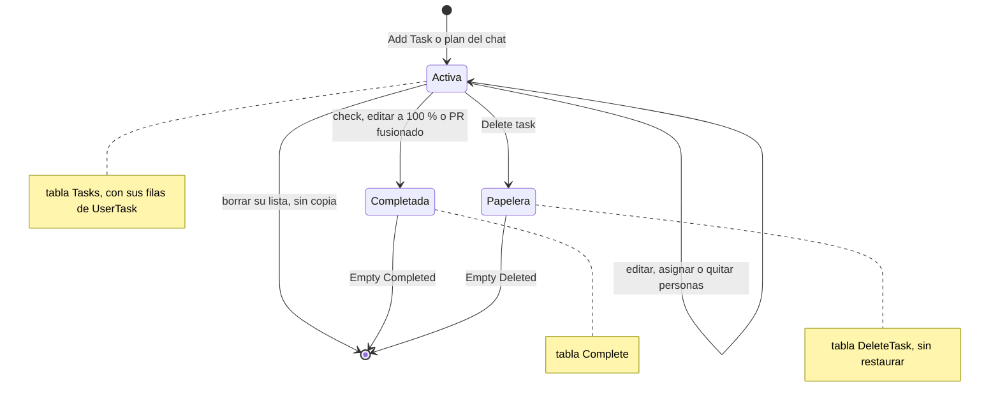
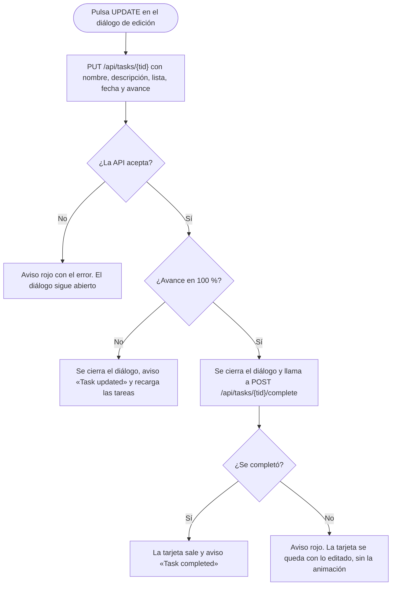

# Tareas: flujos

**En una frase:** cada acción de la pantalla `/tasks` es una sola llamada a la API; completar y mandar a la papelera mueven la tarea a otra tabla en una transacción y después avisan a analytics y limpian su rama de GitHub.

## Completar una tarea

## Ciclo de vida de una tarea

## Guardar una edición

## Paso a paso

**Completar** (diagrama de arriba)
1. La tarjeta se marca al 100 % antes de que responda la API.
2. La API revisa el JWT y que el usuario sea miembro del grupo de la tarea.
3. En una transacción: copia a `Complete` (con su `created_at`), cierra los registros de analytics, borra asignaciones y la tarea.
4. Analytics recalcula las métricas en segundo plano; un fallo ahí no cambia la respuesta.
5. Si había rama, `branchService` la borra cuando es seguro (sin cambios sin fusionar ni otro PR abierto) y la API espera hasta 5 s.
6. La pantalla recarga las completadas, muestra el aviso y quita la tarjeta a los 3 s del clic.

**Otros flujos**
- **Crear:** `POST /api/tasks` → la API genera el `tid`, la BD le pone `created_at` y la tarjeta se agrega al final de su lista («Creation Date»).
- **Mandar a la papelera:** `POST /api/tasks/{tid}/trash`. Igual que completar, pero copia a `DeleteTask` con su avance y cierra los registros de analytics como `failed`.
- **Borrar una lista:** `DELETE /api/tasks/list/{gid}/{lista}`. Borra todas sus tareas en una transacción, sin copiarlas a la papelera, y limpia sus ramas. La lista se marca ocupada mientras tanto.
- **Asignar:** el interruptor cambia al instante y llama a `POST /api/usertask`. La API responde y después registra la asignación en analytics. Quitar llama a `DELETE /api/usertask` y cierra el registro como `reassigned`.
- **Vaciar:** `DELETE /api/completados/{gid}` o `DELETE /api/delete/{gid}`. Borra para siempre todas las completadas, o toda la papelera, del grupo.
- **PR fusionado:** el webhook de GitHub completa la tarea con la misma función. Ver [GitHub](07-github.md).

## Qué ve el usuario si algo falla

Los avisos rojos muestran el mensaje que manda la API (en inglés).

| Código (HTTP) | Cuándo | Qué ve el usuario |
|---|---|---|
| `VALIDATION_ERROR` (400) | Falta un campo, es muy largo, la fecha no existe o pasa de 2079, el `gid` no coincide, o la persona a asignar no es del grupo | Aviso rojo, por ejemplo «name must be at most 25 characters» o «The user is not a member of this group». El diálogo de edición sigue abierto |
| `UNAUTHENTICATED` (401) | Sin token, o vencido | Se cierra la sesión y vuelve a «Sign In» |
| `NOT_GROUP_MEMBER` (403) | Ya no es miembro del grupo | Aviso rojo «You are not a member of this group» |
| `TASK_NOT_FOUND` (404) al completar o borrar | Otro miembro ya la borró o un PR la completó | La tarjeta sale y aparece «This task no longer exists. The list was refreshed.» |
| `TASK_NOT_FOUND` (404) al editar o asignar | La tarea ya no existe | Aviso rojo «Task not found» |
| `RATE_LIMITED` (429) | Más de 300 peticiones en un minuto | «Demasiadas solicitudes. Espera un momento e inténtalo de nuevo.» |
| `DB_BUSY` (503) | La base siguió bloqueada tras reintentar (completar, papelera, borrar lista, quitar persona) | «The database is busy, please try again» |
| `INTERNAL_ERROR` (500) | Error inesperado en el servidor | «Internal server error» |
| `NETWORK_ERROR` (sin respuesta) | La API no está corriendo o no hay red | «Could not reach the server. Check your connection.» |

Qué se deshace en la pantalla:
- Si falla completar o mandar a la papelera, la tarjeta vuelve como estaba.
- Si falla asignar o quitar, el interruptor vuelve a su posición.
- Si falla borrar una lista, además del aviso rojo aparece «Delete failed» abajo.
- Si falla leer las asignaciones de una tarea, el menú las muestra todas apagadas.

## Para saber más

- Quién puede hacer cada acción: [04-casos-de-uso/03-tareas.md](../04-casos-de-uso/03-tareas.md)
- Tablas que cambian: [03-base-de-datos/03-tareas.md](../03-base-de-datos/03-tareas.md)
- Arquitectura del módulo: [02-arquitectura/03-tareas.md](../02-arquitectura/03-tareas.md)
- Limitaciones conocidas: [cierre del proyecto](../01-proyecto/cierre-del-proyecto.md#limitaciones-conocidas)
