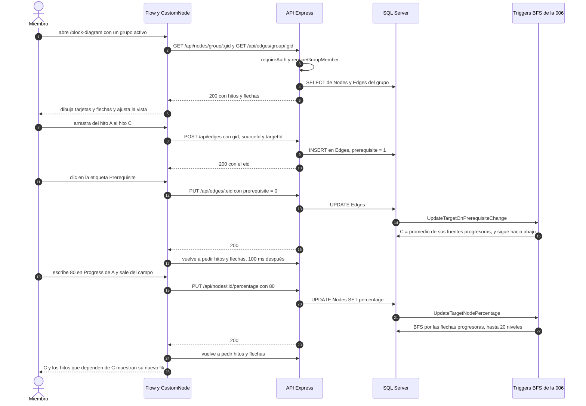
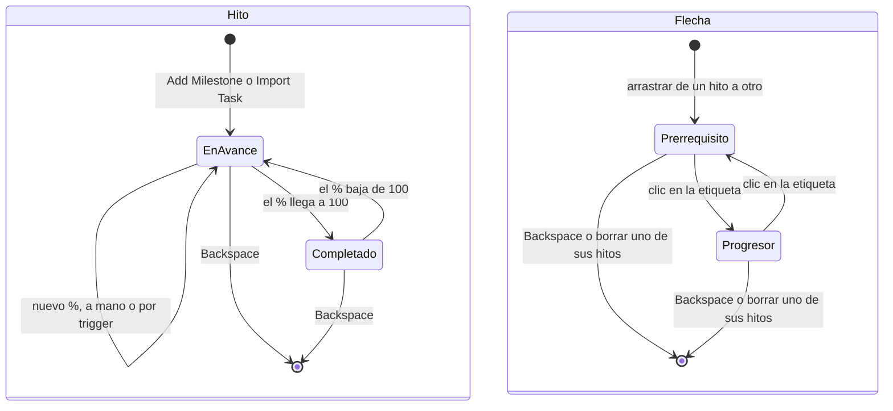
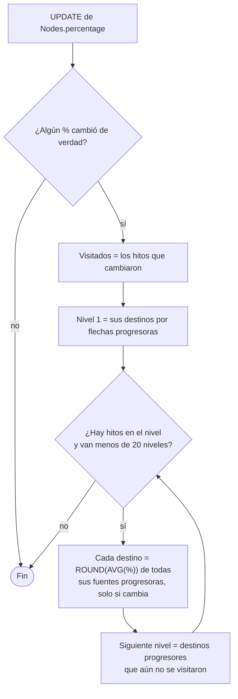

# Hitos y calendario: flujos

**En una frase:** el lienzo carga los hitos y las flechas del grupo, guarda cada cambio con una llamada REST y, cuando cambia un porcentaje o el tipo de una flecha, SQL Server recalcula los hitos que dependen de él y el lienzo se vuelve a cargar.

## Flujo principal: conectar dos hitos y propagar el avance

## Ciclo de vida de un hito y de una flecha

- «Completado» es lo que se ve: la tarjeta verde con «✓ Completed» cuando `percentage = 100`, lo ponga el usuario o un trigger.
- Un **prerrequisito** solo dibuja la dependencia. Un **progresor** hace que el destino tome el promedio de sus fuentes progresoras.

## Cómo propaga el avance el trigger

Ejemplo: A (80 %) y B (40 %) apuntan a C como progresores → C = 60 %. Si C es progresor de D, D también queda en 60 %, en la misma sentencia.

## Paso a paso

1. **Abrir:** el lienzo pide hitos y flechas del grupo activo y ajusta la vista sin pasar de 100 % de zoom.
2. **Crear:** nombre y fecha → «Add Milestone» → `POST /api/nodes` → la tarjeta aparece con 0 %.
3. **Importar:** «Import Task» → elegir tarea → `POST /api/nodes` con el id de la tarea, su fecha y su %.
4. **Mover:** soltar la tarjeta → `PUT /api/nodes/:id/coords`.
5. **Editar:** «Edit» → «Save» → `PUT /api/nodes/:id` y `PUT /api/tasks/nodes/:id` a la vez → el lienzo se recarga.
6. **Conectar:** arrastrar → `POST /api/edges` → la flecha nace como «Prerequisite».
7. **Cambiar el tipo:** clic en la etiqueta → `PUT /api/edges/:eid` → trigger → recarga.
8. **Fijar el %:** escribir y salir del campo → `PUT /api/nodes/:id/percentage` → trigger → recarga.
9. **Completar:** escribir 100 → `PUT /api/nodes/:id/toggleComplete` con 1 y luego el % → la tarjeta se pone verde.
10. **Borrar:** Backspace. Hito: `DELETE /api/edges/source/:id` y `DELETE /api/nodes/:id`, que borra también las flechas que llegan. Flecha: `DELETE /api/edges/:eid`, sin recalcular porcentajes.
11. **Calendario:** `GET /api/nodes/tasks/:gid` une `Nodes` y `Tasks` del grupo; cada fila es un evento de un día.

- Editar desde el lienzo copia nombre, descripción y fecha a la tarea importada. Editar la tarea en «Tasks» no cambia el hito.
- Una tarea importada aparece dos veces en el calendario: como tarea y como hito. Al completarla o mandarla a la papelera sale de `Tasks` y solo queda el hito.

## Qué ve el usuario si algo falla

En «Milestones» el error sale en un aviso rojo abajo al centro (4 s). En «Calendar» sale un aviso rojo arriba del mes. El texto es el que manda la API.

| Situación | Código | Mensaje |
|---|---|---|
| Sesión vencida o sin JWT | 401 `UNAUTHENTICATED` | Ninguno: la app cierra la sesión y vuelve al login |
| No es miembro del grupo | 403 `NOT_GROUP_MEMBER` | «You are not a member of this group» |
| El hito o la flecha ya no existe | 404 `NOT_FOUND` o `TASK_NOT_FOUND` | «Node not found», «Edge not found» o, al usar «Save», «Task not found» |
| Nombre vacío o largo, fecha vacía o inválida | 400 `VALIDATION_ERROR` | «name is required», «name must be at most 25 characters», «date is required» o «date must be a date like YYYY-MM-DD…» |
| Conectar hitos o importar una tarea de otro grupo | 400 `VALIDATION_ERROR` | «sourceId and targetId must be nodes of the group» o «nid belongs to a task of another group» |
| Repetir una flecha con el mismo origen y destino | 409 `DUPLICATE_EDGE` | «These nodes are already connected» |
| Demasiados pedidos | 429 `RATE_LIMITED` | «Demasiadas solicitudes. Espera un momento e inténtalo de nuevo.» |
| La API no responde o falla | `NETWORK_ERROR` o 500 `INTERNAL_ERROR` | «Could not reach the server. Check your connection.» o «Internal server error» |

- **Después del error:** si falla borrar, el lienzo se recarga y el elemento vuelve. Si falla el %, el tipo de flecha o completar, se deshace el cambio local. Si falla crear o conectar, no aparece nada nuevo.
- **Antes de llamar,** la interfaz evita algunos errores: «Add Milestone» se desactiva sin grupo, nombre o fecha, el nombre no deja escribir más de 25 caracteres y «Progress» solo acepta de 0 a 100.

## Para saber más
- Tablas y triggers: [03-base-de-datos/04-hitos-y-calendario.md](../03-base-de-datos/04-hitos-y-calendario.md)
- Pantallas: [05-interfaz/04-hitos-y-calendario.md](../05-interfaz/04-hitos-y-calendario.md)
- Permisos: [04-casos-de-uso/04-hitos-y-calendario.md](../04-casos-de-uso/04-hitos-y-calendario.md)
- Arquitectura: [02-arquitectura/04-hitos-y-calendario.md](../02-arquitectura/04-hitos-y-calendario.md)
- Limitaciones conocidas: [cierre del proyecto](../01-proyecto/cierre-del-proyecto.md#limitaciones-conocidas)
