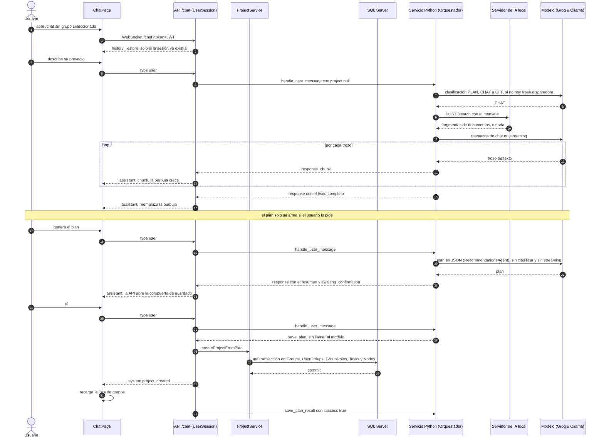
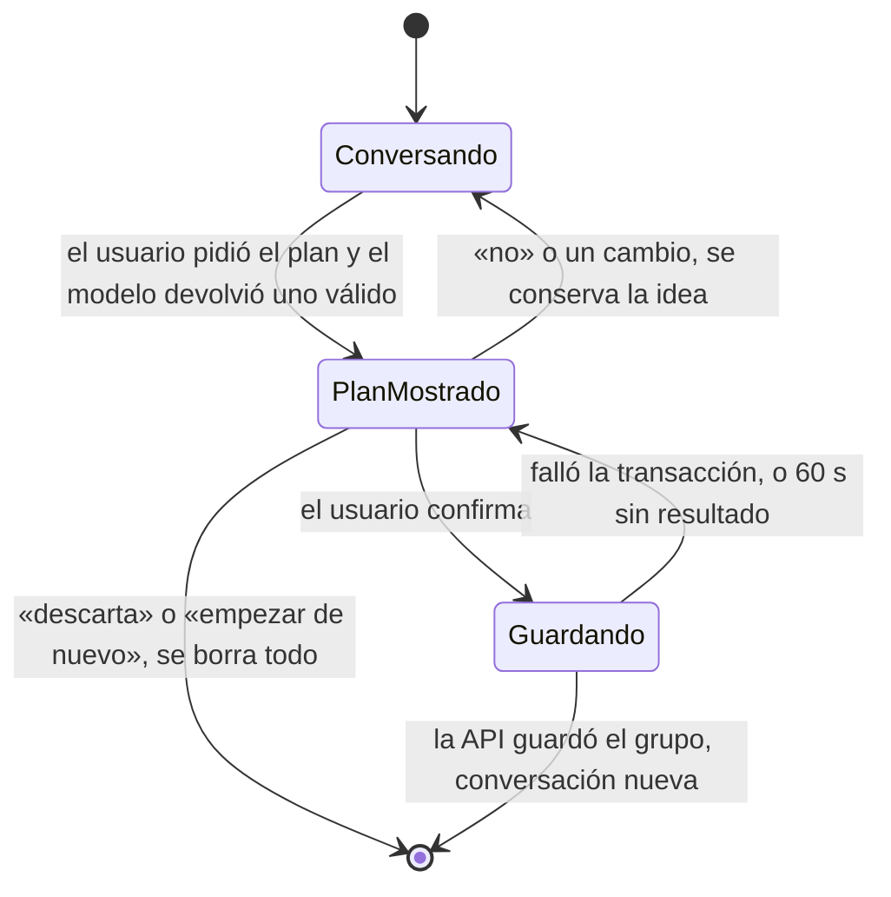
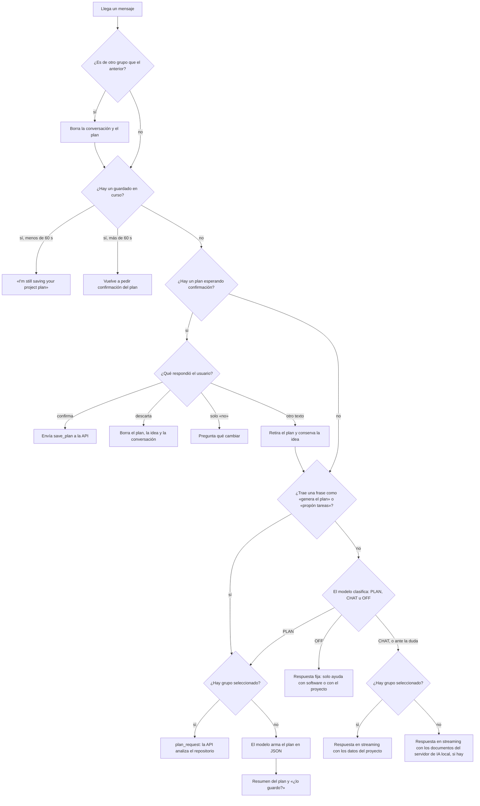
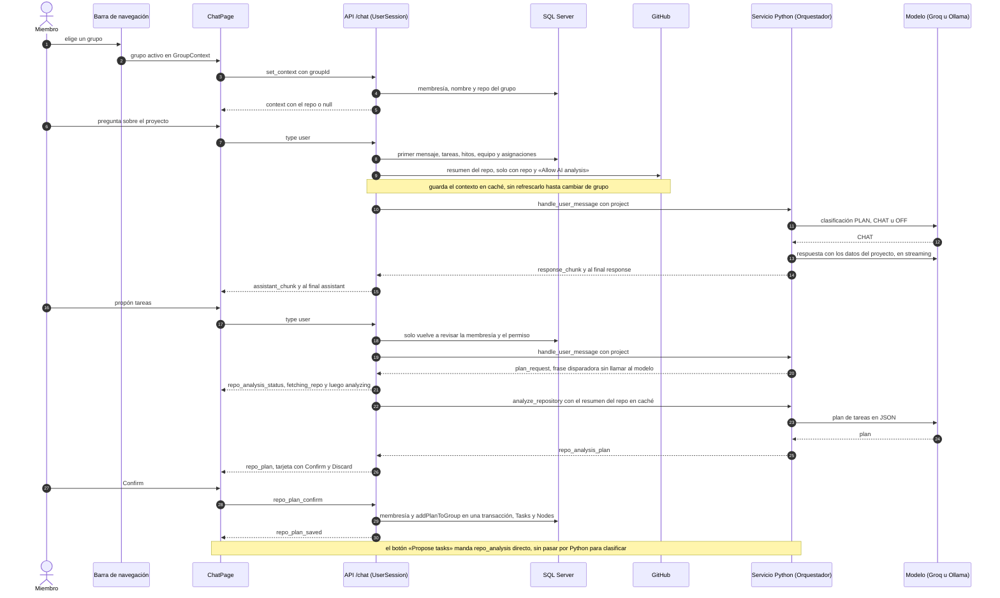

# Chat con IA: flujos

**En una frase:** cada mensaje se clasifica como pedido de plan, conversación o fuera de tema; la conversación se responde en streaming (con los datos del grupo elegido en la barra, o sin grupo con los documentos del servidor de IA local), y el plan solo se arma cuando el usuario lo pide: con grupo, como análisis del repositorio; sin grupo, como un proyecto nuevo que la API guarda en una sola transacción al responder «sí».

## Diagrama 1: sin grupo, de la idea al proyecto guardado

## Diagrama 2: vida del plan de un proyecto nuevo

Si el usuario elige un grupo en la barra, el siguiente mensaje llega con otro proyecto y Python borra la conversación y el plan.

## Diagrama 3: cómo decide el orquestador qué responder

## Diagrama 4: con grupo, el asistente del proyecto

## Paso a paso

**Sin grupo seleccionado** (Diagramas 1, 2 y 3)
1. `ChatPage` abre `/chat?token=<JWT>`; la API revisa el `Origin` y el JWT antes de aceptar.
2. `SessionManager` busca la sesión del usuario. Si existe (otra pestaña o menos de 60 min desconectado), la reutiliza y manda `history_restore`; si no, crea una y el navegador muestra un saludo local a los 1,5 s.
3. El usuario escribe. La API valida el largo (4000) y el ritmo (20 por minuto), guarda el mensaje en el historial, lo manda a Python con `project` en `null` y arranca un plazo de 90 s.
4. El orquestador decide qué hacer (Diagrama 3). Si el mensaje no trae una frase disparadora, una llamada corta al modelo lo clasifica (PLAN, CHAT u OFF; ante la duda, CHAT). Así, un mensaje normal cuesta dos llamadas: clasificar y responder.
5. CHAT: pide al servidor de IA local (`POST /search`) los fragmentos de documentos parecidos al mensaje y responde en streaming. OFF: respuesta fija, en español o en inglés según el mensaje.
6. PLAN: `RecommendationsAgent` pide el plan en JSON. El prompt pide 4 hitos (Setup, Development, Testing, Launch), al menos 8 tareas (`MIN_TASKS`, con los dos proveedores) y al menos 3 roles.
7. Python lo resume en una tabla Markdown y marca `awaiting_confirmation`. La API abre su compuerta de guardado.
8. El usuario confirma («sí», «ok», «guardar», «dale», «listo»…). Python responde `save_plan` con el plan, sin llamar al modelo.
9. La API comprueba la compuerta y llama a `ProjectService.createProjectFromPlan`, que crea grupo, membresía, roles, tareas e hitos en una transacción.
10. La API manda `project_created` al navegador, que recarga sus grupos (el grupo nuevo no se selecciona solo: hay que elegirlo en la barra), y `save_plan_result` a Python, que empieza una conversación nueva.

**Con grupo seleccionado** (Diagrama 4)
1. El grupo se elige en la barra de navegación. `ChatPage` manda `set_context` (también en cada reconexión); la API comprueba la membresía y responde `context` con el repo o `null`. Si el grupo cambió, descarta el contexto anterior.
2. Con el primer mensaje, la API arma el contexto: tareas, hitos, nombres del equipo, quién tiene cada tarea y, si hay repo, la instalación está activa y el admin activó «Allow AI analysis», el resumen del repo. Lo guarda en caché y no lo refresca mientras el grupo no cambie.
3. En los mensajes siguientes solo vuelve a revisar la membresía y, si el contexto tiene el resumen del repo, que siga permitido.
4. Python recibe el contexto con cada mensaje. Si es de otro grupo que el anterior, borra la conversación y el plan.
5. CHAT: responde en streaming con los datos del proyecto (sin los documentos del servidor de IA local). Si algo no está en esos datos, dice que no lo ve.
6. PLAN: Python devuelve `plan_request` y la API lanza el análisis del repositorio con el mensaje como instrucciones (hasta 500 caracteres) y las mismas reglas que «Propose tasks»: uno a la vez, uno por minuto y 90 s de plazo. Reutiliza el resumen del repo en caché.
7. Llega la tarjeta del plan: «Confirm» guarda las tareas y los hitos en el grupo con `addPlanToGroup`; «Discard» la descarta. El plan vence a los 30 min.

**Streaming:**
- Python manda cada trozo como `response_chunk`; la API lo reenvía como `assistant_chunk` solo si el pedido sigue pendiente, con el mismo `requestId` que llevará el `assistant` final.
- El navegador junta los trozos y pinta una vez por cuadro de pantalla. El `assistant` final reemplaza la burbuja; si llega un error o se corta la conexión, la burbuja se congela con lo que tenía.
- Los trozos no reinician los plazos de 90 s (API) y 100 s (navegador), y no se guardan en el historial.

**Sesiones y memoria:**
- Una sesión por usuario: si abres el chat en otra pestaña, la nueva toma la sesión y la anterior deja de recibir respuestas.
- La API guarda hasta 100 mensajes por usuario. El historial es por usuario, no por grupo: al cambiar de grupo las burbujas siguen en pantalla, aunque Python empieza una conversación nueva.
- Python guarda su propio contexto: las últimas 16 líneas, por 2 h. Todo está en memoria: reiniciar la API o Python lo borra.

## Qué ve el usuario si algo falla

Los errores aparecen como un aviso rojo centrado, con `Code: <código>` debajo. Los fallos del modelo, en cambio, llegan como una respuesta normal del asistente.

| Situación | Código | Qué ve el usuario |
|---|---|---|
| Token inválido o vencido, u `Origin` no permitido | HTTP 401 o 403 al conectar | «Connection problem: WebSocket connection error» y el botón «🔌 Connect»; tras 5 reintentos, «Maximum reconnection attempts reached» |
| El token vence con el chat abierto | cierre 4001 | Vuelve a la pantalla de inicio de sesión |
| Más de 20 mensajes en un minuto | `RATE_LIMITED` | «You are going too fast: wait a moment before trying again. You can retry in N s.» |
| Mensaje de más de 4000 caracteres | `MESSAGE_TOO_LONG` | El cuadro no deja escribir más; si llega, «The message is too long: the limit is 4000 characters.» |
| Python apagado, no conecta en 5 s o se corta el enlace | `LLM_ERROR` | «The AI service is not available right now.» |
| Python no responde en 90 s | `LLM_TIMEOUT` | «The AI took too long to answer. Please try again.» |
| El modelo falla: límite de uso de Groq, demora, Ollama apagado o modelo sin instalar | sin código | Respuesta normal del asistente: «The AI assistant is receiving too many requests right now. Please try again in 20s.», «The AI assistant took too long to respond. Please try again.» o «The AI assistant is temporarily unavailable. Please try again in a moment.». El detalle de Ollama («is Ollama running?», «ollama pull …») solo queda en el log de Python |
| El modelo devuelve un plan inválido (JSON roto o sin tareas) | sin código | «I had trouble generating the project plan. Could you provide a bit more detail about what you want to build?» |
| Falla la transacción al guardar el proyecto nuevo | `SAVE_FAILED` | «Could not create the project.» No se guarda nada |
| Pedir un plan con un grupo sin repo | `REPO_NOT_CONNECTED` | «The project has no GitHub repository connected.» |
| Pedir un plan sin «Allow AI analysis» | `AI_ANALYSIS_DISABLED` | «AI analysis is turned off for this project. A group admin can turn it on from the GitHub page (“Allow AI analysis”).» |
| Más de un análisis por minuto | `RATE_LIMITED` | «You can only ask for one analysis per minute. You can retry in N s.» |
| Ya hay un análisis en curso | `ANALYSIS_IN_PROGRESS` | «An analysis is already running.» |
| El análisis falla en Python | `ANALYSIS_FAILED` | «Could not complete the analysis.» |
| La tarjeta del plan venció (30 min) o ya se usó | `REPO_PLAN_EXPIRED` o `REPO_PLAN_NOT_FOUND` | La tarjeta pasa a «Plan expired: ask for the analysis again to get a new one.» y aparece «The plan expired; analyze the repository again.» o «The plan is no longer available.» |
| Falla el guardado del plan del análisis | `SAVE_FAILED` | «Could not save the plan.»; la tarjeta se puede volver a confirmar mientras no venza |
| No llega ninguna respuesta en 100 s | sin código | «No answer arrived in time. If it arrives later it will show up here; you can also try again.» |
| El socket está cerrado al enviar | sin código | «Failed to send message. Please check your connection.» |
| El mensaje supera el tamaño que acepta el socket | cierre 1009 | «The message is too large to send. Shorten it and try again.» |
| Error inesperado en la API | `INTERNAL_ERROR` | «An unexpected error occurred.» |

El análisis también puede terminar con códigos de GitHub (`INSTALLATION_SUSPENDED`, `REPO_EMPTY`, `GITHUB_RATE_LIMITED`…): qué significa cada uno, en [07-github](07-github.md).

**Reintentar después de `SAVE_FAILED`:** Python vuelve a dejar el plan esperando confirmación, pero la API ya cerró su compuerta. Si el usuario escribe «sí» otra vez, la API rechaza el guardado (`PLAN_NOT_EXPECTED`) sin avisar y a los 100 s aparece «No answer arrived in time…». Para reintentar, hay que escribir «genera el plan»: la IA arma el plan de nuevo y la compuerta se vuelve a abrir ([limitaciones conocidas](../01-proyecto/cierre-del-proyecto.md#chat-con-ia)).

## Para saber más
- El análisis del repositorio, que usa el mismo socket: [07-github](07-github.md)
- Piezas y conexiones: [02-arquitectura/05-chat-ia.md](../02-arquitectura/05-chat-ia.md)
- Tablas que se leen y se escriben: [03-base-de-datos/05-chat-ia.md](../03-base-de-datos/05-chat-ia.md)
- La pantalla: [05-interfaz/05-chat-ia.md](../05-interfaz/05-chat-ia.md)
- El servidor de IA local: [10-ia-sobre-el-codigo](10-ia-sobre-el-codigo.md)
- Limitaciones conocidas: [cierre de la línea de Pablo y estado](../01-proyecto/cierre-del-proyecto.md#limitaciones-conocidas)
