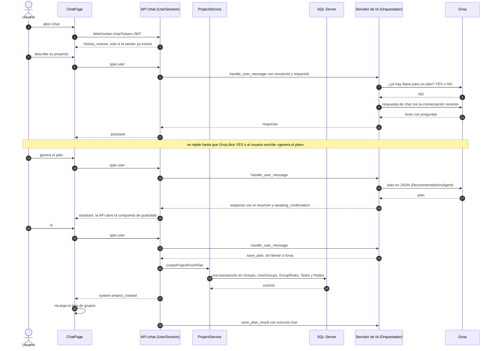
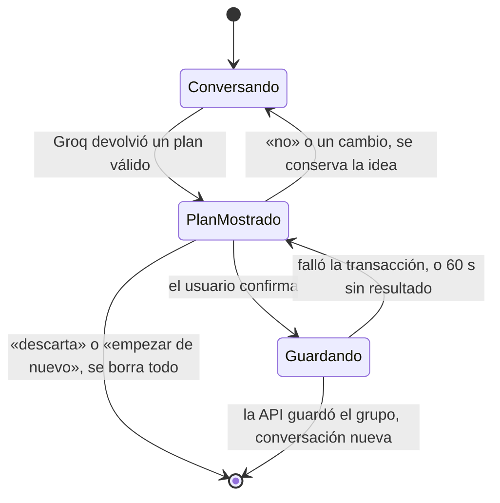
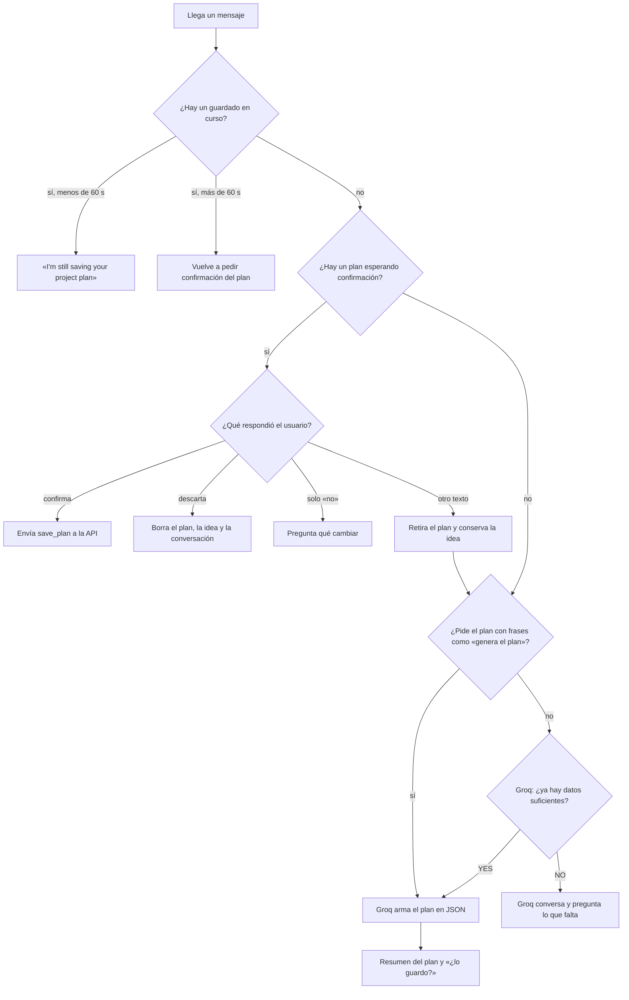

# Chat con IA: flujos

**En una frase:** el usuario describe su idea, la IA pregunta lo que falta y arma un plan; cuando el usuario responde «sí», la API crea el grupo con sus roles, tareas e hitos en una sola transacción.

## Diagrama 1: de la idea al proyecto guardado

## Diagrama 2: vida del plan

## Diagrama 3: cómo decide el orquestador qué responder

## Paso a paso
1. `ChatPage` abre `/chat?token=<JWT>`; la API revisa el `Origin` y el JWT antes de aceptar.
2. `SessionManager` busca la sesión del usuario. Si existe (otra pestaña o menos de 60 min desconectado), la reutiliza y manda `history_restore`; si no, crea una y el navegador muestra un saludo local a los 1,5 s.
3. El usuario escribe. La API valida el largo (4000) y el ritmo (20 por minuto), guarda el mensaje en el historial, lo manda a Python y arranca un plazo de 90 s.
4. El orquestador decide qué hacer (Diagrama 3) y llama a Groq con el modelo `openai/gpt-oss-20b`.
5. Con datos suficientes, `RecommendationsAgent` pide el plan en JSON. El prompt pide 4 hitos (Setup, Development, Testing, Launch), al menos 50 tareas y al menos 3 roles.
6. Python lo resume en una tabla Markdown y marca `awaiting_confirmation`. La API abre su compuerta de guardado.
7. El usuario confirma («sí», «ok», «guardar», «dale», «listo»…). Python responde `save_plan` con el plan, sin llamar a Groq.
8. La API comprueba la compuerta y llama a `ProjectService.createProjectFromPlan`, que crea grupo, membresía, roles, tareas e hitos en una transacción.
9. La API manda `project_created` al navegador, que recarga sus grupos, y `save_plan_result` a Python, que empieza una conversación nueva.

**Sesiones y memoria:**
- Una sesión por usuario: si abres el chat en otra pestaña, la nueva toma la sesión y la anterior deja de recibir respuestas.
- La API guarda hasta 100 mensajes por usuario. Python guarda su propio contexto: las últimas 16 líneas, por 2 h. Todo está en memoria: reiniciar la API o Python lo borra.

## Qué ve el usuario si algo falla

Los errores aparecen como un aviso rojo centrado, con `Code: <código>` debajo. Los fallos de Groq, en cambio, llegan como una respuesta normal del asistente.

| Situación | Código | Qué ve el usuario |
|---|---|---|
| Token inválido o vencido, u `Origin` no permitido | HTTP 401 o 403 al conectar | «Connection problem: WebSocket connection error» y el botón «🔌 Connect»; tras 5 reintentos, «Maximum reconnection attempts reached» |
| El token vence con el chat abierto | cierre 4001 | Vuelve a la pantalla de inicio de sesión |
| Más de 20 mensajes en un minuto | `RATE_LIMITED` | «Vas muy rápido: espera un momento antes de volver a intentarlo. Podrás reintentar en N s.» |
| Mensaje de más de 4000 caracteres | `MESSAGE_TOO_LONG` | El cuadro no deja escribir más; si llega, «El mensaje es demasiado largo: el máximo es 4000 caracteres.» |
| Python apagado, no conecta en 5 s o se corta el enlace | `LLM_ERROR` | «El servicio de IA no está disponible en este momento.» |
| Python no responde en 90 s | `LLM_TIMEOUT` | «La IA tardó demasiado en responder. Inténtalo de nuevo.» |
| Groq: límite de uso, demora o falla | sin código | Respuesta en inglés, p. ej. «The AI assistant is receiving too many requests right now. Please try again in 20s.» |
| Groq devuelve un plan inválido (JSON roto o sin tareas) | sin código | «I had trouble generating the project plan. Could you provide a bit more detail about what you want to build?» |
| Falla la transacción al guardar | `SAVE_FAILED` | «No se pudo crear el proyecto.» No se guarda nada |
| No llega ninguna respuesta en 100 s | sin código | «No llegó respuesta a tiempo. Si llega más tarde aparecerá aquí; también puedes intentarlo de nuevo.» |
| El socket está cerrado al enviar | sin código | «Failed to send message. Please check your connection.» |
| Error inesperado en la API | `INTERNAL_ERROR` | «Ocurrió un error inesperado.» |

**Reintentar después de `SAVE_FAILED`:** Python vuelve a dejar el plan esperando confirmación, pero la API ya cerró su compuerta. Si el usuario escribe «sí» otra vez, la API rechaza el guardado (`PLAN_NOT_EXPECTED`) sin avisar y a los 100 s aparece «No llegó respuesta a tiempo…». Para reintentar, hay que escribir «genera el plan»: la IA arma el plan de nuevo y la compuerta se vuelve a abrir.

## Para saber más
- El análisis del repositorio, que usa el mismo socket: [07-github](07-github.md)
- Piezas y conexiones: [02-arquitectura/05-chat-ia.md](../02-arquitectura/05-chat-ia.md)
- Tablas que se escriben: [03-base-de-datos/05-chat-ia.md](../03-base-de-datos/05-chat-ia.md)
- La pantalla: [05-interfaz/05-chat-ia.md](../05-interfaz/05-chat-ia.md)
- Limitaciones conocidas: [cierre del proyecto](../01-proyecto/cierre-del-proyecto.md#limitaciones-conocidas)
