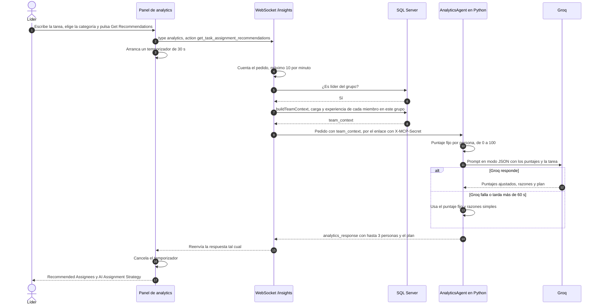
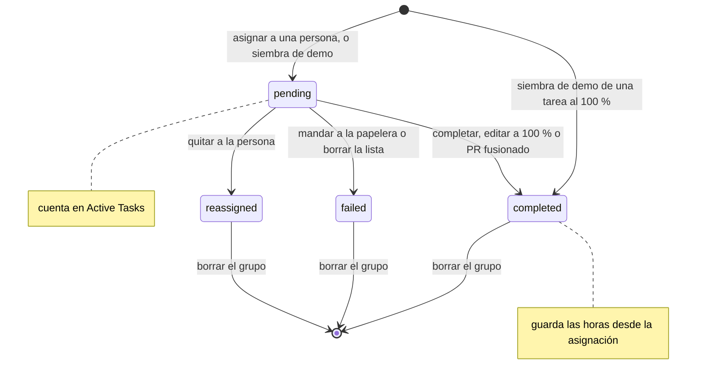
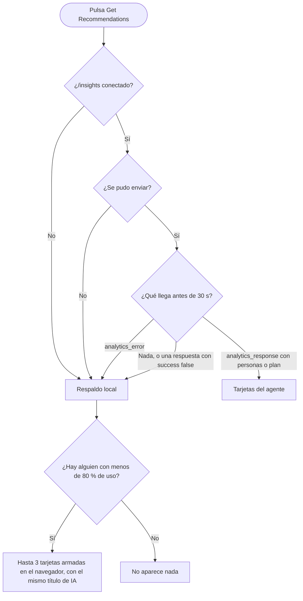

# Analytics: flujos

**En una frase:** el panel lee los números con un `GET` y pide recomendaciones por el WebSocket `/insights`; Node revisa que seas líder, arma los datos reales del equipo y el agente de Python los puntúa con ayuda de Groq; si algo falla, el navegador muestra su propia estimación.

## Pedir recomendaciones de asignación

## Ciclo de vida de un registro de `TaskAnalytics`

Quitar a una persona y volver a asignarla crea un registro `pending` nuevo. El viejo se queda como historial.

## Qué muestra el panel al pedir recomendaciones

## Paso a paso

**Abrir el panel**
1. `/analytics` llama a `GET /api/analytics/dashboard/:groupId` con el JWT, y a la vez abre `/insights` con `?token=`.
2. La API valida el `groupId` y revisa que seas líder del grupo (`isGroupLeader`).
3. Lee en paralelo el resumen, la carga y la experiencia; el panel arma tarjetas, barras y el mejor por categoría.

**Pedir recomendaciones** (primer diagrama)
1. El panel manda la descripción, la categoría y el grupo. También manda su tabla de carga, pero el agente no la usa.
2. Node cuenta el pedido, descarta cualquier `team_context` del navegador y exige ser líder.
3. Node arma el `team_context` con datos de este grupo solamente: asignaciones abiertas, capacidad y experiencia.
4. Python calcula un puntaje fijo con experiencia, tasa de éxito, carga y capacidad, y le pide a Groq que lo ajuste.
5. Si Groq falla, el agente responde igual con el puntaje fijo; el plan dice «Analytics-based assignment (LLM unavailable)…».
6. La respuesta vuelve por el mismo `/insights` y el panel la dibuja. No se guarda nada.

**Registrar la actividad** (segundo diagrama)
- **Asignar** (`POST /api/usertask`): la API responde y después el hook crea el registro `pending`, con la categoría adivinada por palabras clave.
- **Completar, mandar a la papelera, borrar una lista o quitar a una persona:** el registro se cierra dentro de la misma transacción de la tarea.
- **Después de completar o mandar a la papelera:** el hook recalcula `UserExpertise` y `UserMetrics`, sin hacer esperar al usuario.
- **Job de métricas** (solo con `ANALYTICS_BATCH_ENABLED=true`): a la hora de `ANALYTICS_BATCH_SCHEDULE` (2:00 por defecto) recalcula `UserMetrics` y los puntajes de `UserExpertise`.

## Qué ve el usuario si algo falla

**Al abrir el panel.** Los textos rojos son el mensaje de la API, en inglés.

| Código (HTTP) | Cuándo | Qué ve el usuario |
|---|---|---|
| `NOT_GROUP_ADMIN` (403) | No es líder del grupo activo | «Solo líderes del equipo», y un 403 en la consola del navegador |
| `VALIDATION_ERROR` (400) | El `groupId` no es un UUID | «Could not load analytics data: groupId must be a valid UUID» y el panel en cero |
| `UNAUTHENTICATED` (401) | Sin token, o vencido | Se cierra la sesión y vuelve a «Sign In» |
| `RATE_LIMITED` (429) | Más de 300 peticiones a la API en un minuto | «Could not load analytics data: Demasiadas solicitudes. Espera un momento e inténtalo de nuevo.» |
| `INTERNAL_ERROR` (500) | Falla la base de datos | «Could not load analytics data: Failed to retrieve dashboard data» |
| `NETWORK_ERROR` | La API no está corriendo | «Could not load analytics data: Could not reach the server. Check your connection.» |

**Al pedir recomendaciones.** Ningún error se muestra en pantalla: el panel solo lo escribe en la consola y pasa al respaldo local.

| Qué falla | Qué pasa |
|---|---|
| `/insights` no conectó, o agotó sus 5 reintentos | Respaldo local al instante |
| Más de 10 pedidos por minuto (`RATE_LIMITED`; cuenta junto con los de analytics del chat) | `analytics_error` y respaldo local al instante |
| El servidor de IA está caído (`LLM_ERROR`) | Node espera hasta 5 s la conexión, manda `analytics_error` y el panel pasa al respaldo local |
| Falla el orquestador de Python | `analytics_error` («Analytics request failed.») y respaldo local al instante |
| Se corta el enlace con Python a mitad del pedido | Llega un evento `error` que el panel no reconoce: respaldo local a los 30 s |
| Falla el cálculo dentro del agente | Responde `success: false`, sin personas: el botón vuelve a «Get Recommendations» y, a los 30 s, aparece el respaldo local |
| Groq falla o pasa su límite (`LLM_TIMEOUT_SEC`, 60 s por defecto) | Llegan tarjetas con el puntaje fijo, sin confianza |
| Groq tarda entre 30 s y 60 s | Primero aparece el respaldo local; cuando llega la respuesta real, la reemplaza |

- Los hooks nunca muestran errores: si fallan, lo anotan en el log de la API y la acción sobre la tarea sigue adelante.
- El respaldo local se presenta como si fuera de la IA. Ver [limitaciones](../01-proyecto/cierre-del-proyecto.md#analytics).

## Para saber más

- La pantalla y sus textos: [05-interfaz/06-analytics.md](../05-interfaz/06-analytics.md)
- Quién puede hacer cada acción: [04-casos-de-uso/06-analytics.md](../04-casos-de-uso/06-analytics.md)
- Tablas y cómo se calculan los puntajes: [03-base-de-datos/06-analytics.md](../03-base-de-datos/06-analytics.md)
- Arquitectura del módulo: [02-arquitectura/06-analytics.md](../02-arquitectura/06-analytics.md)
- Limitaciones conocidas: [cierre del proyecto](../01-proyecto/cierre-del-proyecto.md#analytics)
