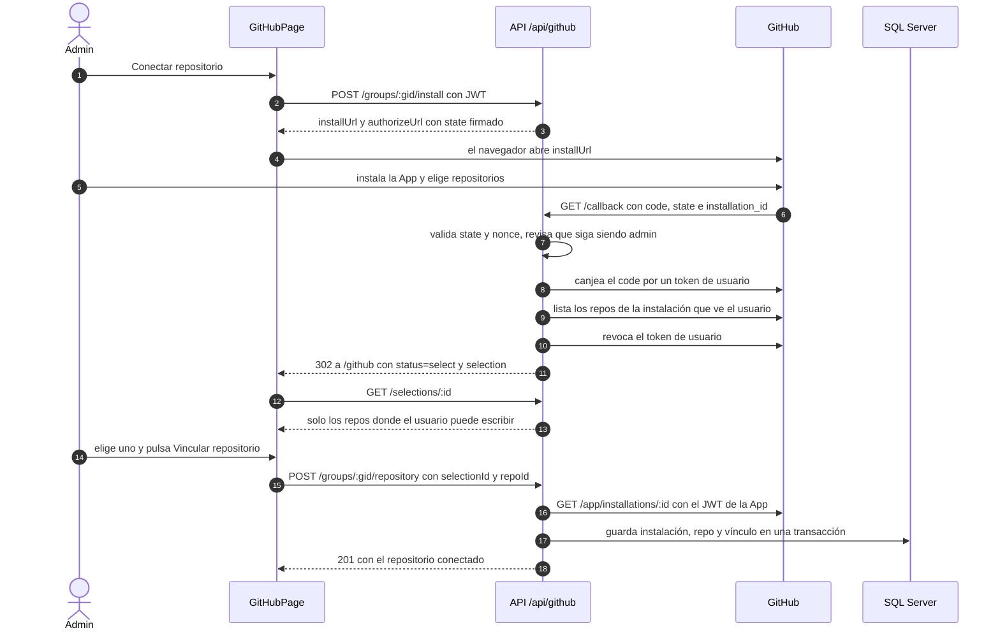
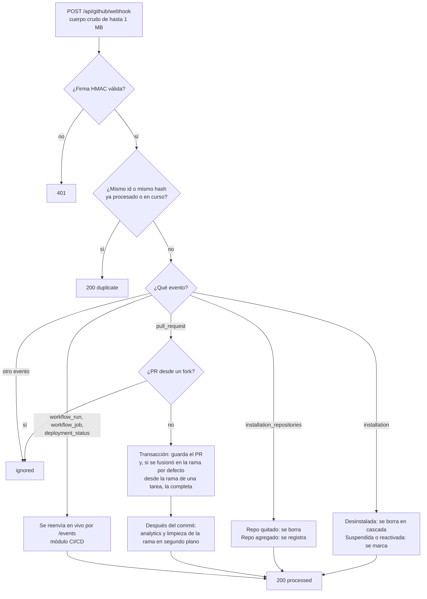
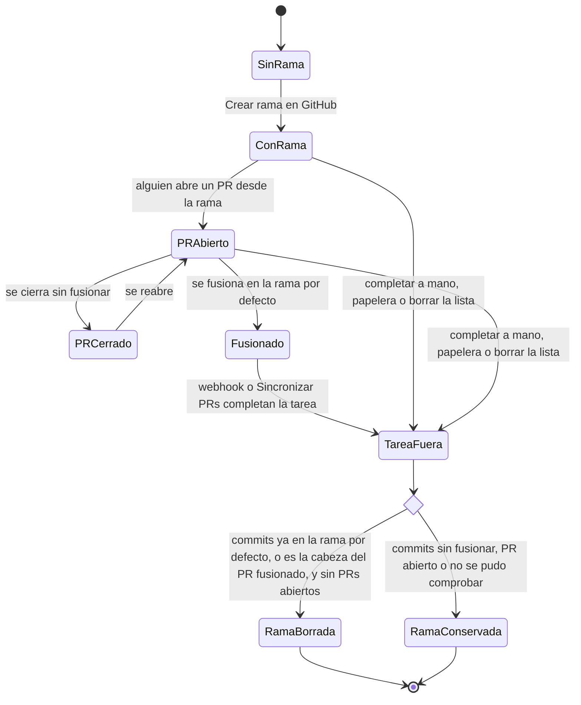

# GitHub: flujos

**En una frase:** el admin conecta el repo con un `state` firmado que GitHub devuelve al callback; luego cada tarea puede tener su rama, y cuando su PR se fusiona en la rama por defecto, el webhook completa la tarea y borra la rama si es seguro.

## Diagrama 1: conectar el repositorio

## Diagrama 2: un webhook llega a la API

Si el proceso tarda más de 8 s, la API responde 202 y sigue. Si falla, la entrega queda `failed` y responde 500.

## Diagrama 3: vida de la rama de una tarea

## Paso a paso

**Conectar el repositorio** (Diagrama 1)
1. El admin pulsa «Conectar repositorio» (instalar) o «Ya instalé la App» (solo autorizar).
2. La API firma un `state` de 10 min, ligado al admin, al grupo y a un nonce de un solo uso.
3. GitHub vuelve al callback; la API valida el `state` y que la persona siga siendo admin.
4. Con un token de usuario de corta vida lista los repos y deja solo aquellos donde puede escribir.
5. Revoca ese token y redirige a `/github?status=select`. La selección dura 10 min.
6. El admin elige el repo; `POST /repository` lo vincula en una transacción. Si había otro, borra sus ramas de tareas.

**Si el dueño cambia la instalación en github.com** (por ejemplo, da acceso a otro repo)
1. GitHub vuelve al callback sin `state` («Redirect on update»).
2. La API no canjea ni vincula nada: solo redirige a `/github?status=updated`.
3. Si quien vuelve es admin del grupo activo, la página reinicia el flujo normal con `state` y abre la selección.

**Crear la rama de una tarea**
1. Un miembro pulsa «Crear rama en GitHub» en la tarea.
2. La API arma `tm/<slug del nombre>-<8 caracteres del tid>` y lee el último commit de la rama por defecto.
3. Crea la rama en GitHub y guarda la fila en `TaskBranches`. Si la rama ya existía y no es de otra tarea, la adopta.
4. Si falla el guardado, borra la rama que acaba de crear.

**PR fusionado → tarea completada** (Diagrama 2)
1. GitHub manda `pull_request`; en desarrollo pasa por smee.
2. La API verifica la firma y registra la entrega.
3. En una sola transacción guarda el PR y completa la tarea, si corresponde.
4. Después del commit: registra la finalización en analytics y limpia la rama sin hacer esperar a GitHub.

**Sincronizar PRs**
1. Un miembro pulsa «Sincronizar PRs» (una vez cada 30 s).
2. La API actualiza el nombre y la rama por defecto del repo si cambiaron en GitHub.
3. Consulta los PRs de hasta 30 ramas (primero las que no tienen PR o lo tienen abierto) y aplica cada uno como el webhook.

**Analizar el repositorio con IA:** ver el [flujo del chat](05-chat-ia.md). Exige `ai_analysis_enabled`, y a Groq va un resumen del repo, no el código.

## Qué ve el usuario si algo falla

| Código | Cuándo | Mensaje |
|---|---|---|
| `INVALID_STATE` | El `state` venció, ya se usó o es falso | «El enlace de conexión expiró o ya se usó. Vuelve a pulsar «Conectar repositorio».» |
| `NOT_GROUP_ADMIN` | Dejó de ser admin durante la conexión | «Ya no eres administrador de este grupo, así que no se pudo conectar el repositorio.» |
| `ACCESS_DENIED` | Canceló la autorización en GitHub | «Se canceló la autorización en GitHub.» |
| `INSTALLATION_NOT_FOUND` | Su cuenta no ve esa instalación | «Tu cuenta de GitHub no tiene acceso a esa instalación de la App.» |
| `NO_REPOSITORIES` | La instalación no tiene repos | «La instalación no tiene acceso a ningún repositorio.» |
| `NO_WRITABLE_REPOSITORIES` | Solo tiene lectura en los repos | «Tu cuenta de GitHub no tiene permiso de escritura en ningún repositorio de la instalación…» |
| (sin código) `status=pending` | Una organización debe aprobar la instalación | «La instalación quedó pendiente: un propietario de la organización debe aprobarla en GitHub…» |
| `SELECTION_NOT_FOUND` (404) | La selección venció o ya se usó | «La selección de repositorios expiró o ya se usó. Vuelve a conectar el repositorio.» |
| `REPO_NOT_ACCESSIBLE` (403) | La App perdió acceso al repo | «La GitHub App no tiene acceso a ese repositorio.» |
| `INSTALLATION_SUSPENDED` (409) | La instalación está suspendida | «La instalación de la GitHub App está suspendida.» |
| `REPO_EMPTY` (409) | El repo no tiene commits | «El repositorio está vacío: haz un primer commit para poder crear ramas.» |
| `BRANCH_CONFLICT` (409) | La rama ya es de otra tarea | «Ya existe una rama con ese nombre vinculada a otra tarea.» |
| `FILE_TOO_LARGE` (413) | Archivo de más de 1 MB | «El archivo supera 1 MB y no se puede mostrar aquí. Ábrelo en GitHub.» |
| `FILE_NOT_FOUND` (404) | El archivo no está en esa rama | «El archivo no existe en esta rama.» |
| `RATE_LIMITED` (429) | Sincronizar dos veces en 30 s | «Ya se sincronizó hace poco. Espera unos 30 segundos e inténtalo de nuevo.» |
| `GITHUB_RATE_LIMITED` (503) | Se gastó el presupuesto de GitHub; trae `Retry-After` | «Se alcanzó el límite de uso de la API de GitHub. Inténtalo más tarde.» |
| `GITHUB_NOT_CONFIGURED` (503) | Faltan variables de la App en el `.env` | «La integración con GitHub no está configurada en el servidor.» |
| `DB_BUSY` (503) | Bloqueos en la BD tras los reintentos | «El servidor está ocupado. Inténtalo de nuevo en unos segundos.» |
| `AI_ANALYSIS_DISABLED` | Analizar sin el permiso del admin | «El análisis con IA está desactivado para este proyecto…» |
| `RATE_LIMITED` (chat) | Más de un análisis por minuto | «Solo se puede pedir un análisis por minuto.» |
| Limpieza `error` | GitHub no contestó a tiempo al limpiar la rama | «No se pudo confirmar qué pasó con la rama … en GitHub; puede que siga ahí.» |

Un webhook fallido no se ve en la interfaz: la entrega queda `failed` y GitHub no la reintenta sola. Se arregla con «Sincronizar PRs» o reenviándola desde la configuración de la App en GitHub.

Cuando un webhook completa una tarea, `/tasks` no se actualiza en vivo: el cambio se ve al recargar ([limitación conocida](../01-proyecto/cierre-del-proyecto.md#github-y-cicd)).

## Para saber más

- Casos de uso y permisos: [04-casos-de-uso/07-github.md](../04-casos-de-uso/07-github.md)
- Tablas y reglas: [03-base-de-datos/07-github.md](../03-base-de-datos/07-github.md)
- Todos los códigos de error y su solución: [guía de la GitHub App, §10](../07-guias/guia-github-app.md#10-solución-de-problemas)
- Diagramas originales de la Fase 3: [capítulo de la Fase 3](../08-fases/fase-03-integracion-github/README.md#diagramas)
- Limitaciones conocidas: [cierre del proyecto](../01-proyecto/cierre-del-proyecto.md#github-y-cicd)
